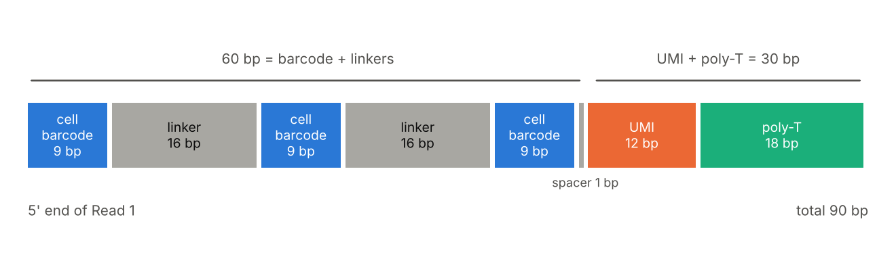
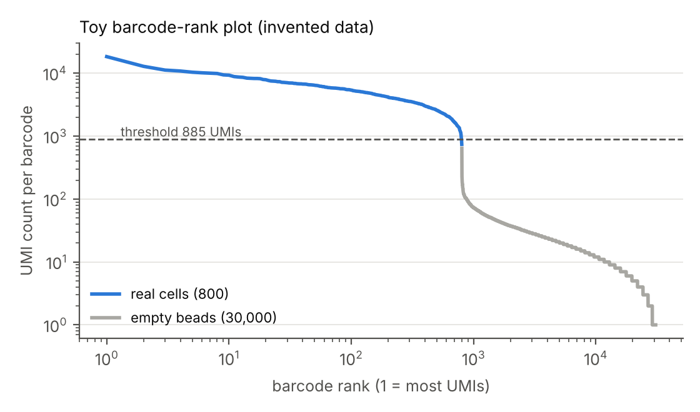
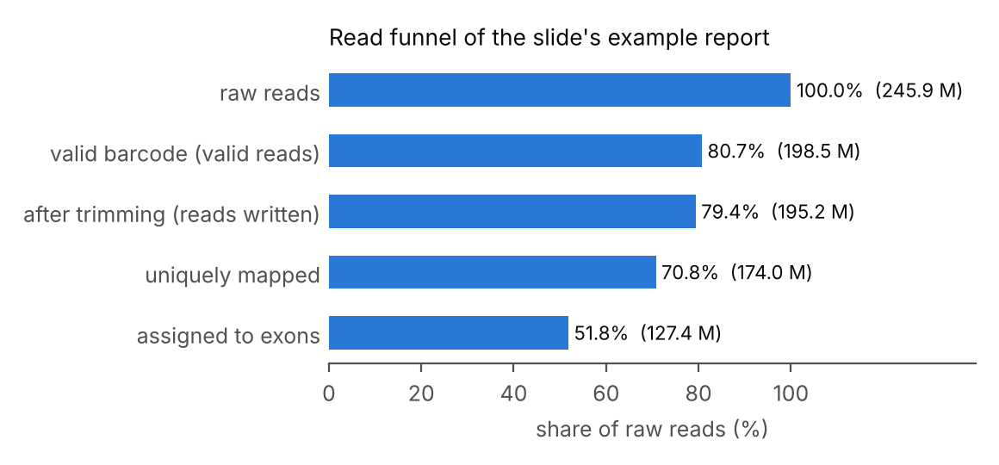
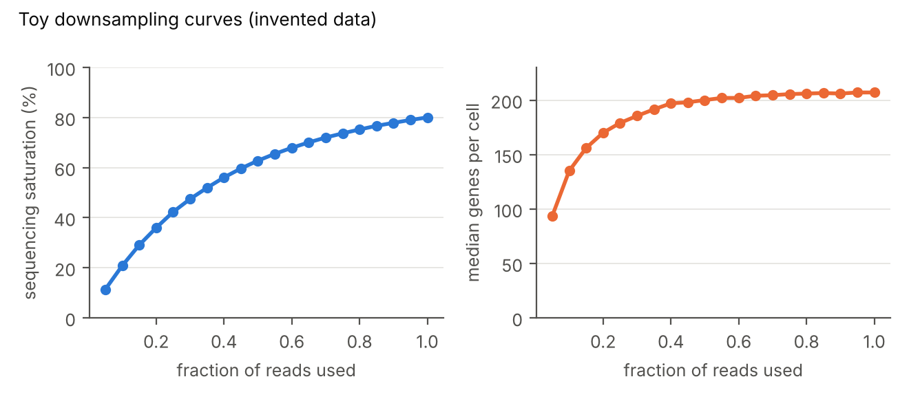

# CeleScope Operations Guide

> Module 2: Running CeleScope, the pre-processing pipeline for single-cell RNA-seq data — how paired-end FASTQ files become a cell-by-gene count matrix and a QC report, what each of the seven per-sample steps does, how to install the software, build the reference genome, and run the whole analysis with `multi_rna`.

---

## Table of Contents

1. [Where CeleScope Fits in a Single-Cell Project](#1-where-celescope-fits-in-a-single-cell-project)
2. [What CeleScope Is](#2-what-celescope-is)
3. [The Raw Data: What the Sequencer Gives You](#3-the-raw-data-what-the-sequencer-gives-you)
4. [The Pipeline at a Glance](#4-the-pipeline-at-a-glance)
5. [The Seven Steps in Detail](#5-the-seven-steps-in-detail)
6. [Cells versus Background: the Count Step in Depth](#6-cells-versus-background-the-count-step-in-depth)
7. [Reading the CeleScope QC Report](#7-reading-the-celescope-qc-report)
8. [Installing CeleScope](#8-installing-celescope)
9. [Preparing the Reference Genome](#9-preparing-the-reference-genome)
10. [Running the Analysis with multi_rna](#10-running-the-analysis-with-multi_rna)
11. [The Output Directory](#11-the-output-directory)
12. [Getting Help](#12-getting-help)
13. [Key Takeaways](#13-key-takeaways)
14. [What's Next](#14-whats-next)

---

## How to read this module

Module 1 taught Linux and Conda. This module uses them for a real job: turning the raw output of a single-cell sequencing run into the table that every later analysis (clustering, annotation, trajectories) starts from.

```
FASTQ files (Read 1 + Read 2)
   -> CeleScope: 7 per-sample steps          (this module)
   -> count matrix (genes x cells) + QC report
   -> Seurat and the downstream tools        (Modules 4 to 8)
```

The Python code in this module was run, and every printed output is the real output of that exact code. The datasets are **small and invented** so that each result can be checked by hand. **The CeleScope, conda, and shell commands are shown as text and were not run**: the software, its 30 GB reference index, and the sequencing data are not available on the machine used to check this module. The numbers quoted from example QC reports come from the lecture slides; the Python code in section 7 only recomputes their percentages to check that the slides agree with themselves. Statements marked **(not on the slides)** are background knowledge that I added, so check them against the CeleScope documentation before relying on them.

---

## 1. Where CeleScope Fits in a Single-Cell Project

The lecture opens with a map of the whole project. It is worth keeping in mind, because the rest of the course (Modules 3 to 8) follows this map from left to right.

| Stage | What happens | Software on the slide |
|---|---|---|
| Wet lab | Prepare a cell suspension, load the chip, lyse cells and reverse-transcribe, build the library, sequence | GEXSCOPE kit, Matrix NEO instrument |
| Split library and quantification | Raw reads become a count matrix | **CeleScope** (Python) |
| Exploration | Data QC, choosing features, dimension reduction and clustering, annotation, differential genes, visualization | Seurat (R); annotation also with SynEcoSys |
| Inference | Trajectories, cell-cell communication, enrichment, transcription factors, copy number | Monocle (R) or Velocity (Python); CellPhoneDB (Python) or CellChat (R); GO/KEGG and GSEA/GSVA (R); SCENIC (Python or R); inferCNV (R) |
| Joint analysis | Combine with other data types | scATAC, spatial omics, TCGA, metabonomics, machine learning, databases |

A second slide shows the same idea more simply:

```
Raw FASTQ files -> CeleScope -> count matrix        = pre-processing  (today's topic)
count matrix -> clustering, marker genes, cell type assignment (annotation)  = downstream analysis
```

> **Key idea:** CeleScope does the *pre-processing*. It stops at the count matrix (plus a first-look report). Everything biological, such as which cell is a T cell, happens afterwards in Seurat and the tools after it.

---

## 2. What CeleScope Is

**CeleScope is a collection of bioinformatics analysis pipelines that process single-cell sequencing data generated with Singleron products.** The pipelines take **paired-end FASTQ files** as input and write two kinds of output: files for downstream analysis, and a summary of QC criteria. The code is open source on GitHub (`singleron-RD/CeleScope`).

It is a **collection** because Singleron kits measure more than one thing. CeleScope provides an interface called `multi_{assay}` that generates the pipeline scripts for each assay type:

| Interface | Assay (as listed on the slide) |
|---|---|
| `multi_rna` | Single-cell RNA (transcriptome) — the subject of this module |
| `multi_vdj` | Immune receptor (V(D)J) |
| `multi_tag` | Tag-based assays |
| `multi_dynaseq` | Dynaseq |
| `multi_snp` | SNP calling |
| `multi_capture_virus` | Virus capture |

The slide also lists several kit names (GEXSCOPE, CLindex, DynaSCOPE, FocuSCOPE, an mRNA-by-EBV library). The list is partly cut off in the slide, so I do not match kits to assays here. Each assay has a documentation page under `doc/assay` in the repository.

> **Key idea:** you choose the assay by choosing the interface. For ordinary single-cell transcriptomes the interface is `multi_rna`, which in turn runs `celescope rna ...` commands one after another.

---

## 3. The Raw Data: What the Sequencer Gives You

### How a read is made

The slide on the single-cell RNA-seq workflow shows the chemistry in four stages:

1. Cells and **barcoded beads** are loaded into a chip with many tiny wells.
2. A **reverse transcription reaction** inside each well turns the cell's mRNA into cDNA. Each bead carries a PCR handle, a **cell tag** (barcode), a **UMI**, and a run of **T** bases (poly-T). The poly-T pairs with the poly-A tail of mRNA, so the cDNA that is made carries the bead's barcode and UMI.
3. **cDNA amplification and library preparation** add the Illumina ends (p5 and p7).
4. **Sequencing** reads the library from both ends.

The library layout on the slide is `p5 - Barcode - UMI - polyT - insert - p7`, where the first part is **90 bp**: 60 bp of barcode and linker, 12 bp of UMI, and 18 bp of poly-T. The slide draws Read 1 and Read 2 as 150 bp each.

### Which read carries what

The barcode step on a later slide makes the division of labour clear: it **extracts the barcode and UMI from Read 1**, filters Read 1, and outputs **demultiplexed Read 2**. So:

| Read | Carries | Used for |
|---|---|---|
| Read 1 (R1) | cell barcode, linkers, UMI, poly-T | identifying which cell and which molecule |
| Read 2 (R2) | the cDNA (the transcript sequence) | aligning to the genome to find which gene |

### The V2 bead layout as a pattern string

For V2 beads the slide gives the layout as a compact string, `C9L16C9L16C9L1U12T18`. Read it as letter-and-length pairs: `C9` is 9 bases of cell barcode, `L16` is 16 bases of linker, `L1` is a one-base linker, `U12` is a 12-base UMI, and `T18` is 18 bases of poly-T. The cell barcode therefore comes in **three pieces of 9 bases, separated by two linkers**. The code below parses the string and checks every total quoted on the slides (90, 60, 27, and 12).

```python
import re

pattern = "C9L16C9L16C9L1U12T18"          # V2 bead layout, copied from the slide
names = {"C": "cell barcode", "L": "linker", "U": "UMI", "T": "poly-T"}

segments, pos = [], 0
for letter, n in re.findall(r"([A-Z])(\d+)", pattern):
    n = int(n)
    segments.append((names[letter], pos, pos + n))
    print(f"{names[letter]:<13} R1[{pos:>2}:{pos + n:>2}]  {n:>2} bp")
    pos += n

total = pos
barcode = sum(e - s for name, s, e in segments if name == "cell barcode")
umi = sum(e - s for name, s, e in segments if name == "UMI")
linker = sum(e - s for name, s, e in segments if name == "linker")
print("total length          :", total)
print("cell barcode (3 x 9)  :", barcode)
print("UMI                   :", umi)
print("linkers (16+16+1)     :", linker)
print("barcode + linker      :", barcode + linker, "(the slide's 60 bp bracket)")

# The Read2 header shown on the slide: 27 b cell barcode, '_', 12 b UMI, '_', read number
header = "@TGTGGACACGTAATGGACCCAATACAG_GCGCGGAAGGCC_1"
cb, ub, num = header[1:].split("_")
print("header barcode length :", len(cb), "| UMI length:", len(ub), "| read no.:", num)
assert (total, barcode, umi, barcode + linker) == (90, 27, 12, 60)
assert (len(cb), len(ub)) == (27, 12)

# Output:
# cell barcode  R1[ 0: 9]   9 bp
# linker        R1[ 9:25]  16 bp
# cell barcode  R1[25:34]   9 bp
# linker        R1[34:50]  16 bp
# cell barcode  R1[50:59]   9 bp
# linker        R1[59:60]   1 bp
# UMI           R1[60:72]  12 bp
# poly-T        R1[72:90]  18 bp
# total length          : 90
# cell barcode (3 x 9)  : 27
# UMI                   : 12
# linkers (16+16+1)     : 33
# barcode + linker      : 60 (the slide's 60 bp bracket)
# header barcode length : 27 | UMI length: 12 | read no.: 1
```



Why build a barcode from three pieces? (This reasoning is not on the slides.) If each position can hold one of W allowed 9-base sequences, the three positions give W x W x W different cell barcodes. The number of oligonucleotide sequences that must be made stays small (3 x W) while the number of distinguishable cells is large (W cubed). The real whitelist size is not on the slides, so section 5 uses W = 4, giving 64 barcodes, only to illustrate the idea. A second benefit is error detection: a sequencing error in one piece usually produces a 9-mer that is **not on the whitelist**, so the read can be recognised as damaged.

The slide also shows a Read 2 record after the barcode step. Its name line is `@TGTGGACACGTAATGGACCCAATACAG_GCGCGGAAGGCC_1`: the **27-base cell barcode**, an underscore, the **12-base UMI**, an underscore, and a read number. The code above confirms the lengths 27 and 12. This is the trick that keeps the pipeline simple: after demultiplexing, the barcode and UMI travel inside the **read name** of the cDNA read, so the aligner can ignore them and later steps can recover them.

The first linker printed on the slide, `ATCCACGTGCTTGAGA`, is 16 letters long, as `L16` says. The second linker as I read it from the slide is 17 letters long (`TTCAGCATGCGGCTACG`), which disagrees with `L16`. The slide image is low resolution, so I treat this as a transcription error on my side or a slide typo, and the code in section 5 uses the first 16 letters.

> **Key idea:** a Singleron read is a sandwich. Read 1 says *who* (cell barcode) and *which molecule* (UMI); Read 2 says *what* (the transcript). The first job of the pipeline is to move the "who" and "which molecule" from Read 1 into the name of Read 2.

---

## 4. The Pipeline at a Glance

The slide titled "CeleScope single cell transcriptome analysis process" shows the whole pipeline as three groups of boxes. The text under it says **eight steps** cover data quality control, reference genome construction, sequence alignment, expression matrix generation, and cell population visualization.

| Order | Command | Group on the slide | Tool behind it | Reads | Writes |
|---|---|---|---|---|---|
| once | `mkref` | Constructing a reference genome | STAR index (inferred from the files it writes) | genome FASTA and GTF | a reference directory |
| 0 | `sample` | Sequencing data QC | CeleScope | R1 | sample information and chemistry |
| 1 | `barcode` | Sequencing data QC | CeleScope | R1 and R2 | demultiplexed R2 |
| 2 | `cutadapt` | Sequencing data QC | cutadapt | demultiplexed R2 | clean R2 |
| 3 | `star` | Alignment | STAR | clean R2 | BAM files |
| 4 | `featureCounts` | Expression matrix and standard analysis | featureCounts | BAM | BAM with gene names |
| 5 | `count` | Expression matrix and standard analysis | CeleScope | annotated BAM | count matrix |
| 6 | `analysis` | Expression matrix and standard analysis | CeleScope | count matrix | clusters, markers, t-SNE |

`mkref` is run **once per reference genome**, not once per sample. The other seven run **once per sample**, in this fixed order, and each step reads what the previous step wrote. Section 10 shows that chain explicitly.

Each per-sample step is a command of the form `celescope rna <step> --outdir ... --sample ... --thread ...`. You rarely type them: `multi_rna` writes them for you (section 10).

---

## 5. The Seven Steps in Detail

All slides in this section are for the **RNA assay of CeleScope v1.14.1**, whose example report is described in section 7.

### Step 00: sample

The `sample` step does the bookkeeping. It records the **kit bead version** (V1 or V2), the CeleScope (pipeline) version that was used, and information about the sample and the assay (rna, vdj, tag, dynaseq, snp, and so on). It fills the first block of the final report: sample ID, assay, chemistry (the example says `scopeV3.0.1 (kit V2)`), and software version. In the commands, `--chemistry auto` asks the program to detect the bead version itself.

### Step 01: barcode (demultiplexing)

**Input:** R1 and R2 reads. **Function:** extract the barcode and UMI from R1 (this is **demultiplexing**) and **filter out invalid R1 reads**. The slide lists four ways a read can be invalid:

| Reason | What is checked |
|---|---|
| No linker | The linker sequences must be present in the right places (checked against a whitelist) |
| No correct barcode | Every barcode piece must be on the whitelist |
| No poly-T | The poly-T region must be there |
| Low quality | Reads with low Phred scores (the slide does not say which bases are checked) |

**Output:** demultiplexed R2 reads, with the barcode and UMI inside the read name. The report block for this step shows **Raw Reads**, **Valid Reads** (with a percentage), **Q30 of Barcodes**, and **Q30 of UMIs**. Q30 means a Phred score of at least 30 (an error probability of at most 1 in 1000); the Q30 figures are the percentage of barcode (or UMI) bases that reach this quality.

The exact tolerances CeleScope uses (how many mismatches a linker may have, how many poly-T bases are enough, what counts as low quality) are **not on the slides**. The example command passes `--lowNum 2`, which I read as "tolerate up to two low-quality bases" (not on the slides; I infer it from the option name). The code below builds a toy sequencing run, damages some reads on purpose in the four ways above, and applies my own simple tolerances: an exact linker match, an exact whitelist match for each barcode piece, at least 16 of 18 poly-T bases, and at most two bases below Phred 10 in the barcode and UMI.

```python
import random
from collections import Counter

rng = random.Random(7)
dna = lambda n: "".join(rng.choice("ACGT") for _ in range(n))

# --- layout of R1 (from c1): three 9-bp barcode pieces, two linkers, 1 spacer, 12-bp UMI, 18 T
LINK1, LINK2, SPACER = "ATCCACGTGCTTGAGA", "TTCAGCATGCGGCTAC", "A"   # each linker is 16 bp
CB = [(0, 9), (25, 34), (50, 59)]
L1, L2 = (9, 25), (34, 50)
UMI, POLYT = (60, 72), (72, 90)

# --- whitelist: 4 allowed 9-mers per position -> 4 x 4 x 4 = 64 possible cell barcodes
whitelist = [{dna(9) for _ in range(4)} for _ in range(3)]
pieces = [sorted(w) for w in whitelist]

def make_r1(bc, umi):
    return bc[0] + LINK1 + bc[1] + LINK2 + bc[2] + SPACER + umi + "T" * 18

def qual(n, low=0):
    """Phred+33 string: mostly 'F' (Q37); `low` random positions are '#' (Q2)."""
    q = ["F"] * n
    for i in rng.sample(range(n), low):
        q[i] = "#"
    return "".join(q)

# --- build a toy run: 3 true cells, 300 reads each, then damage some reads on purpose
reads = []
for cell in range(3):
    bc = [p[cell] for p in pieces]
    for _ in range(100):
        reads.append((make_r1(bc, dna(12)), qual(90), dna(60)))
good = len(reads)
for _ in range(20):                      # damage 1: wrong linker
    r1, q, r2 = reads[rng.randrange(good)]
    reads.append((r1[:9] + "G" * 16 + r1[25:], q, r2))
for _ in range(15):                      # damage 2: barcode piece not on the whitelist
    r1, q, r2 = reads[rng.randrange(good)]
    reads.append(("A" * 9 + r1[9:], q, r2))
for _ in range(10):                      # damage 3: poly-T missing
    r1, q, r2 = reads[rng.randrange(good)]
    reads.append((r1[:72] + dna(18), q, r2))
for _ in range(5):                       # damage 4: too many low-quality bases in barcode + UMI
    r1, _q, r2 = reads[rng.randrange(good)]
    reads.append((r1, qual(90, low=5), r2))

def demultiplex(r1, q1, low_qual=10, low_num=2):
    """Return (reason, barcode, umi). reason is 'valid' or the first check that failed."""
    if r1[L1[0]:L1[1]] != LINK1 or r1[L2[0]:L2[1]] != LINK2:
        return "no linker", None, None
    bc = [r1[a:b] for a, b in CB]
    if any(piece not in wl for piece, wl in zip(bc, whitelist)):
        return "barcode not on whitelist", None, None
    if r1[POLYT[0]:POLYT[1]].count("T") < 16:           # my tolerance: at least 16 of 18
        return "no poly-T", None, None
    region = "".join(q1[a:b] for a, b in CB) + q1[UMI[0]:UMI[1]]
    if sum(ord(c) - 33 < low_qual for c in region) > low_num:
        return "low quality", None, None
    return "valid", "".join(bc), r1[UMI[0]:UMI[1]]

tally, kept = Counter(), []
for r1, q1, r2 in reads:
    reason, bc, umi = demultiplex(r1, q1)
    tally[reason] += 1
    if reason == "valid":
        kept.append(f"@{bc}_{umi}_{len(kept) + 1}\n{r2}")     # barcode + UMI go into the read name

raw = len(reads)
for reason in ["valid", "no linker", "barcode not on whitelist", "no poly-T", "low quality"]:
    print(f"{reason:<26}{tally[reason]:>5}  ({tally[reason] / raw:6.2%})")
print(f"raw reads {raw}; valid reads {tally['valid']} ({tally['valid'] / raw:.2%})")
print("distinct cell barcodes among valid reads:", len({k.split('_')[0] for k in kept}))
print("first demultiplexed R2 read name:", kept[0].split("\n")[0])
assert sum(tally.values()) == raw and tally["valid"] == len(kept)

# Output:
# valid                       302  (86.29%)
# no linker                    20  ( 5.71%)
# barcode not on whitelist     15  ( 4.29%)
# no poly-T                    10  ( 2.86%)
# low quality                   3  ( 0.86%)
# raw reads 350; valid reads 302 (86.29%)
# distinct cell barcodes among valid reads: 3
# first demultiplexed R2 read name: @AATTACATAAACTTGTTGATGCATACG_ACCCCATCGGAC_1
```

Two things to notice in the output. First, the counts add up: the four failure categories plus the valid reads equal the raw reads, which is what the report's "Valid Reads" percentage means. Second, **302 reads are valid, not 300**: of the five reads that I gave bad qualities, two had at most two of their five bad bases inside the barcode and UMI, which my rule tolerates. Whether that is the right behaviour depends on the tolerance; this is why the real software exposes it as an option.

> **Key idea:** the barcode step is a gatekeeper. A read that cannot be trusted to name its cell and its molecule is thrown away before alignment, because a wrong barcode is worse than a missing read.

### Step 02: cutadapt (trimming)

There is **no separate slide for this step** in the lecture, but it appears in the pipeline diagram, in the command list, and in the report. Its input is the demultiplexed R2 and its output is `<sample>_clean_2.fq` plus a `cutadapt.log`. The command on the slides uses the options `--minimum_length 20 --nextseq_trim 20 --overlap 10 --insert 150`.

The report's **Trimming** block has six numbers: **Reads with Adapters**, **Reads Too Short**, **Reads Written**, **Base Pairs Processed**, **Base Pairs Quality-Trimmed**, and **Base Pairs Written**. Cutadapt is a general-purpose tool that removes adapter sequences from reads (not on the slides). From the option names, `--minimum_length 20` discards reads that are shorter than 20 bases after trimming, `--nextseq_trim 20` applies the quality-trimming mode designed for two-colour sequencers such as NextSeq with a quality cutoff of 20, and `--overlap 10` is the minimum number of bases a read must overlap an adapter before the adapter is trimmed (all not on the slides). I do not know what `--insert 150` means exactly, and the slides do not say.

### Step 03: STAR (mapping)

**STAR** is the aligner. It aligns the clean R2 reads to the reference genome (human, mouse, yeast, reptile, fly, and so on, depending on which reference you built). The input is the clean R2 FASTQ and the output is a **BAM file** plus log files; the slide notes that Picard-style metrics such as multi-mapped reads and unique reads are reported. The command uses `--outFilterMultimapNmax 1`, which, as I understand the STAR option, drops reads that map to more than one place (not on the slides), and `--starMem 30`.

The report's **Mapping** block has the genome name (for example `Homo_sapiens_Ensembl_92`), **Uniquely Mapped Reads**, and **Multi-Mapped Reads**, each with a percentage. In section 7 I show that these percentages are fractions of the reads that entered STAR.

The memory requirement in section 8 (a minimum of 32 GB of RAM) exists because of this step: STAR loads the whole genome index into memory.

### Step 04: featureCounts (assigning reads to genes)

**featureCounts** assigns each uniquely mapped read to a **feature**, which here means a gene (`--gtf_type gene`). The output is again a BAM file, now containing the **assigned feature name for each read**. The slide prints one BAM line, and its extra tags show how the information travels: `CB:Z:` is the cell barcode, `UB:Z:` is the UMI, `GN:Z:SSH2` is the gene name, `GX:Z:ENSG00000141298` is the gene ID, and `XS:Z:Assigned` says the read was assigned.

The report's **FeatureCounts** block splits the uniquely mapped reads into four groups: **exonic**, **intronic**, **intergenic**, and **unassigned because of ambiguity**. The toy example below shows how such a classification works on a tiny annotation with three genes, one of which overlaps another. A read that overlaps exons of exactly one gene is exonic; a read that overlaps exons of two genes is ambiguous; a read inside a gene body but touching no exon is intronic; and anything else is intergenic. How CeleScope treats intronic reads when it builds the count matrix is **not stated on the slides**, so I do not claim anything about it.

```python
from collections import Counter

# Toy annotation on one chromosome: gene -> (gene start, gene end, [exon intervals]); half-open coordinates
genes = {
    "GENE_A": (100, 400, [(100, 180), (250, 300), (350, 400)]),
    "GENE_B": (380, 600, [(380, 430), (550, 600)]),      # overlaps GENE_A near position 380-400
    "GENE_C": (800, 1000, [(800, 860), (940, 1000)]),
}
overlap = lambda a0, a1, b0, b1: a0 < b1 and b0 < a1

def classify(start, length=50):
    end = start + length
    exon_hits = {g for g, (_, _, exons) in genes.items() if any(overlap(start, end, e0, e1) for e0, e1 in exons)}
    body_hits = {g for g, (g0, g1, _) in genes.items() if overlap(start, end, g0, g1)}
    if len(exon_hits) == 1:
        return "exonic", exon_hits.pop()
    if len(exon_hits) > 1:
        return "ambiguity", "+".join(sorted(exon_hits))
    if body_hits:
        return "intronic", "+".join(sorted(body_hits))
    return "intergenic", "-"

starts = [110, 190, 360, 700, 560, 820, 880, 920, 270, 30]
tally = Counter()
for s in starts:
    kind, gene = classify(s)
    tally[kind] += 1
    print(f"read {s:>4}-{s + 50:<4} -> {kind:<10} {gene}")
print(dict(tally), "| total", sum(tally.values()))
for kind in ["exonic", "intronic", "intergenic", "ambiguity"]:
    print(f"{kind:<11}{tally[kind]:>2}  {tally[kind] / len(starts):.0%}")
assert sum(tally.values()) == len(starts)

# Output:
# read  110-160  -> exonic     GENE_A
# read  190-240  -> intronic   GENE_A
# read  360-410  -> ambiguity  GENE_A+GENE_B
# read  700-750  -> intergenic -
# read  560-610  -> exonic     GENE_B
# read  820-870  -> exonic     GENE_C
# read  880-930  -> intronic   GENE_C
# read  920-970  -> exonic     GENE_C
# read  270-320  -> exonic     GENE_A
# read   30-80   -> intergenic -
# {'exonic': 5, 'intronic': 2, 'ambiguity': 1, 'intergenic': 2} | total 10
# exonic      5  50%
# intronic    2  20%
# intergenic  2  20%
# ambiguity   1  10%
```

> **Key idea:** a read becomes useful for counting only when it lands in an annotated gene without ambiguity. The four report categories add up to the uniquely mapped reads, which section 7 verifies with the slide's own numbers.

### Step 05: count (cell calling and the expression matrix)

This step is explained in its own section (6), because it produces the matrix that every later module uses.

### Step 06: analysis

The last step takes the filtered matrix and does a quick first look: **basic t-SNE plots with clustering information and marker genes**. The outputs are a marker-gene table (tsv) and the t-SNE coordinates (tsv); the step also writes an `.h5ad` file and the final **CeleScope report in HTML format**. The marker table on the slide has the columns `gene`, `avg_log2FC`, `pct.1`, `pct.2`, and `p_val_adj`; these are the names Seurat's `FindMarkers` uses, which hints that this quick analysis uses Seurat's methods (not on the slides). A parameter `--type_marker_tsv` (a tsv file with a header) lets you add cell-type comments to the report.

This first look is **not a replacement for the downstream modules**. The clustering in the report is a convenience for checking that the data look sensible; proper annotation is done in Seurat (Modules 4 and 5).

---

## 6. Cells versus Background: the Count Step in Depth

### Why cell calling is needed

Every bead barcode that appears in the data gets a column in the raw matrix, including beads that never met a cell. Those **empty beads** still pick up a little free-floating RNA from the solution, so they have small non-zero counts. **Cell calling** is the step that **distinguishes cells from background barcodes**. Its output, according to the slide, is the **expression matrix**, written as three files: `barcodes.tsv`, `matrix.mtx`, and `genes.tsv`.

### The three files

| File | Content | Example on the slide |
|---|---|---|
| `barcodes.tsv` | One cell barcode per line (the columns of the matrix) | the 27-base barcodes; "Total # of barcodes: 9,050" |
| `genes.tsv` | One gene per line (the rows of the matrix): gene ID and gene name | `ENSG00000000003 TSPAN6`, `ENSG00000000419 DPM1`, ...; "Total # of genes: 26,807" |
| `matrix.mtx` | The non-zero counts only: gene number, cell number, UMI count | UMI counts as the third column |

The matrix itself is a genes-by-cells table: **rows are genes, columns are cells, and each entry is a UMI count**. Most entries are zero, so the file stores only the non-zero ones. The code below does the whole count step on a tiny example: it counts **UMIs, not reads**, writes the three files, reads them back, and computes the "Cells" numbers that the report prints.

The principle is the one from Module 16: reads that share the same cell barcode, the same gene, and the same UMI are **PCR copies of one molecule**, so they count once.

```python
import os, random, tempfile
from collections import defaultdict
import numpy as np
from scipy import io, sparse

rng = random.Random(3)
dna = lambda n: "".join(rng.choice("ACGT") for _ in range(n))
barcodes = [dna(27) for _ in range(3)]                       # three cells
genes = [("ENSG00000000003", "TSPAN6"), ("ENSG00000000419", "DPM1"), ("ENSG00000000457", "SCYL3")]

# molecule list: (cell, gene, how many reads came from this one molecule)
molecules = [(0, 0, 3), (0, 0, 1), (0, 1, 2), (1, 0, 1), (1, 2, 1), (1, 2, 1), (1, 2, 1), (2, 1, 5)]
reads = [(c, g, umi) for (c, g, k), umi in zip(molecules, (dna(12) for _ in molecules)) for _ in range(k)]
print("assigned reads :", len(reads))

# UMI counting: reads sharing (cell, gene, UMI) are PCR copies of ONE molecule
umis = defaultdict(set)
for c, g, umi in reads:
    umis[(c, g)].add(umi)
M = np.zeros((len(genes), len(barcodes)), dtype=int)         # rows = genes, columns = cells
for (c, g), s in umis.items():
    M[g, c] = len(s)
print("gene x cell UMI matrix:\n", M)

# write the three files CeleScope-style, read them back, compare
out = tempfile.mkdtemp()
io.mmwrite(os.path.join(out, "matrix.mtx"), sparse.coo_matrix(M))
open(os.path.join(out, "barcodes.tsv"), "w").write("\n".join(barcodes) + "\n")
open(os.path.join(out, "genes.tsv"), "w").write("\n".join(f"{i}\t{n}" for i, n in genes) + "\n")
mtx_lines = [ln for ln in open(os.path.join(out, "matrix.mtx")).read().splitlines() if not ln.startswith("%")]
print("matrix.mtx (comment lines removed):", mtx_lines, " <- header: genes cells nonzeros")
back = io.mmread(os.path.join(out, "matrix.mtx"), spmatrix=False).toarray()
print("round trip identical:", np.array_equal(back, M))

# the report's 'Cells' metrics, computed on the toy matrix
umi_per_cell, genes_per_cell = M.sum(axis=0), (M > 0).sum(axis=0)
print("estimated cells:", len(barcodes), "| median UMI per cell:", np.median(umi_per_cell),
      "| median genes per cell:", np.median(genes_per_cell), "| total genes detected:", int((M.sum(axis=1) > 0).sum()))
print("sequencing saturation = 1 - UMIs/reads =", f"{1 - M.sum() / len(reads):.2%}", f"({M.sum()} UMIs, {len(reads)} reads)")

# Output:
# assigned reads : 15
# gene x cell UMI matrix:
#  [[2 1 0]
#  [1 0 1]
#  [0 3 0]]
# matrix.mtx (comment lines removed): ['3 3 5', '1 1 2', '1 2 1', '2 1 1', '2 3 1', '3 2 3']
#   <- header: genes cells nonzeros
# round trip identical: True
# estimated cells: 3 | median UMI per cell: 3.0 | median genes per cell: 2.0 | total genes
#   detected: 3
# sequencing saturation = 1 - UMIs/reads = 46.67% (8 UMIs, 15 reads)
```

Check the numbers by hand: cell 0 has two molecules of gene 0 (one read-three-times, one read-once) and one molecule of gene 1; the three reads of that first molecule collapse into one UMI. The matrix header `3 3 5` means three genes, three cells, five non-zero entries, and each following line is `gene cell count` (numbering starts at 1). Cell 2's gene-1 count is 1 even though five reads came from it — the heavy duplication does not inflate the count, which is the entire point of UMIs.

The last printed line is the **sequencing saturation**, here computed as 1 minus the number of UMIs divided by the number of reads. This is the usual definition (not on the slides): if every read were a different molecule the value would be 0, and the more often molecules are re-read, the closer to 1 it gets.

### How does the software decide what a cell is?

The command on the slides uses `--cell_calling_method EmptyDrops_CR`, `--expected_cell_num 3000`, and `--force_cell_num None` (no forced number). The slides do not explain the algorithm. The name suggests the EmptyDrops method (which tests whether a barcode's profile differs from the ambient-RNA profile) in the form used by Cell Ranger (not on the slides). To show the basic idea without pretending to reproduce that method, the code below uses a much **simpler rule** in the spirit of Cell Ranger's older "order of magnitude" approach (not on the slides): sort barcodes by UMI count, take the 99th percentile of the top *N* expected cells, and keep every barcode that has at least one tenth of that value.

```python
import numpy as np

rng = np.random.default_rng(11)
cells = rng.lognormal(mean=np.log(3000), sigma=0.5, size=800).astype(int)             # 800 real cells
ambient = np.maximum(1, rng.lognormal(mean=np.log(8), sigma=0.9, size=30000).astype(int))  # empty beads
umi = np.concatenate([cells, ambient])
is_cell = np.r_[np.ones(len(cells), bool), np.zeros(len(ambient), bool)]

order = np.argsort(-umi)                  # barcode rank: rank 1 = barcode with the most UMIs
ranked, truth = umi[order], is_cell[order]

# A simple rule in the spirit of Cell Ranger's "ordmag": take the 99th percentile of the top
# `expected` barcodes and keep every barcode with at least one tenth of that value.
expected = 1000
threshold = np.percentile(ranked[:expected], 99) / 10
called = ranked >= threshold

tp, fp = int((called & truth).sum()), int((called & ~truth).sum())
fn = int((~called & truth).sum())
print(f"barcodes: {len(umi)} (true cells {len(cells)}, empty {len(ambient)})")
print(f"threshold: {threshold:.0f} UMIs -> {called.sum()} barcodes called as cells")
print(f"true cells found {tp}, empty beads wrongly kept {fp}, real cells missed {fn}")
print(f"median UMI per called cell: {np.median(ranked[called]):.0f}")
print(f"share of all UMIs that sit in called cells: {ranked[called].sum() / ranked.sum():.2%}")

# Output:
# barcodes: 30800 (true cells 800, empty 30000)
# threshold: 885 UMIs -> 794 barcodes called as cells
# true cells found 794, empty beads wrongly kept 0, real cells missed 6
# median UMI per called cell: 3046
# share of all UMIs that sit in called cells: 88.61%
```



The picture is the same one that appears in the report as **Barcode rank**: the x-axis is the rank of the barcode (1 is the barcode with the most UMIs), the y-axis is its UMI count, and both are on a log scale. A good sample shows a plateau of cells, then a steep drop (the "knee"), then a long tail of background barcodes. The threshold sits on the drop. In this toy example, a simple rule finds 794 of the 800 true cells and keeps no empty beads, because the two populations are well separated by construction. Real data are messier, which is why the real method is more careful.

> **Key idea:** cell calling is a classification, and every classification has two kinds of error: empty beads kept as cells, and real cells discarded. The `expected_cell_num` parameter tells the software roughly where to look; it is a hint, not the answer.

---

## 7. Reading the CeleScope QC Report

CeleScope writes one HTML report per sample (`<sample>_report.html`). The slides walk through the version 1.14.1 RNA-assay report. It has the following blocks, in pipeline order:

| Block | What it tells you | Question it answers |
|---|---|---|
| Sample | Sample ID, assay, chemistry, software version | What was run, and with which version? |
| Demultiplexing | Raw reads, valid reads, Q30 of barcodes and UMIs | Was the barcode read good? |
| Trimming | Reads with adapters, too short, written; base pairs processed, quality-trimmed, written | How much was lost to cleaning? |
| Mapping | Genome, uniquely mapped, multi-mapped reads | Did the reads belong to this genome? |
| FeatureCounts | Exonic, intronic, intergenic, ambiguous | Did the reads land in genes? |
| Cells | Estimated number of cells, fraction of reads in cells, mean reads per cell, median UMI per cell, total genes, median genes per cell, saturation; plots of barcode rank, sequencing saturation, median genes per cell | How many cells, and how deeply sequenced? |
| Analysis | t-SNE plots coloured by cluster and by gene counts; marker genes by cluster | Does the data separate into sensible groups? |

### The numbers on the slides agree with themselves

The slides show two example reports (two different samples). The code below copies their numbers and recomputes every percentage. Doing this teaches **what each percentage is a fraction of**, which the report does not print. Everything matches the slides to the digit shown.

```python
# Numbers copied from the example CeleScope reports on the slides (two different samples).
A = dict(raw=245_864_746, valid=198_478_709, adapters=35_712_005, short=3_298_287, written=195_180_422,
         bp_in=29_970_285_059, bp_qtrim=317_406_187, bp_out=27_290_326_668,
         unique=173_994_147, multi=10_543_632,
         exon=127_391_755, intron=27_994_556, inter=13_472_336, ambig=5_135_500,
         cells=8_547, mean_reads_per_cell=23_222)
B = dict(raw=361_487_788, valid=286_821_963, unique=254_854_517, multi=13_928_653,
         exon=231_035_580, intron=5_916_400, inter=7_407_044, ambig=10_495_493,
         cells=9_050, mean_reads_per_cell=31_693)

pct = lambda a, b: f"{100 * a / b:.2f}%"
print("Sample A (report C230612001_scR)")
print("  valid / raw             ", pct(A["valid"], A["raw"]), "  (slide 80.73%)")
print("  adapters / valid        ", pct(A["adapters"], A["valid"]), "  (slide 17.99%)")
print("  too short / valid       ", pct(A["short"], A["valid"]), "   (slide 1.66%)")
print("  valid - too short       ", A["valid"] - A["short"], "= reads written", A["written"])
print("  bp quality-trimmed / in ", pct(A["bp_qtrim"], A["bp_in"]), "   (slide 1.06%)")
print("  bp written / in         ", pct(A["bp_out"], A["bp_in"]), "  (slide 91.06%)")
print("  uniquely mapped / written", pct(A["unique"], A["written"]), " (slide 89.15%)")
print("  multi-mapped / written  ", pct(A["multi"], A["written"]), "   (slide 5.4%)")
unmapped = A["written"] - A["unique"] - A["multi"]
print("  left over (unmapped)    ", f"{unmapped:,}", pct(unmapped, A["written"]))
parts = A["exon"] + A["intron"] + A["inter"] + A["ambig"]
print("  exon+intron+inter+ambig ", f"{parts:,}", "== uniquely mapped:", parts == A["unique"])
for k in ["exon", "intron", "inter", "ambig"]:
    print(f"    {k:<7}{pct(A[k], A['unique'])}")
print("  mean reads per cell x cells =", f"{A['mean_reads_per_cell'] * A['cells']:,}", "vs valid reads", f"{A['valid']:,}")

print("Sample B (the 9,050-cell report)")
print("  valid / raw             ", pct(B["valid"], B["raw"]), "  (slide 79.34%)")
implied = round(B["unique"] / 0.9134)               # the slide says 91.34% of reads mapped uniquely
print("  91.34% implies STAR input =", f"{implied:,}", "reads =", pct(implied, B["valid"]), "of the valid reads")
parts = B["exon"] + B["intron"] + B["inter"] + B["ambig"]
print("  exon+intron+inter+ambig ", f"{parts:,}", "== uniquely mapped:", parts == B["unique"])
print("  exon share              ", pct(B["exon"], B["unique"]), "  (slide 90.65%)")
print("  mean reads per cell x cells =", f"{B['mean_reads_per_cell'] * B['cells']:,}", "vs valid reads", f"{B['valid']:,}")

# Output:
# Sample A (report C230612001_scR)
#   valid / raw              80.73%   (slide 80.73%)
#   adapters / valid         17.99%   (slide 17.99%)
#   too short / valid        1.66%    (slide 1.66%)
#   valid - too short        195180422 = reads written 195180422
#   bp quality-trimmed / in  1.06%    (slide 1.06%)
#   bp written / in          91.06%   (slide 91.06%)
#   uniquely mapped / written 89.15%  (slide 89.15%)
#   multi-mapped / written   5.40%    (slide 5.4%)
#   left over (unmapped)     10,642,643 5.45%
#   exon+intron+inter+ambig  173,994,147 == uniquely mapped: True
#     exon   73.22%
#     intron 16.09%
#     inter  7.74%
#     ambig  2.95%
#   mean reads per cell x cells = 198,478,434 vs valid reads 198,478,709
# Sample B (the 9,050-cell report)
#   valid / raw              79.34%   (slide 79.34%)
#   91.34% implies STAR input = 279,017,426 reads = 97.28% of the valid reads
#   exon+intron+inter+ambig  254,854,517 == uniquely mapped: True
#   exon share               90.65%   (slide 90.65%)
#   mean reads per cell x cells = 286,821,650 vs valid reads 286,821,963
```

Reading the output:

- **Valid Reads** is a fraction of raw reads (80.73%). **Reads with Adapters** and **Reads Too Short** are fractions of the *valid* reads, not of the raw reads.
- Reads written equal valid reads minus too-short reads, exactly.
- **Uniquely mapped** and **multi-mapped** percentages are fractions of the reads *written by trimming*, that is, of the reads that entered STAR. About 5.45% of them are neither (they did not map at all); the report does not print that group.
- The four FeatureCounts groups **add up exactly to the uniquely mapped reads**, in both samples, and their percentages are fractions of the uniquely mapped reads.
- **Mean Reads per Cell multiplied by the number of cells gives the number of valid reads** (to rounding): 23,222 x 8,547 = 198,478,434, against 198,478,709 valid reads. So "mean reads per cell" divides *all valid reads* by the number of cells, not only the reads inside cells. This is my reading from the arithmetic; the slides do not define the term. It also shows that the second sample's mean reads per cell (31,693) goes with its 9,050 cells and 286.8 million valid reads.

The funnel below turns the first sample's numbers into a picture of where the reads go. Starting from 100% of the raw reads, about 80.7% pass the barcode filter, 79.4% survive trimming, 70.8% map uniquely, and 51.8% land in exons.



The two samples are very different in one respect: the share of exonic reads among the uniquely mapped is 73.22% in the first sample and 90.65% in the second, while the intronic share is 16.09% versus 2.32%. The slides do not comment on this. A high intronic share is typical of nuclei rather than whole cells (not on the slides), but you cannot tell from the slides which kind of sample either one was.

### Saturation and median genes per cell

The report draws two curves against the **read fraction**: **sequencing saturation** and **median genes per cell**. They answer the question "if I had sequenced more, how much more would I have learned?" The curves are produced by **downsampling**: use 10% of the reads, count what you find, then 20%, and so on. As the fraction grows, saturation rises, because additional reads increasingly re-read molecules that were already seen, and median genes per cell rises but flattens, because most of the genes that can be detected in a cell have already been seen.

The code below builds a toy experiment of 100 cells with 800 molecules each, amplifies each molecule to a random number of reads (at least one, mean five), and downsamples.

```python
import numpy as np

rng = np.random.default_rng(5)
n_cells, n_genes, mols_per_cell = 100, 400, 800
gene_p = rng.lognormal(0, 1.5, n_genes)
gene_p /= gene_p.sum()                                         # a few genes are very abundant, most are rare

cell = np.repeat(np.arange(n_cells), mols_per_cell)            # one entry per RNA molecule
gene = rng.choice(n_genes, size=cell.size, p=gene_p)
copies = 1 + rng.poisson(4, size=cell.size)                    # PCR: every molecule gives >= 1 read (mean 5)
read_mol = np.repeat(np.arange(cell.size), copies)             # read -> molecule it came from

def downsample(fraction):
    keep = rng.random(read_mol.size) < fraction
    seen = np.unique(read_mol[keep])                           # distinct molecules = distinct UMIs
    pairs = np.unique(cell[seen] * n_genes + gene[seen])       # distinct (cell, gene) pairs
    genes_per_cell = np.bincount(pairs // n_genes, minlength=n_cells)
    return keep.sum(), seen.size, 1 - seen.size / keep.sum(), np.median(genes_per_cell)

print(f"{'fraction':>8} {'reads':>8} {'UMIs':>8} {'saturation':>10} {'median genes/cell':>18}")
rows = [downsample(f) for f in (0.1, 0.2, 0.3, 0.5, 0.7, 1.0)]
for f, (r, u, s, g) in zip((0.1, 0.2, 0.3, 0.5, 0.7, 1.0), rows):
    print(f"{f:>8.1f} {r:>8} {u:>8} {s:>10.1%} {g:>18.0f}")
sat = [r[2] for r in rows]
assert all(a < b for a, b in zip(sat, sat[1:]))                # saturation rises with depth

# Output:
# fraction    reads     UMIs saturation  median genes/cell
#      0.1    39937    31596      20.9%                133
#      0.2    80619    51379      36.3%                169
#      0.3   120556    63223      47.6%                187
#      0.5   200716    74682      62.8%                201
#      0.7   280186    78511      72.0%                205
#      1.0   400764    80000      80.0%                207
```



The slide's report shows saturation of 65.42% for the first sample and 69.81% for the second, and a median-genes curve that is still rising slowly at 100% of reads. A curve that is still rising means that deeper sequencing would still reveal more genes per cell; a flat curve means more depth would mostly buy duplicates. The slides do not give a pass or fail threshold, so I do not either.

> **Key idea:** the QC report is a chain of fractions. Read each percentage together with its denominator, and always ask which step lost the reads.

---

## 8. Installing CeleScope

### Operational requirements

The slide lists four requirements:

| Requirement | Why |
|---|---|
| A Linux server with at least **32 GB of RAM** | To run the STAR aligner |
| About **1 TB of disk space**, depending on the number of samples | FASTQ, BAM, and reference files are large |
| **Conda and Mamba** | Software installation and environment management (Module 1) |
| **pip** | Installing the CeleScope package itself |

The size of a reference gives a feel for the memory requirement. The slide shows a listing of a built reference directory. The sizes of the files visible in that listing add up to about **26.8 GB**, of which the suffix array `SA` alone is about 22.4 GB and the `Genome` file about 2.8 GB (my sum of the printed sizes). The listing shows a mouse annotation file (`Mus_musculus.refFlat`) although the other slides use human, so it is an example of the *structure* of a reference, not of the human one.

### Installation commands (version 1.15.0)

The slide shows the installation of v1.15.0. These commands are copied from it and **were not run**:

```bash
# Download the list of required packages (conda_pkgs.txt)
wget https://raw.githubusercontent.com/singleron-RD/CeleScope/v1.15.0/conda_pkgs.txt

# Use mamba to create a CeleScope environment
conda install mamba
mamba create -n celescope_v1.15.0 -y --file conda_pkgs.txt

# Activate the environment
conda activate celescope_v1.15.0

# Install CeleScope with pip
pip install celescope==1.15.0

# Check the installation
celescope --help
```

Tips from the slide:

- `cat conda_pkgs.txt` shows which programs and versions CeleScope relies on.
- Conda installs those packages into the new environment while creating it. Use a **new environment name** of your own for each CeleScope version.
- To leave the environment, run `conda deactivate`.
- `pip` is Python's package manager (search, download, install, uninstall). Conda environments usually live under `miniconda3/envs`.

The package list printed on the slide shows what is under the hood: Python 3.9, **STAR 2.6.1b**, **subread 2.0.1** (the package that contains featureCounts), **samtools 1.16.1**, R packages including **Seurat 4.0.1** and tidyverse, and also bcftools, GATK4, snpEff, IgBLAST, and TRUST4. The last few tools hint at the SNP and immune-receptor assays of section 2 (my inference; the slides do not say).

A version note: the **example report is from v1.14.1** but the **installation commands are for v1.15.0**. When you follow the commands, use the version you installed and check the repository documentation for changes.

---

## 9. Preparing the Reference Genome

### Download the test data and the reference sequence

The lecture uses a public test data set and test scripts, and a human reference from Ensembl release 99 (build GRCh38). The commands are from the slides and **were not run**:

```bash
# test data and scripts
mkdir test_dir
cd test_dir
git clone https://github.com/singleron-RD/celescope_test_data.git
git clone https://github.com/singleron-RD/celescope_test_script.git

# reference genome sequence and annotation
mkdir hs_ensembl_99
cd hs_ensembl_99
wget ftp://ftp.ensembl.org/pub/release-99/fasta/homo_sapiens/dna/Homo_sapiens.GRCh38.dna.primary_assembly.fa.gz
wget ftp://ftp.ensembl.org/pub/release-99/gtf/homo_sapiens/Homo_sapiens.GRCh38.99.gtf.gz
gunzip Homo_sapiens.GRCh38.dna.primary_assembly.fa.gz
gunzip Homo_sapiens.GRCh38.99.gtf.gz
```

The advice on the slide: **keep the test data and the genome data in separate folders.** The two files are the reference *sequence* (FASTA, `.fa`) and the reference *annotation* (GTF), the two formats of Module 11.

### Filter the annotation with mkgtf

GTF files downloaded from Ensembl or UCSC contain many transcripts and gene types. CeleScope provides **`mkgtf`**, a small utility that keeps only the useful gene types. The syntax takes an input and an output file name:

```bash
conda activate celescope_v1.15.0
celescope utils mkgtf Homo_sapiens.GRCh38.99.gtf Homo_sapiens.GRCh38.99.filtered.gtf
```

The gene biotypes that are **kept** are, as printed on the slide: `protein_coding`, `lncRNA`, `antisense`, the immunoglobulin groups `IG_LV_gene`, `IG_V_gene`, `IG_V_pseudogene`, `IG_D_gene`, `IG_J_gene`, `IG_J_pseudogene`, `IG_C_gene`, `IG_C_pseudogene`, and the T-cell-receptor groups `TR_V_gene`, `TR_V_pseudogene`, `TR_D_gene`, `TR_J_gene`, `TR_J_pseudogene`, `TR_C_gene`. The list on the slide runs into the video player controls at the bottom, so it may be longer than what I could read. Everything else (for example small RNAs and rRNA genes) is dropped. The code below imitates this filter on a toy GTF, reading the `gene_biotype` attribute of each line.

```python
import re
from collections import Counter

# Biotypes kept by `celescope utils mkgtf` (the list printed on the slide; the slide may cut it off)
KEEP = {"protein_coding", "lncRNA", "antisense",
        "IG_LV_gene", "IG_V_gene", "IG_V_pseudogene", "IG_D_gene", "IG_J_gene", "IG_J_pseudogene",
        "IG_C_gene", "IG_C_pseudogene",
        "TR_V_gene", "TR_V_pseudogene", "TR_D_gene", "TR_J_gene", "TR_J_pseudogene", "TR_C_gene"}

def attrs(field):
    return dict(re.findall(r'(\w+) "([^"]*)"', field))

# toy GTF: seqname, source, feature, start, end, score, strand, frame, attributes
toy = """\
1\tensembl\tgene\t11869\t14409\t.\t+\t.\tgene_id "G1"; gene_name "DDX11L1"; gene_biotype "transcribed_unprocessed_pseudogene";
1\tensembl\tgene\t29554\t31109\t.\t+\t.\tgene_id "G2"; gene_name "MIR1302-2HG"; gene_biotype "lncRNA";
1\tensembl\tgene\t65419\t71585\t.\t+\t.\tgene_id "G3"; gene_name "OR4F5"; gene_biotype "protein_coding";
1\tensembl\tgene\t100000\t100100\t.\t-\t.\tgene_id "G4"; gene_name "MIRX"; gene_biotype "miRNA";
1\tensembl\tgene\t120000\t120200\t.\t+\t.\tgene_id "G5"; gene_name "TRAC"; gene_biotype "TR_C_gene";
1\tensembl\tgene\t130000\t130200\t.\t+\t.\tgene_id "G6"; gene_name "RNU6X"; gene_biotype "snRNA";
1\tensembl\tgene\t140000\t140300\t.\t-\t.\tgene_id "G7"; gene_name "RNA5SX"; gene_biotype "rRNA";
1\tensembl\tgene\t150000\t152000\t.\t+\t.\tgene_id "G8"; gene_name "ANTX"; gene_biotype "antisense";
"""
kept, dropped = [], Counter()
for line in toy.splitlines():
    f = line.split("\t")
    a = attrs(f[8])
    (kept.append(a["gene_name"]) if a["gene_biotype"] in KEEP else dropped.update([a["gene_biotype"]]))
print("kept   :", kept)
print("dropped:", dict(dropped))
print(f"{len(kept)} of {len(kept) + sum(dropped.values())} genes kept")

# Output:
# kept   : ['MIR1302-2HG', 'OR4F5', 'TRAC', 'ANTX']
# dropped: {'transcribed_unprocessed_pseudogene': 1, 'miRNA': 1, 'snRNA': 1, 'rRNA': 1}
# 4 of 8 genes kept
```

### Build the reference with mkref

`mkref` builds the genome index that STAR needs. The slide's example command, which **was not run**:

```bash
celescope rna mkref \
   --genome_name Homo_sapiens_ensembl_99_filtered \
   --fasta Homo_sapiens.GRCh38.dna.primary_assembly.fa \
   --gtf Homo_sapiens.GRCh38.99.filtered.gtf
```

| Option | Meaning |
|---|---|
| `--genome_name` | A name of your own choosing for the reference |
| `--fasta` | Path to the genome sequence file (`.fa`) |
| `--gtf` | Path to the genome annotation file (`.gtf`), preferably the filtered one |
| `--thread` | Optional: number of threads, default 6 |
| `--mt_gene_list` | Optional: a file listing the mitochondrial genes |

Practical rules from the slide: **run the command in an empty folder**, and because it takes a long time, **run it with `nohup`** so that it keeps going if your connection drops (`nohup` was introduced in Module 1; a typical use is `nohup sh mkref.sh > mkref.log 2>&1 &`, which is not on the slides). Put the command in a file with `vim mkref.sh`, so you can edit it later. In a shell script, a line that ends with a backslash continues on the next line, so the backslash must be the **last character on the line**; the slide's reminder to "put a space before the newline" means that there should be a space before the backslash.

The finished reference directory contains the STAR index files (`Genome`, `SA`, `SAindex`, `genomeParameters.txt`, `sjdbList.out.tab`, and others), the annotation tables (`geneInfo.tab`, `exonInfo.tab`, `transcriptInfo.tab`), the chromosome tables (`chrName.txt`, `chrLength.txt`, and others), and a `celescope_genome.config` file.

> **Key idea:** the reference is built **once** and reused for every sample of that species. Build it in a folder that you will remember, because every later command points to it with `--genomeDir`.

---

## 10. Running the Analysis with multi_rna

### "One directory, two files"

The lecture's title for this section is **"One directory, two files" completes the analysis process.** `multi_rna` automatically **generates the analysis scripts**. For that it needs:

- **One directory:** the reference genome directory made by `mkref`.
- **Two files:** a **mapfile**, which tells the program where the sequencing data are, and a **shell script**, which finally runs the analysis. Both are plain text and are written with an editor such as `vim`, so they are easy to change next time.

The operation suggestion on the slide: **do a good job of directory management and remember the file paths.** A wrong path is the commonest reason for a failed run.

### The mapfile

The mapfile is a **tab-delimited text file**. For the transcriptome, only three columns are necessary:

| Column | Content |
|---|---|
| 1 | The **prefix** of the sequencing data files (determined by the file names) |
| 2 | The **absolute path** of the folder containing R1 and R2 |
| 3 | The **sample name** (you choose it) |

The example on the slide is a single line: `rna`, then the folder `/home/ubuntu/celescope_test_data/rna/fastqs`, then `rna`. The prefix `rna` matches the file names `rna_1.fq.gz` and `rna_2.fq.gz` in the folder (`_1` is R1 and `_2` is R2). Edit it with `vim rna.mapfile`.

### The run script

Write a shell script `run_shell.sh` in the working directory (the values are those on the slide):

```bash
multi_rna \
    --mapfile /home/ubuntu/test_dir/rna.mapfile \
    --genomeDir /home/ubuntu/genomes/Homo_sapiens \
    --thread 16 \
    --mod shell
```

| Option | Meaning |
|---|---|
| `--mapfile` | Location of the mapfile |
| `--genomeDir` | Reference genome folder |
| `--thread` | Number of threads |
| `--mod` | The type of script to generate; `shell` writes plain shell scripts |
| `--outdir` | Optional: where the output goes |
| `--steps_run` | Optional: which steps to run |
| `--type_marker_tsv` | Optional: a tsv file (with a header) of marker genes; if given, cell types are commented in the report |

`multi_rna` covers most of the parameters of the single-step commands, **except `mkref`**, which is run separately.

### Run it and preview the generated script

Activate the environment, then:

```bash
sh run_shell.sh              # multi_rna writes a folder called shell/, with one {sample}.sh per sample
sh ./shell/rna_test.sh       # this starts the actual analysis; use nohup for long runs
```

After the first command, the working folder contains the mapfile, `run_shell.sh`, and the new `shell` directory. After the second finishes, there is a result folder named after the sample (`rna_test`).

The generated `{sample}.sh` is just the seven commands from section 4, each with the right paths. The Python code below is a tiny imitation of `multi_rna`: it reads a mapfile, writes the seven command lines for the example sample, and then **checks that every step reads from the folder written by the step before it**. The commands it prints match the ones on the slide (the slide writes the output folders with a double slash, `.//rna_test/...`, which means the same thing as `./rna_test/...`).

```python
mapfile = "rna\t/home/ubuntu/celescope_test_data/rna/fastqs\trna_test\n"   # prefix, folder, sample name
GENOME, THREAD = "/home/ubuntu/genomes/Homo_sapiens", 16

def read_mapfile(text):
    rows = [line.split("\t") for line in text.strip().splitlines()]
    assert all(len(r) == 3 for r in rows), "a transcriptome mapfile has exactly three tab-separated columns"
    return rows

def commands(prefix, folder, sample, genome=GENOME, thread=THREAD):
    fq1, fq2 = f"{folder}/{prefix}_1.fq.gz", f"{folder}/{prefix}_2.fq.gz"
    out = lambda n: f"./{sample}/{n}"
    # (step, output folder, file it reads from the previous step, extra options)
    plan = [
        ("sample",        out("00.sample"),        None, f"--chemistry auto --fq1 {fq1}"),
        ("barcode",       out("01.barcode"),       None, f"--chemistry auto --lowNum 2 --fq1 {fq1} --fq2 {fq2}"),
        ("cutadapt",      out("02.cutadapt"),      out("01.barcode") + f"/{sample}_2.fq",
         "--minimum_length 20 --nextseq_trim 20 --overlap 10 --insert 150 --fq {IN}"),
        ("star",          out("03.star"),          out("02.cutadapt") + f"/{sample}_clean_2.fq",
         f"--genomeDir {genome} --outFilterMultimapNmax 1 --starMem 30 --fq {{IN}}"),
        ("featureCounts", out("04.featureCounts"), out("03.star") + f"/{sample}_Aligned.sortedByCoord.out.bam",
         f"--gtf_type gene --genomeDir {genome} --input {{IN}}"),
        ("count",         out("05.count"),         out("04.featureCounts") + f"/{sample}_name_sorted.bam",
         f"--genomeDir {genome} --expected_cell_num 3000 --cell_calling_method EmptyDrops_CR --bam {{IN}} --force_cell_num None"),
        ("analysis",      out("06.analysis"),      out("05.count") + f"/{sample}_filtered_feature_bc_matrix",
         f"--genomeDir {genome} --matrix_file {{IN}}"),
    ]
    lines = []
    for step, outdir, inp, extra in plan:
        extra = extra.replace("{IN}", inp or "")
        lines.append((step, outdir, inp, f"celescope rna {step} --outdir {outdir} --sample {sample} --thread {thread} {extra}"))
    return lines

(prefix, folder, sample), = read_mapfile(mapfile)
steps = commands(prefix, folder, sample)
prev_dir = None
for step, outdir, inp, cmd in steps:
    print(f"{step:<14}writes {outdir:<26} reads {inp or '(the raw FASTQ files)'}")
    if inp:                                     # every step must read from the folder written just before it
        assert inp.startswith(prev_dir + "/"), (step, inp, prev_dir)
    prev_dir = outdir
print("steps:", len(steps), "| each input comes from the previous step's folder: True")
print(steps[3][3])

# Output:
# sample        writes ./rna_test/00.sample       reads (the raw FASTQ files)
# barcode       writes ./rna_test/01.barcode      reads (the raw FASTQ files)
# cutadapt      writes ./rna_test/02.cutadapt     reads ./rna_test/01.barcode/rna_test_2.fq
# star          writes ./rna_test/03.star         reads
#   ./rna_test/02.cutadapt/rna_test_clean_2.fq
# featureCounts writes ./rna_test/04.featureCounts reads
#   ./rna_test/03.star/rna_test_Aligned.sortedByCoord.out.bam
# count         writes ./rna_test/05.count        reads
#   ./rna_test/04.featureCounts/rna_test_name_sorted.bam
# analysis      writes ./rna_test/06.analysis     reads
#   ./rna_test/05.count/rna_test_filtered_feature_bc_matrix
# steps: 7 | each input comes from the previous step's folder: True
# celescope rna star --outdir ./rna_test/03.star --sample rna_test --thread 16 --genomeDir
#   /home/ubuntu/genomes/Homo_sapiens --outFilterMultimapNmax 1 --starMem 30 --fq
#   ./rna_test/02.cutadapt/rna_test_clean_2.fq
```

> **Key idea:** `multi_rna` does not analyse anything itself. It is a **script generator**: it reads your mapfile and writes the seven `celescope rna` commands with the paths chained correctly. This is also why the generated script is worth reading: it shows you every parameter that was used.

---

## 11. The Output Directory

The slide shows the result directory with `tree -L 2`. Each step writes into a numbered folder, and every folder has a `stat.txt` that holds the numbers that the report prints for that step.

| Folder | Step | Main files |
|---|---|---|
| `00.sample` | sample | `stat.txt` (basic sample information) |
| `01.barcode` | barcode | `rna_test_2.fq` (demultiplexed R2), `stat.txt` |
| `02.cutadapt` | cutadapt | `cutadapt.log`, `rna_test_clean_2.fq`, `stat.txt` |
| `03.star` | star | `..._Aligned.out.bam`, `..._Aligned.sortedByCoord.out.bam` and its `.bai` index, `..._Log.final.out`, `..._Log.out`, `..._Log.progress.out`, `..._SJ.out.tab`, `stat.txt` |
| `04.featureCounts` | featureCounts | (in a sub-folder named after the sample) `..._Aligned.sortedByCoord.out.bam.featureCounts.bam`, `..._name_sorted.bam`, `.summary`, `stat.txt` |
| `05.count` | count | `..._count_detail.txt`, `..._counts.txt`, `..._downsample.tsv`, **`..._filtered_feature_bc_matrix`** (the files used for downstream analysis), `..._raw_feature_bc_matrix`, `stat.txt` |
| `06.analysis` | analysis | `.h5ad` file, `..._markers_raw.tsv`, `..._markers.tsv`, `..._tsne_coord.tsv`, `stat.txt` |
| (top level) | report | **`rna_test_report.html`**, the CeleScope report |

Two files matter most. The **filtered feature-barcode matrix** in `05.count` is what you load into Seurat in Module 4; the slide marks it as "Files used for downstream analysis". The **HTML report** is what you open first, to decide whether the run is trustworthy. The "raw" matrix presumably keeps every barcode and the "filtered" one only the called cells (my reading of the names; not on the slides).

> **Key idea:** because the folders are numbered in pipeline order, you can follow a problem upstream: a strange number in the report leads to the `stat.txt` of one step, and that folder holds the files from which it was computed.

---

## 12. Getting Help

The last slide of the CeleScope session points to the Singleron-R&D page on GitHub:

- **When you have a problem with the software**, ask the developers on GitHub, in the **Issues** page of the CeleScope repository. The slide shows an example conversation in which a developer asks the user to attach the log file when the problem cannot be reproduced. Good bug reports contain the command that was run, the version, and the log file.
- **Test data and test scripts** for the whole process are in two repositories, `celescope_test_data` and `celescope_test_script`, which you saw in section 9 (`git clone` each of them).

The "Preview" slide at the end of the session asks you to **preview the R introduction training material** and to **set up the environment for R analysis**, including installing the R packages `ggplot2` and `tidyverse`. That is the subject of the next module.

---

## 13. Key Takeaways

1. **CeleScope is the pre-processing stage**: paired-end FASTQ files in; a count matrix and an HTML report out. Biology (clusters, cell types) comes later in Seurat.
2. **Read 1 says who and which molecule; Read 2 says what.** The pattern `C9L16C9L16C9L1U12T18` describes 90 bases: a 27-base cell barcode in three pieces, linkers, a 12-base UMI, and 18 poly-T.
3. **The pipeline has one set-up step and seven per-sample steps**: `mkref` once, then `sample`, `barcode`, `cutadapt`, `star`, `featureCounts`, `count`, `analysis`, each reading what the previous step wrote.
4. **A UMI count is a molecule count.** Reads with the same cell barcode, gene, and UMI are PCR copies and count once.
5. **The QC report is a chain of fractions.** Each percentage has its own denominator: valid reads out of raw reads, mapped reads out of trimmed reads, and so on. The FeatureCounts groups add up to the uniquely mapped reads.
6. **Cell calling separates cells from empty beads** using the barcode-rank curve; the expected number of cells is a hint, not an answer.
7. **Hardware matters**: at least 32 GB of RAM (for STAR) and about 1 TB of disk. Build the reference once, in a safe folder, and use `nohup` for long jobs.
8. **`multi_rna` generates scripts from a mapfile.** The three mapfile columns are the file prefix, the absolute folder, and the sample name.
9. **The matrix to carry forward** is the filtered feature-barcode matrix in `05.count`, together with the report that tells you whether to trust it.

---

## 14. What's Next

Module 3 introduces **R** and RStudio: the data structures (vectors, matrices, data frames, lists, factors), functions, and plotting with `ggplot2`. After that, Module 4 loads the filtered matrix from this module into **Seurat** and starts exploring the cells: QC filtering, normalisation, dimension reduction, and clustering.
