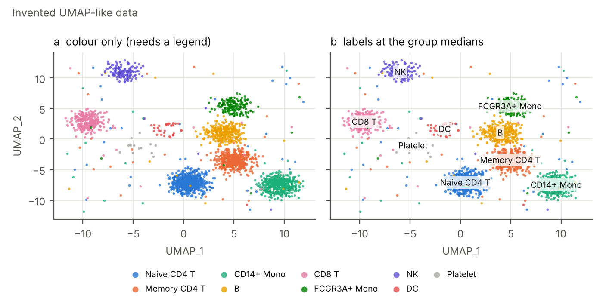
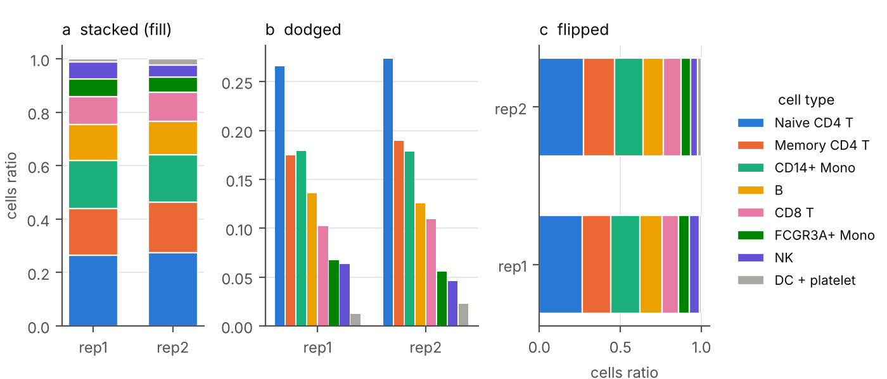

# R Language Data Science and Practice

> Module 3: R and RStudio from the ground up — installing them, reading and writing basic R syntax, the five data structures (vector, matrix, array, data frame, list), factors, functions, and drawing publication-style figures with ggplot2, using single-cell examples that lead directly into Seurat.

---

## Table of Contents

1. [Why R?](#1-why-r)
2. [Installing R and RStudio](#2-installing-r-and-rstudio)
3. [Installing Packages: CRAN, Bioconductor, GitHub](#3-installing-packages-cran-bioconductor-github)
4. [Basic Syntax: Assignment, Functions, and Help](#4-basic-syntax-assignment-functions-and-help)
5. [Data Structures](#5-data-structures)
6. [Factors](#6-factors)
7. [Functions: Your Own and the Built-in Ones](#7-functions-your-own-and-the-built-in-ones)
8. [Plotting with ggplot2: the Grammar](#8-plotting-with-ggplot2-the-grammar)
9. [A Single-Cell Worked Example](#9-a-single-cell-worked-example)
10. [Saving Figures](#10-saving-figures)
11. [Practice Questions with Answers](#11-practice-questions-with-answers)
12. [Resources and After-Class Assignments](#12-resources-and-after-class-assignments)
13. [Key Takeaways](#13-key-takeaways)
14. [What's Next](#14-whats-next)

---

## How to read this module

Module 2 ended with a count matrix. Everything after that, from Seurat clustering to cell-cell communication, is done in **R**, so this module is the language lesson that makes the rest of the course readable. Each section follows the lecture's order and adds the reasoning that the slides leave out.

**R is not installed on the machine used to check this module, so no R code here was run.** R code appears in `r` blocks. Where an R result is printed, it is one of two kinds, and I say which: either it is **copied from the slide**, or it is a value that I worked out and then checked with a short **Python script that follows R's rules** (counting from 1, filling matrices by column, dividing by n - 1, and so on). The Python code in this module was run and its outputs are real; but a Python check of an R rule is a check of my understanding, not an output of R. The Seurat examples in section 9 need a Seurat object (`pbmc3k_final.rds`) that I do not have, so they are transcribed from the slides and are **untested**. The data in the Python examples are small and invented, except for one set of cell-type counts that I mention where it is used.

---

## 1. Why R?

### The short history

The lecture presents R as the end of a line of languages. It began as the **S language at Bell Labs** (the names on the slide are Rick Becker and John Chambers), was re-implemented by **Ross Ihaka and Robert Gentleman** (the first letters of their first names are highlighted in red on the slide, which is where the name "R" comes from), and is now maintained by the **R Development Core Team**. A commercial implementation of S, S-PLUS, existed alongside it. A third name on the slide is **Hadley Wickham**, the author of ggplot2 and of the "tidyverse" packages (dplyr, tidyr) used throughout this module.

### What R is good at

From the lecture's bullet points:

- R is **free and open-source** software.
- It is an excellent tool for **statistical calculation** and statistical mapping. (The slide draws a map of provinces with ggplot2 as an illustration.)
- It runs on **Windows, Unix, Linux, and Mac**.
- In bioinformatics it is most often used for **statistical analysis and visualization of biological data**.
- **Many single-cell tools are written in R**: Seurat, SingleR, Monocle, inferCNV, and CellChat. These are the subjects of Modules 4 to 8.

A second slide lists the characteristics of R:

| Characteristic | What it means in practice |
|---|---|
| You can write your own functions | You can package a repeated analysis once and reuse it (section 7) |
| The largest and most active community of statisticians | New statistical methods usually appear first as R packages |
| Many packages, with strong functions and good speed | Most tasks already have a package |
| A console, a graphics window, error messages, and memory functions, and a good interface to other languages and databases | R can call other languages and read from databases |

### R in the whole analysis

The slide's pyramid shows where R sits in a data analysis, from the bottom up:

| Level | Task | R tools named on the slide |
|---|---|---|
| Data sources | Information providers, database systems | (reading data in) |
| Data pre-processing | Select, group, combine, delete; cleaning and processing | dplyr, tidyr |
| Data exploration | Statistical analysis and model building | clustering, correlation, regression |
| Data presentation | Visualization | `plot`, `ggplot2` |
| Conclusion | What the data say | — |

> **Key idea:** a typical R session moves up this pyramid: read data, clean it with dplyr and tidyr, explore it with statistics, and present it with ggplot2. This module covers the bottom (data structures) and the top (ggplot2), which is what you need before Seurat.

---

## 2. Installing R and RStudio

R and RStudio are **two separate programs**. **R** is the language and the engine that does the calculations. **RStudio** is a comfortable window around it, with an editor, a console, and panels for plots and help. Install R first, then RStudio.

### Step 1: R from CRAN

The download address is `https://cran.r-project.org/` (CRAN is the Comprehensive R Archive Network). The slide shows three steps:

1. Open the official website and choose the download for your system: **Download R for Linux** (Debian, Fedora/Red Hat, Ubuntu), **for macOS**, or **for Windows**. CRAN also has a list of **mirrors**, which are copies of the archive in many countries; pick one near you if asked.
2. On Windows, choose the **base** distribution, **"install R for the first time"**.
3. Download the installer (the slide shows R 4.1.2 for Windows) and follow the installation prompts. Use the **current** version instead of 4.1.2: the slide that lists the manuals later says that the up-to-date version is 4.3.3, and newer versions exist.

### Step 2: RStudio

The RStudio website (`rstudio.com`) has moved to **Posit** (`posit.co`), so you may be redirected. The slide's instructions: go to "Download RStudio" and choose the **free RStudio Desktop** (the open-source edition). Then pick the installer for your operating system: Windows 10/11 (`.exe`), macOS 11 or newer (`.dmg`), Ubuntu or Debian (`.deb`), or Fedora and Red Hat (`.rpm`). The page itself says: **1: Install R, 2: Install RStudio**, and that RStudio needs R 3.3.0 or newer. Paid editions (Desktop Pro, Server, Workbench) exist, but you do not need them.

### The RStudio panels

The slide labels four areas of the RStudio window:

| Panel | Where | What it is for |
|---|---|---|
| **Text editing area** (script editor) | top left | Write and save scripts (`.R` files); several scripts can be open as tabs |
| **Interactive code area** (Console) | bottom left | Type a command and press Enter to run it; the history of what you ran is kept. A Terminal tab sits next to it |
| **Variables** (Environment) | top right | Lists the objects that exist in your session; History and Connections tabs are beside it |
| **Plots, packages, and help** | bottom right | Files, Plots, Packages, Help, and Viewer tabs: this is where figures appear and where documentation opens |

The console prints a banner when it starts. Its last lines are worth knowing: `demo()` shows demonstrations, **`help()`** opens on-line help, **`help.start()`** opens an HTML help browser, and **`q()`** quits R.

> **Key idea:** write your analysis in the **script editor**, not directly in the console. A script is a saved, rerunnable record of what you did, which is the same reproducibility idea as Module 17.

---

## 3. Installing Packages: CRAN, Bioconductor, GitHub

A **package** is a bundle of functions, documentation, and sometimes data that extends R. Almost everything in this course (Seurat, ggplot2, tidyverse, monocle) is a package. You **install a package once** and **load it in every session** with `library()`. The slide lists three sources:

| Source | What lives there | Install function |
|---|---|---|
| **CRAN** | General-purpose R packages | `install.packages("name")` |
| **Bioconductor** | Packages for genomics and other biology | `BiocManager::install("name")` |
| **GitHub** | Development versions and packages not on CRAN | `devtools::install_github("owner/repo")` |

The slide's own examples (Seurat, tidyverse, monocle, seurat-data) appear in the code block below.

```r
# (1) CRAN  - the full list is organised into "views" at https://cran.r-project.org/web/views/
install.packages("dplyr")
install.packages("Seurat")
install.packages("tidyverse")

# (2) Bioconductor  (https://bioconductor.org/)
if (!requireNamespace("BiocManager", quietly = TRUE))
    install.packages("BiocManager")            # install the installer itself, once
BiocManager::install("monocle")

# (3) GitHub
install.packages("devtools")
devtools::install_github("satijalab/seurat-data")

# every session:
library(Seurat)
library(ggplot2)
```

The commands above are copied from the slides and **were not run**. Points to notice:

- `if (!requireNamespace("BiocManager", quietly = TRUE)) install.packages("BiocManager")` reads: "if the package BiocManager is **not** available, install it". It makes the line safe to run twice.
- `package::function` (two colons) calls a function from a package without loading the whole package.
- On the Bioconductor slide, the comment line uses `ggplot2` as its example in red. **ggplot2 is actually a CRAN package** (not on the slides): install it with `install.packages("ggplot2")`. It is also included in `tidyverse`.
- The Bioconductor example on the slide sets `version = "3.12"`, which is an old release; use the current one for your R version (not on the slides).

The Module 2 preview slide asked you to install `ggplot2` and `tidyverse` before this session, which is why they are the first packages in the list.

---

## 4. Basic Syntax: Assignment, Functions, and Help

The lecture's three syntax rules fit on one slide:

1. **A function is the basic unit of work.** It is written as a **function name followed by parentheses**, with its inputs inside. The result can be given a name so that you can use it later.
2. **Assignment is written `<-`.** The expression `x <- 6` means "give the variable `x` the value 6". The equals sign `=` also works but, as the slide says, try to avoid it. Think of `<-` as an arrow pointing from the value into the name.
3. **`c()` means "combine values"**: it joins values into a vector (or list). `t.test()` is the function that runs a t-test.

### Reading a line of R

The slide takes a paired t-test apart in three steps:

```r
Group_A <- c(5, 2, 6, 7, 2)          # 1. combine five numbers into an object called Group_A
Group_B <- c(1, 2, 1, 4, 2)          # 2. the same for Group_B
t.test(x = Group_A, y = Group_B, paired = TRUE)   # 3. call t.test with named parameters
```

In the third line, **`t.test`** is the function name; **`x`**, **`y`**, and **`paired`** are **parameter names**; and `Group_A`, `Group_B`, and `TRUE` are the **values** given to them. `paired = TRUE` says that the first number in A and the first in B belong to the same subject (for example, before and after a treatment).

The R output is not on the slide. The Python code below computes what a paired t-test gives for these ten numbers. It also checks the idea from section 7 that R's `var()` and `sd()` divide by n - 1. R's `t.test` uses the same paired t formula, so the same t, degrees of freedom, and p-value are expected; I could not confirm that by running R.

```python
import numpy as np
from scipy import stats

# ---- the slide's user-defined function:  roll <- function(x, y) { dice = rep(1:3, each = x, times = y); print(dice); sum(dice) }
def roll(x, y):
    dice = np.tile(np.repeat([1, 2, 3], x), y)         # rep(1:3, each = x, times = y)
    print(" ".join(map(str, dice)))                     # print(dice)
    return int(dice.sum())                              # R returns the value of the last line: sum(dice)

print("roll(2, 3) returns", roll(2, 3))

# ---- summary functions on the slide's Group_A (R: var() and sd() divide by n - 1)
g = np.array([5, 2, 6, 7, 2])
print("mean", g.mean(), "| median", np.median(g), "| range", (int(g.min()), int(g.max())), "| sum", g.sum())
print("var  (n - 1):", round(g.var(ddof=1), 4), "| sd:", round(g.std(ddof=1), 4), "   <- what R's var() and sd() return")
print("var  (n)    :", round(g.var(ddof=0), 4), "                     <- NOT what R returns")

# ---- t.test(x = Group_A, y = Group_B, paired = TRUE)
Group_A = np.array([5, 2, 6, 7, 2])
Group_B = np.array([1, 2, 1, 4, 2])
res = stats.ttest_rel(Group_A, Group_B)
ci = res.confidence_interval(0.95)
diff = Group_A - Group_B
print("differences A - B:", diff.tolist(), "| mean difference:", diff.mean())
print(f"t = {res.statistic:.4f}, df = {res.df}, p-value = {res.pvalue:.4f}")
print(f"95 percent confidence interval for the mean difference: {ci.low:.3f} to {ci.high:.3f}")
one = stats.ttest_1samp(diff, 0)
print("same test as a one-sample test of the differences against 0:", f"t = {one.statistic:.4f}, p = {one.pvalue:.4f}")

# Output:
# 1 1 2 2 3 3 1 1 2 2 3 3 1 1 2 2 3 3
# roll(2, 3) returns 36
# mean 4.4 | median 5.0 | range (2, 7) | sum 22
# var  (n - 1): 5.3 | sd: 2.3022    <- what R's var() and sd() return
# var  (n)    : 4.24                      <- NOT what R returns
# differences A - B: [4, 0, 5, 3, 0] | mean difference: 2.4
# t = 2.3311, df = 4, p-value = 0.0802
# 95 percent confidence interval for the mean difference: -0.459 to 5.259
# same test as a one-sample test of the differences against 0: t = 2.3311, p = 0.0802
```

How to read the result: the differences A minus B are 4, 0, 5, 3, 0, with mean 2.4. The t statistic is the mean difference divided by its standard error (2.4 divided by 2.302 over the square root of 5, which is 1.03), giving t = 2.33 with 4 degrees of freedom, and p = 0.08. The 95% confidence interval for the mean difference runs from about -0.46 to 5.26, so it includes 0. With only five pairs, this is **not significant at the 5% level**, even though the average difference is 2.4. The same number comes out if you test the five differences against zero with a one-sample test, which is exactly what a paired test is.

### Getting help

The slide gives `https://www.r-project.org/help.html` as the starting point for documentation. Inside R, `help()` and `?name` (not on the slides) open the manual page of a function, and `help.start()` opens an HTML help browser. In RStudio the **Help** tab (section 2) shows the same pages.

> **Key idea:** `name <- value` stores something, and `function(parameter = value)` does something. Almost every line of R you will ever read, including every Seurat command, is one of these two shapes or a combination of them.

---

## 5. Data Structures

Creating a data set in a usable format is the first step of any analysis: **choose a data structure to store the data, then enter or import the data into it**. R can take data typed in by hand or imported from Excel, text files, SAS, and MySQL. A data set is usually a **rectangular array**: **rows are records and columns are attributes**. The slide's example is a patient table:

| Patient ID | AdmDate | Age | Diabetes | Status |
|---|---|---|---|---|
| 1 | 10/15/2009 | 25 | Type1 | Poor |
| 2 | 11/01/2009 | 34 | Type2 | Improved |
| 3 | 10/21/2009 | 28 | Type1 | Excellent |
| 4 | 10/28/2009 | 52 | Type1 | Poor |

Notice that the columns hold **different kinds** of values: numbers (age), dates, and words (diabetes type, status). That fact decides which structure we need.

### The five structures and the four data types

| Structure | Shape | Can hold |
|---|---|---|
| (a) **Vector** | one-dimensional, a straight line | one type of value |
| (b) **Matrix** | two-dimensional, a plane | one type of value |
| (c) **Array** | three or more dimensions, a cube | one type of value |
| (d) **Data frame** | a table; each column can be a different type | different types in different columns |
| (e) **List** | an ordered collection of anything | vectors, arrays, data frames, even other lists |

The four common **data types** on the slide are **numerical** (for example, species abundance), **character** (a sample name), **logical** (`TRUE` or `FALSE`), and **factor** (a category variable, section 6).

### Vectors

A vector is a one-dimensional array of numbers, characters, or logical values. **Two habits of R matter here: positions are counted from 1, and a negative position means "leave this one out".**

```r
a <- c(1, 2, 3, 4, 5, 6)
b <- c("one", "two", "three")
c <- c(TRUE, FALSE, TRUE, TRUE, FALSE)

a[2]            # the second element
a[-2]           # everything except the second element
a[c(2:4)]       # the second through the fourth element

x <- 1:5                  # the integers 1 to 5
seq(from = 1, to = 10, by = 2)
rep(1:2, 2)               # the block 1 2 repeated twice
rep(1:2, each = 2)        # each element repeated twice

length(a); max(a); min(a)
```

(The slide's list of "Create vectors regularly" is partly hidden by the video controls, and its last line is cut off; the `rep` pair above is how I read it.) The Python code below reproduces what each of these expressions returns, following R's rules. Note that `a[-2]` **returns** a vector without the second element; it does not change `a`, although the slide's wording "delete the second element" can suggest otherwise.

```python
import numpy as np

# R counts from 1 and a negative index means "leave this one out".  Python counts from 0.
a = np.array([1, 2, 3, 4, 5, 6])                     # R: a <- c(1, 2, 3, 4, 5, 6)
print("a[2]        ->", a[2 - 1])                    # R: the second element
print("a[-2]       ->", np.delete(a, 2 - 1))         # R: everything except the second (a itself is unchanged)
print("a[c(2:4)]   ->", a[2 - 1:4])                  # R: the second through the fourth (both ends included)
print("a is still  ->", a)

# regular sequences
print("1:5                 ->", np.arange(1, 6))
print("seq(1, 10, by = 2)  ->", np.arange(1, 11, 2))
print("rep(1:2, 2)         ->", np.tile([1, 2], 2))            # the whole block repeated
print("rep(1:2, each = 2)  ->", np.repeat([1, 2], 2))          # each element repeated

# which.max / which.min return a POSITION counted from 1
x = np.array([4, 9, 2, 9, 7])
print("length, max, min    ->", x.size, x.max(), x.min())
print("which.max(x)        ->", int(np.argmax(x)) + 1, "(first maximum; Python index", int(np.argmax(x)), ")")
print("which.min(x)        ->", int(np.argmin(x)) + 1)

# Output:
# a[2]        -> 2
# a[-2]       -> [1 3 4 5 6]
# a[c(2:4)]   -> [2 3 4]
# a is still  -> [1 2 3 4 5 6]
# 1:5                 -> [1 2 3 4 5]
# seq(1, 10, by = 2)  -> [1 3 5 7 9]
# rep(1:2, 2)         -> [1 2 1 2]
# rep(1:2, each = 2)  -> [1 1 2 2]
# length, max, min    -> 5 9 2
# which.max(x)        -> 2 (first maximum; Python index 1 )
# which.min(x)        -> 3
```

`which.max(x)` and `which.min(x)` (section 7) return the **position** of the largest or smallest value, and if there is a tie they report the first one.

### Matrices

A matrix is a special vector with two extra properties, the number of rows and the number of columns. The slide's example creates one from the numbers 1 to 10:

```r
mymat <- matrix(c(1:10), nrow = 2, ncol = 5, byrow = TRUE)
mymat
#      [,1] [,2] [,3] [,4] [,5]      <- as printed on the slide
# [1,]    1    2    3    4    5
# [2,]    6    7    8    9   10

mymat[2, ]      # the second row
mymat[, 2]      # the second column
mymat[1, 5]     # row 1, column 5
```

The general form is `matrix(vector, nrow, ncol, byrow, dimnames)`. **`byrow = TRUE` fills the matrix one row at a time; the default, `byrow = FALSE`, fills it one column at a time.** The indexing rule is `[row, column]`; leaving one side empty means "all of them". (On the slide the lines explaining `mymat[2, ]` and `mymat[, 2]` overlap and are garbled; the descriptions above are the ones that match the code.)

### Arrays

An array is a matrix with more dimensions. Its elements are called with `[row, column, layer]`. The slide's example has dimensions 2 by 3 by 2:

```r
myarr <- array(c(1:12), dim = c(2, 3, 2))
dim(myarr)              # the dimensions: 2 3 2
myarr[1, 2, 1]          # first row, second column, first layer
```

The general form is `array(data, dim, dimnames)`: `data` is the content, `dim` is a numeric vector of the dimensions, and `dimnames` is a list of labels for each dimension. **Arrays are filled column by column**, layer after layer. The slide prints layer 1 as rows `1 3 5` and `2 4 6`, and layer 2 as `7 9 11` and `8 10 12`, and `myarr[1,2,1]` as `3`. The Python code below reproduces all of that (first the matrix, then the array):

```python
import numpy as np

# R: mymat <- matrix(c(1:10), nrow = 2, ncol = 5, byrow = TRUE)
v = np.arange(1, 11)
mymat = v.reshape(2, 5)                               # byrow = TRUE: fill row by row
print("byrow = TRUE:\n", mymat)
print("byrow = FALSE (R's default) fills column by column:\n", v.reshape(2, 5, order="F"))
print("mymat[2, ]  ->", mymat[2 - 1, :])             # R: the second row
print("mymat[, 2]  ->", mymat[:, 2 - 1])             # R: the second column
print("mymat[1, 5] ->", mymat[0, 4])                 # R: first row, fifth column

# R: myarr <- array(c(1:12), dim = c(2, 3, 2))   (an array is always filled column by column)
myarr = np.arange(1, 13).reshape((2, 3, 2), order="F")
print("layer 1 (', , 1'):\n", myarr[:, :, 0])
print("layer 2 (', , 2'):\n", myarr[:, :, 1])
print("myarr[1, 2, 1] ->", myarr[0, 1, 0], "(the slide prints 3)")
assert myarr[0, 1, 0] == 3 and mymat[0, 4] == 5

# Output:
# byrow = TRUE:
#  [[ 1  2  3  4  5]
#  [ 6  7  8  9 10]]
# byrow = FALSE (R's default) fills column by column:
#  [[ 1  3  5  7  9]
#  [ 2  4  6  8 10]]
# mymat[2, ]  -> [ 6  7  8  9 10]
# mymat[, 2]  -> [2 7]
# mymat[1, 5] -> 5
# layer 1 (', , 1'):
#  [[1 3 5]
#  [2 4 6]]
# layer 2 (', , 2'):
#  [[ 7  9 11]
#  [ 8 10 12]]
# myarr[1, 2, 1] -> 3 (the slide prints 3)
```

### Data frames

A data frame is **like a matrix, but each column can have a different type**, and it is the most commonly used format in R. It is what you get when you read a table from a file, and the cell-annotation table in Seurat (`meta.data`) is one.

```r
patientID <- c(1, 2, 3, 4)
age       <- c(25, 34, 28, 52)
diabetes  <- c("Type1", "Type2", "Type1", "Type1")
status    <- c("Poor", "Improved", "Excellent", "Poor")
patientdata <- data.frame(patientID, age, diabetes, status)
patientdata
#   patientID age diabetes    status       <- as printed on the slide
# 1         1  25    Type1      Poor
# 2         2  34    Type2  Improved
# 3         3  28    Type1 Excellent
# 4         4  52    Type1      Poor
```

| Call | Meaning |
|---|---|
| `patientdata[1, ]` | The first row |
| `patientdata[, 2]` | The second column |
| `patientdata[1:2, 1:2]` | The first two rows and the first two columns |
| `patientdata$age` | One column, by name (the `$` extracts it) |
| `str(patientdata)` | The structure: type and first values of each column |
| `rownames(patientdata)` and `colnames(patientdata)` | Row names and column names |
| `summary(patientdata)` | A summary of each column |
| `View(patientdata)` | Opens a spreadsheet-like viewer (the slide writes `view`, but the function is `View` with a capital V) |
| `head(patientdata)` | The first few rows |

**A column of a data frame is a named vector**, so everything from the vector section applies to it. The slide shows this with a real single-cell table, the `meta.data` of the Seurat object `pbmc3k.final` (a PBMC data set): the **rows are cells** (named by their cell barcodes, as in Module 2), and the **columns are measurements per cell**: `orig.ident`, `nCount_RNA`, `nFeature_RNA`, `seurat_annotations`, `percent.mt`, `RNA_snn_res.0.5`, and `seurat_clusters`. Arrows on the slide point to the row names, to `nCount_RNA`, and to `seurat_annotations` to show that each column can be read as a vector. In Seurat, `nCount_RNA` is the number of UMIs in a cell and `nFeature_RNA` is the number of genes detected (not on the slides); they are the per-cell versions of the "median UMI per cell" and "median genes per cell" in the CeleScope report of Module 2.

### Lists

A list is **an ordered combination of different objects** (vectors, matrices, arrays, data frames, even lists), and it is the most flexible structure in R. Seurat objects are built from lists of this kind.

```r
a <- c(1, 2, 3, 4, 5)
b <- c('Amy', 'Bobby', 'candy', 'Daniel', 'Emma', 'Frank')
d <- data.frame(A1 = 1:3, A2 = c('s', 'ss', 'sss'), A3 = c(FALSE, TRUE, FALSE))
e <- matrix(1:20, ncol = 5)
mylist <- list(a, b, d, e)
names(mylist) <- c('L1', 'L2', 'L3', 'L4')
mylist

mylist[[1]]         # a component by position (double brackets)
mylist$L1           # a component by name
str(mylist)         # the types inside
summary(mylist)     # length, class and mode of each component
```

| Component | Length | Class | Mode (as printed on the slide) |
|---|---|---|---|
| L1 | 5 | none | numeric |
| L2 | 6 | none | character |
| L3 | 3 | data.frame | list |
| L4 | 20 | none | numeric |

Pay attention to the **Length** column: a data frame's length is its **number of columns** (3), and a matrix's length is its **number of cells** (20). The slide's other outputs are `class(mylist)` giving `"list"`, `as.matrix(a)` giving a one-column matrix with the values 1 to 5, and `is.matrix(a)` giving `FALSE`. The Python code below builds the same objects and reproduces the lengths, and also the first part of this section's data frame calls and the factor of section 6.

```python
import numpy as np
import pandas as pd

# ---- data frame: R  patientdata <- data.frame(patientID, age, diabetes, status)
patientdata = pd.DataFrame({"patientID": [1, 2, 3, 4], "age": [25, 34, 28, 52],
                            "diabetes": ["Type1", "Type2", "Type1", "Type1"],
                            "status": ["Poor", "Improved", "Excellent", "Poor"]})
print(patientdata.to_string(index=False))
print("patientdata[1, ]        ->\n" + patientdata.iloc[[0]].to_string(index=False))   # first row
print("patientdata[, 2]        ->", patientdata.iloc[:, 1].tolist())         # second column
print("patientdata[1:2, 1:2]   ->\n" + patientdata.iloc[0:2, 0:2].to_string(index=False))
print("patientdata$age         ->", patientdata["age"].tolist())
print("dim(patientdata)        ->", patientdata.shape, " (rows, columns)")

# ---- factor: R  factor(c('f','m','f','f','m'), levels = c('f','m'), labels = c('female','male'), ordered = TRUE)
sex = pd.Categorical(["f", "m", "f", "f", "m"], categories=["f", "m"], ordered=True)
sex = sex.rename_categories(["female", "male"])
print("sex                     ->", list(sex), "| Levels:", " < ".join(sex.categories))
print("integer codes R stores  ->", (sex.codes + 1).tolist(), "(R numbers the levels from 1)")

# why levels = matters: without it R sorts the labels alphabetically
status = ["Poor", "Improved", "Excellent"] * 25
print("default level order     ->", sorted(set(status)), "  (alphabetical: wrong for an ordered scale)")
ordered = pd.Categorical(status, categories=["Poor", "Improved", "Excellent"], ordered=True)
print("levels = c('Poor','Improved','Excellent') ->", list(ordered.categories), ordered.value_counts().to_dict())

# ---- list: R  mylist <- list(a, b, d, e)
a = [1, 2, 3, 4, 5]
b = ["Amy", "Bobby", "candy", "Daniel", "Emma", "Frank"]
d = pd.DataFrame({"A1": [1, 2, 3], "A2": ["s", "ss", "sss"], "A3": [False, True, False]})
e = np.arange(1, 21).reshape((4, 5), order="F")                    # matrix(1:20, ncol = 5)
mylist = {"L1": a, "L2": b, "L3": d, "L4": e}
rlength = {k: (v.shape[1] if isinstance(v, pd.DataFrame) else np.size(v)) for k, v in mylist.items()}
print("length of each component ->", rlength, "(a data frame's length is its number of columns)")
print("matrix L4, first row     ->", e[0].tolist(), " last row:", e[3].tolist())

# Output:
#  patientID  age diabetes    status
#          1   25    Type1      Poor
#          2   34    Type2  Improved
#          3   28    Type1 Excellent
#          4   52    Type1      Poor
# patientdata[1, ]        ->
#  patientID  age diabetes status
#          1   25    Type1   Poor
# patientdata[, 2]        -> [25, 34, 28, 52]
# patientdata[1:2, 1:2]   ->
#  patientID  age
#          1   25
#          2   34
# patientdata$age         -> [25, 34, 28, 52]
# dim(patientdata)        -> (4, 4)  (rows, columns)
# sex                     -> ['female', 'male', 'female', 'female', 'male'] | Levels: female
#   < male
# integer codes R stores  -> [1, 2, 1, 1, 2] (R numbers the levels from 1)
# default level order     -> ['Excellent', 'Improved', 'Poor']   (alphabetical: wrong for an
#   ordered scale)
# levels = c('Poor','Improved','Excellent') -> ['Poor', 'Improved', 'Excellent'] {'Poor':
#   25, 'Improved': 25, 'Excellent': 25}
# length of each component -> {'L1': 5, 'L2': 6, 'L3': 3, 'L4': 20} (a data frame's length
#   is its number of columns)
# matrix L4, first row     -> [1, 5, 9, 13, 17]  last row: [4, 8, 12, 16, 20]
```

> **Key idea:** choose the structure by asking what is in each cell and how the cells are arranged. Same type, in a line: vector. Same type, in a grid: matrix. A table whose columns differ in type: data frame. Anything at all, bundled together: list.

---

## 6. Factors

Variables come in three kinds, and R treats them differently:

- A **nominal** variable is a category with **no order** (blood group, sex).
- An **ordered** variable has an **order but no quantity** (poor < improved < excellent; low < medium < high).
- A **continuous** variable can take any value in a range and carries both order and quantity (age, expression level).

In R, **nominal and ordered variables are stored as factors.** This matters because the factor determines **how the data are analysed and how they are drawn**. Category data are very useful for grouping (male and female; high, middle, and low).

```r
sex <- factor(c('f', 'm', 'f', 'f', 'm'),
              levels = c('f', 'm'),
              labels = c('female', 'male'),
              ordered = TRUE)
sex
# [1] female male   female female male        <- as printed on the slide
# Levels: female < male
```

Read the three arguments carefully: **`levels`** lists the values that are allowed, in the order you want; **`labels`** gives each level a new, readable name; and **`ordered = TRUE`** declares that the levels have an order (shown by the `<` in the printout). Internally R stores the factor as whole numbers that point to the levels.

A second slide builds a factor with three levels and plots it:

```r
status <- rep(c("Poor", "Improved", "Excellent"), each = 25)
status <- factor(status, ordered = TRUE,
                 levels = c("Poor", "Improved", "Excellent"),
                 labels = c("P", "I", "E"))
index    <- sample(1:100, 75)
plotdata <- data.frame(index, status)
boxplot(index ~ status, col = "red")
```

The slide prints `str(plotdata)` as 75 observations of 2 variables, with `status` an ordered factor with three levels `"P"<"I"<"E"`, and `summary(plotdata)` shows 25 observations for each of P, I, and E. The numbers in `index` are random, so the three boxes in the picture differ only by chance; the example demonstrates the syntax, not a result.

### Why `levels` matters

If you leave out `levels`, R sorts the values **alphabetically**. For the status values above that would give Excellent, Improved, Poor, which is exactly the wrong order for an ordered scale, and every table, boxplot, and legend would list the groups in that order. In the single-cell world the same thing happens with cluster labels, which is why plots in Seurat and ggplot2 follow the level order of the label (not on the slides). The Python code of this section (above, in the data-structures code) prints both orders to show the difference.

> **Key idea:** a factor is a column of labels plus a **rule about their order**. If a plot shows groups in a strange order, the cure is almost always to set the `levels` of the factor.

---

## 7. Functions: Your Own and the Built-in Ones

**A function is an organised, reusable piece of code that does one thing or a few related things.** Its general form is:

```r
function_name <- function(parameter1, parameter2) {
    expression1
    expression2
    return(result)
}

function_name(parameter1, parameter2)      # calling it
```

You can **run the function code directly** (select it and run it) or **save it in a file and load it with `source()`**. The slide's example simulates rolling dice a given number of times:

```r
roll <- function(x, y) {
    dice = rep(1:3, each = x, times = y)
    print(dice)
    sum(dice)
}
roll(2, 3)
```

Step by step, `roll(2, 3)` sets `x = 2` and `y = 3`. `rep(1:3, each = 2, times = 3)` first repeats each of 1, 2, 3 twice (1 1 2 2 3 3) and then repeats that whole block three times; `print(dice)` shows it; and `sum(dice)` is the **last expression**, so it is the value the function returns. (The template above shows `return(...)`, but the example does not use it: **R returns the value of the last expression automatically.**) The Python code of section 4 also runs this function: its output there is `1 1 2 2 3 3 1 1 2 2 3 3 1 1 2 2 3 3` and the returned value is 36, since each block sums to 12 and there are three blocks.

### Handy functions for any object

| Function | Does |
|---|---|
| `head(object)` and `tail(object)` | View the beginning and the end |
| `str(object)` | Display the structure |
| `length(object)` | Number of elements or components |
| `dim(object)` | Dimensions of a matrix or data frame |
| `mode(object)` | Type of the object (numeric, logical, character, list, ...) |
| `t(object)` | Transpose |
| `names(object)` | The names of the components |
| `fix(object)` | Edit the object directly |
| `newobject <- edit(object)` | Edit it and save the result as a new object |
| `rbind(object1, object2, ...)` | Merge objects **by row** (stack them) |
| `cbind(object1, object2, ...)` | Merge objects **by column** (put them side by side) |

### Handy functions for numbers

| Function | Does |
|---|---|
| `max(x)`, `min(x)` | Maximum and minimum |
| `mean(x)`, `median(x)` | Mean and median |
| `range(x)` | The minimum and maximum together |
| `which.max(x)`, `which.min(x)` | The **position** of the maximum or minimum |
| `var(x)`, `sd(x)` | Variance and standard deviation |
| `sum(x)` | Sum |

One detail deserves attention: **`var()` and `sd()` in R divide by n - 1** (the sample variance), not by n. For the slide's `Group_A` (5, 2, 6, 7, 2) the sample variance is 5.3 and the standard deviation 2.302; dividing by n would give 4.24, which is not what R returns. The Python code in section 4 prints both.

> **Key idea:** a function is a named, reusable recipe. Write your own whenever you copy and paste the same lines a third time; the function name documents what the lines do, and a fix has to be made in only one place.

---

## 8. Plotting with ggplot2: the Grammar

**ggplot2** is the R package for drawing statistical and data graphics, written by Hadley Wickham. What makes it different from most plotting software is that it has an **underlying grammar of graphics**: you do not choose "a bar chart"; you **compose** a figure from independent components. The lecture gives the core concept in three points: the plot is built in **layers**; the components can be **freely combined**; and the **data are kept separate from the description of the picture** (the slide's first point is garbled; this is how I read it).

### The components

The slide's template shows every component that can appear:

```r
ggplot(data = <DATA>,
       mapping = aes(<MAPPINGS>)) +
  <GEOM_FUNCTION>(mapping = aes(<MAPPINGS>),
                  stat = <STAT>,
                  position = <POSITION>) +
  <SCALE_FUNCTION> +
  <COORDINATE_FUNCTION> +
  <FACET_FUNCTION> +
  <THEME_FUNCTION>
```

| Component | Question it answers | Examples |
|---|---|---|
| **Data** | Which table? | a data frame |
| **Mapping**, `aes(x, y, ...)` | Which column goes to which visual property (position, colour, size)? | `aes(carat, price, colour = cut)` |
| **Geometry**, `geom_xxxx()` | In what shape is it drawn? | `geom_point()`, `geom_bar()`, `geom_text()` |
| **Statistics**, `stat` | Is a summary computed first? | histogram counts, a fitted line |
| **Scale**, `scale_xxx()` | How are values turned into positions and colours? | `scale_fill_manual(values = ...)` |
| **Coordinates**, `coord_xxx()` | In which coordinate system? | Cartesian, polar, flipped, logarithmic |
| **Facets**, `facet_xxx()` | Should the data be split into sub-plots? | `facet_wrap(~ replicate)` |
| **Theme**, `theme()` | How do the non-data parts look? | background, grid lines, fonts |

A **layer** is `Data + mapping + geom_xxxx() + scale_x_xxx()`, and **layers are connected with `+`**. The first two lines, data and mapping, are the "drawing object": the slide's formula is *visual data (a data frame) plus figure mapping (`aes(x, y)`)*. The slide shows three small examples of changing one component while keeping the rest: a **facet** splits one stacked bar chart into one panel per replicate, a **coord** change turns a bar chart into a polar (pie-like) chart, and a **scale** change turns a continuous colour scale into a discrete one.

### A first complete example

```r
library(ggplot2)
ggplot(data = diamonds, aes(carat, price, colour = cut)) + geom_point()
```

The `diamonds` data set that comes with ggplot2 is a table with 53,940 rows and 10 columns (`carat`, `cut`, `color`, `clarity`, `depth`, `table`, `price`, `x`, `y`, `z`). Reading the line from the left: **`ggplot`** is the function; **`data = diamonds, aes(carat, price, colour = cut)`** is the drawing object (put carat on the x axis, price on the y axis, and colour each point by its cut); and **`geom_point()`** is the geometry, which says "draw a point for every row". The slide's resulting scatter plot has one colour per cut and the characteristic vertical stripes at round carat values.

> **Key idea:** to read any ggplot2 command, split it at the plus signs. The first part says *what data and which columns*; every following part adds *one* decision. To change a plot, change one layer.

---

## 9. A Single-Cell Worked Example

The last part of the lecture builds real single-cell figures from a Seurat object of PBMCs (peripheral blood mononuclear cells) called `pbmc3k.final`. "PBMC 3k" is a standard Seurat tutorial data set of roughly three thousand cells (not stated on the slides). **The R code in this section is copied from the slides and was not run**, because it needs that object. I corrected one typo: the slide's `readRDS('../pbmc3k_final.rds)` is missing its closing quote.

### Three levels of the same UMAP

The slide shows the same cell map at three levels of effort.

```r
library(Seurat)
pbmc3k.final <- readRDS("../pbmc3k_final.rds")     # change this path to where your file is
pbmc3k.final
head(pbmc3k.final)

library(ggplot2)
# Basic: one command, Seurat's own plot
p1 <- DimPlot(pbmc3k.final)

# Advanced: take the plotting data out of Seurat and draw it with ggplot2
p2 <- ggplot(DimPlot(pbmc3k.final)$data, aes(UMAP_1, UMAP_2, fill = ident)) +
  geom_point(shape = 21, colour = "black", stroke = 0.25, alpha = 0.8) +
  DimPlot(pbmc3k.final, label = T)$theme +
  theme_bw() + NoLegend()
```

**Basic:** `DimPlot()` draws the UMAP with default colours and a legend. **Advanced:** `DimPlot(...)$data` extracts the table behind the plot (as I understand Seurat, one row per cell with `UMAP_1`, `UMAP_2`, and `ident`, the cluster or cell type; this is not on the slides); `ggplot()` then draws it from scratch, which allows details such as `shape = 21` (a point with a separate outline colour), `stroke = 0.25` (a thin outline), `alpha = 0.8` (slight transparency), and `NoLegend()`.

**High order:** the third version labels each group directly on the map, at the **centre** of that group.

```r
library(tidyverse)
pbmc <- pbmc3k.final
pbmc <- AddMetaData(pbmc, pbmc@reductions$umap@cell.embeddings,
                    col.name = colnames(pbmc@reductions$umap@cell.embeddings))
head(pbmc@meta.data)

class_avg <- pbmc@meta.data %>%
  group_by(celltype) %>%
  summarise(UMAP_1 = median(UMAP_1),
            UMAP_2 = median(UMAP_2))

allcolour <- c("#DC143C", "#0000FF", "#20B2AA", "#FFA500", "#9370DB", ...)   # a long hand-picked colour list

umap <- ggplot(pbmc@meta.data, aes(x = UMAP_1, y = UMAP_2)) +
  geom_point(aes(color = celltype)) +
  scale_color_manual(values = allcolour) +
  geom_text(aes(label = celltype), data = class_avg) +
  theme(panel.background = element_rect(fill = "white", colour = "black"),
        panel.grid = element_blank(),
        legend.title = element_blank(),
        legend.key = element_blank()) +
  guides(colour = guide_legend(override.aes = list(size = 5)))
umap
```

I shortened the code: the slide repeats `family = "Arial", size = 18` styling for text, axis titles, and legend, and its colour list is cut off by the video controls, so I wrote `...` for the hidden part. Two things are worth checking before you run it:

- `AddMetaData(..., cell.embeddings, col.name = ...)` copies the two UMAP coordinates **into the cell table** (`meta.data`), so that ggplot2 can use `UMAP_1` and `UMAP_2` as ordinary columns. The pipe `%>%` passes the result of each line to the next: take the table, group it by `celltype`, and summarise each group with the **median** of its coordinates.
- The slide groups by a column called `celltype`, but the `meta.data` shown earlier on the slide has `seurat_annotations`. So a `celltype` column must exist, or you must change the name. For example `pbmc$celltype <- Idents(pbmc)` would create it (my suggestion; not on the slides).

Why the median and not the mean? A few stray cells far from their group drag the **mean** away from the visual centre, while the **median** barely moves. The Python code below invents UMAP-like data, scatters 4% of the cells away from their groups, and compares the two positions. The median is closer to the true centre for 8 of the 9 groups (it is a tie for the smallest group, Platelet, which has only 14 cells).

```python
import numpy as np
import pandas as pd

# Invented 2-D "UMAP" coordinates: one blob per cell type (centres chosen by hand) plus a few stray cells.
centres = {"Naive CD4 T": (0.5, -7.0), "Memory CD4 T": (5.0, -3.5), "CD14+ Mono": (9.5, -7.5), "B": (4.0, 1.0),
           "CD8 T": (-9.5, 3.0), "FCGR3A+ Mono": (5.0, 5.5), "NK": (-6.0, 11.0), "DC": (-2.0, 1.5), "Platelet": (-4.5, -1.0)}
sizes = {"Naive CD4 T": 711, "Memory CD4 T": 480, "CD14+ Mono": 472, "B": 344, "CD8 T": 279,
         "FCGR3A+ Mono": 162, "NK": 144, "DC": 32, "Platelet": 14}
rng = np.random.default_rng(7)
rows = []
for ct, (cx, cy) in centres.items():
    xy = rng.normal([cx, cy], 0.9, size=(sizes[ct], 2))
    stray = rng.random(sizes[ct]) < 0.04                           # 4% of the cells land far from the group
    xy[stray] = rng.uniform(-12, 12, size=(stray.sum(), 2))
    rows += [(ct, x, y) for x, y in xy]
meta = pd.DataFrame(rows, columns=["celltype", "UMAP_1", "UMAP_2"])   # like pbmc@meta.data after AddMetaData

# R:  class_avg <- meta %>% group_by(celltype) %>% summarise(UMAP_1 = median(UMAP_1), UMAP_2 = median(UMAP_2))
class_avg = meta.groupby("celltype")[["UMAP_1", "UMAP_2"]].median().loc[list(centres)]
mean_xy = meta.groupby("celltype")[["UMAP_1", "UMAP_2"]].mean().loc[list(centres)]
truth = pd.DataFrame(centres, index=["UMAP_1", "UMAP_2"]).T
err_median = np.hypot(*(class_avg - truth).T.values)
err_mean = np.hypot(*(mean_xy - truth).T.values)
out = pd.DataFrame({"label x": class_avg["UMAP_1"], "label y": class_avg["UMAP_2"],
                    "off by (median)": err_median, "off by (mean)": err_mean}).round(2)
print(out.to_string())
print("median is closer to the true centre for", int((err_median < err_mean).sum()), "of 9 cell types")

# Output:
#               label x  label y  off by (median)  off by (mean)
# celltype
# Naive CD4 T      0.48    -7.10             0.10           0.20
# Memory CD4 T     4.94    -3.41             0.11           0.35
# CD14+ Mono       9.51    -7.48             0.02           0.42
# B                3.95     1.05             0.07           0.15
# CD8 T           -9.54     2.85             0.16           0.39
# FCGR3A+ Mono     4.91     5.40             0.14           0.38
# NK              -5.98    11.00             0.02           0.38
# DC              -1.55     1.66             0.47           0.58
# Platelet        -4.71    -1.03             0.21           0.21
# median is closer to the true centre for 8 of 9 cell types
```



Panel (a) forces your eye to go back and forth between the legend and the dots, and it fails for readers who cannot tell the colours apart. Panel (b) labels each group where it sits, which is what the "high order" command does with `geom_text()`.

### Cell proportions per replicate

The second example draws a stacked bar chart of how the cell types are distributed in each replicate. The slide first **invents a replicate label** for each cell, so the example shows plotting, not biology:

```r
set.seed(42)
pbmc$replicate <- sample(c("rep1", "rep2"), size = ncol(pbmc), replace = TRUE)
head(pbmc@meta.data)

as.data.frame(prop.table(table(Idents(pbmc), pbmc@meta.data[, "replicate"]),
                         margin = 2)) -> pdf -> td
allcolour -> colour1

plt <- ggplot(td, aes(x = td[, 2], y = td[, 3], fill = td[, 1])) +
  geom_bar(position = "stack", stat = "identity") +
  labs(x = "replicate", y = "Cells Ratio") +
  scale_y_continuous(expand = c(0.001, 0.001)) +
  scale_fill_manual(values = colour1) +
  guides(fill = guide_legend(keywidth = 1, keyheight = 1, ncol = 1, title = "Cluster"))
plt
```

Take it apart one function at a time:

| Piece | What it does |
|---|---|
| `set.seed(42)` | Fixes R's random number generator so that the "random" replicate labels are the same every time (reproducibility, Module 17) |
| `sample(c("rep1","rep2"), size = ncol(pbmc), replace = TRUE)` | Draw one label per cell, with replacement, so each cell is rep1 or rep2 by chance |
| `table(Idents(pbmc), replicate)` | Count the cells in every combination of cell type and replicate |
| `prop.table(..., margin = 2)` | Divide each **column** by its own total, so every replicate sums to 1 |
| `as.data.frame(...)` | Turn the table into a long data frame: columns `Var1` (cell type), `Var2` (replicate), `Freq` (proportion) |
| `x = td[, 2]`, `y = td[, 3]`, `fill = td[, 1]` | Replicate on the x axis, proportion on the y axis, cell type as the fill colour |

The slide's code uses `td[, 2]` and so on instead of column names, which is why the order `Var1, Var2, Freq` matters. The Python code below follows the same steps. The cell-type counts it uses are **my recollection of the public Seurat PBMC 3k tutorial** (they add up to 2,638 cells); they are **not on the slides**. Check them against your own object. The random stream is numpy's, not R's, so the replicate sizes will not match what R's `set.seed(42)` would give, but the logic is identical.

```python
import numpy as np
import pandas as pd

# Cell-type counts: my recollection of the public Seurat PBMC 3k tutorial (NOT on the slides) - 2,638 cells in all.
counts = {"Naive CD4 T": 711, "Memory CD4 T": 480, "CD14+ Mono": 472, "B": 344, "CD8 T": 279,
          "FCGR3A+ Mono": 162, "NK": 144, "DC": 32, "Platelet": 14}
celltype = np.repeat(list(counts), list(counts.values()))          # Idents(pbmc): one label per cell
print("cells:", celltype.size)

# R: set.seed(42); pbmc$replicate <- sample(c("rep1", "rep2"), size = ncol(pbmc), replace = TRUE)
rng = np.random.default_rng(42)                                     # numpy's random stream, NOT R's
replicate = rng.choice(["rep1", "rep2"], size=celltype.size, replace=True)
names, n = np.unique(replicate, return_counts=True)
print("cells per replicate:", {str(k): int(v) for k, v in zip(names, n)})

# R: table(Idents(pbmc), pbmc@meta.data[, "replicate"])
tab = pd.crosstab(celltype, replicate).loc[list(counts)]            # keep the cell-type order above
# R: prop.table(tab, margin = 2)  -> divide every COLUMN by its own total, so each replicate sums to 1
prop = tab / tab.sum(axis=0)
# R: as.data.frame(prop)  -> long format: one row per (cell type, replicate), columns Var1, Var2, Freq
td = pd.DataFrame([(ct, rp, prop.loc[ct, rp]) for rp in prop.columns for ct in prop.index],
                  columns=["Var1", "Var2", "Freq"])
print(td.head(4).round(4).to_string())
print("rows:", len(td), "= 9 cell types x 2 replicates")
print("column sums of the proportions:", prop.sum(axis=0).round(10).to_dict())
print("slide mapping: td[,1] = Var1 (fill), td[,2] = Var2 (x), td[,3] = Freq (y)")
assert np.allclose(prop.sum(axis=0), 1) and len(td) == 18

# Output:
# cells: 2638
# cells per replicate: {'rep1': 1328, 'rep2': 1310}
#            Var1  Var2    Freq
# 0   Naive CD4 T  rep1  0.2658
# 1  Memory CD4 T  rep1  0.1747
# 2    CD14+ Mono  rep1  0.1792
# 3             B  rep1  0.1355
# rows: 18 = 9 cell types x 2 replicates
# column sums of the proportions: {'rep1': 1.0, 'rep2': 1.0}
# slide mapping: td[,1] = Var1 (fill), td[,2] = Var2 (x), td[,3] = Freq (y)
```

Because every replicate's proportions sum to 1, a stacked bar for each replicate reaches the top exactly. Since the replicate was chosen at random, the two bars look almost the same, as the slide's picture does.

The same table can be drawn in other ways by changing **one component**. The slide shows these variants (code and pictures on the slide), with `position = "fill"` in the last three:

```r
col <- c('red', 'blue', 'cyan4', 'yellow', 'skyblue', 'purple',
         'olivedrab3', 'springgreen', 'olivedrab1', 'forestgreen', 'darkslateblue')

# side-by-side bars: position = "dodge" instead of stack
ggplot(td, aes(x = td[, 2], y = td[, 3], fill = td[, 1])) +
  geom_bar(stat = "identity", position = "dodge") +
  scale_fill_manual(values = col)

p3 <- ggplot(td, aes(x = td[, 2], y = td[, 3], fill = td[, 1])) +
  geom_bar(stat = "identity", position = "fill") +
  scale_fill_manual(values = col) + coord_flip()                 # swap the axes

p4 <- ggplot(td, aes(x = td[, 2], y = td[, 3], fill = td[, 1])) +
  geom_bar(stat = "identity", position = "fill") +
  scale_fill_manual(values = col) +
  facet_wrap(~ td[, 2], scales = "free")                         # one panel per replicate

p5 <- ggplot(td, aes(x = td[, 2], y = td[, 3], fill = td[, 1])) +
  geom_bar(stat = "identity", position = "fill") +
  scale_fill_manual(values = col) +
  coord_polar(theta = "y")                                       # a pie-like polar chart
```

The first plot of this example used `position = "stack"`; because every replicate sums to 1, `"fill"` gives the same bars. I left out the slide's long `theme(...)` line (transparent backgrounds and black axis text) from the first plot. The matplotlib figure below redraws three of these looks from the Python table: it is an illustration of the idea, **not** ggplot2 output, and the two smallest groups, DC and platelets, are merged into one grey segment so that eight colours suffice.



> **Key idea:** a ggplot figure is a recipe, not a picture. The data table (`td`) stayed the same in every variant above; only one component changed each time (position, coordinates, facets). Learn the components and you can produce hundreds of different figures without learning hundreds of commands.

---

## 10. Saving Figures

There are two ways to save a figure, as the slide shows.

**1. Direct output from RStudio.** In the Plots panel, the **Export** menu offers **Save as Image**, **Save as PDF**, and **Copy to Clipboard**. It is quick, but the size is whatever the panel happens to be.

**2. Command output, which is reproducible.** Open a graphics device, draw the plot, and close the device:

```r
pdf(file = "file.pdf", width = 7, height = 10)
png(file = "file.png", width = 480, height = 480)
jpeg(file = "file.jpg", width = 480, height = 480)
tiff(file = "file.tiff", width = 480, height = 480)
p            # the plot you want to save (print it while the device is open)
dev.off()    # close the device so that the file is completed
```

You choose **one** of the first four lines (the slide lists all four as alternatives), then print the plot object, then close with `dev.off()`. For `ggplot2` plots there is a shortcut that does all three steps:

```r
ggsave("file.pdf", p, width = 7, height = 7)     # save the drawing directly
```

Two practical notes (not on the slides): `pdf()` takes its size in **inches**, while `png()`, `jpeg()`, and `tiff()` take it in **pixels**, which is why the slide's numbers look so different; and a vector format such as PDF stays sharp at any zoom, which is why it is the usual choice for figures in papers.

---

## 11. Practice Questions with Answers

The after-class assignment asks you to practise the basic grammar. Here is a short set to test yourself, with the answers computed by the Python code below (following R's rules; R itself was not run).

1. What does `x[-1]` return if `x <- c(10, 20, 30, 40)`?
2. What does `matrix(1:6, nrow = 2)` look like?
3. What are `var(v)` and `sd(v)` for `v <- c(2, 4, 4, 4, 5, 5, 7, 9)`?
4. What does `which.max(c(3, 8, 8, 1))` return?
5. What do `rbind(1:3, 4:6)` and `cbind(1:3, 4:6)` return?
6. For `factor(c('low','high','mid','low'), levels = c('low','mid','high'), ordered = TRUE)`, what are the levels and is low smaller than high?

```python
import numpy as np
import pandas as pd

# Practice answers. R is not installed here, so each value is computed the way R defines the expression.
x = np.array([10, 20, 30, 40])
print("1. x[-1]                          ->", x[1:].tolist(), "  (drop the first element)")
print("2. matrix(1:6, nrow = 2)           ->", np.arange(1, 7).reshape((2, 3), order="F").tolist(), " (filled by column)")
v = np.array([2, 4, 4, 4, 5, 5, 7, 9])
print("3. var(v), sd(v)                   ->", round(float(v.var(ddof=1)), 4), round(float(v.std(ddof=1)), 4), "  (divides by n - 1)")
print("4. which.max(c(3, 8, 8, 1))        ->", int(np.argmax([3, 8, 8, 1])) + 1, "  (first maximum, counted from 1)")
r1, r2 = np.arange(1, 4), np.arange(4, 7)
print("5. rbind(1:3, 4:6)                 ->", np.vstack([r1, r2]).tolist())
print("   cbind(1:3, 4:6)                 ->", np.column_stack([r1, r2]).tolist())
sizes = pd.Categorical(["low", "high", "mid", "low"], categories=["low", "mid", "high"], ordered=True)
print("6. factor(c('low','high','mid','low'), levels = c('low','mid','high'), ordered = TRUE)")
print("                                   ->", list(sizes), "| Levels:", " < ".join(sizes.categories),
      "| low < high by level order:", bool((sizes[:1] < sizes[1:2])[0]))

# Output:
# 1. x[-1]                          -> [20, 30, 40]   (drop the first element)
# 2. matrix(1:6, nrow = 2)           -> [[1, 3, 5], [2, 4, 6]]  (filled by column)
# 3. var(v), sd(v)                   -> 4.5714 2.1381   (divides by n - 1)
# 4. which.max(c(3, 8, 8, 1))        -> 2   (first maximum, counted from 1)
# 5. rbind(1:3, 4:6)                 -> [[1, 2, 3], [4, 5, 6]]
#    cbind(1:3, 4:6)                 -> [[1, 4], [2, 5], [3, 6]]
# 6. factor(c('low','high','mid','low'), levels = c('low','mid','high'), ordered = TRUE)
#                                    -> ['low', 'high', 'mid', 'low'] | Levels: low < mid <
#   high | low < high by level order: True
```

Remember the traps these questions are built around: negative indices **remove** elements; matrices fill **by column** unless `byrow = TRUE`; the variance divides by **n - 1** (the population variance of this vector would be exactly 4); `which.max` counts from **1** and reports the **first** tie; `rbind` stacks rows while `cbind` places columns side by side; and the factor's own `levels` define its order.

---

## 12. Resources and After-Class Assignments

### Books named on the slides

| Book | Use it for |
|---|---|
| *An Introduction to R* (Venables, Smith, and the R Core Team), free at `https://cran.r-project.org/doc/manuals/R-intro.pdf` | The official manual; the slide notes that it is kept up to date with each R version |
| *R in Action*, 3rd edition (Robert I. Kabacoff) | A practical, example-driven introduction |
| *ggplot2: Elegant Graphics for Data Analysis*, 2nd edition (Hadley Wickham) | The grammar of graphics in depth |
| *R for Data Science*, 2nd edition (Wickham, Çetinkaya-Rundel, and Grolemund) | Import, tidy, transform, visualize, and model data |
| *R Packages*, 2nd edition (Wickham and Bryan), and *Advanced R*, 2nd edition (Wickham) | The slide marks these as **not for beginners** |

### Single-cell resources named on the slides

- *Analysis of single cell RNA-seq data* (the Sanger Institute course): `https://scrnaseq-course.cog.sanger.ac.uk/website/index.html`
- *Orchestrating Single-Cell Analysis with Bioconductor*: `http://bioconductor.org/books/release/OSCA/`
- *Assigning cell types with SingleR*: `http://bioconductor.org/books/release/SingleRBook/`
- ArchR, for single-cell ATAC analysis: `https://www.archrproject.com/bookdown/index.html`

### After-class assignments

1. Practise the basic grammar of R according to the guidelines of the lecture's "Basic syntax" part (sections 4 to 7 here).
2. Practise the **ggplot2** section to complete the figures, and make sure you **understand the meaning of each part of the code**.
3. **Look up the parameters of ggplot2** in R (for example, the help page of `geom_point`).
4. Preview the **Seurat courseware**.

---

## 13. Key Takeaways

1. **R** is a free, open-source language for statistics and visualization; the main single-cell tools (Seurat, SingleR, Monocle, inferCNV, CellChat) are R packages.
2. **R and RStudio are separate**: install R first, then RStudio. Work in the script editor so that your analysis is a saved, rerunnable file.
3. **Packages** come from CRAN (`install.packages`), Bioconductor (`BiocManager::install`), or GitHub (`devtools::install_github`). Install once, `library()` every session.
4. **`<-` stores, `function(parameter = value)` acts.** `c()` combines values.
5. **Counting starts at 1 and negative indices remove elements.** Matrices and arrays fill column by column unless told otherwise; `[row, column]` is the rule.
6. **Choose the structure by content and shape**: vector (one type, a line), matrix (one type, a grid), array (a cube), data frame (a table with mixed types), list (anything).
7. **Factors carry an order.** Set `levels` explicitly, or R sorts alphabetically.
8. **`var()` and `sd()` divide by n - 1**, and a function returns its last expression.
9. **ggplot2 builds figures from components** (data, mapping, geometry, statistics, scale, coordinates, facets, theme) joined with `+`. To change a figure, change one component.
10. **Label groups on the plot** (median positions with `geom_text`) and **save with `ggsave` or an explicit device** so that figures are reproducible.

---

## 14. What's Next

Module 4 starts the real single-cell analysis with **Seurat**: loading the filtered matrix produced by CeleScope (Module 2), quality control with the per-cell measurements you saw in `meta.data`, normalisation, dimension reduction, clustering, and the first UMAP, drawn with the `DimPlot` and ggplot2 tools of this module.
