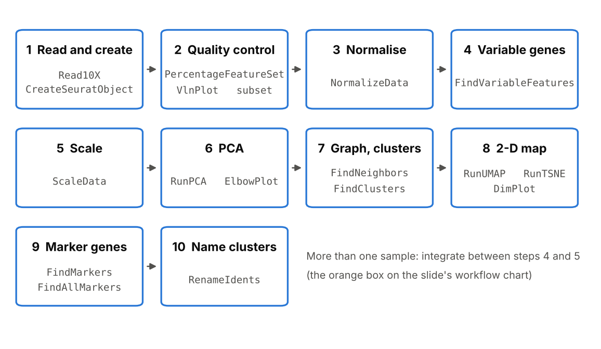
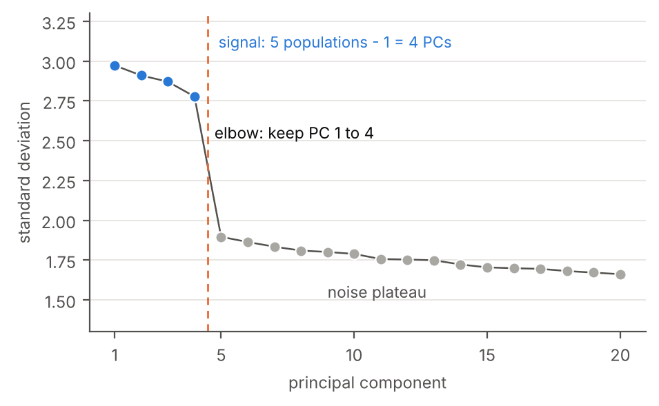
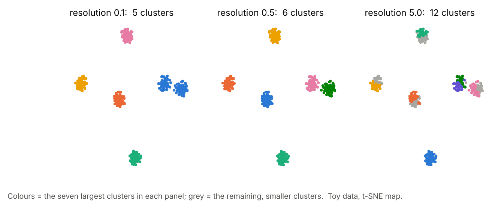
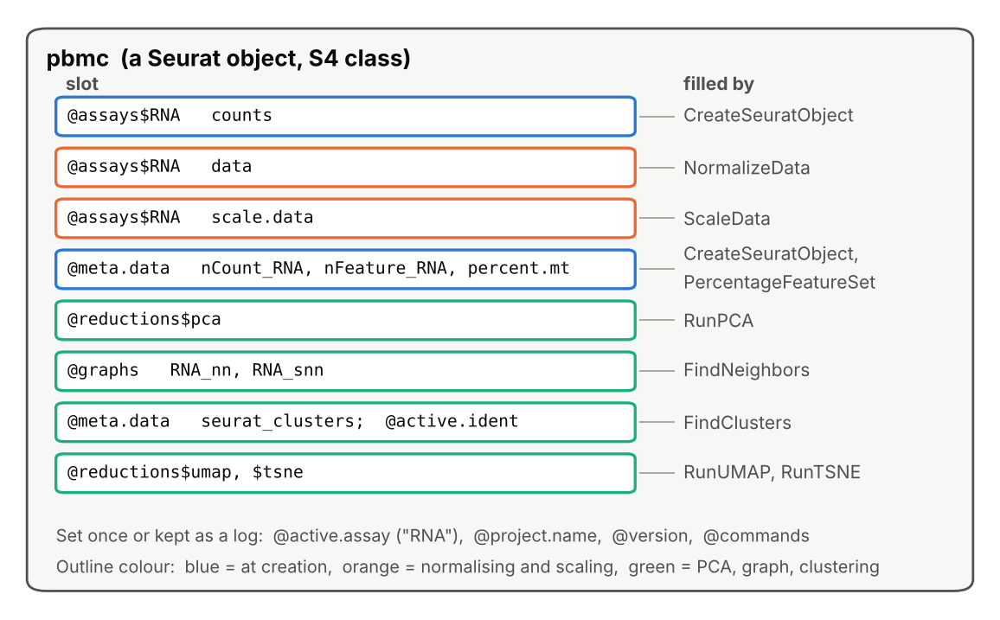

# Single Cell Data Exploration with Seurat

> Module 4: the standard Seurat workflow from a count matrix to named clusters. Installing Seurat, getting and reading data, quality control, normalisation, variable genes, scaling, PCA, graph-based clustering, UMAP and t-SNE, marker genes, naming clusters, the anatomy of a Seurat object, and everyday commands for saving, subsetting and merging.

---

## Table of Contents

1. [Where Seurat Fits](#1-where-seurat-fits)
2. [Installing Seurat](#2-installing-seurat)
3. [The Standard Workflow at a Glance](#3-the-standard-workflow-at-a-glance)
4. [Getting Data](#4-getting-data)
5. [Expression Matrix Formats](#5-expression-matrix-formats)
6. [Step 1: Create the Object and Do Quality Control](#6-step-1-create-the-object-and-do-quality-control)
7. [Step 2: Normalisation](#7-step-2-normalisation)
8. [Step 3: Highly Variable Genes](#8-step-3-highly-variable-genes)
9. [Step 4: Scaling and Unwanted Variation](#9-step-4-scaling-and-unwanted-variation)
10. [Step 5: PCA and Choosing the Number of PCs](#10-step-5-pca-and-choosing-the-number-of-pcs)
11. [Step 6: Graph, Clusters, UMAP and t-SNE](#11-step-6-graph-clusters-umap-and-t-sne)
12. [Step 7: Marker Genes](#12-step-7-marker-genes)
13. [Step 8: Looking at Genes](#13-step-8-looking-at-genes)
14. [Step 9: Naming Clusters](#14-step-9-naming-clusters)
15. [The Seurat Object in Detail](#15-the-seurat-object-in-detail)
16. [Saving and Exporting Results](#16-saving-and-exporting-results)
17. [Identities, Subsets and Resolution](#17-identities-subsets-and-resolution)
18. [Merging Samples](#18-merging-samples)
19. [Command Cheat Sheet and Plot Types](#19-command-cheat-sheet-and-plot-types)
20. [Further Resources and the After-Class Assignment](#20-further-resources-and-the-after-class-assignment)
21. [Key Takeaways](#21-key-takeaways)
22. [What's Next](#22-whats-next)

---

## How to read this module

Module 2 produced a filtered count matrix; Module 3 taught the R needed to read code. This module puts them together: the matrix goes into **Seurat**, the R package that most single-cell analyses use, and comes out as clusters that can be named. The notes follow the lecture's four parts (introduction and installation, the basic analysis process, data processing, and data visualisation) and add the reasoning that the slides leave out.

**Sources and honesty about them.** The lecture slides are image captures of a video, so some text is cut by the player controls. A text version of the narration is also available, and it was produced by speech recognition: it writes "Seurat" as "SRA", "Sarra" or "Surra", "Satija" as "SATA", "multtest" as "multest", "CITE-seq" as "sightseek", "Louvain or Leiden" as "Lou vein or lighten", and so on. I corrected those names silently. Where the narration and a slide disagree, I say so.

**R is not installed on the machine used to check this module, so no R code here was run.** R code appears in `r` blocks and is copied or reconstructed from the slides; it is **untested**. Where I added code that is not on a slide (for example the cell-cycle scoring call), the text says "not on the slides". The Python code blocks **were run** and their outputs are real, but they check the *logic* of a step (what normalisation computes, how a graph is cut into clusters, what `prop.table` returns) on small invented data, not Seurat itself. Real Seurat output on PBMC 3k needs the PBMC 3k data, which I do not have here. The slides show **Seurat v4 syntax** (the course installs v4.4.0), and I follow it.

---

## 1. Where Seurat Fits

**Seurat** is an R package for exploring single-cell RNA-seq data. It is developed by the **Satija Lab**, and the lecture starts with its history because each version added something that you will meet in the field.

| Version | Year | What it added (from the narration) |
|---|---|---|
| V1 | 2015 | The first release: basic single-cell transcriptomics (the slide cites Satija and others, *Spatial reconstruction of single-cell gene expression data*, Nature Biotechnology 33, 495-502) |
| V2 | 2017 | Better clustering and visualisation; the groundwork for integrating data sets (cited on the slide: Butler and others, Nature Biotechnology 36, 411-420) |
| V3 | 2019 | The **anchor-based integration** framework, for combining data across technologies, conditions or batches; described as the standard way of correcting batch effects (Stuart and others, Cell, 2019) |
| V4 | 2021 | **Multimodal** analysis: for example RNA and protein measured together (CITE-seq), and **weighted nearest neighbour (WNN)** analysis, which combines modalities in a balanced way (Hao and others, Cell 184(13), 3573-3587) |
| V5 | 2023 | More scalability, more multimodal integration, and compatibility with spatial data |

The slide also lists the sub-versions from 1.1 (2015) to 4.1.1 (2022). The point of the history: Seurat grew from a visualisation tool into an ecosystem. This module teaches the **standard workflow**, which is the same in every version: it is what you do before any integration, multimodal or spatial analysis.

---

## 2. Installing Seurat

The slide offers three routes and a fix for a missing dependency. All commands below are copied from the slides and **were not run** (there is no R here, and no network).

```r
# 1. Latest version (v5) from CRAN
install.packages("Seurat")
library(Seurat)

# 2. A previous version. Seurat v4 is "our version" in this course
install.packages("remotes")
remotes::install_version("SeuratObject", "4.1.4",
    repos = c("https://satijalab.r-universe.dev", getOption("repos")))
remotes::install_version("Seurat", "4.4.0",
    repos = c("https://satijalab.r-universe.dev", getOption("repos")))
library(Seurat)
#    Seurat v3:
remotes::install_version("Seurat", version = "3.X.X")      # put the exact version number in place of 3.X.X

# 3. The development version, straight from GitHub
install.packages("remotes")
remotes::install_github(repo = "satijalab/seurat", ref = "develop")
library(Seurat)

# A dependency that is NOT on CRAN: multtest, from Bioconductor
if (!require("BiocManager", quietly = TRUE))
    install.packages("BiocManager")
BiocManager::install("multtest")
install.packages("Seurat")
library(Seurat)
```

Points to notice:

- **Why v4 is still used.** The narration says v4 is "extremely popular for its stability and integration tools". The slide installs `SeuratObject` first, because `Seurat` depends on it, and pins the versions (4.1.4 and 4.4.0) so that everyone in the class gets the same behaviour.
- **`remotes::install_version(package, version)`** installs one exact version from an archive. The `repos = c(..., getOption("repos"))` part adds the Satija Lab's package server to the usual list.
- **multtest** implements **multiple-hypothesis-testing** procedures, which matter when you test thousands of genes at once (section 12). The narration says that V2 and V3 used it for differential expression, that V4 and V5 rely on it less, and that installing it avoids "missing function" errors anyway. It comes from **Bioconductor**, not CRAN, which is why the slide shows `BiocManager` (section 3 of Module 3).
- **Copying from slides.** On the slides, some quotation marks are curly (typographic). R needs straight quotes `"`. If you paste from a slide and see an "unexpected input" error, replace the quotes (not on the slides).
- The slide links to the official installation page: `https://satijalab.org/seurat/articles/install.html`.

---

## 3. The Standard Workflow at a Glance



The narration stresses that **the core steps stay the same for any data set**: PBMCs, tumours, or spatial data. In words:

1. **Read** the raw data, usually a gene-by-cell matrix, and **create a Seurat object**, a container for every later result.
2. **Quality control (QC)**: remove cells with too few genes, too many genes, or a high mitochondrial share (which often signals stress or cell death).
3. **Normalise**, so that differences in sequencing depth do not bias the comparison.
4. Find the **highly variable genes**, the ones that carry the differences between cells.
5. **Scale** the data (and, if needed, regress out nuisance variables).
6. **PCA**, to compress thousands of genes into a few dimensions.
7. Build a **graph** of similar cells and cut it into **clusters**.
8. Draw a **2-D map** (UMAP or t-SNE) to look at the result.
9. Find the **marker genes** of each cluster.
10. **Name** the clusters from those markers.

The slide pairs each step with one line of code. The lecture also uses a workshop analogy (slide "Seurat workflow"): `CreateSeuratObject()` places raw data in a **container**; the **converters** (`PercentageFeatureSet()`, `NormalizeData()`, `FindVariableFeatures()`, `ScaleData()`) each fill in another part of that container; and the **inspectors** (`VlnPlot()`, `FeatureScatter()`, `VariableFeaturePlot()`, and reading `pbmc[["RNA"]]@data` or `@scale.data`) let you look at what each converter added. Keep this picture in mind: **every step adds something to the same object** (section 15 shows exactly what and where).

---

## 4. Getting Data

You can start from your own data or from public data. The lecture lists three public routes.

**Method 1: the SeuratData package.** SeuratData distributes data sets **as installable R packages** (the slide's diagram: datasets, objects, package). Its home is `https://github.com/satijalab/seurat-data` (you saw `devtools::install_github('satijalab/seurat-data')` in Module 3). Each data set comes with its species, tissue, cell count and technology:

| Data set | Summary | Species | System | Cells | Technology |
|---|---|---|---|---|---|
| cbmc | scRNA-seq and 13-antibody sequencing of cord blood cells | human | CBMC (cord blood) | 8,617 | CITE-seq |
| hcabm40k | 40,000 cells from the Human Cell Atlas bone marrow data | human | bone marrow | 40,000 | 10x v2 |
| ifnb | IFNB-stimulated and control PBMCs | human | PBMC | 13,999 | 10x v1 |
| panc8 | Eight pancreas data sets across five technologies | human | pancreatic islets | 14,892 | SMART-Seq2, Fluidigm C1, CEL-Seq, CEL-Seq2, inDrops |
| **pbmc3k** | 3k PBMCs from 10X Genomics | human | PBMC | 2,700 | 10x v1 |
| pbmcsca | Broad Institute PBMC systematic comparative analysis | human | PBMC | 31,021 | 10x v2, 10x v3, SMART-Seq2, Seq-Well, inDrops, Drop-seq, CEL-Seq2 |
| ssHippo | Slide-seq v2 data set of mouse hippocampus | mouse | hippocampus | not given | Slide-seq v2 |
| stxBrain | 10x Genomics Visium mouse brain data set | mouse | brain | 12,167 | Visium |

The slide highlights **pbmc3k** in red: it is the data set used throughout this module. The install-and-load commands are on the Seurat website, not on this slide (typically `InstallData("pbmc3k")` followed by loading it; not on the slides, untested).

**Method 2: raw data from a tutorial or a company site.** The slide gives the Seurat PBMC tutorial, `https://satijalab.org/seurat/articles/pbmc3k_tutorial.html` (it describes 2,700 single cells sequenced on an Illumina NextSeq 500), and the 10x Genomics data-set page, `https://support.10xgenomics.com/single-cell-gene-expression/datasets`.

**Method 3: the GEO database.** GEO (Gene Expression Omnibus, at NCBI) is the public repository where papers deposit expression data. The slide's example is **GSE125449**, a liver-cancer study (*Tumor Cell Biodiversity Drives Microenvironmental Reprogramming in Liver Cancer*). Its page lists supplementary files for two sets, Set 1 and Set 2, and each set has four files: `barcodes.tsv.gz`, `genes.tsv.gz`, `matrix.mtx.gz` and `samples.txt.gz`. You search GEO by accession number at `https://www.ncbi.nlm.nih.gov/geo/query/acc.cgi`. The raw sequence reads are in SRA; the processed matrices are on the series record.

To download, use the Linux skills from Module 1. The slide shows both ways (not run here: no network):

```bash
# one file: -c continues a download that was interrupted
wget -c ftp://ftp.ncbi.nlm.nih.gov/geo/series/GSE125nnn/GSE125449/suppl/GSE125449_Set1_barcodes.tsv.gz

# all eight files: copy the eight addresses into a text file, turn each into a wget line,
# save the file as a shell script, and run it in the background so that it survives logout
nohup sh GSE125449_download.sh &
```

The slide's last screenshot lists the downloaded files with `ll -h`, a total of about 4.9 MB.

---

## 5. Expression Matrix Formats

The narration says: "understanding the structure of your expression matrix is key". There are two formats.

### Format 1: three files (the 10x and CeleScope format)

This is exactly what the CeleScope pipeline of Module 2 writes in its `05.count` folder: a `*_filtered_feature_bc_matrix` folder (and a raw one) holding three files. The slide shows the folder tree and the start of each file:

```
$ head -n 5 barcodes.tsv                 <- cell names (these become the COLUMN names)
AAACATACAACCAC-1
AAACATTGAGCTAC-1
AAACATTGATCAGC-1
AAACCGTGCTTCCG-1
AAACCGTGTATGCG-1

$ head -n 5 genes.tsv                    <- gene names (these become the ROW names)
ENSG00000243485   MIR1302-10
ENSG00000237613   FAM138A
ENSG00000186092   OR4F5
ENSG00000238009   RP11-34P13.7
ENSG00000239945   RP11-34P13.8

$ head -n 8 matrix.mtx                   <- the expression values, in triplet form
%%MatrixMarket matrix coordinate real general
%
32738 2700 2286884
32709 1 4
32707 1 1
32706 1 10
32704 1 1
32703 1 5
```

How to read `matrix.mtx` (the slide's three-line legend): after the header, the **first line** gives the matrix size and the number of stored values: here **32,738 rows (genes), 2,700 columns (cells), 2,286,884 non-zero entries**. Every later line is a triple: **the first number is a row number in `genes.tsv`, the second is a row number in `barcodes.tsv`, the third is the expression quantity (the UMI count)**. So `32709 1 4` means "gene number 32,709 has 4 UMIs in cell number 1". Only non-zero values are written, which is what makes this a **sparse** format. The Python check below does the arithmetic on the header and shows why sparse matters.

```python
# ---- the slide's matrix.mtx header and first entries  ("32738 2700 2286884" then "32709 1 4" ...)
n_genes, n_cells, n_nonzero = 32738, 2700, 2286884
entries = ["32709 1 4", "32707 1 1", "32706 1 10", "32704 1 1", "32703 1 5"]
print("how to read each triple (gene row in genes.tsv, cell column in barcodes.tsv, UMI count):")
for e in entries:
    g, c, v = map(int, e.split())
    print(f"  line '{e}': gene number {g}, cell number {c}, count {v}")

cells_total = n_genes * n_cells
print(f"\ndense matrix: {n_genes} x {n_cells} = {cells_total:,} cells in the table")
print(f"non-zero entries: {n_nonzero:,}  ->  {100 * n_nonzero / cells_total:.2f}% non-zero, {100 - 100 * n_nonzero / cells_total:.2f}% zeros")
print(f"average non-zero genes per cell: {n_nonzero / n_cells:.0f}  (compare the QC window 200 < nFeature_RNA < 2500)")
dense_mb = cells_total * 8 / 1e6                           # 8 bytes per double-precision number
sparse_mb = n_nonzero * (8 + 4) / 1e6                      # per non-zero: an 8-byte value and a 4-byte row index (column pointers are tiny)
print(f"dense storage as 8-byte numbers: about {dense_mb:,.0f} MB | sparse (value + row index): about {sparse_mb:,.0f} MB | ratio {dense_mb / sparse_mb:.0f}x")

# ---- genes kept after CreateSeuratObject(min.cells = 3), from the variable-feature plot on slide 20
variable, non_variable = 2000, 11714
print(f"\ngenes in the object after min.cells = 3: {variable} variable + {non_variable} non-variable = {variable + non_variable:,}"
      f" (of {n_genes:,} in the raw matrix). If those two numbers cover every gene in the object,"
      f" the min.cells filter removed {n_genes - variable - non_variable:,} genes")

# Output:
# how to read each triple (gene row in genes.tsv, cell column in barcodes.tsv, UMI count):
#   line '32709 1 4': gene number 32709, cell number 1, count 4
#   line '32707 1 1': gene number 32707, cell number 1, count 1
#   line '32706 1 10': gene number 32706, cell number 1, count 10
#   line '32704 1 1': gene number 32704, cell number 1, count 1
#   line '32703 1 5': gene number 32703, cell number 1, count 5
# 
# dense matrix: 32738 x 2700 = 88,392,600 cells in the table
# non-zero entries: 2,286,884  ->  2.59% non-zero, 97.41% zeros
# average non-zero genes per cell: 847  (compare the QC window 200 < nFeature_RNA < 2500)
# dense storage as 8-byte numbers: about 707 MB | sparse (value + row index): about 27 MB |
#   ratio 26x
# 
# genes in the object after min.cells = 3: 2000 variable + 11714 non-variable = 13,714 (of
#   32,738 in the raw matrix). If those two numbers cover every gene in the object, the
#   min.cells filter removed 19,024 genes
```

Reading the result: only **2.59%** of the table is non-zero; an average cell has about **847 genes detected** (which sits comfortably inside the QC window of section 6), and the sparse form is about **26 times smaller** than a dense table. The storage figures are my own estimate (8-byte numbers; Seurat's real storage differs slightly). The last line uses a number from slide 20 (11,714 non-variable plus 2,000 variable genes) to infer how many genes the `min.cells = 3` filter dropped; that inference assumes the plot counts every gene in the object.

### Format 2: one big text table

The slide shows `less -S matrix.txt.gz` (view a compressed file without wrapping lines) and a table whose **columns are cell names** (like `"AAACCTGCAACTGCTA.5"`) and whose **rows are gene names** (like `"MIR1302-10"`), full of zeros. This is a **dense** matrix saved as text.

A discrepancy to be aware of: the narration calls Format 2 a "triplet format" with gene, cell and value, but the slide shows a full table. A triplet list is what `matrix.mtx` is (Format 1). The narration's other remark is true of the table on the slide: a matrix saved this way "will be a very big file", because every zero is written out. Format 1 is the compact one.

Which reader to use (not on the slides, untested): `Read10X()` expects the three-file format. A dense text table is read with an ordinary table reader (for example `read.table()`), and the result is given to `CreateSeuratObject(counts = ...)`.

### Converting between tools

The slide "Single cell transcriptome data type conversion" is a map of arrows between Seurat and its neighbours: **Bioconductor's SingleCellExperiment** (`as.SingleCellExperiment`, `as.Seurat`), the **loom** file format (packages `LoomExperiments` and `loomR`), and **scanpy's AnnData** (`.h5ad` files, `ReadH5AD`). The narration adds that if you analyse in Python with scanpy you end up with an `.h5ad` object instead, and you can switch with conversion functions. Which package gives the best-supported conversion has changed between versions, so check the current documentation before relying on one (my note, not on the slides).

---

## 6. Step 1: Create the Object and Do Quality Control

### Install and load the packages

The slide installs `remotes`, the two pinned Seurat packages (section 2), then `tidyverse`, `ggplot2` and `reshape2`, and loads `Seurat`, `ggplot2`, `reshape2`, `dplyr`, `grid` and `tidyverse`. (You only install "if you haven't already"; you load in every session. See Module 3.)

### Read the matrix and create the object

```r
# Load the PBMC data set: the folder that holds barcodes.tsv, genes.tsv, matrix.mtx
pbmc.data <- Read10X(data.dir = "/Path/to/folder/filtered_gene_bc_matrices/hg19")

# Initialise the Seurat object with the raw (non-normalised) counts
pbmc <- CreateSeuratObject(counts = pbmc.data, project = "pbmc3k",
                           min.cells = 3, min.features = 200)
pbmc <- RenameCells(pbmc, add.cell.id = "pbmc3k")
```

- `Read10X(data.dir = ...)` reads the three files of Format 1 and returns a sparse matrix (genes in rows, cells in columns).
- `CreateSeuratObject(counts = ...)` builds the container. `project` is a name for the data set. **`min.cells = 3`** keeps only genes detected in at least 3 cells, and **`min.features = 200`** keeps only cells with at least 200 detected genes (the meaning of these two arguments is general Seurat knowledge, not stated on the slide). The narration adds that you may set them here or leave them to the QC step.
- `RenameCells(add.cell.id = "pbmc3k")` puts the sample name in front of every barcode, joined with an underscore. It is harmless for one sample and **essential when merging** (section 18).

### Mitochondrial and ribosomal content

Damaged or dying cells leak cytoplasmic RNA and lose it from the cell, while mitochondrial transcripts, which are protected inside the mitochondria, stay behind. A cell with a high **percentage of mitochondrial reads** is therefore likely to be stressed or dying (the narration: "often indicates stress or apoptosis"). `PercentageFeatureSet()` computes that percentage for any set of genes chosen by a name **pattern**:

```r
# human mitochondrial genes start with "MT-", mouse ones with "mt-"
pbmc[["percent.mt"]] <- PercentageFeatureSet(pbmc, pattern = "^MT-|^mt-")

# the slide's "Think" question: how do you get the ribosomal share?
pbmc[["percent.rb"]] <- PercentageFeatureSet(pbmc, pattern = "^RPL|^RPS|^MRPL|^MRPS")
```

`pbmc[["percent.mt"]] <- ...` creates a new column in the cell table (`meta.data`, section 15). The pattern uses a **regular expression**: `^` means "at the start of the name", and `|` means "or". The slide has an earlier line, commented out, that uses only `"^MT-"`; the live line adds `"^mt-"` so that the same code works for human and mouse. The Python check below applies the same patterns to a toy gene list, and then applies the QC filter of the next paragraph to eight toy cells.

```python
import re
import pandas as pd

# ---- percentage of reads from a gene set:  PercentageFeatureSet(pbmc, pattern = "^MT-|^mt-")
genes  = ["MT-ND1", "MT-CO1", "MT-ATP6", "mt-Nd1", "MTOR", "MT1X", "RPL13", "RPS6", "RPLP0",
          "MRPL12", "MRPS5", "RPS6KA1", "ACTB", "GAPDH", "CD3D", "LYZ"]
counts = [  30,       40,       10,        5,        2,      3,      60,      50,      40,
            10,       10,       4,         120,      100,     20,     26]     # one toy cell, 530 counts in total
cell = pd.Series(counts, index=genes)
total = cell.sum()

def pct(pattern):
    hit = [g for g in genes if re.search(pattern, g)]
    return hit, 100 * cell[hit].sum() / total

for label, pattern in [("percent.mt  '^MT-'      ", r"^MT-"),
                       ("percent.mt  '^MT-|^mt-' ", r"^MT-|^mt-"),
                       ("looser      '^MT'       ", r"^MT"),
                       ("percent.rb  '^RPL|^RPS|^MRPL|^MRPS'", r"^RPL|^RPS|^MRPL|^MRPS")]:
    hit, p = pct(pattern)
    print(f"{label}: {p:5.2f}%   genes matched: {', '.join(hit)}")

# ---- the QC filter:  subset(pbmc, subset = nFeature_RNA > 200 & nFeature_RNA < 2500 & percent.mt < 5)
qc = pd.DataFrame({"nFeature_RNA": [779, 1352, 150, 3100, 960, 521, 2300, 1129],
                   "nCount_RNA":   [2419, 4903, 260, 15000, 2639, 980, 7000, 3147],
                   "percent.mt":   [3.0, 3.8, 1.2, 2.0, 1.7, 7.5, 4.9, 0.9]},
                  index=[f"cell{i}" for i in range(1, 9)])
keep = (qc["nFeature_RNA"] > 200) & (qc["nFeature_RNA"] < 2500) & (qc["percent.mt"] < 5)
def reason(r):
    why = []
    if r["nFeature_RNA"] <= 200: why.append("too few genes (empty droplet or debris?)")
    if r["nFeature_RNA"] >= 2500: why.append("too many genes (doublet?)")
    if r["percent.mt"] >= 5: why.append("high mitochondrial % (stressed or dying)")
    return "; ".join(why) if why else "kept"
qc["kept"] = keep
qc["reason"] = qc.apply(reason, axis=1)
print()
print(qc.to_string())
print("cells kept:", int(keep.sum()), "of", len(qc))

# Output:
# percent.mt  '^MT-'      : 15.09%   genes matched: MT-ND1, MT-CO1, MT-ATP6
# percent.mt  '^MT-|^mt-' : 16.04%   genes matched: MT-ND1, MT-CO1, MT-ATP6, mt-Nd1
# looser      '^MT'       : 16.04%   genes matched: MT-ND1, MT-CO1, MT-ATP6, MTOR, MT1X
# percent.rb  '^RPL|^RPS|^MRPL|^MRPS': 32.83%   genes matched: RPL13, RPS6, RPLP0, MRPL12,
#   MRPS5, RPS6KA1
# 
#        nFeature_RNA  nCount_RNA  percent.mt   kept
#   reason
# cell1           779        2419         3.0   True
#   kept
# cell2          1352        4903         3.8   True
#   kept
# cell3           150         260         1.2  False  too few genes (empty droplet or
#   debris?)
# cell4          3100       15000         2.0  False                 too many genes
#   (doublet?)
# cell5           960        2639         1.7   True
#   kept
# cell6           521         980         7.5  False  high mitochondrial % (stressed or
#   dying)
# cell7          2300        7000         4.9   True
#   kept
# cell8          1129        3147         0.9   True
#   kept
# cells kept: 5 of 8
```

Three lessons from the output. First, `^MT-` and `^mt-` are different patterns, and the mouse gene `mt-Nd1` is missed by the human-only pattern (15.09% against 16.04%). Second, the hyphen matters: the looser `^MT` also matches `MTOR` and `MT1X`, which are not mitochondrial-genome genes. Third, the ribosomal pattern is a **shortcut that over-matches**: `RPS6KA1` starts with `RPS` but is a kinase, not a ribosomal protein (my observation, not on the slides). It is good enough for a QC percentage, but not an exact gene list.

### Look at the QC metrics, then filter

```r
VlnPlot(object = pbmc, features = c("nFeature_RNA", "nCount_RNA", "percent.mt"), ncol = 3)
pbmc <- subset(pbmc, subset = nFeature_RNA > 200 & nFeature_RNA < 2500 & percent.mt < 5)
```

The three metrics (narration and slide):

- **`nFeature_RNA`**: the number of different genes detected in a cell.
- **`nCount_RNA`**: the total number of transcripts (UMIs) in a cell.
- **`percent.mt`**: the percentage of transcripts from mitochondrial genes.

A **violin plot** shows the whole distribution: the wide part is where many cells fall, the narrow part is where few do. The slide shades the regions to remove: above 2,500 and below 200 for `nFeature_RNA`, and above 5 for `percent.mt`. Why each cut: too **few** genes suggests an empty droplet or debris; too **many** genes suggests a **doublet** (two cells captured in one droplet; Module 5 returns to doublets); a high mitochondrial share suggests a damaged cell. The thresholds 200, 2500 and 5 are "common starting points for PBMC data sets"; the narration and the slide (a box plot of mitochondrial percentage across human tissues) both warn that **the cut-offs must fit the tissue**, because some tissues, such as heart, naturally have a much higher mitochondrial share.

---

## 7. Step 2: Normalisation

```r
pbmc <- NormalizeData(object = pbmc, normalization.method = "LogNormalize", scale.factor = 10000)
```

**Why normalise?** The slide's answer: "to eliminate the effects of technological differences", for example that some cells' cDNA is amplified more than others. A cell that was sequenced twice as deeply has about twice the counts for every gene, which says nothing about biology.

**What `LogNormalize` does** (the slide quotes the documentation): for each cell, divide the count of each gene by the cell's total counts, multiply by `scale.factor`, then take the natural log with `log1p` (that is, `log(1 + x)`, which keeps zeros at zero). The slide also names two other methods: **CLR** (a centred log-ratio transformation) and **RC** (relative counts: the same division and multiplication, with no log; set `scale.factor = 1e6` for counts per million). The narration's reason for 10,000: it "brings normalised counts to a scale similar to raw UMI counts", stabilises variance, and works well with the log transformation.

The Python code below applies the formula to four toy cells, in which `cell2` is the same cell as `cell1` sequenced twice as deeply.

```python
import numpy as np
import pandas as pd

# R: pbmc <- NormalizeData(pbmc, normalization.method = "LogNormalize", scale.factor = 10000)
genes = ["CD3D", "MS4A1", "LYZ", "GAPDH", "ACTB", "NKG7"]
counts = pd.DataFrame(
    {"cell1": [4, 0, 0, 20, 30, 6],      # a T cell, sequenced at depth 60
     "cell2": [8, 0, 0, 40, 60, 12],     # the SAME cell type, sequenced twice as deeply (depth 120)
     "cell3": [0, 6, 0, 15, 25, 0],      # a B cell
     "cell4": [0, 0, 30, 10, 20, 0]},    # a monocyte
    index=genes)

def log_normalize(m, scale_factor=10_000):
    # divide each gene by the cell's total counts, multiply by the scale factor, then log1p
    return np.log1p(m / m.sum(axis=0) * scale_factor)

norm = log_normalize(counts)
print("total counts per cell (library size):", counts.sum(axis=0).to_dict())
print("\nraw counts:")
print(counts.to_string())
print("\nLogNormalize, scale.factor = 10000:")
print(norm.round(3).to_string())

# hand check of one entry: CD3D in cell1 = log(1 + 4/60 * 10000)
by_hand = np.log(1 + 4 / 60 * 10_000)
print("\nhand check, CD3D in cell1:", round(by_hand, 4), "| table value:", round(norm.loc["CD3D", "cell1"], 4))
print("cell1 and cell2 identical after normalisation (depth difference removed):",
      bool(np.allclose(norm["cell1"], norm["cell2"])))
print("raw counts of cell1 and cell2 identical:", bool(np.allclose(counts["cell1"], counts["cell2"])))

# Output:
# total counts per cell (library size): {'cell1': 60, 'cell2': 120, 'cell3': 46, 'cell4':
#   60}
# 
# raw counts:
#        cell1  cell2  cell3  cell4
# CD3D       4      8      0      0
# MS4A1      0      0      6      0
# LYZ        0      0      0     30
# GAPDH     20     40     15     10
# ACTB      30     60     25     20
# NKG7       6     12      0      0
# 
# LogNormalize, scale.factor = 10000:
#        cell1  cell2  cell3  cell4
# CD3D   6.504  6.504  0.000  0.000
# MS4A1  0.000  0.000  7.174  0.000
# LYZ    0.000  0.000  0.000  8.517
# GAPDH  8.112  8.112  8.090  7.419
# ACTB   8.517  8.517  8.601  8.112
# NKG7   6.909  6.909  0.000  0.000
# 
# hand check, CD3D in cell1: 6.5038 | table value: 6.5038
# cell1 and cell2 identical after normalisation (depth difference removed): True
# raw counts of cell1 and cell2 identical: False
```

How to read it: the raw counts of `cell1` and `cell2` differ by a factor of 2 everywhere, but after normalisation the two columns are **identical**, and the hand check of one entry matches the table. Notice the second effect of the log: the gap between a gene with 4 counts and one with 30 counts becomes small, which stops a few very highly expressed genes from dominating. Normalised values go into the `data` slot of the object; the raw counts stay untouched in `counts` (section 15).

---

## 8. Step 3: Highly Variable Genes

```r
pbmc <- FindVariableFeatures(object = pbmc, selection.method = "vst", nfeatures = 2000)
top10 <- VariableFeatures(pbmc)[1:10]
plot1 <- VariableFeaturePlot(pbmc)
plot2 <- LabelPoints(plot = plot1, points = top10, repel = TRUE)
plot1 + plot2
```

Most of the 13,000 or so genes in a PBMC data set are not informative about cell type: housekeeping genes are about the same everywhere, and many genes are barely detected. The genes that **vary a lot between cells** are the ones that separate cell types, so the later steps (PCA and clustering) use only the **top 2,000** (`nfeatures = 2000`, "mostly a default setting", the narration says, to be adjusted for your sample type). `selection.method = "vst"` is the variance-stabilising method: it fits the relationship between a gene's mean and variance and ranks genes by how much variance they have *beyond* what their average level predicts (the description of "vst" is my knowledge, not on the slide).

On the slide's **variable-feature plot**, the x-axis is a gene's average expression and the y-axis is its standardised variance; the 2,000 **variable** genes are red and the **11,714** others are black (the legend gives both counts, which add to 13,714 genes in the object). The ten labelled genes, as I read them on the slide, are PPBP, S100A9, IGLL5, LYZ, GNLY, FTL, PF4, FTH1, GNG11 and S100A8. These are what you expect in blood: platelet genes (PPBP, PF4, GNG11), monocyte genes (S100A8, S100A9, LYZ, FTL, FTH1), a B-cell gene (IGLL5) and an NK/cytotoxic gene (GNLY), which are strongly "on" in a small subset of cells (general knowledge, not on the slides). `LabelPoints(..., repel = TRUE)` writes the names without overlapping, and `plot1 + plot2` puts the two plots side by side.

---

## 9. Step 4: Scaling and Unwanted Variation

```r
all.gene <- rownames(pbmc)
pbmc <- ScaleData(pbmc, features = all.gene)
```

**What scaling does.** The slide's definition: make the **mean expression of each gene in all cells 0 and the variance 1**. That gives **each gene equal weight** in the next step, so that highly expressed genes are less prominent. Without it, PCA would be dominated by whichever genes have the biggest numbers. The Python code below shows this with three toy genes, and also shows the two other ideas of this section: regressing out a nuisance variable, and a clipping limit.

```python
import numpy as np

rng = np.random.default_rng(42)
n = 300
pct_mt = rng.uniform(0.5, 6.0, n)                       # a nuisance variable (percent.mt) for each cell

# ---- (1) why scaling gives every gene an equal say
high = rng.normal(100, 20, n)                           # a highly expressed gene, large spread
mid  = rng.normal(5, 1.5, n)
low  = rng.normal(0.5, 0.2, n)
X = np.column_stack([high, mid, low])
names = ["high", "mid", "low"]
var = X.var(axis=0, ddof=1)
print("variance share BEFORE scaling:", {k: f"{100 * v / var.sum():.1f}%" for k, v in zip(names, var)})
Z = (X - X.mean(axis=0)) / X.std(axis=0, ddof=1)        # ScaleData: mean 0, variance 1 for every gene
print("column means after scaling:", Z.mean(axis=0).round(12).tolist())
print("column variances after scaling:", Z.var(axis=0, ddof=1).round(6).tolist())
varZ = Z.var(axis=0, ddof=1)
print("variance share AFTER scaling:", {k: f"{100 * v / varZ.sum():.1f}%" for k, v in zip(names, varZ)})

# ---- (2) regressing out an unwanted variable: ScaleData(pbmc, vars.to.regress = "percent.mt")
gene = 10 + 2.0 * pct_mt + rng.normal(0, 0.5, n)        # a gene whose level mostly follows percent.mt
r_before = np.corrcoef(gene, pct_mt)[0, 1]
A = np.column_stack([np.ones(n), pct_mt])
coef, *_ = np.linalg.lstsq(A, gene, rcond=None)         # fit gene ~ percent.mt by least squares
resid = gene - A @ coef                                 # what is left after the fitted part is removed
r_after = np.corrcoef(resid, pct_mt)[0, 1]
print(f"\ncorrelation of the gene with percent.mt: before {r_before:.3f}, after regression {r_after:.2e}")
print(f"fitted slope {coef[1]:.3f} (true value used to build the data: 2.0)")

# ---- (3) clipping: a rare, extreme value cannot dominate
x = np.zeros(300); x[0] = 50.0
z = (x - x.mean()) / x.std(ddof=1)
print(f"\nrare gene seen in one cell: z-score of that cell {z[0]:.2f}; after clipping at 10: {min(z[0], 10):.2f}")

# Output:
# variance share BEFORE scaling: {'high': '99.4%', 'mid': '0.6%', 'low': '0.0%'}
# column means after scaling: [0.0, -0.0, -0.0]
# column variances after scaling: [1.0, 1.0, 1.0]
# variance share AFTER scaling: {'high': '33.3%', 'mid': '33.3%', 'low': '33.3%'}
# 
# correlation of the gene with percent.mt: before 0.986, after regression -1.36e-15
# fitted slope 2.012 (true value used to build the data: 2.0)
# 
# rare gene seen in one cell: z-score of that cell 17.26; after clipping at 10: 10.00
```

How to read it: before scaling, one gene carries 99.4% of the variance and the other two almost none, so PCA would effectively see only one gene; after scaling each gene carries exactly one third. Means are 0 and variances are 1, as the slide says (R's `sd()` divides by n - 1, which the code copies). The clipping at 10 is a Seurat default (`scale.max`) that I know from the documentation, not from the slides.

### Regressing out unwanted variation

The slide's box asks, "How can I remove unwanted sources of variation?" The answer is that `ScaleData()` can **regress out** a variable: it fits each gene against the unwanted variable and keeps the **residuals**, which are what is left after the fitted part has been removed. The slide's examples are **cell cycle stage** and **mitochondrial contamination**:

```r
pbmc <- ScaleData(pbmc, features = all.gene, vars.to.regress = "percent.mt")
```

In the Python check, the toy gene correlates 0.986 with `percent.mt`, and after the regression the correlation is zero (to rounding), while the fitted slope 2.01 recovers the 2.0 used to build the data. (That `ScaleData` uses a linear model for this is my knowledge, not on the slide.)

### The cell-cycle effect

Cells in S or G2/M phase express many proliferation genes, and that can split one cell type into several clusters by phase instead of by identity. The narration describes a three-part routine:

1. **Score** each cell with `CellCycleScoring()`, which adds an **S score**, a **G2M score** and a **phase** (S, G2M or G1) from known marker genes. The scoring call is not on the slide; the usual form is `CellCycleScoring(pbmc, s.features = s.genes, g2m.features = g2m.genes)` with the gene lists that ship with Seurat (not on the slides, untested).
2. **Diagnose**: run PCA on the cell-cycle genes and colour by phase. If S, G2M and G1 cells separate in PC space, the cell cycle could bias clustering.
3. **Regress out if needed** (the slide's code, which carries on past the visible part):

```r
# remove the effects of the cell cycle
pbmc1 <- ScaleData(pbmc1, vars.to.regress = c("S.Score", "G2M.Score"), features = rownames(pbmc1))
pbmc1 <- RunPCA(pbmc1, features = c(s.genes, g2m.genes))
DimPlot(pbmc1)        # the slide's code is cut off after "DimPlot(" - the rest is my completion
```

The slide shows two PC plots: before, the G1, G2M and S cells form separate regions; after, they overlap in one cloud. The slide states plainly that this picture is "an example, not the result of PBMC3k". The narration's advice: in some data sets, **especially PBMCs**, the cell cycle is not biologically meaningful for the question and can distort clustering by splitting cells by phase instead of by cell type, so regressing it out helps cell type, not cell cycle, drive the clusters. Note that the slide's main PBMC workflow (the `ScaleData` call at the top of this section) does **not** regress it; the cell-cycle step is a diagnostic you run when the PCA suggests a problem (the narration: "this step is usually diagnostic").

---

## 10. Step 5: PCA and Choosing the Number of PCs

```r
pbmc <- RunPCA(pbmc, features = VariableFeatures(object = pbmc))
ElbowPlot(pbmc)
```

Each cell is described by 2,000 numbers (the variable genes), which is too many to cluster directly and mostly noise. **PCA** finds new axes, the **principal components (PCs)**, ordered by how much variation they capture, so that the first few PCs hold the real structure and the rest hold noise. `RunPCA` computes them (50 by default; section 15's slide shows a 2,700 by 50 table of cell coordinates).

**How many PCs to keep?** `ElbowPlot()` plots the **standard deviation** of each PC. The real PCs fall steeply; the noise PCs form a flat tail; the bend between them is the **elbow**. On the slide's PBMC plot the first PC has a standard deviation of about 7 and the curve flattens at about 1.8; the narration's example is "the elbow is at PC 10", so the later steps use `dims = 1:10`.

The Python code below builds 300 toy cells from five populations (60 each), scales them, runs PCA, and prints the standard deviations that `ElbowPlot` would draw.

```python
import numpy as np

rng = np.random.default_rng(42)
n_groups, per_group, n_genes, n_signal = 5, 60, 300, 20
labels = np.repeat(np.arange(n_groups), per_group)               # the true cell type of each cell
X = rng.normal(0, 1, (n_groups * per_group, n_genes))            # noise in every gene
for g in range(n_groups):                                        # each group switches on its own 20 genes
    X[labels == g, g * n_signal:(g + 1) * n_signal] += 1.5

# ScaleData (z-score each gene), then PCA by singular value decomposition
Z = (X - X.mean(axis=0)) / X.std(axis=0, ddof=1)
U, s, Vt = np.linalg.svd(Z, full_matrices=False)
sdev = s / np.sqrt(Z.shape[0] - 1)                               # standard deviation of each PC (what ElbowPlot shows)
pcs = U * s                                                      # cell coordinates on the PCs

print("standard deviation of the first 12 PCs:")
for i, v in enumerate(sdev[:12], 1):
    print(f"  PC{i:<2d} {v:5.2f} {'#' * int(round(v * 6))}")
drop = sdev[:-1] / sdev[1:]
print("\nratio sdev[k] / sdev[k+1] for k = 1..9:", np.round(drop[:9], 2).tolist())
print("share of variance in the first 4 PCs: %.1f%%, in the first 10: %.1f%%" %
      (100 * (sdev[:4] ** 2).sum() / (sdev ** 2).sum(), 100 * (sdev[:10] ** 2).sum() / (sdev ** 2).sum()))
print("true number of groups:", n_groups, "-> expected informative PCs:", n_groups - 1)

# Output:
# standard deviation of the first 12 PCs:
#   PC1   2.97 ##################
#   PC2   2.91 #################
#   PC3   2.87 #################
#   PC4   2.78 #################
#   PC5   1.90 ###########
#   PC6   1.86 ###########
#   PC7   1.83 ###########
#   PC8   1.81 ###########
#   PC9   1.80 ###########
#   PC10  1.79 ###########
#   PC11  1.76 ###########
#   PC12  1.75 ###########
# 
# ratio sdev[k] / sdev[k+1] for k = 1..9: [1.02, 1.01, 1.03, 1.46, 1.02, 1.02, 1.01, 1.0,
#   1.01]
# share of variance in the first 4 PCs: 11.1%, in the first 10: 17.8%
# true number of groups: 5 -> expected informative PCs: 4
```



How to read it: five populations that differ from each other need **four** informative dimensions (five points are defined by four independent differences), and that is exactly where the curve drops: four values near 2.8 to 3.0, then a fall to 1.9 and a slow decline. The toy elbow is sharper than a real one; real data usually bend more gently, which is why the choice (7, 10, 15, 20) is a judgement call and it is wise to check that conclusions do not change if you try a nearby value (my advice, not on the slides).

---

## 11. Step 6: Graph, Clusters, UMAP and t-SNE

```r
pbmc <- FindNeighbors(pbmc, dims = 1:10)
pbmc <- FindClusters(pbmc, resolution = 0.5)
pbmc <- RunUMAP(pbmc, dims = 1:10)
DimPlot(pbmc, reduction = "umap")
pbmc <- RunTSNE(pbmc, dims = 1:10)
DimPlot(pbmc, reduction = "tsne")
saveRDS(pbmc, file = "pbmc.rds")
```

### From PCs to clusters

The slide's chain is **PCs, distance matrix, KNN graph, SNN graph, clusters**. A bracket assigns the first three links to `FindNeighbors()` and the last to `FindClusters()`.

1. **Distance matrix.** Using the first 10 PCs, compute how far each cell is from every other cell.
2. **KNN graph** (k nearest neighbours). Connect each cell to the cells closest to it.
3. **SNN graph** (shared nearest neighbours). Two cells are strongly connected if they have **many neighbours in common**, which is a more robust measure than the raw distance.
4. **Clusters.** Cut the graph into **communities**: groups of cells with many strong connections inside and few outside. Seurat uses a graph-based method, **Louvain** (or Leiden), which the narration names.

The slide teaches the graph part on a six-cell example (cells A to F): an **adjacency matrix** says only whether two cells are connected (1 or 0), while a **weight matrix** gives the strength of each connection, between 0 (no similarity) and 1 (maximum). The weights are 0.8, 0.8 and 0.6 inside A, B, C; 0.8, 0.8 and 0.6 inside D, E, F; and only 0.1 (B-D) and 0.2 (C-E) between the two triangles. Cutting the weak links leaves the two triangles shown at the bottom of the slide. The first part of the Python check does this with Louvain on the slide's own matrix.

The second part builds a real SNN graph from toy PCs with k = 20 neighbours, as Seurat's graph appears to do (see below), using the **Jaccard** overlap (shared neighbours divided by all neighbours of the two cells), prunes weak edges, and clusters at several resolutions.

```python
import numpy as np
import networkx as nx
from networkx.algorithms.community import louvain_communities
from sklearn.neighbors import NearestNeighbors
from sklearn.metrics import adjusted_rand_score

# ---- (A) the slide's six-cell weight matrix W (cells A..F): weak edges are bridges, strong edges are communities
names = list("ABCDEF")
W = np.array([[0, .8, .8, 0, 0, 0],
              [.8, 0, .6, .1, 0, 0],
              [.8, .6, 0, 0, .2, 0],
              [0, .1, 0, 0, .8, .8],
              [0, 0, .2, .8, 0, .6],
              [0, 0, 0, .8, .6, 0]])
G = nx.from_numpy_array(W)
G = nx.relabel_nodes(G, dict(enumerate(names)))
print("adjacency (1 = connected) row sums:", {n: int((W[i] > 0).sum()) for i, n in enumerate(names)})
comms = louvain_communities(G, weight="weight", seed=1)
print("Louvain communities on the slide's graph:", sorted(sorted(c) for c in comms))

# ---- (B) a toy dataset: KNN graph -> SNN graph -> Louvain at several resolutions
rng = np.random.default_rng(42)
sizes = [60, 60, 60, 60, 120]                            # five populations; the last one is really two close sub-populations
group = np.concatenate([[g] * s_ for g, s_ in enumerate(sizes)])
n = len(group)
X = rng.normal(0, 1, (n, 300))
for g in range(5):                                       # each population switches on its own 20 genes
    X[group == g, g * 20:(g + 1) * 20] += 1.5
idx4 = np.where(group == 4)[0]
half = idx4[len(idx4) // 2:]
X[half, 150:170] += 1.5                                  # sub-population 4b differs from 4a in 20 extra genes
fine = group.copy(); fine[half] = 5                      # the 6-way truth

Z = (X - X.mean(0)) / X.std(0, ddof=1)
U, s, Vt = np.linalg.svd(Z, full_matrices=False)
pcs = (U * s)[:, :10]                                    # dims = 1:10

k = 20
neigh = NearestNeighbors(n_neighbors=k).fit(pcs).kneighbors(pcs, return_distance=False)   # 20 nearest cells (self included)
sets = [set(r) for r in neigh]
snn = np.zeros((n, n))
for i in range(n):
    for j in range(i + 1, n):
        inter = len(sets[i] & sets[j])
        if inter:
            snn[i, j] = snn[j, i] = inter / len(sets[i] | sets[j])   # Jaccard overlap of the two neighbour lists
snn[snn < 1 / 15] = 0                                    # prune weak edges
print(f"\nSNN graph: {n} cells, {int((snn > 0).sum() // 2)} edges after pruning")
H = nx.from_numpy_array(snn)
labels_by_res = {}
for res in (0.1, 0.5, 1.5, 5.0, 8.0):
    cl = louvain_communities(H, weight="weight", resolution=res, seed=1)
    lab = np.zeros(n, dtype=int)
    for c, members in enumerate(cl):
        lab[list(members)] = c
    labels_by_res[res] = lab
    print(f"resolution {res:>3}: {len(cl):2d} clusters | ARI vs 5 populations {adjusted_rand_score(group, lab):.2f}"
          f" | ARI vs 6 populations {adjusted_rand_score(fine, lab):.2f}")

# Output:
# adjacency (1 = connected) row sums: {'A': 2, 'B': 3, 'C': 3, 'D': 3, 'E': 3, 'F': 2}
# Louvain communities on the slide's graph: [['A', 'B', 'C'], ['D', 'E', 'F']]
# 
# SNN graph: 360 cells, 10590 edges after pruning
# resolution 0.1:  5 clusters | ARI vs 5 populations 1.00 | ARI vs 6 populations 0.82
# resolution 0.5:  6 clusters | ARI vs 5 populations 0.82 | ARI vs 6 populations 1.00
# resolution 1.5:  6 clusters | ARI vs 5 populations 0.82 | ARI vs 6 populations 1.00
# resolution 5.0: 12 clusters | ARI vs 5 populations 0.54 | ARI vs 6 populations 0.70
# resolution 8.0: 58 clusters | ARI vs 5 populations 0.14 | ARI vs 6 populations 0.19
```

### Checking the slide's SNN numbers

Slide 35 prints the start of the real `RNA_snn` graph: `1.0000 0.0811 0.0811 0.1111 0.0811 0.1429`. These numbers can be explained exactly. The `RNA_nn` graph above it has 54,000 stored values for 2,700 cells, which is **20 per cell** (k = 20, a cell counted among its own neighbours). If two cells share `s` of their 20 neighbours, their Jaccard similarity is `s / (40 - s)`.

```python
# Slide 35 shows the first values of the RNA_snn graph: 1.0000 0.0811 0.0811 0.1111 0.0811 0.1429 ...
# With k = 20 neighbours per cell (the RNA_nn graph on the slide has 54000 = 2700 x 20 entries), two cells that share
# `inter` neighbours have Jaccard similarity  inter / (20 + 20 - inter).
k = 20
print("shared  Jaccard  kept after pruning (cutoff 1/15 = %.4f)?" % (1 / 15))
for inter in range(1, 9):
    j = inter / (2 * k - inter)
    print(f"  {inter:>2}    {j:.4f}   {'yes' if j >= 1 / 15 else 'no (set to 0)'}")
shown = [0.0811, 0.1111, 0.1429]
cands = {round(i / (2 * k - i), 4): i for i in range(1, k + 1)}
print("\nvalues printed on the slide and the number of shared neighbours that produces them:")
for v in shown:
    print(f"  {v}  <-  {cands.get(v)} shared neighbours")
print("1.0000 is a cell compared with itself (all 20 shared): ", 20 / (2 * k - 20))

# size of the SNN graph on the slide: 198484 stored values for 2700 cells
stored, cells = 198_484, 2700
off_diag = stored - cells                                  # remove the diagonal (each cell with itself)
print(f"\nstored values {stored:,}; minus {cells:,} diagonal entries = {off_diag:,} off-diagonal; "
      f"/2 = {off_diag // 2:,} edges; average {off_diag / cells:.1f} neighbours per cell")
print("a dense 2700 x 2700 graph would have", f"{cells * cells:,}", "entries -> the graph is",
      f"{100 * stored / cells ** 2:.1f}% filled")

# Output:
# shared  Jaccard  kept after pruning (cutoff 1/15 = 0.0667)?
#    1    0.0256   no (set to 0)
#    2    0.0526   no (set to 0)
#    3    0.0811   yes
#    4    0.1111   yes
#    5    0.1429   yes
#    6    0.1765   yes
#    7    0.2121   yes
#    8    0.2500   yes
# 
# values printed on the slide and the number of shared neighbours that produces them:
#   0.0811  <-  3 shared neighbours
#   0.1111  <-  4 shared neighbours
#   0.1429  <-  5 shared neighbours
# 1.0000 is a cell compared with itself (all 20 shared):  1.0
# 
# stored values 198,484; minus 2,700 diagonal entries = 195,784 off-diagonal; /2 = 97,892
#   edges; average 72.5 neighbours per cell
# a dense 2700 x 2700 graph would have 7,290,000 entries -> the graph is 2.7% filled
```

Reading the result: 0.0811, 0.1111 and 0.1429 are exactly the values for 3, 4 and 5 shared neighbours, and 1.0000 is a cell compared with itself. Pairs sharing only 1 or 2 neighbours would score 0.0256 and 0.0526, **below 1/15**, and the smallest value on the slide is 0.0811; that is what you expect if weak edges are pruned at 1/15 (the pruning cut-off is Seurat's default as I remember it, not on the slides, but the data on the slide agree with it). The stored size of the graph, 198,484 values, means about 72 neighbours per cell: a sparse graph, 2.7% filled.

### The resolution parameter

`FindClusters(resolution = 0.5)` controls how aggressively the graph is cut. The narration: a **lower resolution (for example 0.1 to 0.3) gives fewer, broader clusters**; a **higher resolution gives more, finer clusters**. On the slide, the PBMC data give **9 clusters (0 to 8)** at 0.5 and **13 clusters (0 to 12)** at 1.5 (read from the two legends), and red circles mark the regions that break into more pieces at the higher setting. The toy experiment shows the same behaviour on data I control:



In the toy data, one population is really two close sub-populations. At resolution 0.1 they are merged (5 clusters); from 0.5 they are separated (6 clusters, and the agreement with the true 6-way structure is perfect); at 5.0 the cells are chopped into 12 clusters, and by 8.0 into 58, which is meaningless fragmentation. Two warnings: resolution numbers from this toy (computed with a different Louvain implementation) are **not comparable** to Seurat's numbers, and the lesson is the shape of the curve, not the values. There is no single correct resolution: choose it by whether the clusters make biological sense (next steps), and compare several, as in section 17.

### UMAP and t-SNE are pictures, not the clustering

After clustering, you "project cells into 2-D space for visualisation" with `RunUMAP` and `RunTSNE`, then look at them with `DimPlot`. Both maps are built from the same PCs (`dims = 1:10`). The slide shows the 9 clusters on a t-SNE plot and a UMAP plot side by side. The narration compares them:

- **t-SNE** (t-distributed stochastic neighbour embedding) is excellent for **small, tight clusters**, but it does not preserve **global relationships**: distances between clusters are not meaningful. It is computationally heavy and can give slightly different pictures each time.
- **UMAP** (uniform manifold approximation and projection) tries to keep **both local and global structure**, is faster on large data sets, and is generally more stable. "Use UMAP for most visualisations; use t-SNE to highlight subtle differences in small clusters."

One caution that I add (not on the slides): neither map should be over-read. The **clusters come from the graph**, not from the 2-D picture, and the distance between two blobs on a UMAP is only a rough guide. `saveRDS(pbmc, file = "pbmc.rds")` at the end of the slide's code writes the whole object to disk (section 16).

---

## 12. Step 7: Marker Genes

```r
# cluster 1 against all the other cells
clusters1.markers <- FindMarkers(pbmc, ident.1 = 1, logfc.threshold = 0.25, min.pct = 0.25)

# marker genes of every cluster, in one big table
pbmc.markers <- FindAllMarkers(object = pbmc, logfc.threshold = 0.25, min.pct = 0.25)
```

A **marker gene** of a cluster is a gene that is clearly higher in that cluster than in the others, and the set of markers is what you use to decide what the cluster *is*. `FindMarkers()` compares one group of cells with another; `FindAllMarkers()` does it for every cluster and returns "one large data frame where each row is a marker gene for some cluster".

### Who is compared with whom

The slide's diagram uses coloured blocks. `ident.1` is the group of interest; `ident.2` is what it is compared with:

- `ident.1 = cluster 1, ident.2 = NULL` (left panel): cluster 1 against **all other cells**. This is the default.
- `ident.1 = cluster 1, ident.2 = c(cluster 3, cluster 4, cluster 5)` (right panel): cluster 1 against **a chosen set of clusters**, and the same set can be used for `ident.1 = cluster 2`.

The choice of comparison matters, and the Python check below shows how, on three toy clusters (B-like, T-like and monocyte-like) and eight genes.

```python
import numpy as np
import pandas as pd
from scipy import stats

# Toy log-normalised data: 3 clusters (1 = B-like, 2 = T-like, 3 = monocyte-like), 8 genes.
rng = np.random.default_rng(7)
genes = ["CD79A", "MS4A1", "CD3D", "IL7R", "LYZ", "S100A8", "GAPDH", "NKG7"]
sizes = {1: 80, 2: 100, 3: 120}
# (probability of being detected, mean level when detected) for each gene in each cluster
spec = {1: [(.9, 2.5), (.85, 2.2), (.05, 1), (.1, 1), (.1, 1), (.1, 1), (.98, 3), (.05, 1)],
        2: [(.03, 1), (.03, 1), (.9, 2.4), (.7, 2.0), (.1, 1), (.1, 1), (.98, 3), (.1, 1)],
        3: [(.03, 1), (.03, 1), (.05, 1), (.1, 1), (.95, 3.5), (.9, 3.0), (.98, 3), (.05, 1)]}
expr = {}
for c, n in sizes.items():
    cols = []
    for p, mu in spec[c]:
        on = rng.random(n) < p
        cols.append(np.where(on, np.clip(rng.normal(mu, 0.4, n), 0.1, None), 0.0))
    expr[c] = np.column_stack(cols)

N_GENES_IN_OBJECT = 13714                                    # genes in the PBMC object after min.cells = 3 (from slide 20)

def find_markers(ident1, ident2=None, logfc_threshold=0.25, min_pct=0.25):
    g1 = expr[ident1]
    g2 = np.vstack([expr[c] for c in sizes if c != ident1]) if ident2 is None else \
         np.vstack([expr[c] for c in ident2])
    rows = []
    for j, gene in enumerate(genes):
        a, b = g1[:, j], g2[:, j]
        pct1, pct2 = (a > 0).mean(), (b > 0).mean()
        lfc = np.log2(np.expm1(a).mean() + 1) - np.log2(np.expm1(b).mean() + 1)   # Seurat v4 style average log2 fold change
        p = stats.mannwhitneyu(a, b, alternative="two-sided").pvalue                # Wilcoxon rank-sum test
        rows.append((gene, p, lfc, pct1, pct2, min(1.0, p * N_GENES_IN_OBJECT)))   # Bonferroni over all genes
    df = pd.DataFrame(rows, columns=["gene", "p_val", "avg_log2FC", "pct.1", "pct.2", "p_val_adj"]).set_index("gene")
    keep = (df["avg_log2FC"].abs() >= logfc_threshold) & (np.maximum(df["pct.1"], df["pct.2"]) >= min_pct)
    return df[keep].sort_values("avg_log2FC", ascending=False)

pd.options.display.float_format = lambda v: f"{v:.3g}"
print("FindMarkers(ident.1 = 1)   cluster 1 versus all other cells, logfc.threshold = 0.25, min.pct = 0.25")
print(find_markers(1).to_string())
print("\nSame cluster against different comparison groups (avg_log2FC of CD79A and LYZ):")
for label, id2 in [("ident.2 = NULL (all others)", None), ("ident.2 = 2 (T-like cells only)", [2]), ("ident.2 = 3 (monocyte-like only)", [3])]:
    d = find_markers(1, id2, logfc_threshold=0, min_pct=0)
    print(f"  {label:<34} CD79A {d.loc['CD79A', 'avg_log2FC']:6.2f}   LYZ {d.loc['LYZ', 'avg_log2FC']:6.2f}")

# Output:
# FindMarkers(ident.1 = 1)   cluster 1 versus all other cells, logfc.threshold = 0.25,
#   min.pct = 0.25
#           p_val  avg_log2FC  pct.1  pct.2  p_val_adj
# gene
# CD79A  1.55e-54        3.43  0.912 0.0273   2.12e-50
# MS4A1  2.63e-47        2.89  0.838 0.0364    3.6e-43
# IL7R   8.47e-07       -1.51  0.075  0.345     0.0116
# CD3D   5.87e-11       -2.29 0.0375  0.436   8.05e-07
# S100A8 4.12e-13       -3.19  0.138  0.568   5.65e-09
# LYZ    2.51e-13       -3.98  0.113  0.555   3.44e-09
# 
# Same cluster against different comparison groups (avg_log2FC of CD79A and LYZ):
#   ident.2 = NULL (all others)        CD79A   3.43   LYZ  -3.98
#   ident.2 = 2 (T-like cells only)    CD79A   3.47   LYZ   0.15
#   ident.2 = 3 (monocyte-like only)   CD79A   3.40   LYZ  -4.81
```

How to read the table. `avg_log2FC` is the **average log2 fold change**: positive means higher in `ident.1`, negative means lower. `pct.1` and `pct.2` are the **fractions of cells that express the gene** in each group; a good marker has high `pct.1` and low `pct.2`. `p_val` is a test p-value (the Wilcoxon rank-sum test, which is the Seurat default as I remember it), and `p_val_adj` is the same p-value after a **multiple-testing correction** (Bonferroni, multiplying by the number of genes tested, so that testing 13,714 genes does not produce false hits by chance). The narration: "adjusted p-values ensure robustness against multiple testing". In the toy table, `CD79A` and `MS4A1` pass every test as B-cell markers, while the genes with negative fold change are the other cells' markers. I wrote the fold-change formula the way Seurat v4 does, as I remember it (the log2 of the mean of the un-logged values plus one, for each group), not from the slide.

The thresholds:

- **`logfc.threshold = 0.25`** drops genes whose fold change is too small to matter.
- **`min.pct = 0.25`** keeps only genes detected in at least 25% of the cells of at least one of the two groups (my reading of the documentation; the toy code does the same). This speeds the test and removes noise. The per-cluster loop of section 16 uses a looser `min.pct = 0.1`, in the narration's words "genes expressed in at least 10% of the cells in the cluster".

The second half of the output shows why `ident.2` matters. Cluster 1's `CD79A` is high whatever you compare it with (about 3.4). But `LYZ` is **-3.98** against all other cells (monocyte-like cells have lots of it), **+0.15** against T-like cells only (neither has much), and **-4.81** against monocyte-like cells only. So "marker of cluster 1" always means "marker relative to a reference group".

### Top markers per cluster

```r
top10 <- pbmc.markers %>% group_by(cluster) %>% top_n(n = 10, wt = avg_log2FC)
```

`FindAllMarkers` can return hundreds of genes per cluster, so the slide takes the strongest ten. Two pieces of grammar from the slide: the **pipe** `%>%` (from the `magrittr` package) passes the result on its left as the first input of the function on its right, and in `dplyr`, **`group_by(cluster)`** says "do the next operation separately for each cluster" and **`top_n(n, wt)`** "takes the first n rows" ranked by the weight column. The slide illustrates it on a five-row table; the Python code reproduces that example, and then does the cluster-size tables that section 16 needs.

```python
import pandas as pd

# ---- the slide's tiny example of  pbmc.markers %>% group_by(cluster) %>% top_n(n = 2, wt = avg_log2FC)
markers = pd.DataFrame({"gene": list("ABCDE"), "cluster": [1, 1, 2, 2, 2],
                        "avg_log2FC": [2, 3, 2, 1, 0],
                        "p_val_adj": [3.78e-4, 4.13e-6, 2.98e-4, 1.59e-3, 3.42e-2]})
rank = markers.groupby("cluster")["avg_log2FC"].rank(method="min", ascending=False)   # 1 = strongest; ties share a rank
top2 = markers[rank <= 2].reset_index(drop=True)                                       # like top_n, ties are kept
print("input table:"); print(markers.to_string(index=False))
print("\nafter group_by(cluster) %>% top_n(n = 2, wt = avg_log2FC):"); print(top2.to_string(index=False))
print("genes kept:", top2["gene"].tolist(), "| dropped:", sorted(set(markers["gene"]) - set(top2["gene"])))

# ---- cluster sizes and proportions:  table(active.ident, orig.ident)  and  prop.table(..., margin = 2)
cells = pd.DataFrame({"cluster": [0] * 50 + [1] * 30 + [2] * 20 + [0] * 20 + [1] * 60 + [2] * 20,
                      "orig.ident": ["sampleA"] * 100 + ["sampleB"] * 100})
tab = pd.crosstab(cells["cluster"], cells["orig.ident"])
print("\ntable(active.ident, orig.ident):"); print(tab.to_string())
col_prop = tab / tab.sum(axis=0)                     # margin = 2: divide by the COLUMN total (each sample sums to 1)
row_prop = tab.div(tab.sum(axis=1), axis=0)          # margin = 1: divide by the ROW total (each cluster sums to 1)
print("\nprop.table(margin = 2)  -> share of each SAMPLE that sits in each cluster:"); print(col_prop.round(3).to_string())
print("column sums:", col_prop.sum(axis=0).tolist())
print("\nprop.table(margin = 1)  -> share of each CLUSTER that comes from each sample:"); print(row_prop.round(3).to_string())
print("row sums:", row_prop.sum(axis=1).tolist())

# Output:
# input table:
# gene  cluster  avg_log2FC  p_val_adj
#    A        1           2   0.000378
#    B        1           3   0.000004
#    C        2           2   0.000298
#    D        2           1   0.001590
#    E        2           0   0.034200
# 
# after group_by(cluster) %>% top_n(n = 2, wt = avg_log2FC):
# gene  cluster  avg_log2FC  p_val_adj
#    A        1           2   0.000378
#    B        1           3   0.000004
#    C        2           2   0.000298
#    D        2           1   0.001590
# genes kept: ['A', 'B', 'C', 'D'] | dropped: ['E']
# 
# table(active.ident, orig.ident):
# orig.ident  sampleA  sampleB
# cluster
# 0                50       20
# 1                30       60
# 2                20       20
# 
# prop.table(margin = 2)  -> share of each SAMPLE that sits in each cluster:
# orig.ident  sampleA  sampleB
# cluster
# 0               0.5      0.2
# 1               0.3      0.6
# 2               0.2      0.2
# column sums: [1.0, 1.0]
# 
# prop.table(margin = 1)  -> share of each CLUSTER that comes from each sample:
# orig.ident  sampleA  sampleB
# cluster
# 0             0.714    0.286
# 1             0.333    0.667
# 2             0.500    0.500
# row sums: [1.0, 1.0, 1.0]
```

How to read it: the five-gene table has two genes in cluster 1 and three in cluster 2. With `n = 2`, both genes of cluster 1 stay (A and B), and in cluster 2 the two strongest (C and D) stay while `E`, with fold change 0, is dropped: four genes in the result, exactly the right-hand table of the slide. In newer versions of dplyr `top_n()` is "superseded" by `slice_max()`, which does the same job (my note, not on the slides). Ties are kept by `top_n`, which the Python code mimics.

---

## 13. Step 8: Looking at Genes

Marker tables are lists of numbers; plots let you **see** whether a gene really belongs to a group.

```r
# violin plot and feature plot of B-cell markers
VlnPlot(object = pbmc, features = c("MS4A1", "CD79A"))
FeaturePlot(object = pbmc, features = c("MS4A1", "CD79A", "CD3D", "CD4"))

# heat map of the top 10 markers per cluster
DoHeatmap(object = pbmc, features = top10$gene)
```

- **`VlnPlot`** draws, for each cluster, the distribution of one gene's expression. A marker is a gene whose violin is high and wide in one cluster and flat at zero in the others.
- **`FeaturePlot`** colours every cell on the UMAP by the gene's expression. On the slide, `MS4A1` and `CD79A` (B-cell genes) light up **one small island**, while `CD3D` (a T-cell gene) lights up a different region, and `CD4` is fainter and patchier (the genes' roles are general knowledge; the island's identity is confirmed by naming the clusters in section 14).
- **`DoHeatmap`**: **rows are marker genes, columns are cells** (grouped by cluster, with a coloured bar on top), and the colour is the expression level. A good result is a clear block structure: each cluster has its own bright block of genes. The slide's colour scale runs from magenta (low) through black to yellow (high). The narration describes the colours differently ("lighter bluish colours symbolise lower expression"), so trust the colour bar of the plot you are looking at. The narration's value of the heat map: "it simplifies the huge list of all markers".
- **`RidgePlot`** (a slide in section 19) draws each cluster's expression distribution as a ridge, which is useful for comparing a few marker genes across many groups.
- **`DotPlot`** is described in the narration but has no slide in the file I have: **dot size shows the percentage of cells expressing the gene, colour shows the intensity**, which makes it the natural way to summarise a panel of markers across clusters.

---

## 14. Step 9: Naming Clusters

```r
new.cluster.ids <- c("Naive CD4 T", "Memory CD4 T", "CD14+ Mono", "B", "CD8 T",
                     "FCGR3A+ Mono", "NK", "DC", "Platelet")
names(new.cluster.ids) <- levels(pbmc)
pbmc <- RenameIdents(pbmc, new.cluster.ids)
pbmc[["celltype"]] <- Idents(pbmc)
DimPlot(pbmc, reduction = "umap", label = TRUE, pt.size = 0.5) + NoLegend()
```

This is where numbers become biology. After looking at the top markers per cluster, the slide assigns nine names to clusters 0 to 8: **Naive CD4 T, Memory CD4 T, CD14+ Mono, B, CD8 T, FCGR3A+ Mono, NK, DC (dendritic cell), Platelet**. How the code works:

- `new.cluster.ids` is a list of names **in cluster order**.
- `names(new.cluster.ids) <- levels(pbmc)` attaches each name to its cluster number. `levels(pbmc)` returns the current identities ("0" to "8"), so the first name goes with cluster 0, and so on. **If your names are in the wrong order, the labels are silently wrong**, so always check against the markers.
- `RenameIdents(pbmc, new.cluster.ids)` replaces the identities with the names.
- `pbmc[["celltype"]] <- Idents(pbmc)` saves the names in a **permanent metadata column**; identities alone change whenever you call `Idents<-` or re-cluster.
- `DimPlot(..., label = TRUE, pt.size = 0.5) + NoLegend()` writes the names on the map and removes the legend (`NoLegend()` is a `ggplot2`-style addition, Module 3).

The Python code in section 17 shows this mapping on twelve toy cells. The narration says the proper handling of annotation (automatic and manual) is the subject of the **next session** (Module 5).

---

## 15. The Seurat Object in Detail



A **Seurat object** is an **S4 object**: R's formal object type, with a fixed list of named **slots** (compartments). It holds "raw counts, normalised data, variable genes, PCA, UMAP, t-SNE results, cluster identities, metadata for each cell, graphs used for clustering", and later anything else you add. The slide's list, which you can see by typing `pbmc@` and pressing Tab in RStudio, is: `assays`, `meta.data`, `active.assay`, `active.ident`, `graphs`, `neighbors`, `reductions`, `project.name`, `version`, `images`, `misc`, `tools` and `commands`. The slides then take `assays`, `meta.data`, `active.assay`, `graphs` and `reductions` one at a time. The figure above is my summary of the narration: the object **grows as you work**, and "preserves a complete history of your analysis".

### assays: the expression matrices

`pbmc@assays` is a list of **Assay objects**, one per kind of measurement (RNA, and later perhaps protein). Typing `pbmc@assays$RNA@` shows what is inside:

- **`counts`**: the filtered original matrix, **raw UMI counts** (a sparse matrix, `dgCMatrix`).
- **`data`**: the **normalised** matrix (section 7).
- **`scale.data`**: the **scaled** matrix used for PCA (section 9).

The slide's other entries (`key`, `assay.orig`, `var.features`, `meta.features`, `misc`) are bookkeeping; `var.features` is where the 2,000 variable genes are stored. In Seurat v5, assays were redesigned (the matrices become "layers" and `@data` style access changes), so the v4 commands on the slides do not all carry over unchanged (my note, not on the slides).

### meta.data: one row per cell

`meta.data` is a **data frame with one row per cell and one column per cell-level variable**. The slide's example has 2,700 rows and 6 columns: `orig.ident` (the project name), `nCount_RNA`, `nFeature_RNA`, `percent.mt`, `RNA_snn_res.0.5` (the cluster at resolution 0.5) and `seurat_clusters`. The first rows on the slide read:

```
                 orig.ident nCount_RNA nFeature_RNA percent.mt RNA_snn_res.0.5
AAACATACAACCAC   pbmc3k          2419          779  3.0177759               1
AAACATTGAGCTAC   pbmc3k          4903         1352  3.7935958               3
AAACATTGATCAGC   pbmc3k          3147         1129  0.8897363               1
AAACCGTGCTTCCG   pbmc3k          2639          960  1.7430845               2
```

Two ways to read one column (both on the slide): `pbmc[["nCount_RNA"]]` and `pbmc@meta.data$nCount_RNA`. This is the table that filtering (`subset`), colouring (`group.by`) and annotation all use, which is why the narration calls it "extremely important".

### active.assay and active.ident

- **`active.assay`** says which assay the commands use by default. `pbmc@active.assay` returns `"RNA"` on the slide, and `DefaultAssay(pbmc) <- "RNA"` sets it. "This ensures consistency across functions."
- **`active.ident`** is the **current identity of every cell**: cluster numbers after clustering, names after `RenameIdents`. `Idents(pbmc)` reads and sets it. Plots and `FindMarkers` use it.

### graphs, reductions

- **`graphs`** holds the two graphs of section 11: **`RNA_nn`** (the nearest-neighbour graph, 2,700 by 2,700, 54,000 stored values) and **`RNA_snn`** (the shared-nearest-neighbour graph, 198,484 stored values). Both are sparse matrices with cells as rows and columns.
- **`reductions`** holds the coordinates from each dimensionality reduction. On the slide: `pca` has `cell.embeddings` of 2,700 by 50, `feature.loadings` of 2,000 by 50 (one row per variable gene), a `stdev` of 50 numbers starting `6.87 4.44 3.84 3.71 3.21 2.60`, and the key `PC_`; `umap` and `tsne` each have a 2,700 by 2 table of coordinates (the `umap` key is `UMAP_`). Those `stdev` values are exactly what `ElbowPlot` drew in section 10. `Embeddings(pbmc, "umap")` returns the UMAP coordinates for plotting.

---

## 16. Saving and Exporting Results

```r
# the RDS file: the whole object, reloadable with readRDS()
saveRDS(pbmc, file = "pbmc.diff_PRO.rds")

# number and proportion of preserved cells
cluster_num <- table(pbmc@active.ident, pbmc@meta.data[, "orig.ident"])
write.table(cluster_num, file = "pbmc.CellsNumberPerCluster.xls", sep = "\t", quote = FALSE, row.names = TRUE)
freq_table <- prop.table(x = table(pbmc@active.ident, pbmc@meta.data[, "orig.ident"]), margin = 2)
write.table(freq_table, file = "pbmc.CellsPerCluster.xls", sep = "\t", quote = FALSE, row.names = TRUE)

# the differential-gene list of every cluster, one file per cluster
subc <- levels(x = pbmc@active.ident)
for (i in subc) {
  cluster.markers <- FindMarkers(object = pbmc, ident.1 = i, min.pct = 0.1, logfc.threshold = 0.25)
  write.table(cluster.markers, file = paste(i, "_diffgenes.xls", sep = ""), sep = "\t", quote = FALSE, row.names = TRUE)
}
dev.off()
```

(On the slide the loop variable is typed with a capital I or an "l"; I wrote `i`, which is the natural name.)

- **`saveRDS` / `readRDS`** saves one R object to a compressed file and restores it later, so that you do not have to repeat the whole workflow. This is the file you hand to the next session.
- **`table(active.ident, orig.ident)`** counts cells for every cluster and sample; the slide uses it for "the number and proportion of preserved cells". **`prop.table(..., margin = 2)`** turns each **column** into proportions that sum to 1 (`margin = 1` would be rows). Here it gives, for each sample, the share of its cells that sits in each cluster, which is the table behind the cluster-proportion bar charts of Module 3. The two examples in section 12's Python output show both margins on toy numbers.
- **`write.table(..., sep = "\t")`** writes a tab-separated text file for sharing with collaborators ("this ensures reproducibility"). The files are named `.xls` on the slide, but they are **plain text** that Excel can open, not real Excel workbooks (my observation).
- The **loop** runs `FindMarkers` once per cluster and writes one file per cluster, named after it (`0_diffgenes.xls`, `1_diffgenes.xls`, ...). `paste(i, "_diffgenes.xls", sep = "")` glues the cluster name to the suffix.
- `dev.off()` closes any open graphics file (Module 3, section 10).

---

## 17. Identities, Subsets and Resolution

### Looking inside the object

```r
colnames(x = pbmc)      # cell names  (also Cells(x = pbmc))
rownames(x = pbmc)      # gene names
ncol(x = pbmc)          # number of cells
nrow(x = pbmc)          # number of genes

Idents(object = pbmc)   # the identity (cluster or cell type) of every cell
levels(pbmc)            # the distinct identities
VariableFeatures(pbmc)  # the variable genes
Embeddings(pbmc, "umap")  # UMAP coordinates of every cell

# keep a backup of the current labels before you change them
pbmc[["old.ident"]] <- Idents(object = pbmc)
pbmc@meta.data$old.ident <- Idents(object = pbmc)      # the same thing, written the other way
```

The backup matters because most operations here **overwrite** the identity. If you rename clusters and later realise the labels were wrong, `old.ident` is the way back.

### Renaming, and screening for cells

```r
pbmc <- RenameIdents(object = pbmc, "CD8 T" = "CD8 Teff")
DimPlot(pbmc, reduction = "umap", label = TRUE, pt.size = 0.5) + NoLegend()

# keep only some cell types ...
pbmc_sub <- subset(pbmc, idents = c("B", "NK"))
# ... or everything except those
pbmc_sub <- subset(pbmc, idents = c("B", "NK"), invert = TRUE)

# keep cells that express a gene
pbmc_sub1 <- subset(x = pbmc, subset = MS4A1 > 1)
DimPlot(pbmc_sub1, reduction = "umap", label = TRUE)
```

`RenameIdents` changes **only the named label** (the slide shows "CD8 T" becoming "CD8 Teff" on the UMAP and nothing else moving). `subset(idents = ...)` filters on the **current identity**; `invert = TRUE` returns all cells that are *not* in the list, which "is very useful for targeted analysis". `subset(subset = MS4A1 > 1)` filters on **expression**: it keeps cells with `MS4A1` above 1, and the narration adds that you can give a list of genes instead of one. On the slide, the filtered UMAP shows where those cells sit within the original landscape: mainly the B-cell island, with a few cells elsewhere.

The Python code uses twelve toy cells to check all of this: the cluster-to-name mapping of section 14, the backup column, the rename, the two identity subsets (which together give back every cell) and the expression subset.

```python
import pandas as pd

# ---- naming clusters:  names(new.cluster.ids) <- levels(pbmc);  pbmc <- RenameIdents(pbmc, new.cluster.ids)
new_cluster_ids = ["Naive CD4 T", "Memory CD4 T", "CD14+ Mono", "B", "CD8 T", "FCGR3A+ Mono", "NK", "DC", "Platelet"]
levels = [str(i) for i in range(9)]                        # levels(pbmc) = "0" ... "8"
mapping = dict(zip(levels, new_cluster_ids))               # the named vector: cluster id -> cell type
print("cluster id -> cell type:", mapping)

cells = pd.DataFrame({"cluster": ["3", "0", "1", "6", "2", "4", "3", "8", "5", "0", "7", "3"],
                      "MS4A1": [3.1, 0.0, 0.0, 0.0, 0.0, 0.0, 2.2, 0.0, 0.0, 0.0, 0.0, 0.4]},
                     index=[f"cell{i}" for i in range(1, 13)])
cells["old.ident"] = cells["cluster"]                      # pbmc[["old.ident"]] <- Idents(pbmc)   (back up first)
cells["celltype"] = cells["cluster"].map(mapping)          # RenameIdents + pbmc[["celltype"]] <- Idents(pbmc)
print(); print(cells.to_string())

# ---- RenameIdents(pbmc, "CD8 T" = "CD8 Teff"): only the matching label changes
cells["celltype2"] = cells["celltype"].replace({"CD8 T": "CD8 Teff"})
print("\nafter renaming 'CD8 T':", cells.loc[cells["cluster"] == "4", "celltype2"].tolist(),
      "| every other label unchanged:", bool((cells["celltype"][cells["cluster"] != "4"] == cells["celltype2"][cells["cluster"] != "4"]).all()))

# ---- subset(pbmc, idents = c("B", "NK")), the same with invert = TRUE, and subset(pbmc, subset = MS4A1 > 1)
sel = cells["celltype"].isin(["B", "NK"])
print("\nsubset(idents = c('B','NK'))              :", cells.index[sel].tolist())
print("subset(idents = c('B','NK'), invert = T)  :", cells.index[~sel].tolist())
print("subset(subset = MS4A1 > 1)                :", cells.index[cells["MS4A1"] > 1].tolist(),
      "-> labels", cells.loc[cells["MS4A1"] > 1, "celltype"].tolist())
print("the two subsets are complementary:", bool(set(cells.index[sel]) | set(cells.index[~sel]) == set(cells.index)))

# Output:
# cluster id -> cell type: {'0': 'Naive CD4 T', '1': 'Memory CD4 T', '2': 'CD14+ Mono', '3':
#   'B', '4': 'CD8 T', '5': 'FCGR3A+ Mono', '6': 'NK', '7': 'DC', '8': 'Platelet'}
# 
#        cluster  MS4A1 old.ident      celltype
# cell1        3    3.1         3             B
# cell2        0    0.0         0   Naive CD4 T
# cell3        1    0.0         1  Memory CD4 T
# cell4        6    0.0         6            NK
# cell5        2    0.0         2    CD14+ Mono
# cell6        4    0.0         4         CD8 T
# cell7        3    2.2         3             B
# cell8        8    0.0         8      Platelet
# cell9        5    0.0         5  FCGR3A+ Mono
# cell10       0    0.0         0   Naive CD4 T
# cell11       7    0.0         7            DC
# cell12       3    0.4         3             B
# 
# after renaming 'CD8 T': ['CD8 Teff'] | every other label unchanged: True
# 
# subset(idents = c('B','NK'))              : ['cell1', 'cell4', 'cell7', 'cell12']
# subset(idents = c('B','NK'), invert = T)  : ['cell2', 'cell3', 'cell5', 'cell6', 'cell8',
#   'cell9', 'cell10', 'cell11']
# subset(subset = MS4A1 > 1)                : ['cell1', 'cell7'] -> labels ['B', 'B']
# the two subsets are complementary: True
```

### Changing the resolution

```r
pbmc$res0.5 <- Idents(object = pbmc)                  # save the current clusters first
pbmc <- FindClusters(pbmc, resolution = 1.5)
pbmc <- RunUMAP(pbmc, dims = 1:10)
a <- DimPlot(pbmc, reduction = "umap", group.by = "RNA_snn_res.1.5")
b <- DimPlot(pbmc, reduction = "umap", group.by = "RNA_snn_res.0.5")
CombinePlots(plots = list(a, b))
```

Every call to `FindClusters` adds a column to `meta.data` named after the resolution (`RNA_snn_res.1.5`; the earlier `RNA_snn_res.0.5` stays), and it also resets the active identity to the new clusters, which is why the slide saves the old one first. `group.by` colours the plot by any metadata column, so you can compare the two resolutions side by side. The narration: "compare results at different resolutions using combined plots; this helps balance sensitivity and specificity". (`CombinePlots` is older style; newer Seurat versions prefer the `patchwork` addition `a + b`. My note, not on the slides.)

---

## 18. Merging Samples

To analyse several samples in one object, create one object per sample and **merge** them:

```r
## read and create each sample
pbmc1.data <- Read10X(data.dir = "/home/ny/data/Seurat/filtered_gene_bc_matrices/hg19")
pbmc1 <- CreateSeuratObject(counts = pbmc1.data, project = "pbmc3k", min.cells = 3, min.features = 200)
pbmc2.data <- Read10X(data.dir = "/home/ny/data/Seurat/filtered_matrices_mex/hg19")
pbmc2 <- CreateSeuratObject(counts = pbmc2.data, project = "pbmc6k", min.cells = 3, min.features = 200)

## add the sample name in front of the barcodes, then merge
pbmc1 <- RenameCells(pbmc1, add.cell.id = "pbmc1")
pbmc2 <- RenameCells(pbmc2, add.cell.id = "pbmc2")
merge.data <- merge(pbmc1, pbmc2)

## more than two samples
# merge.data <- merge(x = pbmc1, y = list(pbmc2, pbmc3))
```

**Why `RenameCells` first?** Barcodes come from a fixed list, so two samples can contain the *same* barcode in two different cells. A merged object needs unique cell names, and the prefix also records which sample each cell came from. The Python code reproduces this with two toy samples; it also shows what happens to genes that exist in only one sample.

```python
import pandas as pd

# two toy samples; the SAME barcode can occur in both (10x barcodes are drawn from one whitelist)
s1 = pd.DataFrame([[1, 0, 3], [0, 2, 0], [4, 0, 0]], index=["CD3D", "LYZ", "MS4A1"],
                  columns=["AAACATAC", "AAACCGTG", "AAAGTAGC"])
s2 = pd.DataFrame([[0, 5], [1, 0], [2, 2]], index=["CD3D", "LYZ", "NKG7"],
                  columns=["AAACATAC", "AAAGCAAG"])
print("barcodes shared by the two samples:", sorted(set(s1.columns) & set(s2.columns)))
naive = pd.concat([s1, s2], axis=1)
print("merge WITHOUT prefixes -> duplicated cell names:", naive.columns[naive.columns.duplicated()].tolist())

# RenameCells(pbmc1, add.cell.id = "pbmc1") puts the id in front of every barcode, joined with "_"
r1 = s1.rename(columns=lambda b: "pbmc1_" + b)
r2 = s2.rename(columns=lambda b: "pbmc2_" + b)
merged = pd.concat([r1, r2], axis=1).fillna(0).astype(int)    # genes are united; a gene missing from a sample counts 0
print("\nmerge WITH prefixes:"); print(merged.to_string())
print("all cell names unique:", merged.columns.is_unique, "| genes:", merged.shape[0], "| cells:", merged.shape[1])
orig_ident = [c.split("_")[0] for c in merged.columns]        # the prefix keeps the sample of origin recoverable
print("cells per sample:", pd.Series(orig_ident).value_counts().to_dict())

# Output:
# barcodes shared by the two samples: ['AAACATAC']
# merge WITHOUT prefixes -> duplicated cell names: ['AAACATAC']
# 
# merge WITH prefixes:
#        pbmc1_AAACATAC  pbmc1_AAACCGTG  pbmc1_AAAGTAGC  pbmc2_AAACATAC  pbmc2_AAAGCAAG
# CD3D                1               0               3               0               5
# LYZ                 0               2               0               1               0
# MS4A1               4               0               0               0               0
# NKG7                0               0               0               2               2
# all cell names unique: True | genes: 4 | cells: 5
# cells per sample: {'pbmc1': 3, 'pbmc2': 2}
```

How to read it: `AAACATAC` occurs in both samples, so merging without prefixes would create a duplicate name; with the prefixes `pbmc1_` and `pbmc2_` all five names are unique and the sample is still recoverable from the name. The merged table has the **union** of the genes (4 here), and a gene that one sample never reported (`MS4A1` in sample 2, `NKG7` in sample 1) counts as 0 there (that `merge` unites genes the same way is my understanding, not on the slide).

**The slide's thinking exercise:** "how do I use `lapply` to read multiple single-cell data at once?" My answer, untested and not from the slides: put the data folders in a named list, let `lapply` create one object per folder, and merge the list.

```r
dirs <- c(pbmc3k = "/home/ny/data/Seurat/filtered_gene_bc_matrices/hg19",
          pbmc6k = "/home/ny/data/Seurat/filtered_matrices_mex/hg19")
objs <- lapply(names(dirs), function(nm) {
  CreateSeuratObject(counts = Read10X(data.dir = dirs[[nm]]), project = nm,
                     min.cells = 3, min.features = 200)
})
merge.data <- merge(x = objs[[1]], y = objs[-1], add.cell.ids = names(dirs))
```

`lapply(X, FUN)` applies a function to every element of a list and returns a list, which replaces copy-pasting the same two lines for every sample. `add.cell.ids` does the renaming inside `merge`. Note that a plain `merge` just stacks the cells; it does **not** correct for differences between samples (batch effects). That is the job of **integration** (section 20).

---

## 19. Command Cheat Sheet and Plot Types

The slide "Review" is a mind map of everyday commands, with a longer version on the visualisation slide. Its source is `https://satijalab.org/seurat/articles/essential_commands.html`. Here it is as a table (commands as legible on the slides):

| I want to ... | Command |
|---|---|
| Get cell names and gene names | `colnames(x = pbmc)` (or `Cells(x = pbmc)`) and `rownames(x = pbmc)` |
| Count cells and genes | `ncol(x = pbmc)` and `nrow(x = pbmc)` |
| Get the identity classes | `Idents(object = pbmc)`, `levels(x = pbmc)` |
| Stash the identities | `pbmc[["old.ident"]] <- Idents(object = pbmc)` |
| Set the identities | `Idents(object = pbmc) <- "CD4 T cells"` (all cells), `Idents(object = pbmc, cells = 1:10) <- "CD4 T cells"` (ten cells) |
| Set the identities from a metadata column | `Idents(object = pbmc) <- "orig.ident"` |
| Rename an identity class | `RenameIdents(object = pbmc, "CD4 T cells" = "T Helper cells")` |
| Subset by identity | `subset(x = pbmc, idents = "B cells")`, add `invert = TRUE` for everything else |
| Subset by expression | `subset(x = pbmc, subset = MS4A1 > 3)` |
| Combine criteria | `subset(x = pbmc, subset = MS4A1 > 3 & PC_1 > 5)`, `subset(x = pbmc, subset = MS4A1 > 3, idents = "B cells")` |
| Subset by a metadata value | `subset(x = pbmc, subset = orig.ident == "Replicate1")` |
| Downsample cells per identity | `subset(x = pbmc, downsample = 100)` |
| Merge two objects | `merge(x = pbmc1, y = pbmc2)` |
| Merge more than two objects | `merge(x = pbmc1, y = list(pbmc2, pbmc3))` |

(The slide's PC criterion is written `PC1`; Seurat names the column `PC_1`. I wrote the second form, as I remember it.)

### DimPlot: three maps of the same cells

```r
Idents(object = pbmc) <- pbmc[["celltype"]]
a <- DimPlot(pbmc, reduction = "tsne")
b <- DimPlot(pbmc, reduction = "pca")
c <- DimPlot(pbmc, reduction = "umap")
CombinePlots(plots = list(a, b, c), ncol = 3)
```

`DimPlot` draws any reduction coloured by identity. The slide puts the **t-SNE, PCA and UMAP** of the same PBMC cells side by side, all coloured by the nine cell types: the PCA map is a smear where types overlap; t-SNE and UMAP separate them into islands. That is the reason to compute a non-linear map for display.

### RidgePlot

```r
RidgePlot(object = pbmc, feature = c("LYZ", "CCL5", "IL32"))
```

A **ridge plot** stacks one density curve per cell type for each gene, so you can see at a glance where a marker is on. On the slide, each of the three genes is high in a different subset of the nine cell types; the row labels are small, so reading exactly which rows is easiest on a zoomed copy of the plot. The narration says only that ridge plots are "useful for comparing marker genes and validating annotations".

The narration closes the visualisation part with a table of when to use each plot (DimPlot for clusters in PCA, t-SNE or UMAP space; ridge plots for distributions across clusters; dot plots for marker panels); that table is not in the slide file I have.

---

## 20. Further Resources and the After-Class Assignment

**Interactive tools.** If you prefer not to code, the slide offers the **Seurat V3 Wizard** (`http://nasqar.abudhabi.nyu.edu/SeuratV3Wizard`, a web application that guides the analysis step by step) and **Azimuth** (`https://azimuth.hubmapconsortium.org/`, which maps your cells onto a reference atlas and returns cell types). The narration calls them "especially useful for beginners".

**Seurat's own tutorials**: `https://satijalab.org/seurat/articles/get_started.html`. The slide's list: a single-sample PBMC learning tutorial, multimodal data analysis (RNA and protein), spatial transcriptome analysis, integration analysis, the weighted nearest neighbour algorithm, and SCTransform (an alternative normalisation).

**After-class assignment (from the last slide).** Perform **Seurat integration analysis** with the **gastric tissue expression matrices** provided, repeating the basic steps of section "02 Seurat basic analysis process" (sections 6 to 14 here). Finally, **save the RDS file**, the **cluster UMAP**, a **bar chart** and a **sample UMAP**, and generate a **list of the differential genes for each cluster**.

I do not have the gastric matrices, so I cannot run it; this is a plan, not a result:

1. Read each sample with `Read10X` (or your reader for the file format), create one object per sample, and name the cells with `RenameCells(add.cell.id = ...)` (sections 5, 6 and 18).
2. Do QC on each sample with thresholds fitted to the tissue (section 6).
3. **Integrate** the samples so that sample-to-sample batch differences do not become clusters. The tools are Seurat's integration functions (anchor-based integration, introduced in V3); they are not taught on these slides, so follow the "Data Integration" vignette on Seurat's website.
4. On the integrated data: scale, PCA, `FindNeighbors`, `FindClusters`, `RunUMAP` (sections 9 to 11).
5. Outputs: `saveRDS`; a UMAP coloured by cluster; a UMAP coloured by sample (`group.by = "orig.ident"`); a bar chart of cluster proportions per sample (`prop.table`, as in section 16 and Module 3); and one markers file per cluster, with the loop of section 16.

---

## 21. Key Takeaways

1. Seurat's **standard workflow** is the same for every data set: read, create object, QC, normalise, variable genes, scale, PCA, graph, clusters, 2-D map, markers, names.
2. The matrix is read from three files (`barcodes.tsv`, `genes.tsv`, `matrix.mtx`); only non-zero counts are stored, which is why the file is small.
3. **QC** removes cells with too few genes, too many genes or a high mitochondrial share; the cut-offs (200, 2500, 5) are a PBMC starting point and **must fit the tissue**.
4. **Normalisation** divides by each cell's total, multiplies by 10,000 and takes `log1p`; two cells that differ only in depth become identical.
5. Only the **2,000 variable genes** go into PCA; **scaling** gives each gene variance 1 so that big genes do not dominate, and `vars.to.regress` can remove a nuisance variable.
6. **ElbowPlot** guides how many PCs to use (the slides use 10).
7. Clustering is **graph-based**: PCs, distances, KNN graph, SNN graph, community detection. The **resolution** sets how finely the graph is cut; there is no single correct value.
8. **UMAP and t-SNE are pictures** made from the same PCs. The clusters come from the graph, not the picture.
9. `FindAllMarkers` gives genes with log fold change, `pct.1`, `pct.2` and an adjusted p-value; **which cells you compare against** changes what "marker" means.
10. The **Seurat object** is a set of slots (`assays`, `meta.data`, `reductions`, `graphs`, `active.ident`, and others) that fills up step by step; `meta.data` is the cell table behind all filtering and colouring.
11. Save with `saveRDS`, back up identities before changing them, and use `RenameCells` before `merge` so that cell names stay unique.

---

## 22. What's Next

Module 5 takes this object and **names the clusters properly**: automatic annotation with a reference (SingleR), manual annotation from marker genes and marker databases, subdividing a cell type such as T cells, doublets, and tumour data. Everything it needs is what you now have: an object with clusters, a marker table, and a `meta.data` column to store the labels in.
