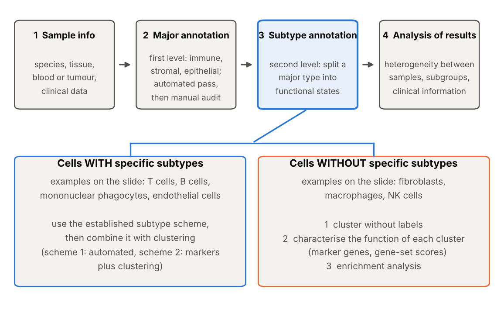
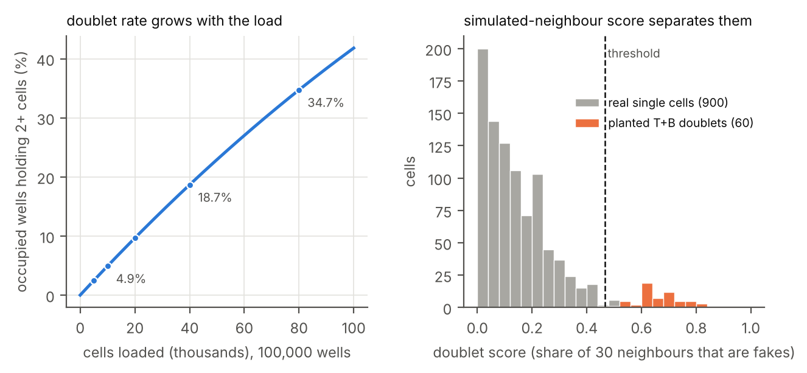
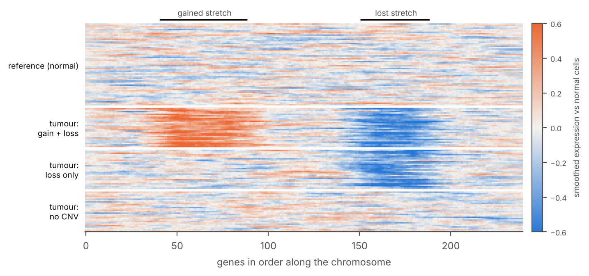
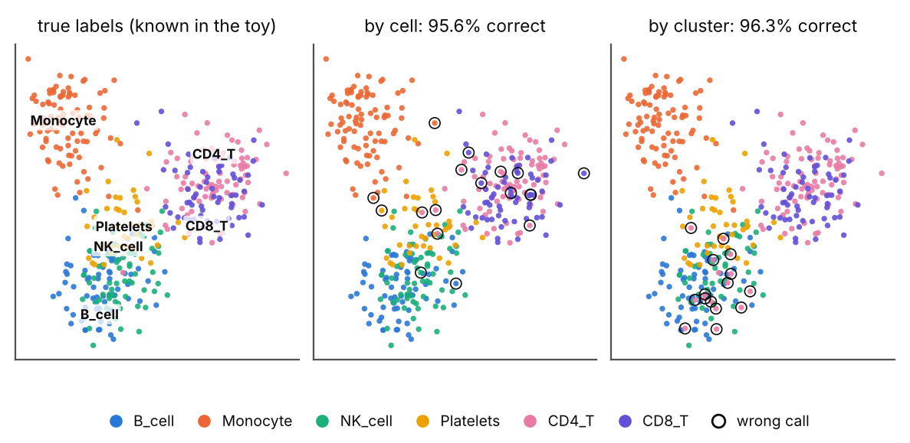

# Cell Type Annotation

> Module 5: from numbered clusters to named cell types. The landscape of cell types, automatic annotation with SingleR (by cell and by cluster), manual annotation from marker genes and a marker database, subtype annotation and function scoring, doublets, tumour cells, writing labels back into the Seurat object, and subdividing a cell type such as T cells.

---

## Table of Contents

1. [Why Annotate, and Which Cell Types to Expect](#1-why-annotate-and-which-cell-types-to-expect)
2. [Two Ways to Annotate, and the Annotation Process](#2-two-ways-to-annotate-and-the-annotation-process)
3. [Reading a Marker Table](#3-reading-a-marker-table)
4. [Major Annotation: the First Level](#4-major-annotation-the-first-level)
5. [Subtype Annotation: the Second Level](#5-subtype-annotation-the-second-level)
6. [Doublets](#6-doublets)
7. [Judging Tumour Cells](#7-judging-tumour-cells)
8. [Automatic Annotation with SingleR: Setup](#8-automatic-annotation-with-singler-setup)
9. [SingleR by Cell and by Cluster](#9-singler-by-cell-and-by-cluster)
10. [Manual Annotation: Marker Plots and a Marker Database](#10-manual-annotation-marker-plots-and-a-marker-database)
11. [Writing the Labels Back into the Object](#11-writing-the-labels-back-into-the-object)
12. [Subdividing a Cell Type: T Cells](#12-subdividing-a-cell-type-t-cells)
13. [After-Class Assignments and the Next Session](#13-after-class-assignments-and-the-next-session)
14. [Key Takeaways](#14-key-takeaways)
15. [What's Next](#15-whats-next)

---

## How to read this module

Module 4 ended with an object that has numbered clusters and a table of marker genes for each. This module answers the question that comes next: **which cell type is cluster 3?** The notes follow the lecture's three parts (an overview of cell types, how cell types are identified, and the practical operations in R) and add the reasoning the slides leave out.

**Sources and honesty about them.** The lecture slides are image captures of a video, so the player controls cut some text and some figures are small; where a number or a label is hard to read, I say "my reading". A text version of the narration is also available and was produced by speech recognition, which writes SingleR as "Single R", CellID as "Cell ID" and several tool names in odd ways; I corrected those silently. Where the narration and a slide disagree, I say so.

**R is not installed on the machine used to check this module, so no R code here was run.** R code appears in `r` blocks and is copied from the slides (with the slides' stray spaces and typos cleaned up and mentioned). It is **untested**. Where I add something that is not on a slide, the text says "not on the slides". The Python blocks **were run** and their outputs are real, but they check the *logic* of a step (how a marker table is read, why annotating by cluster is steadier than by cell, how a doublet rate grows) on small invented data, not SingleR or Seurat themselves. The slides use **Seurat v4 syntax** (the same as Module 4), and so do I.

---

## 1. Why Annotate, and Which Cell Types to Expect

After clustering, a data set is a set of groups with numbers as names: 0, 1, 2 and so on. **Cell type annotation** gives each group a biological name, and every later question depends on it: how many B cells are there, which genes change in macrophages, which cell type is more common in disease. The lecture starts by asking what you can expect to find, because annotation is easier when you already know the possible answers.

**Three classes of cells.** The slide's first level (the "class level") divides cells into:

- **Immune cells**: T cells, B cells, mononuclear phagocytes (MPs), mast cells, neutrophils.
- **Stromal cells**: endothelial cells (ECs), fibroblasts, mural cells. These are the supporting cells of a tissue.
- **Parenchymal cells**: epithelial cells (and, on the slide's tree, adipocytes and endocrine cells). These are the cells that perform the organ's own job.

The slide's tree also carries two more branches, **cancer cells** and **neurons**, and it fills in the detail below each class. A few examples from it, so that you recognise the vocabulary: the endothelial branch splits into lymphatic, arterial, venous and capillary endothelial cells; the mural branch into smooth muscle cells and pericytes; the lymphocyte branch into NK cells, T cells (naive, regulatory, T helper, CD8+ effector, CD8+ exhausted, mucosal-associated invariant, tissue-resident memory and gamma delta T cells), B cells (naive, memory, germinal centre) and plasma cells; and the myeloid branch into monocytes, macrophages, dendritic cell types, mast cells and neutrophils, with platelets and erythrocytes beside them.

The slide adds one sentence that guides everything else: **the immune cells of different tissues are similar, but the main difference between tissues is in the parenchymal cells.** In practice this means that the immune part of annotation is the same everywhere (and automatic tools do it well), while the parenchymal part depends on the tissue and is where you need a tissue-specific reference or your own biological knowledge.

**An example of how large the list can get: the lung.** The slide shows a published atlas of the human lung (it gives the reference doi 10.1038/s41586-020-2922-4). The count on the slide is **58 cell types: 15 epithelial, 9 endothelial, 9 stromal and 25 immune**. The picture is a tree of the types, a cut-away drawing of the airway and the alveoli showing where each type sits, and under the tree the marker genes that define each type. The narration's lesson is that a tissue holds many sub-populations, so annotation has to be careful and detailed, not a quick pass.

---

## 2. Two Ways to Annotate, and the Annotation Process

The lecture's second part ("cell type identification") has two sub-topics: the **annotation method and process**, and **common problems and their solutions** (doublets and tumour cells, sections 6 and 7 here).

**Species and tissue.** The slide shows the cloud platform's database browser and says it covers **human, mouse and monkey** and tissues such as liver, lymph and blood, and that analysis and annotation can be run automatically on the platform (the slide names SynEcoSys and a cloud analysis tool called CeleLens). The narration says this is especially useful for large data sets. In this course the same job is done in R, which is what the rest of the module teaches.

**Automated and manual annotation.** There are two approaches, and the narration compares them directly:

| | Automated (SingleR, CellID) | Manual (markers, databases, literature) |
|---|---|---|
| Speed | Fast | Slow |
| Accuracy | Good for common types; may miss rare ones | More accurate and more sensitive |
| Needs | A reference data set with known labels | Marker genes and biological knowledge |
| Weakness | Only as good as the reference | Time, and the person's expertise |

The recommendation, repeated on the slides ("automation plus manual audit"), is to **combine them**: let an automatic tool label the clusters as a first pass, then check and correct the labels by hand.

**The four-stage process (slide "cell annotation process").** The figure below redraws the slide.

1. **Sample information.** What do you know before you look at any gene? The slide lists: the species; the tissue, or peripheral blood; whether the sample is tumour or adjacent tissue; clinicopathology (staging, treatment efficacy); and the major cell types you expect. This is the prior knowledge that stops you naming a cluster "alveolar cell" in a blood sample.
2. **Major annotation (first level).** Audit the automated results for the three classes: immune cells, stromal cells, parenchymal cells (section 4).
3. **Subtype annotation (second level).** Differential gene analysis and screening, comparison with the literature and databases, and identification of cell subtypes and their functions (section 5).
4. **Analysis of results.** Combine clinical information, look at heterogeneity or similarity between samples, and find specific subgroups and their markers.



The next slide shows the whole route on one data set. On the left is a UMAP coloured by raw clusters (the legend runs to 28 clusters, my reading). The middle shows the result of automatic annotation with **SingleR or CellID**, and on the right is the final map after **manual review**, where the clusters carry names. The caption reads "automated annotation results + manual review". The message is that the automatic step gives a draft and the review gives the version you trust.

---

## 3. Reading a Marker Table

Manual annotation starts from a table of marker genes per cluster, like the one you made in Module 4 with `FindAllMarkers`. The slide shows such a table for one cluster ("cluster 9") with the columns **LogFC, Pvalue, PvalueAdj, Pct1 and Pct2** (and a "scores" column) and highlights LogFC, Pct1 and Pct2 with red boxes. (These names belong to the cloud platform's export. Seurat's own table calls them `avg_log2FC`, `p_val`, `p_val_adj`, `pct.1` and `pct.2`; the Excel table on a later slide shows the Seurat names.) The narration explains each column:

- **Average log fold change**: how much higher the gene is in this cluster than in all the other clusters.
- **Pct1**: the fraction of cells **inside** the cluster that express the gene.
- **Pct2**: the fraction of cells in **all other clusters** that express it.
- **Adjusted p-value**: the significance of the difference after correcting for the number of genes tested.

The reading rule from the narration is: look for genes with a **high fold change, a high Pct1, a low Pct2 and a significant adjusted p-value**. A good marker is on in most cells of the cluster and off in almost all other cells.

On the slide the top gene of this cluster is `MS4A1`, followed by `IGHD`, `IGHM`, `CD79A`, `BANK1`, `VPREB3`, `TCL1A`, `CD22`, `CD19`, `PAX5`, `CD79B` and others. A reader who knows immunology sees at once that these are B-cell genes: `MS4A1` encodes CD20, `CD79A` and `CD79B` are parts of the B-cell receptor complex, `IGHM` and `IGHD` are immunoglobulin heavy chains, and `PAX5` is a B-lineage transcription factor (general knowledge, not on the slides). That is manual annotation in one step: read the list, recognise the lineage.

The Python code below uses 15 rows of the slide's table (typed from the screenshot, which is low resolution, so the last digit of a value can be off) to show why the rule has more than one condition.

```python
import pandas as pd

# ---- rows of the slide's marker table for one cluster (typed from the screenshot; read at low resolution, so
# ---- the last digit of a value can be off). Columns on the slide: LogFC, Pct1, Pct2 (Pvalue is 0 for all).
rows = [("MS4A1", 8.329, .932, .035), ("IGHD", 7.747, .669, .013), ("IGHM", 7.194, .844, .086),
        ("CD79A", 7.176, .775, .027), ("BANK1", 7.036, .641, .016), ("VPREB3", 7.033, .405, .007),
        ("LINC02397", 6.873, .211, .003), ("FCRLA", 6.865, .303, .004), ("TCL1A", 6.859, .447, .012),
        ("CD22", 6.854, .454, .008), ("FCER2", 6.759, .502, .012), ("CD19", 6.505, .275, .005),
        ("SPIB", 6.457, .297, .005), ("PAX5", 6.427, .284, .005), ("CD79B", 6.322, .786, .058)]
t = pd.DataFrame(rows, columns=["gene", "LogFC", "Pct1", "Pct2"])

# the slide's reading rule: high fold change, HIGH Pct1, LOW Pct2 (and a significant adjusted p-value)
t["Pct1-Pct2"] = (t["Pct1"] - t["Pct2"]).round(3)
print("ranked by LogFC (the table's own order):")
print(t.sort_values("LogFC", ascending=False)[["gene", "LogFC", "Pct1", "Pct2"]].head(6).to_string(index=False))
print("\nranked by Pct1 - Pct2 (how many more cells of the cluster than of the rest express the gene):")
print(t.sort_values("Pct1-Pct2", ascending=False)[["gene", "LogFC", "Pct1", "Pct2", "Pct1-Pct2"]].head(6).to_string(index=False))

# a gene can have a big fold change and still be a poor marker when few cells of the cluster express it
poor = t[t["Pct1"] < 0.3]["gene"].tolist()
print("\nbig LogFC but expressed in fewer than 30% of the cluster's cells:", poor)
print("robust markers (Pct1 >= 0.6 and Pct2 <= 0.1):", t[(t.Pct1 >= 0.6) & (t.Pct2 <= 0.1)]["gene"].tolist())

# Output:
# ranked by LogFC (the table's own order):
#   gene  LogFC  Pct1  Pct2
#  MS4A1  8.329 0.932 0.035
#   IGHD  7.747 0.669 0.013
#   IGHM  7.194 0.844 0.086
#  CD79A  7.176 0.775 0.027
#  BANK1  7.036 0.641 0.016
# VPREB3  7.033 0.405 0.007
# 
# ranked by Pct1 - Pct2 (how many more cells of the cluster than of the rest express the
#   gene):
#  gene  LogFC  Pct1  Pct2  Pct1-Pct2
# MS4A1  8.329 0.932 0.035      0.897
#  IGHM  7.194 0.844 0.086      0.758
# CD79A  7.176 0.775 0.027      0.748
# CD79B  6.322 0.786 0.058      0.728
#  IGHD  7.747 0.669 0.013      0.656
# BANK1  7.036 0.641 0.016      0.625
# 
# big LogFC but expressed in fewer than 30% of the cluster's cells: ['LINC02397', 'CD19',
#   'SPIB', 'PAX5']
# robust markers (Pct1 >= 0.6 and Pct2 <= 0.1): ['MS4A1', 'IGHD', 'IGHM', 'CD79A', 'BANK1',
#   'CD79B']
```

How to read this output. Ranking by fold change alone puts `VPREB3` (Pct1 0.405) in the top six, while ranking by the gap between Pct1 and Pct2 puts `CD79B` (Pct1 0.786) up there instead. `VPREB3` is a fine B-cell gene, but it is detected in only 40% of the cluster's cells, so it is a weaker diagnostic than `CD79B`. The four genes listed as "big LogFC but in fewer than 30% of cells" (`LINC02397`, `CD19`, `SPIB`, `PAX5`) are real B-cell genes too, but they are usually expressed at low levels and are often not detected in a given cell (general knowledge, not on the slide), so their Pct1 is low. This is why the narration asks for the high Pct1 and low Pct2 together with the fold change: **a large fold change tells you the gene is much higher when it is on; Pct1 and Pct2 tell you how reliably it is on.** The six "robust markers" at the end satisfy both conditions.

**Checking the call on a map.** After reading the table, you look at the genes on the plots. The slide shows two genes from that table, `CD79A` and `MS4A1`, as UMAP feature plots (a single small island is red and the rest is grey) and as violin plots (one identity is high, the others flat). When the gene is high in exactly the cluster you suspected, the label is confirmed. Section 10 gives the commands.

---

## 4. Major Annotation: the First Level

**Major annotation** gives each cluster a broad class label. The slide shows two results of it (the legends are small, so the lists below are my reading). The left panel is captioned "PBMC" and its legend lists B cells, erythrocytes, MPs, neutrophils, platelets and T cells; the right panel is captioned "entity organization" and lists B cells, basophils, epithelial cells, MPs, neutrophils, T cells and pDCs (plasmacytoid dendritic cells). The slide's footnote says **MPs are mononuclear phagocytes**. Because the second panel contains epithelial cells, I read it as a solid tissue (my reading; the caption is not explained). The narration describes the PBMC example as clusters grouped into T cells, B cells, mononuclear phagocytes, NK cells and other immune populations; the legend on the slide does not list NK cells, so I follow the slide.

Why a coarse level first? Because it is where automatic tools and markers are most reliable, because it fixes the large structure of the data set, and because every later step builds on it: the narration calls it "the foundation for later subtype analysis and functional interpretation". If a cluster is called "T cell" at this stage, section 12 shows how to cut it into subtypes afterwards.

**A practical rule for merging.** The narration gives an example of manual review: if two clusters both express the canonical genes of mononuclear phagocytes, they are probably the same lineage (macrophage-like) even if the automatic tool gave them different names. So the manual step may also **merge** labels, not only correct them; section 11 shows that renaming two clusters to the same name merges them.

---

## 5. Subtype Annotation: the Second Level

Once the major types are fixed, **subtype annotation** divides each broad class into more specific groups: different endothelial subtypes, fibroblast states, functional T-cell subsets. The slide organises the cell types into two groups, and the narration explains why.

**Cells with specific subtypes.** These cell types have a well-defined, well-known set of functional states. On the slide: **T cells, B cells, MPs and ECs** (generic subtype annotation), combined with unsupervised clustering ("refer to the conventional subtype subdivision method"). The narration's example is T cells: tissue-resident memory, central memory, effector memory and **TEMRA** (effector memory cells that re-express CD45RA). Cells that match one of these patterns can be assigned with confidence.

**Cells without specific subtypes.** For the other cell types (the slide lists fibroblasts, macrophages and NK cells as examples) there is no agreed list of subtypes, or the states form a continuum. The narration says their gene expression and function scores may be intermediate, mixed or weak for every signature, so you keep them in the broader category rather than forcing a wrong subtype label. Two methods are used for them: unsupervised ("mechanical") clustering, and **function scoring**.

**Two schemes for T cells (slide 14).** The slide gives two annotation schemes for the same cell type:

- **Scheme 1** annotates by traditional functional subtypes and is automated. The legend of the UMAP lists CD4+ naive T cells, CD8+ effector T cells, CD8+ exhausted T cells, CD8+ mucosal-associated invariant T cells, CD8+ naive T cells, gamma delta T cells, naive T cells, natural killer cells, proliferating T cells, regulatory T cells, and even a class called "doublet" (the link to section 6: doublets also appear as a label when you annotate carefully).
- **Scheme 2** combines the conventional functional subtypes with **marker-assisted clustering**. You first cluster without labels, then give each cluster a name built from its lineage, its state and a marker gene. The slide's legend lists over thirty clusters with names of the form cluster number, CD4 or CD8, a state such as Tcm, Tem, Temra, Trm, Treg or Tfh, and a marker gene (my reading of a small legend). The narration says this scheme uses both data-driven clustering and prior knowledge, which improves the resolution of the subtypes.

**Function scoring in three steps (slides 16 and 17).** For cell types without clear subtypes, the narration describes a three-step route, shown on the slide with fibroblasts:

1. **Unsupervised clustering.** Group the cells by their expression only, without prior labels.
2. **Characterise the function of each group.** Compare each cluster's markers and expression with known functional signatures (activation, proliferation, cytotoxicity, exhaustion, tissue residency), and compute **scores for curated gene sets**. The slide draws box plots of one score (it is an "adipose-derived fibroblast" score) across seven fibroblast clusters: the clusters differ in how strongly they show that programme.
3. **Enrichment analysis.** Take the marker or differentially expressed genes of each cluster and test which pathways, processes or gene signatures are over-represented (the slide shows a bar chart and a dot plot of enriched terms). The narration says this step confirms the functional reading and can even reveal new disease-specific subtypes and their markers. Enrichment is the topic of the next session (section 13).

**What does a gene-set score compute?** The slides show the result (box plots) but not the calculation. The usual idea, used for instance by Seurat's `AddModuleScore` (not on the slides), is: average the expression of the genes in the set for each cell, then subtract the average of **control genes** that have similar overall expression. The subtraction matters, as the check below shows.

```python
import numpy as np

rng = np.random.default_rng(11)
n_genes, n_set = 300, 8
base = rng.gamma(2.0, 0.5, size=n_genes)                         # average log-expression of every gene (0 ... ~4)
setg = rng.choice(np.arange(60, 300), n_set, replace=False)      # 8 genes of a "function" gene set
null_set = rng.choice(np.setdiff1d(np.arange(n_genes), setg), n_set, replace=False)   # a random gene set, no biology

sizes, active = [200, 200, 200], [0.0, 0.8, 1.6]                 # programme activity of the 3 clusters (log units)
cell_off = [0.0, 0.0, 0.5]                                       # cluster 2 is just "better detected": +0.5 on every gene
cl = np.repeat([0, 1, 2], sizes)
X = np.zeros((600, n_genes))
for c in range(3):
    m = cl == c
    X[m] = base + rng.normal(0, 0.6, (m.sum(), n_genes)) + cell_off[c]
    X[np.ix_(m, setg)] += active[c]
X = np.clip(X, 0, None)

# control genes, matched on average expression (the idea behind Seurat's AddModuleScore, not on the slides)
avg = X.mean(0)
bins = np.digitize(avg, np.quantile(avg, np.linspace(0, 1, 11)[1:-1]))
def module_score(gset, n_ctrl=5):
    ctrl = []
    for g in gset:
        pool = np.setdiff1d(np.where(bins == bins[g])[0], np.concatenate([setg, null_set]))
        ctrl += rng.choice(pool, n_ctrl, replace=False).tolist()
    return X[:, gset].mean(1) - X[:, ctrl].mean(1)

raw_f, raw_n = X[:, setg].mean(1), X[:, null_set].mean(1)
sc_f, sc_n = module_score(setg), module_score(null_set)
print("mean over the cells of each cluster (cluster 2 has a +0.5 detection offset on EVERY gene)")
print("cluster | raw mean, function set | raw mean, random set | control-subtracted, function | control-subtracted, random")
for c in range(3):
    m = cl == c
    print(f"   {c}    |        {raw_f[m].mean():5.2f}          |        {raw_n[m].mean():5.2f}         |           {sc_f[m].mean():5.2f}             |         {sc_n[m].mean():5.2f}")
print("\ntrue programme activity of the clusters:", active)
print("raw random-set mean differs between cluster 0 and 2 by", round(raw_n[cl == 2].mean() - raw_n[cl == 0].mean(), 2), "(pure artefact)")
print("control-subtracted random-set score differs by", round(sc_n[cl == 2].mean() - sc_n[cl == 0].mean(), 2))

# Output:
# mean over the cells of each cluster (cluster 2 has a +0.5 detection offset on EVERY gene)
# cluster | raw mean, function set | raw mean, random set | control-subtracted, function |
#   control-subtracted, random
#    0    |         0.95          |         1.10         |           -0.74             |
#   0.10
#    1    |         1.70          |         1.10         |           -0.01             |
#   0.10
#    2    |         2.99          |         1.58         |            0.80             |
#   0.11
# 
# true programme activity of the clusters: [0.0, 0.8, 1.6]
# raw random-set mean differs between cluster 0 and 2 by 0.48 (pure artefact)
# control-subtracted random-set score differs by 0.01
```

How to read this output. Cluster 2 was simulated with a +0.5 offset on **every** gene (think of cells that were simply captured better). The raw mean of a **random** gene set, which has no biology, still rises by 0.48 in cluster 2, an artefact that would look like "higher activity". After subtracting matched control genes the random set differs by 0.01, so the artefact is gone, and the real programme (true activity 0, 0.8 and 1.6) comes out as steps of 0.73 and 0.81 between the clusters. Two honest notes: the absolute values of the score (for instance -0.74 in cluster 0) depend on which control genes were chosen, so **compare clusters, not absolute values**; and the check is a toy built to show the idea, not the algorithm of any package.

---

## 6. Doublets

A **doublet** (or multiplet) is a droplet or microwell that captured **two or more cells** instead of one. The sequencing result then reads as one "cell" whose expression profile is a mixture of two. The slide's definition is exactly that: "a microwell or droplet might contain two or more cells".

**Why the rate depends on how many cells you load.** The slide says: because the total number of microwells is fixed, when the number of cells increases, the proportion of doublets also increases. Behind this is a simple counting argument. If cells land in wells at random, the number of cells per well follows a Poisson distribution whose mean is *cells loaded divided by wells*. The fraction of occupied wells that hold two or more cells then grows roughly in proportion to that mean. The check below puts numbers on it (the random-loading model and the figure of 100,000 wells are my assumptions, not on the slides; the real number of wells depends on the chip).

```python
import numpy as np
from math import exp

# Assumption (not on the slides): cells land in wells at random, so the number of cells per well is Poisson(lam),
# with lam = cells loaded / number of wells. The number of wells is fixed by the chip: here 100,000, only as an example.
M = 100_000
def doublet_fraction(N):
    lam = N / M
    p0 = exp(-lam); p1 = lam * exp(-lam)
    occupied = 1 - p0
    return lam, (1 - p0 - p1) / occupied       # share of OCCUPIED wells that hold two or more cells

print("cells loaded | cells per well | wells with 2+ cells, among wells that hold a cell")
for N in (5_000, 10_000, 20_000, 40_000, 80_000):
    lam, f = doublet_fraction(N)
    print(f"{N:>12,} |     {lam:5.2f}      |  {100*f:5.2f} %   (rule of thumb lam/2 = {100*lam/2:5.2f} %)")

# check the formula against direct random simulations: load 20,000 cells into 100,000 wells, 20 times
rng = np.random.default_rng(3)
N, fr = 20_000, []
for _ in range(20):
    per_well = np.bincount(rng.integers(0, M, size=N), minlength=M)     # each cell picks a well uniformly at random
    fr.append((per_well >= 2).sum() / (per_well > 0).sum())
print("\nsimulation (mean of 20 runs, 20,000 cells):", round(100 * np.mean(fr), 2), "% of occupied wells hold 2+ cells",
      "| formula:", round(100 * doublet_fraction(N)[1], 2), "%")
print("spread of the 20 runs: min", round(100 * min(fr), 2), "% , max", round(100 * max(fr), 2), "%")

# Output:
# cells loaded | cells per well | wells with 2+ cells, among wells that hold a cell
#        5,000 |      0.05      |   2.48 %   (rule of thumb lam/2 =  2.50 %)
#       10,000 |      0.10      |   4.92 %   (rule of thumb lam/2 =  5.00 %)
#       20,000 |      0.20      |   9.67 %   (rule of thumb lam/2 = 10.00 %)
#       40,000 |      0.40      |  18.67 %   (rule of thumb lam/2 = 20.00 %)
#       80,000 |      0.80      |  34.72 %   (rule of thumb lam/2 = 40.00 %)
# 
# simulation (mean of 20 runs, 20,000 cells): 9.68 % of occupied wells hold 2+ cells |
#   formula: 9.67 %
# spread of the 20 runs: min 9.32 % , max 10.05 %
```

How to read this output. Loading 5,000 cells into 100,000 wells gives about 2.5% doublets; loading 80,000 gives about 35%. The "rule of thumb" column (half the mean number of cells per well) is a good approximation while the load is light and overestimates it when the load is heavy. The 20 random simulations agree with the formula (mean 9.68% against 9.67%). The practical conclusion is the one the narration draws: **in large experiments doublet detection matters more.**

**What doublets do to the analysis.** The slide lists three harms: they can form **artificial clusters**, distort **cell-state trajectories** and bias **functional enrichment**, which is why "annotated doublets are generally removed" before the final annotation.

**How to spot them by hand.** On the cluster map, a doublet can express the marker genes of **two or more cell types that have no developmental relationship**, for example a T-cell marker and a B-cell marker in the same "cell". The narration adds two aids: the literature (use the thresholds that published studies applied) and visual inspection. The slide shows a lymph-node UMAP in which a cluster named "Doublets" sits among the labelled T-cell, B-cell, plasmablast and epithelial groups, with a methods paragraph beside it. Paraphrasing that paragraph (it is small and was read at low resolution): the authors normalised and scaled with Seurat, removed poor-quality cells with thresholds on genes, UMIs and mitochondrial share that differ between the cell-line and the primary data sets, and called doublets as cells with **more than 6,500 genes or a gene count more than four times the median of their cell type**. The point is the style of the rule (a cut-off on total complexity, applied per cell type), not the exact numbers, which belong to that study.

**Computational tools.** The slide names Scrublet, doubletCells, cxds, bcds, Hybrid, DoubletDetection, DoubletFinder, Solo and DoubletDecon, and cites a benchmark paper (Xi and Li, "Benchmarking computational doublet-detection methods for single-cell RNA sequencing data"). A short orientation, from my own knowledge and not from the slides: Scrublet, DoubletDetection and Solo are Python tools (Solo is part of the scvi-tools family); doubletCells, cxds, bcds and Hybrid (the last three come from one package) are R/Bioconductor tools; DoubletFinder is an R package built to work with Seurat objects; DoubletDecon is an R package. Many of them use the same core idea, which the next check demonstrates: **create artificial doublets by adding the profiles of random pairs of real cells, and give each real cell a score for how many of its neighbours are artificial.**

```python
import numpy as np
from sklearn.decomposition import PCA
from sklearn.neighbors import NearestNeighbors

# The idea behind simulation-based doublet callers such as Scrublet (not explained on the slides): make fake doublets
# by adding the profiles of two random real cells, then ask for every real cell how many of its neighbours are fakes.
rng = np.random.default_rng(5)
types = ["T", "B", "Mono"]
G = 90
prof = np.full((3, G), 0.3)
for k in range(3):
    prof[k, k * 30:(k + 1) * 30] = 3.0                      # each type has its own 30 high genes
n_real = [300, 300, 300]
cells, truth = [], []
for k, n in enumerate(n_real):
    cells.append(rng.poisson(prof[k], size=(n, G))); truth += [types[k]] * n
n_dbl = 60                                                  # planted real doublets: one T cell + one B cell in a well
pair = rng.poisson(prof[0], size=(n_dbl, G)) + rng.poisson(prof[1], size=(n_dbl, G))
cells.append(pair); truth += ["T+B doublet"] * n_dbl
C = np.vstack(cells).astype(float); truth = np.array(truth)
norm = lambda M: np.log1p(M / M.sum(1, keepdims=True) * 1e3)    # simple library-size normalisation (doublets have ~2x counts)

# simulate fakes from random pairs of observed cells
n_fake = len(C) // 2                                       # fakes are 1/3 of all points in the neighbour search
i, j = rng.integers(0, len(C), n_fake), rng.integers(0, len(C), n_fake)
fake = C[i] + C[j]
pca = PCA(n_components=10, random_state=0).fit(norm(C))     # PCA learned on the real cells, fakes are projected into it
Z_real, Z_fake = pca.transform(norm(C)), pca.transform(norm(fake))
Z = np.vstack([Z_real, Z_fake]); is_fake = np.r_[np.zeros(len(C), bool), np.ones(n_fake, bool)]
k = 30
nn = NearestNeighbors(n_neighbors=k + 1).fit(Z)
_, idx = nn.kneighbors(Z_real)
score = is_fake[idx[:, 1:]].mean(1)                          # share of a cell's 30 neighbours that are simulated doublets

real_dbl = truth == "T+B doublet"
print("doublet score = fraction of the 30 nearest neighbours that are simulated doublets")
for name in ["T", "B", "Mono", "T+B doublet"]:
    s_ = score[truth == name]
    print(f"{name:12s} n={len(s_):3d}  median {np.median(s_):.2f}   min {s_.min():.2f}   max {s_.max():.2f}")
singles = ~real_dbl
thr = float(np.quantile(score[singles], 0.99))            # a threshold that keeps 99% of the real single cells
called = score > thr
print(f"\nthreshold = 99th percentile of single-cell scores = {thr:.2f}")
print(f"cells called doublets: {int(called.sum())} | planted doublets found: {int((called & real_dbl).sum())} of {int(real_dbl.sum())}"
      f" | single cells wrongly removed: {int((called & singles).sum())} of {int(singles.sum())}")

# Output:
# doublet score = fraction of the 30 nearest neighbours that are simulated doublets
# T            n=300  median 0.10   min 0.00   max 0.43
# B            n=300  median 0.10   min 0.00   max 0.50
# Mono         n=300  median 0.17   min 0.00   max 0.70
# T+B doublet  n= 60  median 0.67   min 0.47   max 0.83
# 
# threshold = 99th percentile of single-cell scores = 0.47
# cells called doublets: 67 | planted doublets found: 59 of 60 | single cells wrongly
#   removed: 8 of 900
```



How to read this output. The planted T+B doublets have a median score of 0.67; the single cells' median is 0.10 to 0.17. With a threshold chosen to keep 99% of the single cells, 59 of the 60 planted doublets are found and 8 of 900 single cells are wrongly removed. Two cautions. First, I set the threshold using the known labels, which you never have in real data; real tools choose it from the shape of the score distribution. Second, this toy has well-separated cell types and one easy kind of doublet. The literature (not the slides) notes that doublets made of two cells of the **same** type are much harder to detect because the sum looks like one more cell of that type; my toy does not test that.

**Software against manual calls.** The last doublet slide compares the doublets called by software (DoubletFinder, shown as a UMAP overlay; my reading of the legend) with those found by manual annotation, and states that the **coincidence rate is low, so the manual annotation shall prevail**. The narration says the same: the overlap can be limited, and manual review remains important because automated detection may miss subtle cases. The sensible workflow is to run a tool, look at which clusters carry high scores and also express two lineages' markers, and remove what you can justify.

---

## 7. Judging Tumour Cells

In tumour data sets there is one more question before naming clusters: **which cells are malignant?** The slide's first answer is the cell of origin:

- **Solid tumours** such as lung or colorectal cancers mostly arise from **epithelial cells**.
- **Haematological tumours** such as lymphomas mostly arise from **T, B and other lymphocytes**.

So in a lung tumour you look for the malignant cells among the epithelial clusters, and in a lymphoma among the lymphocyte clusters.

The second answer is the tumour's own character: **high intratumoral and inter-sample heterogeneity** (the slide writes "intracellular", and the narration says intratumoral). Malignant cells show patient-specific expression patterns and many differentiation states, so cells of the same tumour type from two patients may form two separate clusters, and within one patient there can be several malignant sub-populations. Recognising this keeps you from reading a patient-specific cluster as a batch effect or as a new normal cell type.

**Copy-number evidence.** The slide quotes a lung-cancer study (doi 10.1038/s41467-020-18916-5) with a heat map of copy-number variation (CNV) and UMAPs. Paraphrasing the quoted paragraph (small print, my reading): epithelial cells were re-clustered into 17 clusters; even after the batch effect had been removed the cancer cells kept a patient-specific expression pattern, which the authors traced to CNVs and confirmed with the inferCNV method; CNVs accumulated in most high-grade tumour-derived cells, with deletions on some chromosomes and amplifications on others, shared by almost all high-grade cells; and some cells from tumour tissue had almost no CNV and an expression pattern like normal epithelial cells, so they were probably non-malignant. The epithelial cells were therefore divided into four groups: **low, high, control and undetected**.

**How is a CNV read from expression?** The slides show the heat map but not how it is built. The idea of inferCNV-style tools (my knowledge, not on the slides) is: order the genes along the chromosomes, subtract the average expression of **normal reference cells**, and **smooth along the genome**. A gained region then appears as a run of genes that are all slightly higher, a lost region as a run that is all slightly lower. The check below builds a toy version.

```python
import numpy as np

# Idea of CNV inference tools such as inferCNV (the slide shows a CNV heat map but not how it is made): order genes by
# chromosome position, subtract the average of normal reference cells, and smooth along the genome. A gained or lost
# region then shows up as a stretch of genes that are all a little higher or lower.
rng = np.random.default_rng(21)
n_genes, win = 240, 25
pos_gain, pos_loss = slice(40, 90), slice(150, 190)          # a gained and a lost stretch of genes
groups = [("reference (normal)", 60, None), ("tumour: gain + loss", 30, "both"),
          ("tumour: loss only", 30, "loss"), ("tumour: no CNV", 30, None)]
base = rng.normal(2.0, 0.5, n_genes)
rows, names = [], []
for name, n, kind in groups:
    for _ in range(n):
        x = base + rng.normal(0, 0.8, n_genes)                # noisy single-cell expression (log units)
        if kind == "both":
            x[pos_gain] += 0.5; x[pos_loss] -= 0.5
        if kind == "loss":
            x[pos_loss] -= 0.5
        rows.append(x); names.append(name)
X, names = np.array(rows), np.array(names)

ref_mean = X[names == "reference (normal)"].mean(0)
rel = X - ref_mean                                            # expression relative to normal cells
kernel = np.ones(win) / win
smooth = np.array([np.convolve(r, kernel, mode="same") for r in rel])        # moving average along the genome
core = slice(win, n_genes - win)                              # ignore the edges where the window is cut
burden_raw = (rel[:, core] ** 2).mean(1)                      # "how far from normal", without smoothing
burden_sm = (smooth[:, core] ** 2).mean(1)                    # same, after smoothing

print("noise per gene (sd) = 0.8; a CNV shifts 50 or 40 genes by only 0.5")
print("group                  | burden raw | burden smoothed")
for name, n, kind in groups:
    m = names == name
    print(f"{name:22s} |   {burden_raw[m].mean():.3f}    |   {burden_sm[m].mean():.3f}")
def sep(b):
    a, c = b[names == "reference (normal)"], b[names == "tumour: gain + loss"]
    return (c.mean() - a.mean()) / np.sqrt((a.var() + c.var()) / 2)
print("\nseparation of 'gain + loss' tumour cells from normal cells (difference of means / pooled sd):")
print("  without smoothing:", round(sep(burden_raw), 2), "| with smoothing:", round(sep(burden_sm), 2))
m = names == "tumour: gain + loss"
print("mean smoothed profile of gain+loss cells: genes 50-80 =", round(smooth[m][:, 50:80].mean(), 2),
      "| genes 160-180 =", round(smooth[m][:, 160:180].mean(), 2), "| genes 100-140 =", round(smooth[m][:, 100:140].mean(), 2))
m0 = names == "tumour: no CNV"
print("'no CNV' tumour cells look like normal ones: burden", round(burden_sm[m0].mean(), 3), "vs", round(burden_sm[names == "reference (normal)"].mean(), 3))

# Output:
# noise per gene (sd) = 0.8; a CNV shifts 50 or 40 genes by only 0.5
# group                  | burden raw | burden smoothed
# reference (normal)     |   0.627    |   0.026
# tumour: gain + loss    |   0.764    |   0.116
# tumour: loss only      |   0.678    |   0.061
# tumour: no CNV         |   0.662    |   0.023
# 
# separation of 'gain + loss' tumour cells from normal cells (difference of means / pooled
#   sd):
#   without smoothing: 2.08 | with smoothing: 3.4
# mean smoothed profile of gain+loss cells: genes 50-80 = 0.45 | genes 160-180 = -0.49 |
#   genes 100-140 = 0.01
# 'no CNV' tumour cells look like normal ones: burden 0.023 vs 0.026
```



How to read this output. Each gene is noisy (standard deviation 0.8) and the alteration moves it by only 0.5, so a single gene says almost nothing. After the moving average, the gain stands out (mean +0.45 over genes 50 to 80) and so does the loss (-0.49 over genes 160 to 180), and the separation between altered tumour cells and normal cells rises from 2.08 to 3.4 standard deviations. The "no CNV" tumour cells look exactly like normal cells (0.023 against 0.026), which is the slide's "undetected" group: **absence of a CNV signal does not prove that a cell is normal.** A caveat on the toy: the reference cells are compared with their own average, which flatters them slightly. Real tools exclude them or handle this carefully.

---

## 8. Automatic Annotation with SingleR: Setup

The third part of the lecture moves to R. **SingleR** is an R package for automatic cell type annotation of single-cell RNA-seq data (the slide cites Aran and others, 2019). Its logic: you give it a **reference data set** whose samples have known cell type labels, and for each cell (or cluster) of your **test** data it finds the reference label that the cell most resembles. The reference data sets come from a second package, **celldex**.

**How the matching works** (from my knowledge of the method; the slides do not explain it): SingleR correlates each test cell's expression with each reference sample (using Spearman correlation, on genes that distinguish the labels), scores each label by how well its samples correlate, picks the best label, and then fine-tunes the choice among the top candidates using only the genes that separate them. This matters for two reasons: the quality of the result is limited by the reference, and the method is a similarity search, not a statistical test of identity.

**The reference sets on the slides.** The "database preparation" slide lists these calls (several are commented out in the slide's code, which means "available, choose one"):

| Function | What it is | Species |
|---|---|---|
| `HumanPrimaryCellAtlasData()` | Human primary cell atlas | Human (the slide says so) |
| `BlueprintEncodeData()` | Blueprint and ENCODE | Human (the slide says so) |
| `DatabaseImmuneCellExpressionData()` | Immune cell expression database | Human (my knowledge) |
| `NovershternHematopoieticData()` | Haematopoietic cell types | Human (my knowledge) |
| `MonacoImmuneData()` | Immune cells | Human (my knowledge) |
| `MouseRNAseqData()` | Mouse RNA-seq reference | Mouse (the slide says so) |
| `ImmGenData()` | Immune cells | Mouse (the slide says so) |

The narration summarises: the human primary cell atlas and Blueprint and ENCODE for human data, mouse RNA-seq and related immune references for mouse. **Pick a reference that matches your species and, as far as possible, your tissue**: a blood reference cannot name a lung epithelial cell.

**Step 1: install the packages.** The slide's commands (not run here):

```r
#if (!requireNamespace("BiocManager", quietly = TRUE))
#    install.packages("BiocManager")
BiocManager::install("SingleR")
BiocManager::install("celldex")
devtools::install_version("dbplyr", version = "2.3.4")
```

The first two lines are commented out on the slide (BiocManager is assumed to be installed from the earlier modules). The slide pins `dbplyr` to version 2.3.4 and does not say why; I believe it avoids an incompatibility between newer `dbplyr` versions and the reference download step of celldex, but I have not verified that. The slide's warning: **restart the R session after installation** so that celldex loads correctly.

**Step 2: load the libraries and prepare the reference.**

```r
library(Seurat)
library(tidyverse)
library(SingleR)
library(celldex)

# get the reference data sets (choose the one that fits the species and tissue)
#Mouse.se <- MouseRNAseqData()                  # mouse
hpca.se  <- HumanPrimaryCellAtlasData()         # human
Blue.se  <- BlueprintEncodeData()               # human
#Immune.se <- DatabaseImmuneCellExpressionData()
#Nover.se  <- NovershternHematopoieticData()
#Monaco.se <- MonacoImmuneData()
#ImmGen.se <- ImmGenData()                      # mouse
#saveRDS(Mouse.se, "Mouse.se.rds")              # save a reference so that it can be reloaded
```

The calls download the reference the first time (my knowledge: celldex fetches it through Bioconductor's hub system, which needs a network connection). The narration's advice is to **save the reference objects as RDS files**, which speeds up later runs and makes the analysis reproducible, because you then keep exactly the version you used.

**Step 3: prepare the data to be annotated.** The object is the one saved at the end of the previous session, and SingleR needs its **normalised expression matrix**:

```r
PRO  <- readRDS("/your_path_to_PRO_object/pbmc.diff_PRO.rds")
data <- GetAssayData(PRO, slot = "data")   # the normalised matrix
head(data)
```

`slot = "data"` is Seurat v4 syntax; in Seurat v5 the argument is called `layer` (not on the slides). The matrix is genes by cells, the same orientation SingleR expects. `PRO` is the name this session gives to its Seurat object, a PBMC data set; Module 4's object was `pbmc`.

---

## 9. SingleR by Cell and by Cluster

SingleR can give a label to every **cell**, or one label to every **cluster**. The lecture shows both.

**Method 1: annotate by cell.**

```r
# annotate each cell with the human reference, using the main (broad) labels;
# the finer subclass labels can be used, but their accuracy is uncertain
PRO.human <- SingleR(test = data, ref = hpca.se, labels = hpca.se$label.main)
# several references can be combined (commented out on the slide):
#PRO.human <- SingleR(test = data, ref = list(BP = Blue.se, HPCA = hpca.se),
#                     labels = list(Blue.se$label.main, hpca.se$label.main))

# add the cell type label to the metadata as a new column
PRO@meta.data$SR_cell <- PRO.human$labels

# visualise and compare with the manual annotation of the previous session
# (the "celltype" column was added in the previous session by naming the clusters)
DimPlot(PRO, group.by = c("celltype", "SR_cell"), reduction = "umap", label = TRUE)
```

`PRO.human` is a table with one row per cell; its `labels` column is the predicted type. (My knowledge: the table also has a `pruned.labels` column in which low-confidence calls are set to `NA`; the slide uses `labels`.) The comment about fine subclasses is the slide's: `label.fine` gives more specific names, but the accuracy of the fine labels is uncertain.

**Method 2: annotate by cluster.**

```r
# make the clusters the identity of the cells, so SingleR annotates clusters, not cells
Idents(PRO) <- "RNA_snn_res.0.5"

# annotate each cluster
pred.cluster <- SingleR(test = data, ref = hpca.se, clusters = Idents(PRO),
                        labels = hpca.se$label.main)
pred.cluster

# a small table: cluster number and its label
celltype <- data.frame(ClusterID  = rownames(pred.cluster),
                       SR_cluster = pred.cluster$labels,
                       stringsAsFactors = FALSE)
celltype

# write the cluster label back to every cell of that cluster
PRO[["SR_cluster"]] <- celltype$SR_cluster[match(Idents(PRO), celltype$ClusterID)]
head(PRO@meta.data)
DimPlot(PRO, group.by = c("celltype", "SR_cluster"), reduction = "umap", label = TRUE)
```

`"RNA_snn_res.0.5"` is the metadata column that `FindClusters` wrote for resolution 0.5 (Module 4, section 11), and the narration says exactly this: it tells Seurat to treat the clustering at resolution 0.5 as the current identity, so each cell belongs to a cluster ID such as 0, 1, 2. With `clusters = Idents(PRO)` SingleR **averages the expression inside each cluster** and labels the average. `match(Idents(PRO), celltype$ClusterID)` is the key line: for every cell it looks up the position of its cluster in the small table, and `celltype$SR_cluster[...]` then fetches the label at that position. (The slides contain stray spaces inside the names, such as `[[' SR_cluster ']]`, which I removed.)

**Which method? The narration's comparison.**

- **By cell** gives a label to every single cell and can show **heterogeneity inside a cluster** (for example a cluster that mixes naive and activated T cells). But single-cell labels are **noisier** and more sensitive to dropouts and low coverage, and the picture gets messy when the labels are very granular.
- **By cluster** is **more robust and stable** when the clusters are well defined, because SingleR sees an average profile, and it is easier to read and present. The cost: if a cluster is mixed or **over-merged**, one label hides the sub-structure and rare sub-populations.
- In practice, run both: **annotate by cluster first** for clean labels, then **inspect the cell-level labels inside particular clusters** to find internal heterogeneity or mis-clustering.

The check below tests exactly these claims on invented data: six cell types where CD4 T and CD8 T cells are close relatives, one cluster deliberately over-merged (85 CD4 T plus 15 NK cells), and a sweep over sequencing depth. The labelling rule is a simplified stand-in (Spearman correlation with reference profiles), not SingleR itself.

```python
import numpy as np
from scipy.stats import spearmanr

labels = ["B_cell", "Monocyte", "NK_cell", "Platelets", "CD4_T", "CD8_T"]
n_per, n_hk = 8, 40                       # 8 marker genes per label + 40 shared housekeeping genes
genes = [f"{l}_m{i}" for l in labels for i in range(n_per)] + [f"hk{i}" for i in range(n_hk)]
G = len(genes)
L = {l: k for k, l in enumerate(labels)}

def make_reference(seed=7):
    """one mean log-expression profile per label (what a celldex reference supplies, in spirit)"""
    rng = np.random.default_rng(seed)
    base = rng.lognormal(0.0, 0.6, size=G) * 0.4                 # baseline level of every gene
    ref = np.tile(base, (len(labels), 1))
    for k in range(len(labels)):
        ref[k, k * n_per:(k + 1) * n_per] += rng.uniform(2.0, 3.5, n_per)       # own markers are high
    # CD4 and CD8 T cells are close relatives: each also expresses 6 of the other's 8 "markers" at a lower level
    ref[L["CD4_T"], L["CD8_T"] * n_per:L["CD8_T"] * n_per + 6] += 1.6
    ref[L["CD8_T"], L["CD4_T"] * n_per:L["CD4_T"] * n_per + 6] += 1.6
    ref[L["NK_cell"], L["CD8_T"] * n_per:L["CD8_T"] * n_per + 3] += 1.2         # NK shares a few genes with CD8 T
    return ref

ref = make_reference()
# clusters as if they came from FindClusters; cluster 2 is over-merged: 85 CD4 T + 15 NK cells in one cluster
spec = [("B_cell", 70, 0), ("Monocyte", 90, 1), ("CD4_T", 85, 2), ("NK_cell", 15, 2), ("Platelets", 40, 3),
        ("CD8_T", 60, 4), ("NK_cell", 50, 5)]
truth = np.array([l for l, n, c in spec for _ in range(n)])
cluster = np.array([c for l, n, c in spec for _ in range(n)])

def simulate(depth_scale, seed):
    rng = np.random.default_rng(seed)
    mu = ref[[L[t] for t in truth]]
    depth = rng.uniform(0.25, 0.5, size=(len(truth), 1)) * depth_scale
    counts = rng.poisson(mu * depth * 2.0)
    logn = np.log1p(counts / np.maximum(counts.sum(1, keepdims=True), 1) * 1e4)
    return counts, logn

def sr_like(M):
    """label each row by its highest Spearman correlation with the reference profiles"""
    return np.array([labels[int(np.argmax([spearmanr(r, ref[k]).statistic for k in range(len(labels))]))] for r in M])

def run(depth_scale, seed):
    counts, logn = simulate(depth_scale, seed)
    pred_cell = sr_like(logn)                                                    # Method 1: by cell
    cl_ids = np.unique(cluster)
    cl_lab = sr_like(np.array([logn[cluster == c].mean(0) for c in cl_ids]))     # Method 2: average each cluster first
    pred_cluster = np.array([cl_lab[c] for c in cluster])
    return counts, logn, pred_cell, cl_lab, pred_cluster

print("sweep over sequencing depth (5 random draws each; mean accuracy):")
print("depth scale | zeros  | by cell | by cluster")
for ds in (1.0, 0.5, 0.25):
    a_cell, a_cl, z = [], [], []
    for seed in range(5):
        counts, logn, pc, cl, pcl = run(ds, 100 + seed)
        a_cell.append((pc == truth).mean()); a_cl.append((pcl == truth).mean()); z.append((counts == 0).mean())
    print(f"   {ds:4.2f}     | {np.mean(z):.3f} |  {np.mean(a_cell):.3f}  |   {np.mean(a_cl):.3f}")

# one detailed run at the middle depth (this is the one drawn in the figure)
counts, logn, pred_cell, cl_lab, pred_cluster = run(0.5, 100)
print("\ndetailed run, depth scale 0.5:")
print("accuracy by cell   :", round(float((pred_cell == truth).mean()), 3), "| by cluster:", round(float((pred_cluster == truth).mean()), 3))
print("label given to each cluster:", dict(zip(range(6), cl_lab.tolist())))
for c in range(6):
    m = cluster == c
    v, n = np.unique(pred_cell[m], return_counts=True)
    print(f"cluster {c}: by-cell labels", dict(zip(v.tolist(), n.tolist())))
m = cluster == 2
print("\nover-merged cluster 2 holds", int((truth[m] == 'NK_cell').sum()), "true NK cells;",
      "by-cell labels call", int(((pred_cell[m] == 'NK_cell') & (truth[m] == 'NK_cell')).sum()), "of them NK;",
      "by-cluster labels call", int(((pred_cluster[m] == 'NK_cell') & (truth[m] == 'NK_cell')).sum()))

# Output:
# sweep over sequencing depth (5 random draws each; mean accuracy):
# depth scale | zeros  | by cell | by cluster
#    1.00     | 0.673 |  0.987  |   0.963
#    0.50     | 0.800 |  0.951  |   0.963
#    0.25     | 0.887 |  0.883  |   0.963
# 
# detailed run, depth scale 0.5:
# accuracy by cell   : 0.956 | by cluster: 0.963
# label given to each cluster: {0: 'B_cell', 1: 'Monocyte', 2: 'CD4_T', 3: 'Platelets', 4:
#   'CD8_T', 5: 'NK_cell'}
# cluster 0: by-cell labels {'B_cell': 68, 'Monocyte': 1, 'Platelets': 1}
# cluster 1: by-cell labels {'CD4_T': 1, 'Monocyte': 89}
# cluster 2: by-cell labels {'CD4_T': 77, 'CD8_T': 7, 'NK_cell': 16}
# cluster 3: by-cell labels {'CD4_T': 1, 'Platelets': 39}
# cluster 4: by-cell labels {'CD4_T': 3, 'CD8_T': 56, 'Monocyte': 1}
# cluster 5: by-cell labels {'B_cell': 1, 'CD4_T': 1, 'NK_cell': 48}
# 
# over-merged cluster 2 holds 15 true NK cells; by-cell labels call 15 of them NK;
#   by-cluster labels call 0
```



How to read this output. As the depth falls (more zeros), the **by-cell** accuracy drops from 0.987 to 0.883, while the **by-cluster** accuracy stays at 0.963 at every depth: averaging 40 to 100 cells removes the noise. That is the narration's "more robust". But look at why 0.963 is also the ceiling: the 15 NK cells inside the over-merged cluster 2 receive the label CD4_T when annotating by cluster (0 of 15 correct), while annotating by cell finds all 15 of them. That is the narration's "hides important substructure". In the detailed run both accuracies are close (0.956 and 0.963), so neither is better in general; they fail in different ways, which is why the recommended workflow uses both. A reminder that this is a toy: how big the gap is in real data depends on the reference, the depth and the clusters.

**Reading the slides' real result.** The slide with the by-cell result shows two UMAPs of the PBMC data: on the left the manual labels (naive CD4 T, memory CD4 T, CD14+ monocytes, B, CD8 T, FCGR3A+ monocytes, NK, DC, platelet), on the right SingleR's labels. The by-cell labels are B_cell, CMP, monocyte, NK_cell, platelets, Pre-B_cell_CD34-, Pro-B_cell_CD34+ and T_cells; the by-cluster result has only five: B_cell, monocyte, NK_cell, platelets and T_cells. Three things follow.

1. **The structure agrees**: the same islands are labelled T, B, monocyte, NK and platelet by both methods, and the narration reads this as validation of both the clustering and the annotation.
2. **The by-cell labels contain a few stray types** (CMP, Pre-B, Pro-B) that a PBMC sample should not hold in large numbers (general knowledge: they are progenitor cells, not circulating blood cells); this is the noise the narration warns about, and a good reason to look at them before trusting them.
3. **The automatic labels are coarser than the manual ones.** With the `label.main` labels, SingleR cannot split T cells into naive CD4, memory CD4 and CD8, or monocytes into CD14+, FCGR3A+ and DC. That is why section 12 does the subdivision by hand. It is also why the narration says manual annotation "remains essential for biological accuracy".

---

## 10. Manual Annotation: Marker Plots and a Marker Database

**Method 1: draw known markers and see which cluster lights up.** The slide's code (not run here):

```r
# check some cell markers
VlnPlot(object = PRO, features = c("CD79A", "MS4A1"), log = TRUE, ncol = 2)   # B cells
FeaturePlot(object = PRO, features = c("CD79A", "MS4A1"), ncol = 2)
```

The violin plot shows, for each cluster (the x-axis, "Identity", runs from 0 to 8), the distribution of the gene's expression; `log = TRUE` puts the y-axis on a log scale so that low values are easier to see. On the slide one violin per gene is tall and wide and the others are flat; it sits at about the **fourth position, cluster 3** (my reading). The feature plot colours each cell on the UMAP by expression, and a single small island is highlighted. Both agree: cluster 3 is the B-cell cluster. This matches the naming vector on the later slide (section 11), where the fourth entry is `Bcells`, and it matches the narration: once you know which clusters express the B-cell markers you can label them as B cells and **repeat the process for the other lineages**.

**Method 2: combine the marker table with a marker database.** For unfamiliar tissues or disease states you may not know the markers. The slide's three steps are:

1. **Check the marker gene list of each cluster** (the table from `FindAllMarkers`; the slide shows it opened in Excel with the columns `p_val`, `avg_log...` (the header is cut off, so presumably `avg_log2FC`), `pct.1`, `pct.2`, `p_val_adj`, `cluster` and `gene`, with the cluster-3 B-cell genes such as `CD79A`, `TCL1A`, `CD79B` and `MS4A1` on top).
2. **Query a marker gene database.** The slide uses **SynEcoSys** (`https://www.synecosys.com/bi.html#/`), which can search marker genes across tissues in human, mouse and primates and tell you whether a gene is a marker of a certain cell type.
3. **Annotate the clusters** from what the database returns, and verify on the UMAP or t-SNE and with known biology.

The database's start page (the screenshot's update log is dated 2022-07-11, so current numbers are probably larger) lists its holdings per species:

| | Mus musculus | Homo sapiens | Non-human primates |
|---|---|---|---|
| Datasets | 120 | 305 | 15 |
| Cell types | 143 | 209 | 122 |
| Marker genes | 2,018 | 2,185 | 2,814 |
| Cells counted | 3,122,920 | 17,618,366 | 2,146,803 |
| Tissues | 31 | 48 | 36 |

A search box ("Quick search") takes a gene. The next slide shows the result for `CD79A`: basic gene information (organism human, the synonym IGA/MB1 and a UniProt entry), a table of **canonical markers of cell types** that lists B-cell types with their evidence counts (for B cells the slide reads 89 entries and 88% expression in the target cell, my reading), a bar chart of how the gene is distributed over cell types in the database (B cells at the top), and a box plot of the gene's expression in bulk RNA-seq data. The narration's summary: you can input one or more genes, and the system returns the cell types and tissues in which they are known markers; it is especially useful for less familiar tissues or disease contexts. For each cluster you "link high-confidence marker genes to the cell types suggested by the database, then verify with UMAP or t-SNE and known biology; this iterative process is central to reliable manual annotation".

The logic of such a query can be reproduced with a tiny stand-in database (my own short list of widely used markers, not SynEcoSys's content). For each cell type, count how many of a cluster's top genes belong to it, and ask how surprising that overlap is by chance (a hypergeometric test).

```python
from scipy.stats import hypergeom

# A tiny stand-in for a marker database (SynEcoSys on the slides holds thousands of curated entries; this list is my own
# short list of widely used markers, only to show the logic of "which cell type do my cluster's genes point to?")
db = {
    "B cells":     {"MS4A1", "CD79A", "CD79B", "CD19", "IGHM", "IGHD", "BANK1", "CD22", "PAX5", "VPREB3", "TCL1A", "FCRLA"},
    "T cells":     {"CD3D", "CD3E", "CD3G", "TRAC", "IL7R", "CD2", "LCK", "CD28"},
    "NK cells":    {"NKG7", "GNLY", "KLRD1", "NCAM1", "KLRF1", "PRF1", "CST7", "GZMA"},
    "Monocytes":   {"CD14", "LYZ", "S100A8", "S100A9", "FCGR3A", "CST3"},
    "Platelets":   {"PPBP", "PF4", "GNG11", "ITGA2B", "GP9"},
}
N = 20_000                                               # genes in the universe (an assumption)
def query(top_genes):
    n = len(top_genes); rows = []
    for ct, markers in db.items():
        k = len(markers & set(top_genes))
        p = hypergeom.sf(k - 1, N, len(markers), n) if k > 0 else 1.0     # P(overlap >= k by chance)
        rows.append((ct, k, p))
    return sorted(rows, key=lambda r: (-r[1], r[2]))

clusterA = ["MS4A1", "CD79A", "CD79B", "BANK1", "IGHM", "HLA-DQA1", "CD74", "VPREB3", "TCL1A", "CD37"]   # a B-cell-like list
clusterB = ["CD3D", "IL7R", "CCL5", "NKG7", "GZMA", "CD2", "TRAC", "CST7", "GZMK", "CD3E"]               # T and NK genes mixed
for name, genes in [("cluster A", clusterA), ("cluster B", clusterB)]:
    print(name, "top genes:", ", ".join(genes))
    print("  cell type  | genes in common | chance of such an overlap (hypergeometric)")
    for ct, k, p in query(genes):
        print(f"  {ct:10s} |       {k}         | {p:.1e}")
    print()
print("cluster A points to B cells only. Cluster B overlaps T cells (5 genes) and NK cells (3 genes), both far beyond chance:")
print("the list is a mixture (cytotoxic T cells share genes with NK cells), so a database lookup narrows the choice")
print("but does not finish it - check the genes on the UMAP / violin plot and against known biology.")

# Output:
# cluster A top genes: MS4A1, CD79A, CD79B, BANK1, IGHM, HLA-DQA1, CD74, VPREB3, TCL1A, CD37
#   cell type  | genes in common | chance of such an overlap (hypergeometric)
#   B cells    |       7         | 3.7e-22
#   T cells    |       0         | 1.0e+00
#   NK cells   |       0         | 1.0e+00
#   Monocytes  |       0         | 1.0e+00
#   Platelets  |       0         | 1.0e+00
# 
# cluster B top genes: CD3D, IL7R, CCL5, NKG7, GZMA, CD2, TRAC, CST7, GZMK, CD3E
#   cell type  | genes in common | chance of such an overlap (hypergeometric)
#   T cells    |       5         | 5.3e-16
#   NK cells   |       3         | 5.0e-09
#   B cells    |       0         | 1.0e+00
#   Monocytes  |       0         | 1.0e+00
#   Platelets  |       0         | 1.0e+00
# 
# cluster A points to B cells only. Cluster B overlaps T cells (5 genes) and NK cells (3
#   genes), both far beyond chance:
# the list is a mixture (cytotoxic T cells share genes with NK cells), so a database lookup
#   narrows the choice
# but does not finish it - check the genes on the UMAP / violin plot and against known
#   biology.
```

How to read this output. Cluster A (the slide's real B-cell genes, plus `HLA-DQA1`, `CD74` and `CD37` as general immune genes) shares 7 genes with the B-cell set and none with any other, so the call is clear. Cluster B shares 5 genes with the T-cell set and 3 with the NK set, and both overlaps are far beyond chance. Cytotoxic T cells really do express NK-like genes (`NKG7`, `GZMA`, `CST7`), so the database narrows the choice to two lineages and **cannot finish the job**: you then look at lineage genes such as `CD3D` against NK-specific genes on the violin plot. The p-values here are tiny mostly because the toy lists are short and the gene universe is large (20,000 genes, my assumption), so use them to **rank** the candidates, not as proof.

---

## 11. Writing the Labels Back into the Object

Once you have decided what each cluster is, the names must be stored **inside the Seurat object**, so that every later plot, test and subset uses the same labels. The slide gives two methods. The first needs only R; the second reads the names from a text file, which is convenient when a colleague or a database has produced them.

**Method 1: rename the clusters directly.**

```r
Idents(PRO) <- "seurat_clusters"       # assign the Seurat clusters as the identities
# name the clusters in order, starting from cluster 0 (nine clusters here)
celltype <- c("Tcells", "Tcells", "Monocytes", "Bcells", "Tcells",
              "Monocytes", "NKcells", "DCs", "Platelets")
names(celltype) <- levels(PRO)          # match each cluster number to its name
PRO <- RenameIdents(PRO, celltype)
head(PRO@active.ident)
PRO[["celltype_manual"]] <- Idents(object = PRO)    # keep the names in the metadata
```

The vector holds nine names for the nine clusters 0 to 8, in order. (The slide's line has a missing closing quote after the fifth `"Tcells`; I corrected it.) `names(celltype) <- levels(PRO)` is the step that **pairs each name with a cluster number**: `levels(PRO)` is `"0"`, `"1"`, ..., `"8"`. `RenameIdents` replaces the identities using that pairing, and the last line saves the result as a metadata column so that it survives later changes of the active identity (Module 4, section 17).

**Method 2: read the names from a tab-separated file.** The slide first shows what such a file looks like: a header line `cluster` and `Cell_type`, then one line per cluster (its example, from a different data set, lists clusters 0 to 8 as TCells, Macrophages, AT2, ECs, Fibroblasts, Macrophages, Neutrophils, PlasmaCells and BCells). The code:

```r
cell_ident_file <- read.table("auto_cluster_type.tsv", header = TRUE, sep = "\t",
                              stringsAsFactors = FALSE)
current_ident <- cell_ident_file[, 1]       # the cluster numbers
new_ident     <- cell_ident_file[, 2]       # the names
PRO@active.ident <- plyr::mapvalues(x = PRO@active.ident,
                                    from = current_ident, to = new_ident)
PRO[["new_ident"]] <- Idents(object = PRO)
```

`mapvalues(x, from, to)` replaces each value found in `from` by the value at the same position in `to`. The two methods give the same labels, as the check below shows, together with two mistakes the slides do not warn about.

```python
import pandas as pd

# 9 clusters (0-8) with invented sizes; the names are the ones on the slide:
celltype = ["Tcells", "Tcells", "Monocytes", "Bcells", "Tcells", "Monocytes", "NKcells", "DCs", "Platelets"]
sizes = [700, 480, 470, 340, 270, 160, 150, 40, 30]
ident = pd.Series([str(c) for c, n in enumerate(sizes) for _ in range(n)], name="seurat_clusters")   # one entry per cell

# ---- Method 1: names(celltype) <- levels(PRO);  PRO <- RenameIdents(PRO, celltype)
levels = [str(i) for i in range(9)]                      # levels(PRO) = "0" ... "8"
name_map = dict(zip(levels, celltype))                   # names(celltype) <- levels(PRO)
renamed1 = ident.map(name_map)
print("Method 1 (RenameIdents), cells per new identity - clusters with the same name are merged:")
print(renamed1.value_counts().to_string())
print("number of identities: before", ident.nunique(), "-> after", renamed1.nunique())

# ---- Method 2: a tab-separated file with a header, read with read.table, then plyr::mapvalues(x, from, to)
def mapvalues(x, from_, to):                             # values of x that are not in `from_` are left unchanged
    m = dict(zip(from_, to))
    return x.map(lambda v: m.get(v, v))
tsv = pd.DataFrame({"cluster": levels, "Cell_type": celltype})
renamed2 = mapvalues(ident, tsv["cluster"].astype(str), tsv["Cell_type"])
print("\nMethod 2 gives the same labels as Method 1:", bool((renamed1 == renamed2).all()))

# ---- two ways it goes wrong (my own check, not on the slides)
short = tsv[tsv["cluster"] != "8"]                       # the file forgot cluster 8
r3 = mapvalues(ident, short["cluster"].astype(str), short["Cell_type"])
print("\nfile without a row for cluster 8 ->", r3.value_counts().to_dict())
print("  the 30 platelets keep the label '8'; nothing stops with an error")
wrong = celltype.copy(); wrong[3], wrong[6] = wrong[6], wrong[3]     # Bcells and NKcells swapped in the vector
r4 = ident.map(dict(zip(levels, wrong)))
print("\nvector with entries 3 and 6 swapped: cells with a wrong label =", int((r4 != renamed1).sum()),
      "of", len(ident), "| the numbers look fine, only the biology is wrong")

# Output:
# Method 1 (RenameIdents), cells per new identity - clusters with the same name are merged:
# seurat_clusters
# Tcells       1450
# Monocytes     630
# Bcells        340
# NKcells       150
# DCs            40
# Platelets      30
# number of identities: before 9 -> after 6
# 
# Method 2 gives the same labels as Method 1: True
# 
# file without a row for cluster 8 -> {'Tcells': 1450, 'Monocytes': 630, 'Bcells': 340,
#   'NKcells': 150, 'DCs': 40, '8': 30}
#   the 30 platelets keep the label '8'; nothing stops with an error
# 
# vector with entries 3 and 6 swapped: cells with a wrong label = 490 of 2640 | the numbers
#   look fine, only the biology is wrong
```

How to read this output. Because three clusters are called "Tcells" and two "Monocytes", the nine clusters become six identities: **giving two clusters the same name merges them**. That is the intended way to merge clusters whose labels agree (section 4), but it also means a typo creates a new label silently. The two mistakes: if the file **forgets a cluster**, that cluster keeps its number ("8") and nothing stops with an error, and if two names in the vector are in the wrong places, **490 of 2,640 cells get a wrong label** while every number still looks plausible. The cure is the same in both cases: after renaming, count the cells per label and draw the plot, then check that the markers of each cluster (section 3 and section 10) agree with its new name.

**Checking the result.** The slide ends the section with a comparison of the earlier fine labels (`celltype`, nine types) and the new coarse ones (`celltype_manual`): `DimPlot(PRO, group.by = c("celltype", "celltype_manual"), reduction = "umap", label = TRUE)`. The two maps have identical islands; the right one carries six names (Tcells, Monocytes, Bcells, NKcells, DCs, Platelets), which is exactly the six identities counted above. The narration's point: the visual check confirms that the new naming behaves as expected and that the transitions between cell types make biological sense.

---

## 12. Subdividing a Cell Type: T Cells

Sometimes a broad label is not enough. The narration's example: "T cells" can include naive, memory, cytotoxic and regulatory cells. To separate them, **take the T cells out as their own object and repeat the analysis on them alone**. That works because with only T cells left, the variable genes and the principal components are now chosen to describe differences *between T cells*, not between T cells and everything else.

**Step 1: extract the T cells and repeat the analysis.** The slide's code (not run here):

```r
## manual T cell subgroup subdivision
pro1 <- subset(PRO, ident = "Tcells")            # keep only the T cells
pro1 <- FindVariableFeatures(pro1)

# repeat the analysis steps, for the T cells only
pro1 <- RunPCA(object = pro1, features = VariableFeatures(object = pro1))
pro1 <- FindNeighbors(pro1, reduction = "pca", dims = 1:20)
pro1 <- FindClusters(pro1, resolution = 0.5, algorithm = 1)
pro1 <- RunTSNE(object = pro1, dims.use = 1:20, do.fast = TRUE, check_duplicates = FALSE)
DimPlot(pro1, reduction = "tsne")
pro1 <- RunUMAP(pro1, reduction = "pca", dims = 1:20)
DimPlot(pro1, reduction = "umap")
```

These are the steps of Module 4 on a smaller object: variable genes, PCA, neighbours, clusters (`algorithm = 1` is the original Louvain algorithm, my knowledge), t-SNE and UMAP. The slide's subset has **three clusters** (0, 1 and 2) in a single connected cloud. Three points to check before you run it, all of them my own observations and **not on the slides**:

- **`ScaleData` is missing.** The code goes from `FindVariableFeatures` straight to `RunPCA`. As far as I know, `RunPCA` only uses variable genes that are already in the scaled data, so after a new `FindVariableFeatures` on a subset it is safer to call `ScaleData(pro1)` first. The slide may simply omit the line.
- **`RunTSNE` arguments.** `dims.use` and `do.fast` are argument names from older Seurat versions; in v4 the argument is `dims`. As far as I remember, extra names are passed on and may be ignored without an error, in which case t-SNE would use the default number of PCs instead of 20. A safer call is `RunTSNE(pro1, dims = 1:20, check_duplicates = FALSE)`. Check `?RunTSNE` in your version.
- **`dims = 1:20`** here and `1:10` in Module 4: the number of PCs is a choice for each object; use an elbow plot (Module 4, section 10) for the subset too.

**Step 2: name the sub-clusters.** The narration: define labels such as naive CD4 T, CD8 T and memory CD4 T from marker expression and functional signatures, rename the sub-cluster identities, and store them in a metadata column (`Tcell_subtypes`).

```r
## manual annotation of the T-cell subtypes: rename the clusters directly
Idents(pro1) <- "RNA_snn_res.0.5"
celltype <- c("Naive CD4 T", "CD8 T", "Memory CD4 T")     # exactly as printed on the slide
names(celltype) <- levels(pro1)
pro1 <- RenameIdents(pro1, celltype)
pro1[["Tcell_subtypes"]] <- Idents(object = pro1)
head(pro1)
DimPlot(pro1, group.by = c("celltype", "Tcell_subtypes"), reduction = "umap", label = TRUE)
```

**A discrepancy to check.** The vector above is what the slide prints (the slide underlines it). But the figure under it lists the labels in the order Naive CD4 T, Memory CD4 T, CD8 T, and the colours differ from what the vector produces. In the three-cluster map of the previous slide, cluster 0 is red (the top group), cluster 1 green (the large middle-right group) and cluster 2 blue (the small group at the lower left). The final figure shows the small lower-left blue group as **CD8 T** and the green group as **Memory CD4 T**, so the order that matches the figure is "Naive CD4 T", "Memory CD4 T", "CD8 T"; with the printed order, cluster 1 would be named "CD8 T" and cluster 2 "Memory CD4 T". I may be misreading colours at this resolution, but the lesson stands whichever way it is: **the position of each name in the vector must follow the cluster numbers**, and the only reliable way to fix that order is to look at the markers of each sub-cluster (for example `CD8A` and `CD8B` for CD8 T cells, `IL7R` and `CCR7` for naive and memory CD4 T cells; my examples) before typing the vector. Section 11's check shows what a swapped pair does.

**Step 3: write the sub-labels back into the full object.** After annotating the subset, put the refined labels into the original object so that all cell type information lives in one place. The narration: take the metadata of the original object, build a vector of identities, and update it for the cells that are in the subset. The slide's code:

```r
meta <- PRO@meta.data                       # PRO is the original object
meta$cell_name <- rownames(meta)
meta$cluster   <- as.character(PRO@active.ident)
ident <- meta$cluster
names(ident) <- rownames(meta)

# pro1 is the object obtained after the T-cell subdivision
ident1 <- as.character(pro1@active.ident)
names(ident1) <- names(pro1@active.ident)

for (i in names(ident1)) {                  # for every T cell in the subset
  if (i %in% meta$cell_name) {
    ident[i] <- ident1[i]                   # replace its label by its subtype
  }
}
meta$cluster <- ident
PRO@meta.data <- meta
head(PRO)
DimPlot(PRO, group.by = c("celltype", "cluster"), reduction = "umap", label = TRUE)
saveRDS(PRO, file = "pbmc.final.rds")
```

Two details. First, this only works as intended if the active identity of `PRO` currently holds the **coarse names** from section 11 (a naming that is again not on the slides: running `Idents(PRO) <- "celltype_manual"` first makes sure of it); otherwise `meta$cluster` would start as cluster numbers. Second, `ident` and `ident1` are **named vectors**, so `ident[i] <- ident1[i]` finds the right cell by its name, not by its position. The check below shows why that matters.

```python
import pandas as pd

# The slide's write-back loop:   for(i in names(ident1)){ if(i %in% meta$cell_name){ ident[i] <- ident1[i] } }
# ident and ident1 are NAMED vectors: the lookup is by cell name. The check below shows why that matters.
meta = pd.DataFrame({"cluster": ["Tcells"] * 5 + ["Bcells"] * 2 + ["Monocytes"] * 3},
                    index=[f"AAAC-{i}" for i in range(10)])                  # full object: 10 cells (toy)
subset_names = ["AAAC-4", "AAAC-0", "AAAC-2", "AAAC-1"]                     # the T-cell subset, in a DIFFERENT order
sub = pd.Series(["Memory CD4 T", "Naive CD4 T", "CD8 T", "Naive CD4 T"], index=subset_names)   # new subtype labels

# correct: by name (what the slide's loop does)
by_name = meta["cluster"].copy()
for cell, label in sub.items():
    if cell in meta.index:
        by_name[cell] = label
# wrong: by position (assumes both objects list the cells in the same order)
by_pos = meta["cluster"].copy()
by_pos.iloc[:len(sub)] = sub.to_numpy()

truth = pd.Series({"AAAC-0": "Naive CD4 T", "AAAC-1": "Naive CD4 T", "AAAC-2": "CD8 T", "AAAC-4": "Memory CD4 T"})
print("full object after write-back, by name (like the loop on the slide):")
print(by_name.to_string())
print("\ncells updated correctly by name    :", int((by_name[truth.index] == truth).sum()), "of 4")
print("cells updated correctly by position:", int((by_pos[truth.index] == truth).sum()), "of 4  (subset order differs from object order)")
print("cell AAAC-3 (a T cell outside the subset) stays", repr(by_name["AAAC-3"]), "- the subset did not contain it")
print("\nthe same update, vectorised:", bool((meta["cluster"].where(~meta.index.isin(sub.index), sub.reindex(meta.index)) == by_name).all()))

# Output:
# full object after write-back, by name (like the loop on the slide):
# AAAC-0     Naive CD4 T
# AAAC-1     Naive CD4 T
# AAAC-2           CD8 T
# AAAC-3          Tcells
# AAAC-4    Memory CD4 T
# AAAC-5          Bcells
# AAAC-6          Bcells
# AAAC-7       Monocytes
# AAAC-8       Monocytes
# AAAC-9       Monocytes
# 
# cells updated correctly by name    : 4 of 4
# cells updated correctly by position: 2 of 4  (subset order differs from object order)
# cell AAAC-3 (a T cell outside the subset) stays 'Tcells' - the subset did not contain it
# 
# the same update, vectorised: True
```

How to read this output. In the toy the subset lists its cells in a different order (4, 0, 2, 1) from the full object (0, 1, 2, 3, 4). Updating by name gets all four cells right. Updating by position gets only two of four right and leaves cell `AAAC-4` unchanged. Cell `AAAC-3`, a T cell that is not in the subset, keeps its old label "Tcells", which also happens for any T cell that was filtered out of the subset. The vectorised line at the end does the same job as the loop without a loop (not on the slides; the loop is fine for a few thousand cells).

**The result on the slide.** The last map pair shows the full UMAP coloured by the earlier fine labels (`celltype`, nine types) and by the new `cluster` column. The new column has eight labels (B cells, CD8 T, DCs, memory CD4 T, monocytes, naive CD4 T, NK cells and platelets): the coarse "Tcells" has been replaced by the three T-cell subtypes, and the other cell types keep their coarse names. The narration: "you can now see how these subtypes are distributed across samples and in relation to other cell types, enabling more detailed biological interpretations". The slide ends by saving the object with `saveRDS`, so the next session can start from it.

---

## 13. After-Class Assignments and the Next Session

**The three assignments (slide).** All three use a data set of **mouse stomach tissue**:

1. **Annotate the samples with SingleR**, and produce the corresponding UMAP or t-SNE, a **bar chart of cell type proportions** and the related tables.
2. Use the **marker gene table provided** to annotate the same samples **manually**, and list the relationship between **cluster, cell type and marker genes** in a table. Then compare the manual and SingleR annotations on UMAP plots.
3. **Subdivide the fibroblasts**, map the sub-labels back into the original object, and plot the result.

**A plan for them** (my own suggestions, **not on the slides and untested**, since I have neither R nor the stomach data):

- *Task 1.* Use a **mouse** reference. The slide's own commented lines point to `MouseRNAseqData()` and `ImmGenData()` (both marked mouse); a human reference would be the wrong choice because the gene symbols and the cell type sets differ. Expect weaker labels for stomach epithelial cells than for immune cells, because a general mouse reference is unlikely to contain stomach-specific epithelial types (my expectation, not verified). The proportion chart comes from `table` and `prop.table` as in Module 4 (section 12), then a bar plot of the proportions per sample.
- *Task 2.* For each cluster, take its top markers from `FindAllMarkers`, check them against the provided table, confirm with `VlnPlot` and `FeaturePlot` (section 10), then write the names back with `RenameIdents` (section 11). Keep the table you build as the **evidence** for each label: cluster number, cell type, the two or three genes that decided it.
- *Task 3.* Use section 12 on the fibroblast cluster: `subset`, `FindVariableFeatures`, `ScaleData`, `RunPCA`, `FindNeighbors`, `FindClusters`, `RunUMAP`, look at the markers of each sub-cluster, name them, then write back by name. Two cautions: the name in `subset(..., idents = "...")` must match the label in your object exactly (case and spelling); and if the fibroblast subset has few cells, lower the number of PCs rather than using `dims = 1:20`.

**Preview of the next session.** The lecture's last slide asks you to preview the **enrichment analysis** courseware (the next session's thumbnail reads "Gene Enrichment in Single Cell Analysis: GO, KEGG, GSEA, GSVA"), to understand the databases and packages it uses, and to **install these R packages in advance**: Seurat, tidyverse, `org.Hs.eg.db`, `org.Mm.eg.db`, `msigdbr`, `clusterProfiler`, `enrichplot`, `GSEABase`, `GSVA`, `DOSE`, `topGO` and `pheatmap`. The slide gives no install commands; for the Bioconductor ones, `BiocManager::install(c("org.Hs.eg.db", "org.Mm.eg.db", "clusterProfiler", "enrichplot", "GSEABase", "GSVA", "DOSE", "topGO"))` is the usual form (my suggestion, untested), with `msigdbr`, `tidyverse` and `pheatmap` from CRAN.

---

## 14. Key Takeaways

1. Annotation turns numbered clusters into **cell types**, and everything downstream depends on it. Know the possible answers first: three classes (immune, stromal, parenchymal), plus cancer cells and neurons. **Immune cells look alike across tissues; parenchymal cells differ.**
2. Combine **automated annotation (fast, reference-limited)** with **manual review (accurate, slow)**. The process runs from sample information, to major (first level) annotation, to subtype (second level) annotation, to analysis of results.
3. Read a marker table with four columns in mind: **fold change, Pct1, Pct2 and the adjusted p-value**. A good marker has a high fold change, high Pct1 and low Pct2; fold change alone can promote genes that are on in only a few cells.
4. **Subtypes**: cell types with known functional states (T, B, MPs, ECs) are subdivided with established schemes plus clustering; others (fibroblasts, macrophages, NK) are handled by clustering, **function scoring** (subtract matched control genes!) and **enrichment analysis**. Cells that fit no subtype stay in the broader class.
5. **Doublets** become more common as more cells are loaded into a fixed number of wells; they form artificial clusters and are removed. Software calls and manual calls overlap only partly, so **manual review prevails**.
6. For **tumour data**, malignant cells come from epithelial cells (solid tumours) or lymphocytes (lymphomas) and are heterogeneous between and within patients; **CNV evidence** from expression helps, and "no CNV" does not prove "normal".
7. **SingleR** needs a species-matched reference (celldex) and the normalised matrix. **By cell** shows heterogeneity but is noisier; **by cluster** is steadier but hides mixed clusters. Run by cluster first, then by cell.
8. **Manual annotation** checks known markers with `VlnPlot` and `FeaturePlot`, and queries a marker database (such as SynEcoSys) with the cluster's top genes; the database narrows the choice and your biological judgement finishes it.
9. Write labels back with `RenameIdents` (a vector named by `levels`) or `mapvalues` (a file); **the same name for two clusters merges them**, a missing or swapped entry fails silently, so check the plots and the counts afterwards.
10. To **subdivide a cell type**, subset it and repeat variable genes (and scaling), PCA, neighbours, clustering and the 2-D map; name the sub-clusters from their markers (in cluster order), then **write back by cell name**, never by position.

**Commands at a glance**

| I want to ... | Command |
|---|---|
| Load a human reference | `HumanPrimaryCellAtlasData()` or `BlueprintEncodeData()` (package celldex) |
| Get the normalised matrix | `GetAssayData(PRO, slot = "data")` |
| Annotate each cell | `SingleR(test = data, ref = hpca.se, labels = hpca.se$label.main)` |
| Annotate each cluster | `SingleR(test = data, ref = hpca.se, clusters = Idents(PRO), labels = ...)` |
| Look up a cluster's label per cell | `celltype$SR_cluster[match(Idents(PRO), celltype$ClusterID)]` |
| Check markers on plots | `VlnPlot(PRO, features = c("CD79A", "MS4A1"))` and `FeaturePlot(...)` |
| Rename clusters | `names(celltype) <- levels(PRO)` then `RenameIdents(PRO, celltype)` |
| Rename from a file | `plyr::mapvalues(x = PRO@active.ident, from = ..., to = ...)` |
| Keep only some cells | `subset(PRO, ident = "Tcells")` |
| Compare label sets | `DimPlot(PRO, group.by = c("celltype", "SR_cell"), reduction = "umap", label = TRUE)` |
| Save the object | `saveRDS(PRO, file = "pbmc.final.rds")` |

---

## 15. What's Next

The next module (the course's gene enrichment session) takes the cell types and clusters you have just named and asks **what they do**: which pathways and processes are over-represented among a cluster's marker genes (GO and KEGG enrichment with `clusterProfiler`), how to test a ranked gene list (GSEA), and how to score gene sets per cell or per sample (GSVA). That is the third step of the function-scoring route in section 5, and the packages listed in section 13 are what it needs.
