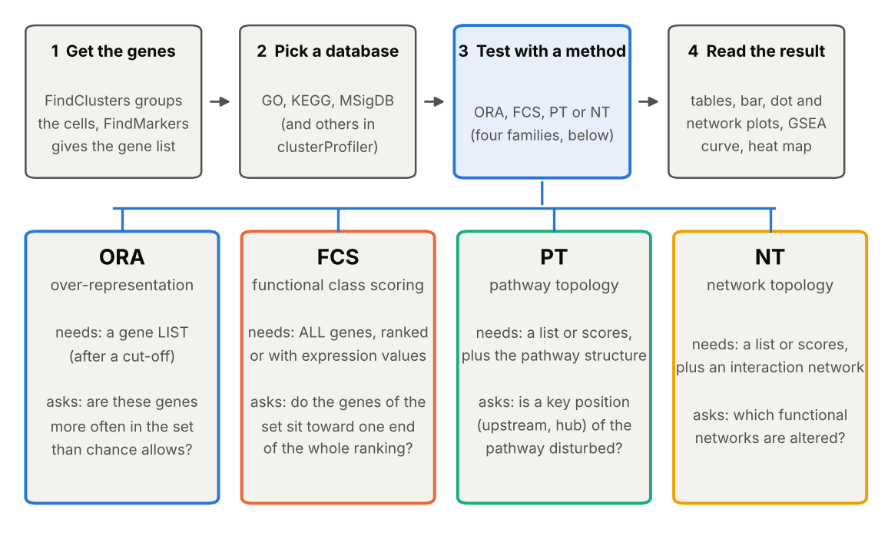
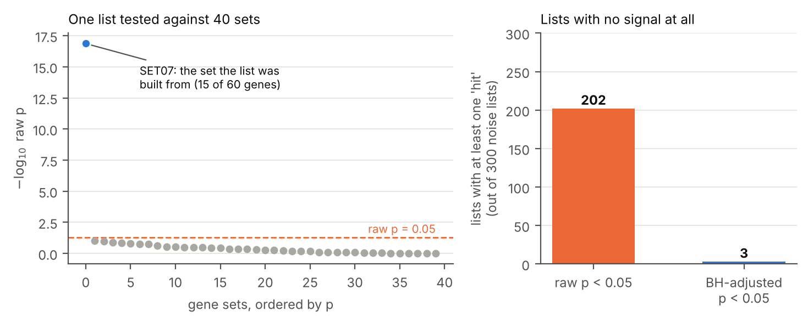
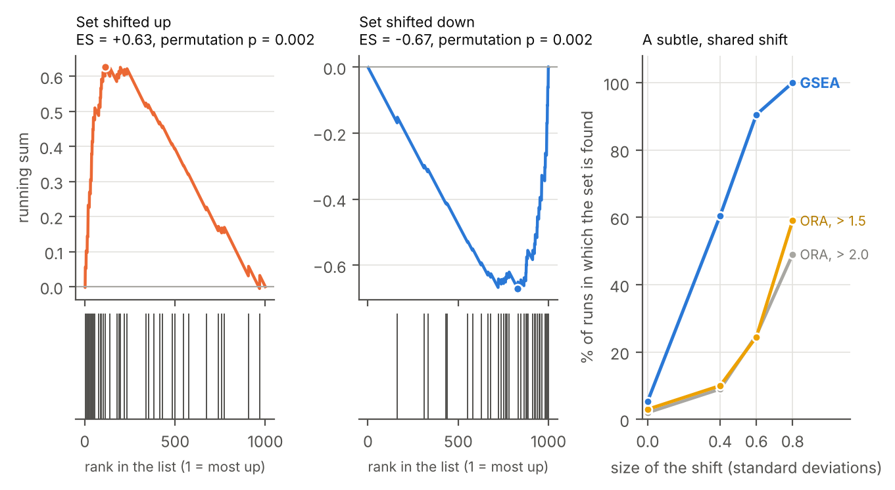
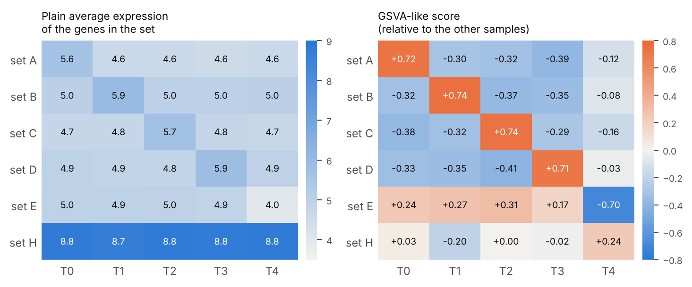

# Gene Enrichment in Single Cell Analysis

> Module 6: from a list of marker genes to biological meaning. Why enrichment analysis is needed, the four families of methods (ORA, FCS, PT, NT), the databases (GO, KEGG, MSigDB), the tools (clusterProfiler, GSEA, GSVA), how to read the plots, and a worked plan for the after-class assignments.

---

## Table of Contents

1. [Why Enrichment Analysis](#1-why-enrichment-analysis)
2. [The Basic Process and Three Questions to Ask First](#2-the-basic-process-and-three-questions-to-ask-first)
3. [Getting the Genes: FindClusters and FindMarkers](#3-getting-the-genes-findclusters-and-findmarkers)
4. [Four Families of Methods: ORA, FCS, PT, NT](#4-four-families-of-methods-ora-fcs-pt-nt)
5. [The Databases: GO, KEGG, MSigDB and Others](#5-the-databases-go-kegg-msigdb-and-others)
6. [The Software: clusterProfiler, GSEA, GSVA](#6-the-software-clusterprofiler-gsea-gsva)
7. [ORA in Practice](#7-ora-in-practice)
8. [Visualising GO and KEGG Results](#8-visualising-go-and-kegg-results)
9. [GSEA: Gene Set Enrichment Analysis](#9-gsea-gene-set-enrichment-analysis)
10. [GSVA: Gene Set Variation Analysis](#10-gsva-gene-set-variation-analysis)
11. [Which Method for Which Question](#11-which-method-for-which-question)
12. [After-Class Assignments and a Plan for Them](#12-after-class-assignments-and-a-plan-for-them)
13. [Key Takeaways](#13-key-takeaways)
14. [What's Next](#14-whats-next)

---

## How to read this module

Module 4 gave you clusters and a table of marker genes for each; Module 5 turned the clusters into named cell types. This module asks the next question: **what do these cells do?** A marker table with hundreds of genes cannot be read gene by gene. Enrichment analysis summarises it as a short list of functions and pathways. The notes follow the lecture's order (why, the basic process, methods, databases, software, the three kinds of result plots, the after-class tasks) and add the reasoning the slides leave out.

**Sources and honesty about them.** The lecture slides are image captures of a video, so the player controls cut some text and some figures are small; where a number or a label is hard to read, I say "my reading". A text version of the narration is also available and was produced by speech recognition, which writes KEGG as "keg", GO as "GIO" or "geo", MSigDB as "MSDB" and ORA as "aura"; I corrected those silently. Two slides (the ones introducing the GSEA and GSVA software) are the same capture twice. Where the narration and a slide disagree, I say so.

**R is not installed on the machine used to check this module, so no R code here was run.** The slides contain almost no code (only an install snippet), so the R code in section 12 is **my own suggestion for the after-class tasks, not from the slides, and untested**. Where I add anything else that is not on a slide, the text says "not on the slides". The Python blocks **were run** and their outputs are real, but they check the *logic* of each method (how an over-representation p-value is computed, what a running sum looks like, why a pathway score is relative) on small invented data. They are **not** clusterProfiler, GSEA or GSVA themselves, and none of the p-values in them are results about real biology.

---

## 1. Why Enrichment Analysis

**The problem.** The lecture's first slide says it directly: in single cell analysis we get **a long list of differential genes, and it is often difficult to get useful information from it**. A cluster of a few thousand cells can easily have several hundred genes that pass the usual cut-offs. Reading them one by one means looking each gene up, remembering what it does, and holding the whole picture in your head.

**The purpose.** The slide states the purpose of enrichment analysis as: to **integrate the differential gene information into functional or pathway information with biological significance**, using three ingredients: the differential gene list, the corresponding database information, and certain statistical methods. In short, you move from "which genes?" to "which functions?".

**The essence.** The slide's one-line summary is: *the essence of enrichment is to describe gene function.* Common methods are **GO, KEGG, GSEA and GSVA**, which are the four names in the title and the four topics of this module.

**What the slide shows.** The first content slide has a table of 19 genes with the columns `p_val`, `avg_log2FC`, `pct.1`, `pct.2` and `p_val_adj` (the same columns you met in Module 4 and 5), and two screenshots of web resources: **GeneCards** (described on the slide as a searchable human gene database that integrates gene-centric data from about 150 web sources) and **PathCards** (a human biological pathway unification database). They are look-up tools for one gene or one pathway at a time; the slide does not discuss them further, and the narration does not mention them.

**Why a statistical method rather than your own eyes.** You could read the 19 genes in that table yourself. A person who knows immunology sees `CD3D`, `CD3E`, `CD3G`, `TRAC`, `TRBC2`, `TRGC2` (parts of the T-cell receptor complex), `CD8A`, `CD8B` (CD8 co-receptor), `CD2`, `IL7R`, `TCF7`, `GZMK` and `IL32` and thinks "T cells" (this is general knowledge, not on the slide). That is manual annotation in one step, exactly as in Module 5. Enrichment analysis does the same job **automatically, against a whole database of known gene sets, and with a number attached** (a p-value), so it still works when the list has 400 genes and some of them you have never heard of.

Section 3 uses this very table to show what a careful reading of a gene list looks like before any test is run.

---

## 2. The Basic Process and Three Questions to Ask First

**The slide's picture.** The slide titled "Basic process of gene enrichment analysis" has a diagram (its source is not stated on the slide). On the left is the **input** (an expression data set, drawn as a gene-chip image, and a **pathway database**). Three routes lead from it to one final box, **"assess pathway significance"**:

1. **ORA (over-representation analysis).** Differential expression analysis gives the differentially expressed (DE) genes; the method then uses the number of DE genes and the number of reference genes in each pathway.
2. **FCS (functional class scoring).** Gene-level statistics are computed first, then converted into gene-set (pathway) statistics.
3. **PT (pathway topology).** DE genes or gene-level statistics are combined with the **structure** of the pathway (the number of reactions, the position of a gene, the type of reaction) to give a **pathway impact factor**.

The three routes are the first three of the four families explained in section 4.

**The slide's three bullets.** (1) A group of genes is first obtained through biological experiments or computation, and appears as a gene list, an expression profile, or gene-chip data. (2) Pre-built gene annotation databases (GO, KEGG, MSigDB and so on) are used. (3) The genes are classified with specific algorithms based on the knowledge in the annotation database.

**Three questions to ask before you start** (the grey box at the bottom of the slide, and repeated in the narration):

1. **How do you select the gene set?** The slide gives two examples: differential expression (DE) and **WGCNA**. WGCNA is weighted gene co-expression network analysis, a method that groups genes whose expression rises and falls together across samples (the narration says "co-expression networks"; the explanation of WGCNA is general knowledge, not on the slides).
2. **Which database should you choose?** GO, KEGG and MSigDB answer different questions (section 5).
3. **Which biological processes are you concerned about?** An enrichment result is only useful if you can say what you were hoping to learn.

**The pipeline as one picture.** The figure below redraws the process as four steps, with the four method families hanging under step 3. It is my drawing, not the slide's.



The figure shows why the earlier modules matter: step 1 is the output of Modules 4 and 5, and the quality of that step decides whether the later steps mean anything.

---

## 3. Getting the Genes: FindClusters and FindMarkers

**The slide.** "Basic process of gene enrichment, gene acquisition" shows two pieces. On the left, **FindClusters**: a 2-D map (t-SNE, axes `tSNE_1` and `tSNE_2`) with cells coloured by cluster; the legend runs from 0 to 7, so eight clusters (my reading). On the right, **FindMarkers**: two small tables of marker genes with the columns `p_val`, `avg_logFC`, `pct.1`, `pct.2`, `p_val_adj` (the old Seurat name `avg_logFC`; the slide-2 table and Seurat v4 use `avg_log2FC`). The first table starts with `S100A9`, `S100A8`, `LGALS2`, `FCN1`, `CD14`; the second with `CD79A`, `HLA-DQA1`, `MS4A1`, `CD79B`, `HLA-DQB1`. The slide does not say which clusters they belong to; from the gene names the first looks like a monocyte cluster and the second like a B-cell cluster (general knowledge, my reading).

**What the narration says each step answers.**

- **FindClusters** groups cells that are transcriptionally similar. Each resulting cluster is assumed to represent a cell type, a cell state or a biological condition. It answers: *which cells look similar enough to belong to the same group?* Without a sensible clustering there are no cell types, nothing to compare, and enrichment "would lack biological meaning".
- **FindMarkers** compares gene expression between one cluster and all the others (or between two chosen clusters or conditions) and returns genes that are significantly higher or lower. It answers: *which genes make this cluster different?* For each gene it compares two groups of cells with a statistical test (the narration names the **Wilcoxon rank-sum test**) and reports the log fold change, the p-value and the adjusted p-value. The result is a ranked list of genes with statistical support.
- Together: FindClusters says **who belongs to which group**, FindMarkers says **what makes each group unique**. Enrichment analysis depends on both.

**"Grouping is the key."** The slide's bold heading. By studying differential expression between groups we can find: **cell-type-specific genes** (one cluster against the others), **developmental-stage-specific genes**, **genes associated with a disease state**, and **environment-related genes**. The comparison you choose decides which question the enrichment answers. Endothelial cells against fibroblasts gives the functions that separate those two cell types (this is assignment 2, section 12); treated against untreated within one cell type gives the response to treatment. The narration adds the warning that **the quality of the grouping directly affects the biological relevance of the enrichment results**.

**A worked reading of the slide's gene list.** Before any test, look at the numbers. The table on slide 2 has 19 genes; I re-checked every value against a high-resolution crop. It looks like the marker list of a T-cell cluster (my reading of the gene names). Notice two things:

- Every adjusted p-value is 0. With thousands of cells almost every difference is "significant", so the p-value cannot rank these genes; the fold change and the two percentage columns must do that (Module 5, section 3).
- Four of the genes are ribosomal (`RPS12`, `RPL13`, `RPL13A`, `RPS29`). Their `pct.2` is between 0.71 and 0.87: they are expressed in most of the *other* cells too. Their log2 fold change of about 1.1 to 1.2 says "somewhat higher in this cluster", not "specific to this cluster".

The check below turns this into a test. It scores the 19 genes against two **toy** gene sets with a hypergeometric test (section 7 explains the test): a T-cell receptor set (a short list I wrote, 15 genes) and a ribosome set (only its size, 80 genes, matters here). The universe of 20,000 genes is an assumption.

```python
import pandas as pd
from scipy.stats import hypergeom

# The marker table on the slide's first page (typed from the screenshot; low resolution, last digit may be off)
rows = [("CD3D", 2.724, .735, .080), ("IL7R", 2.640, .498, .034), ("TRAC", 2.497, .570, .045), ("CD3G", 2.459, .552, .029),
        ("CD3E", 2.211, .653, .086), ("CD8B", 2.116, .310, .016), ("TRBC2", 1.949, .836, .397), ("GZMK", 1.854, .233, .022),
        ("TRGC2", 1.674, .290, .044), ("TCF7", 1.621, .306, .034), ("CD8A", 1.443, .331, .079), ("IL32", 1.281, .802, .336),
        ("CD52", 1.249, .964, .604), ("LDHB", 1.244, .456, .208), ("RPS12", 1.228, .959, .712), ("CD2", 1.196, .405, .129),
        ("RPL13", 1.118, .995, .825), ("RPL13A", 1.110, .996, .838), ("RPS29", 1.084, .997, .865)]
t = pd.DataFrame(rows, columns=["gene", "avg_log2FC", "pct1", "pct2"])
print("genes in the list:", len(t), "| genes expressed in more than 70% of ALL OTHER cells (pct2 > 0.7):",
      t.loc[t.pct2 > 0.7, "gene"].tolist())

# Two toy gene sets. The TCR set is my own short list; for the ribosome set only its size matters (about 80 genes)
tcr = {"CD3D", "CD3E", "CD3G", "CD247", "TRAC", "TRBC1", "TRBC2", "TRDC", "TRGC1", "TRGC2", "CD4", "CD8A", "CD8B", "LCK", "ZAP70"}
ribo_size, ribo_in_list = 80, {"RPS12", "RPL13", "RPL13A", "RPS29"}
N = 20_000                                                       # genes in the universe (an assumption)

def ora(genes, label):
    n = len(genes)
    out = []
    for name, K, k in (("T-cell receptor set", len(tcr), len(tcr & set(genes))),
                       ("cytosolic ribosome", ribo_size, len(ribo_in_list & set(genes)))):
        out.append((name, f"{k}/{n}", f"{K}/{N}", hypergeom.sf(k - 1, N, K, n) if k else 1.0))
    print(label)
    print("  set                  | GeneRatio | BgRatio    | p-value")
    for name, gr, br, p in out:
        print(f"  {name:20s} | {gr:>9s} | {br:>10s} | {p:.1e}")

ora(t.gene.tolist(), "ORA on the whole list of 19 genes:")
keep = t[t.pct2 <= 0.6]
print()
ora(keep.gene.tolist(), f"ORA after dropping genes with pct2 > 0.6 ({len(t) - len(keep)} genes dropped: {sorted(set(t.gene) - set(keep.gene))}):")

# Output:
# genes in the list: 19 | genes expressed in more than 70% of ALL OTHER cells (pct2 > 0.7):
#   ['RPS12', 'RPL13', 'RPL13A', 'RPS29']
# ORA on the whole list of 19 genes:
#   set                  | GeneRatio | BgRatio    | p-value
#   T-cell receptor set  |      8/19 |   15/20000 | 7.6e-22
#   cytosolic ribosome   |      4/19 |   80/20000 | 8.8e-07
# 
# ORA after dropping genes with pct2 > 0.6 (5 genes dropped: ['CD52', 'RPL13', 'RPL13A',
#   'RPS12', 'RPS29']):
#   set                  | GeneRatio | BgRatio    | p-value
#   T-cell receptor set  |      8/14 |   15/20000 | 3.0e-23
#   cytosolic ribosome   |      0/14 |   80/20000 | 1.0e+00
```

**Reading the output.** The T-cell set is hugely over-represented (8 of the 19 genes), as expected. But the ribosome set is also "significant" (4 of 19, p about 1e-06). A real GO or KEGG analysis would likewise report a ribosome or translation term for this list. That result is *true* (those genes are in the list) and *uninteresting* (they are expressed everywhere). When the five genes with `pct.2 > 0.6` are removed, the ribosome signal disappears (0 of 14) and the T-cell signal gets stronger. Two cautions: the cut-off of 0.6 is arbitrary, and it also removed `CD52`, a perfectly good lymphocyte gene (`pct.2` = 0.604). The lesson is not "always filter at 0.6"; it is that **an enrichment result is only as specific as the gene list you feed it**, so inspect the list first. The toy sets and the p-values are illustrative; they are not what GO would return.

---

## 4. Four Families of Methods: ORA, FCS, PT, NT

**The slide's definition.** Enrichment analysis is usually used to analyse whether **known biological functions or processes are over-represented (enriched) in a group of genes**. Because the result is based on a set of related genes and not on single genes, it raises the reliability of the study and the ability to identify the processes most relevant to the biological phenomenon. Methods are divided into four categories by data source and algorithm: **ORA, FCS, PT and NT**.

**ORA: over-representation analysis.** The slide's three steps:

1. Get a set of genes of interest.
2. Count the genes shared between the gene list and a pathway's gene list.
3. Use a statistical test to ask whether the **proportion of shared genes is significantly higher** than the proportion of pathway genes.

The narration's summary: ORA "tests if certain pathways are over-represented in your gene list" and **depends on a threshold**, because the gene list is made by cutting a ranked table at some fold change or p-value.

**FCS: functional class scoring.** The slide's three steps (it numbers them 4, 5, 6, continuing the ORA list; I renumber them):

1. **Score or rank all the genes** between the two groups by their differential expression ratio, or take the sequencing expression profile directly as input.
2. **Convert gene scores into a score for each functional set**, using a specific statistical model.
3. Use **random sampling** (permutation) to judge whether the set-level statistic is significant, that is, whether the functional set changes significantly between groups.

The narration: FCS "uses ranked gene expression data to assess pathway activity", and the key difference from ORA is that **ORA needs a thresholded gene list while FCS considers the full expression profile**. GSEA and GSVA, the last two topics of the module, belong to this idea of scoring a set from all genes (the grouping of GSVA under FCS is my mapping; the lecture teaches the two tools separately).

**PT: pathway topology.** Instead of treating a pathway as an unordered bag of genes, PT methods use the **direction, position and interactions** of genes inside the pathway and give different importance to upstream regulators, downstream targets and hub genes. The question: *are critical positions in a biological pathway functionally disrupted?* The narration gives no tool name and the slides show none, so PT is conceptual in this session.

**NT: network topology.** NT methods go one step further and analyse **gene interaction networks** rather than pre-defined pathways. The question: *which functional gene networks are altered in this condition?* They are useful for complex diseases and system-level regulation. Again conceptual only.

| Family | Needs as input | Question it answers | Needs a cut-off? | Used in this module |
|---|---|---|---|---|
| ORA | a gene **list** | Are these genes more often in the set than chance allows? | Yes (to make the list) | clusterProfiler (GO, KEGG), section 7 |
| FCS | **all genes**, ranked or with values | Do the genes of the set sit toward one end of the whole ranking? | No | GSEA (section 9); GSVA (section 10, my grouping) |
| PT | a list or scores, **plus pathway structure** | Is a key position (upstream, hub) of the pathway disturbed? | Depends | not practised |
| NT | a list or scores, **plus an interaction network** | Which functional networks changed? | Depends | not practised |

---

## 5. The Databases: GO, KEGG, MSigDB and Others

A database in this context is a collection of **gene sets**: named lists of genes that share a function, a location, a pathway or a signature. The method counts or scores the genes of your data against these lists. **The database sets the vocabulary of the answer**, so choose it to match the question.

### 5.1 GO: the Gene Ontology

The slide: GO divides the function of genes into three parts, **cellular component (CC), molecular function (MF) and biological process (BP)**. With GO you can find out which of these levels your target genes are mainly associated with.

| Part | Slide's definition | Plain example |
|---|---|---|
| **BP** (biological process) | A biological process accomplished through multiple molecular activities | cell cycle, immune response |
| **MF** (molecular function) | The activity of a single gene product (protein or RNA) or of a complex of gene products, at the molecular level | binding, catalysis |
| **CC** (cellular component) | The structural position of a gene product in the cell where it performs its function | nucleus, mitochondrion |

The examples in the last column are the narration's. The slide also shows the home page of the GO resource (geneontology.org). From the small print (my reading) the release was dated 2022-07-01 and listed about **43,558 GO terms**, 7.48 million annotations, 1.48 million gene products and 5,213 species. The page has a box labelled "GO Enrichment Analysis" (powered by PANTHER, my reading) in which you paste gene IDs, choose the ontology (biological process is the default shown) and the species. It is a quick way to test a short list without R.

### 5.2 KEGG: Kyoto Encyclopedia of Genes and Genomes

The slide: KEGG is a database that **integrates genomic, chemical and system-functional information**. Its notable feature is the **graphical** presentation: pathway maps that use pictures instead of words to show many metabolic pathways and the relationships between their parts, which gives an intuitive, overall picture. The narration: KEGG enrichment shows **which pathways are most affected** in a condition or cell type.

The screenshot of the KEGG PATHWAY page lists the seven top-level categories (my reading): 1 Metabolism, 2 Genetic Information Processing, 3 Environmental Information Processing, 4 Cellular Processes, 5 Organismal Systems, 6 Human Diseases, 7 Drug Development. The pathway map on the right of the slide is a cancer pathway (the title reads colorectal cancer, my reading) with the genes drawn as boxes.

Two practical remarks that are **not on the slides**: the usual R function for KEGG fetches the pathway information from KEGG's server, so it needs network access; and KEGG has licence terms for some kinds of use, so check them if you plan to redistribute KEGG-derived files.

### 5.3 MSigDB: the Molecular Signatures Database

The slide shows a grid of collections. For human data they are:

| Code | Collection | What the sets are (slide's description, shortened) |
|---|---|---|
| **H** | Hallmark | coherently expressed signatures derived by aggregating many MSigDB sets, representing well-defined biological states or processes |
| C1 | Positional | human chromosome cytogenetic bands |
| **C2** | Curated | from online pathway databases, publications in PubMed, and the knowledge of domain experts |
| C3 | Regulatory target | targets of microRNA seed sequences and predicted transcription factor binding sites |
| C4 | Computational | defined by mining large collections of cancer-oriented microarray data |
| **C5** | Ontology | genes annotated by the same ontology term (GO) |
| C6 | Oncogenic signature | defined from microarray data of cancer gene perturbations |
| C7 | Immunologic signature | cell states and perturbations within the immune system |
| C8 | Cell type signature | curated cluster markers identified in single-cell sequencing studies of human tissue |

The mouse collections have the same idea with an M prefix (MH, M1, M2, M3, M5, M8 are visible; the bottom of the slide is cut off, my reading). The narration stresses two for human data: **C2**, which "includes KEGG and Reactome", and **C5**, the GO gene sets, divided into BP, MF and CC. The sets are manually curated and widely used. The slide points to the MSigDB website (gsea-msigdb.org) as the central resource. One observation of mine: **C8 is built from single-cell cluster markers**, so it is the collection most directly related to the cell-type work of Module 5.

### 5.4 What clusterProfiler can use

The slide "Database" shows clusterProfiler in the middle of a mind map. On the right are the ontologies and pathways it supports: **MSigDB, Disease Ontology (via the DOSE package), Network of Cancer Gene, Reactome Pathway, DisGeNET, GO, KEGG, DAVID, and other annotations (for example CellMarker)**. Below are its three kinds of analysis (**over-representation analysis, gene set enrichment analysis, biological theme comparison**) and its plot functions: **barplot, cnetplot, dotplot, emapplot, gseaplot, goplot, upsetplot**. The three logos at the bottom are GO, KEGG and MSigDB.

---

## 6. The Software: clusterProfiler, GSEA, GSVA

The narration's closing message of this part: the three tools are **complementary**, together a toolkit for functional interpretation, and understanding both the databases and the software is critical for interpreting results correctly.

| Tool | What it does (narration) | Input | Notes |
|---|---|---|---|
| **clusterProfiler** (R, Bioconductor) | GO and KEGG enrichment by over-representation analysis; supports GSEA-style enrichment; works directly with MSigDB sets; has built-in plots. "A complete enrichment workflow from gene list input to visualisation." | a gene list, or a ranked list | the slide's description: statistical analysis and visualisation of functional profiles for genes and gene clusters |
| **GSEA** (a standalone program) | Gene set enrichment analysis on a **ranked** gene list; works with MSigDB or custom sets; produces the standard GSEA plots; "very suitable for teaching and beginners" (the narration's phrase) | ranked gene list | the slide shows the original paper, "Gene set enrichment analysis: a knowledge-based approach for interpreting genome-wide expression profiles", and the program's web page |
| **GSVA** (R, Bioconductor) | Converts gene-level expression into **gene-set-level scores**, to compare pathway activity across samples or cell types; "especially powerful for single cell and heterogeneous data" | expression matrix | the slide shows the paper "GSVA: the Gene Set Variation Analysis package for microarray and RNA-seq data" |

The sentence to remember from the narration: **GSVA asks how active a pathway is in each sample or cell type; the others ask whether a pathway is enriched.**

**Installing clusterProfiler.** The slide's snippet is the standard Bioconductor installation:

```r
if (!requireNamespace("BiocManager", quietly = TRUE))
    install.packages("BiocManager")
BiocManager::install("clusterProfiler")
```

The slide also gives the Bioconductor package page and the clusterProfiler book (the YuLab-SMU online book, my reading of the link). The Bioconductor page in the screenshot shows a release number of 3.11 (my reading), so the capture is a few years old: install from the current Bioconductor release and do not copy any version number from it. Module 5, section 13 listed the full set of packages the lecture asks you to install in advance; section 12 below uses them.

---

## 7. ORA in Practice

ORA is the method behind most GO and KEGG tables you will meet. It is worth understanding completely because every other method is easier to explain by contrast with it.

**The test, step by step.** Four numbers define the problem:

- **N**: the **universe**, all genes that could have been in the list (the background).
- **K**: how many of those N genes belong to the gene set (for example one GO term).
- **n**: the size of your gene list.
- **k**: how many genes of your list belong to the set (the overlap).

If your list were a random draw of n genes from the universe, the overlap would follow the **hypergeometric distribution**, whose mean is n x K / N. The p-value of ORA is the probability of an overlap **at least as large as k**: p = P(X >= k). That is the slide's third step ("is the proportion of shared genes significantly higher than the proportion of pathway genes?") written as a formula. It is the same number as a **one-sided Fisher exact test** on the 2 x 2 table (in list or not, in set or not); the check below confirms this on all 40 sets, with a maximum difference of 0.0.

In clusterProfiler's result table (my knowledge of its columns; the slides do not show one) the two ratios are printed as **GeneRatio = k / n** and **BgRatio = K / N**, next to the p-value, the adjusted p-value (`p.adjust`), the q-value and the gene names. The toy below prints the same columns.

**The toy.** A universe of 2,000 genes and 40 gene sets of 20 to 100 genes each. The list has 60 genes, 14 of them deliberately taken from one set (SET07), the other 46 random. So we know the right answer. Then, to see what multiple testing does, 300 lists made only of random genes (no signal at all) are tested against the same 40 sets.

```python
import numpy as np
import pandas as pd
from scipy.stats import hypergeom, fisher_exact, false_discovery_control

rng = np.random.default_rng(4)
N = 2000                                                    # a small toy universe of genes
genes = np.arange(N)
sizes = rng.integers(20, 101, size=40)                      # 40 toy gene sets of 20 to 100 genes
sets = {f"SET{i:02d}": set(rng.choice(genes, s, replace=False)) for i, s in enumerate(sizes)}

# the DE gene list: 60 genes, 14 of them taken from SET07 (a planted signal), the rest at random
n_list = 60
planted = rng.choice(sorted(sets["SET07"]), 14, replace=False)
others = rng.choice(np.setdiff1d(genes, planted), n_list - 14, replace=False)
de = set(planted) | set(others)

def ora_table(de, sets, N):
    rows = []
    for name, S in sets.items():
        k, K, n = len(de & S), len(S), len(de)
        p = hypergeom.sf(k - 1, N, K, n) if k else 1.0
        # the same number as a one-sided Fisher exact test on the 2x2 table (in list / not in list x in set / not in set)
        pf = fisher_exact([[k, n - k], [K - k, N - K - (n - k)]], alternative="greater")[1]
        rows.append((name, f"{k}/{n}", f"{K}/{N}", p, pf, k))
    df = pd.DataFrame(rows, columns=["ID", "GeneRatio", "BgRatio", "pvalue", "p_fisher", "Count"])
    df["p.adjust"] = false_discovery_control(df["pvalue"].to_numpy(), method="bh")
    return df.sort_values("pvalue").reset_index(drop=True)

res = ora_table(de, sets, N)
pd.options.display.float_format = "{:.2e}".format
print("top of the result table (columns like the output of clusterProfiler's enrichGO):")
print(res.head(4)[["ID", "GeneRatio", "BgRatio", "pvalue", "p.adjust", "Count"]].to_string(index=False))
print("\nmax difference between the hypergeometric p-value and one-sided Fisher exact p-value:",
      f"{(res.pvalue - res.p_fisher).abs().max():.1e}")
print("sets with raw p < 0.05:", int((res.pvalue < 0.05).sum()), "| with p.adjust < 0.05:", int((res["p.adjust"] < 0.05).sum()))

# the cost of testing many sets: 300 random lists with NO signal, tested against all 40 sets
raw_hits, adj_hits = [], []
for _ in range(300):
    lst = set(rng.choice(genes, n_list, replace=False))
    r = ora_table(lst, sets, N)
    raw_hits.append(int((r.pvalue < 0.05).sum())); adj_hits.append(int((r["p.adjust"] < 0.05).sum()))
print("\n300 random lists without any signal, 40 sets each:")
print("  mean number of 'significant' sets per list, raw p < 0.05     :", round(float(np.mean(raw_hits)), 2))
print("  lists with at least one raw 'hit'                            :", int(np.sum(np.array(raw_hits) > 0)), "of 300")
print("  lists with at least one hit after BH adjustment (< 0.05)     :", int(np.sum(np.array(adj_hits) > 0)), "of 300")

# Output:
# top of the result table (columns like the output of clusterProfiler's enrichGO):
#    ID GeneRatio BgRatio   pvalue  p.adjust  Count
# SET07     15/60 26/2000 1.36e-17  5.46e-16     15
# SET18      3/60 37/2000 9.71e-02  8.96e-01      3
# SET03      4/60 61/2000 1.08e-01  8.96e-01      4
# SET34      4/60 66/2000 1.33e-01  8.96e-01      4
# 
# max difference between the hypergeometric p-value and one-sided Fisher exact p-value:
#   0.0e+00
# sets with raw p < 0.05: 1 | with p.adjust < 0.05: 1
# 
# 300 random lists without any signal, 40 sets each:
#   mean number of 'significant' sets per list, raw p < 0.05     : 1.07
#   lists with at least one raw 'hit'                            : 202 of 300
#   lists with at least one hit after BH adjustment (< 0.05)     : 3 of 300
```

**Reading the output.**

- **The signal is found.** SET07 has 15 of the 60 genes (14 planted plus 1 by chance), but only 26 of the 2,000 genes are in it, so the expected overlap is 60 x 26 / 2000 = 0.78. Observing 15 when 0.78 is expected gives p = 1.4e-17. The next best set has p = 0.097, so only SET07 is below 0.05, before or after adjustment.
- **The adjusted p-value.** Forty sets were tested, so the raw p-values are corrected with the **Benjamini-Hochberg (BH)** method, which controls the false discovery rate (the expected share of false findings among the sets you call significant). SET07 stays far below 0.05 (5.5e-16).
- **Why correction is not optional.** Among the 300 lists with *no signal*, **202 lists (67%) had at least one set with a raw p below 0.05**. After BH adjustment only **3 lists (1%)** did. A real database has thousands of sets (about 43,500 GO terms on the slide's screenshot, my reading), so the raw p-values of an enrichment table must never be read on their own. The mean number of raw "hits" per noise list (1.07) is lower than the 2 you would expect from 40 independent 5% tests; I think this is because the hypergeometric p-value takes only discrete values when the expected overlap is small, which makes the test conservative (my explanation, not checked further).



*Figure. Left: the planted set stands far above the others on the raw p-value scale. Right: with no signal at all, two thirds of lists still produce a raw hit; the adjusted p-value removes almost all of them.*

**The background (universe) matters.** The slide does not discuss it, but it is the most common silent error in ORA, so it belongs here. The universe should be the genes that **could have been detected** in your experiment, not all genes in the genome. With the whole genome as background, the overlap looks more surprising than it is, because the many genes you could never have detected are counted as "not in your list". In clusterProfiler this is the `universe` argument (my knowledge). The check below keeps the list (100 genes), the set (50 genes) and the overlap (6) fixed and changes only the background.

```python
from scipy.stats import hypergeom

# The same hit, tested against different backgrounds ("universe" in clusterProfiler): 100 genes in the list, a set of 50 genes,
# 6 of the 100 are in the set. Which genes count as "the background" changes the answer.
n, K, k = 100, 50, 6
print("list of", n, "genes, set of", K, "genes, overlap", k)
print("  background (universe)           expected overlap   p-value")
for label, N in (("all 20,000 annotated genes", 20000), ("12,000 genes detected in the data", 12000),
                 ("6,000 genes detected in this cluster", 6000)):
    print(f"  {label:36s} {n * K / N:6.2f}        {hypergeom.sf(k - 1, N, K, n):.1e}")

# Output:
# list of 100 genes, set of 50 genes, overlap 6
#   background (universe)           expected overlap   p-value
#   all 20,000 annotated genes             0.25        1.8e-07
#   12,000 genes detected in the data      0.42        3.4e-06
#   6,000 genes detected in this cluster   0.83        1.6e-04
```

The same hit is "p = 2e-07" or "p = 2e-04" depending on the background: **almost three orders of magnitude** from this choice alone. (The toy assumes all 50 set genes are among the detected genes; in practice the set is first reduced to the genes inside the universe.)

**Limits of ORA** (the first is the narration's, the others are general knowledge, not on the slides):

- It needs a **cut-off** to make the list. Genes just below the line are treated like genes with no change at all, and the result can change if you move the line.
- It uses **only membership in the list**, not how large the change is.
- Up-regulated and down-regulated genes mixed in one list can hide each other, so they are usually tested separately.
- GO terms are nested (a parent term contains its children), so a result often shows several near-duplicate terms for one underlying signal.

These limits are what FCS methods (sections 9 and 10) try to remove.

---

## 8. Visualising GO and KEGG Results

**What the slide shows.** "Visualization of enrichment results: GO/KEGG" is a collage of the plot types clusterProfiler and its companion package draw. From the slide and the narration:

- **Bar plot and dot plot.** The y-axis lists the **enriched terms or pathways**; the x-axis is usually the **gene ratio** (or a count, or an enrichment score); the **colour** shows the statistical significance, normally the adjusted p-value. In a dot plot the dot **size** is the number of genes (the `Count` column of section 7). The slide shows two dot plots side by side, labelled in the small print "dotplot for ORA" and "dotplot for GSEA" (my reading).
- **cnetplot (gene-concept network).** The slide shows three versions (A, B, C; one is drawn as a circle). It links **genes to the terms they belong to**, so you can see which genes drive which terms and which genes are shared between terms. Gene colour can carry the fold change.
- **goplot.** The GO terms drawn as a hierarchy (a graph where parent terms sit above their children), with the enriched terms coloured, so you can see where in the ontology the result sits.
- **KEGG pathway map.** The same kind of pathway picture as in section 5.2, with your genes highlighted on the map.
- Also named on the earlier slide: **emapplot** (an enrichment map, in which terms are nodes joined when they share genes, my knowledge) and **upsetplot** (overlaps between terms).

The terms in the slide's bar plot are disease names (for example breast carcinoma terms), so the picture seems to come from a disease-ontology demonstration, not from single cell data (my reading). Treat the slide as a gallery of plot types and not as a result to interpret.

**How to read a dot or bar plot well** (my guidance, not on the slides):

1. **Significance and size are different things.** A small adjusted p-value with a tiny gene ratio can be a narrow, specific term; a large ratio with a weak p-value is broad. Look at both.
2. **Look for a theme, not a single top term.** If the first ten terms are all variants of "T-cell activation", the theme is T-cell activation. Use the network plots to see how the terms overlap.
3. **Ask which genes carry the term.** A term supported by one gene is fragile; `cnetplot` shows this immediately.
4. **Always check the term against what you already know** about the cell type (Module 5). A result that contradicts your annotation is either a surprise worth studying or a sign that the annotation or the gene list is wrong.

---

## 9. GSEA: Gene Set Enrichment Analysis

**The idea.** ORA cuts the ranked table and counts. **GSEA keeps every gene.** It ranks all genes from most up-regulated to most down-regulated, then asks whether the genes of one set are **piled up near the top or near the bottom** of that ranking, or spread evenly. The slide's statement of the result: GSEA looks at whether the genes of a set are enriched at the **top** (then, overall, the set is **up-regulated**) or at the **bottom** (then it is **down-regulated**) of the ranked list. The narration calls it ideal for detecting **subtle but coordinated changes** across a set.

**The slide's two advantages.**

1. Traditional GO and KEGG (that is, ORA) work on genes with significant differences, while GSEA **does not need to screen for significant genes** and can keep functionally important genes that change only a little.
2. The slide's second point is worded "it is the analysis of a single gene set". The narration does not explain it. My reading: the unit tested is **one gene set as a whole** (not individual genes), and each set receives its own score.

**The algorithm, as drawn on the slide.** The diagram on the left has three blue boxes that, read in order, are the algorithm:

1. *The genes are ranked and each gene is assigned a rank value.* (A table of genes with a ranking metric, such as a fold change.)
2. *Search for the genes of the gene set in the ranked gene list.* (The gene set's members are located in the ranking.)
3. *Add and subtract points.* (A running sum: a gene of the set adds, a gene not in the set subtracts. The curve at the bottom is labelled "enrichment score".)

The diagram on the right shows the same thing for a real experiment: two phenotype classes A and B, a heat map of the ranked genes, the gene set's members drawn as ticks along the ranking, and the running-sum curve, with the **maximum deviation from zero** labelled as the enrichment score ES(S). The genes before the peak are called the **leading edge** subset (the slide's label).

**In words, exactly:**

1. Rank all N genes by a statistic (a log fold change, for example).
2. Walk down the list from the top. At a gene **in** the set, step **up** by an amount proportional to the gene's score (a gene with a large change counts more; this weighting is the usual default, my knowledge, not on the slides). At a gene **not in** the set, step **down** by a small fixed amount, 1 / (N - K). The steps are scaled so that the up-steps sum to exactly 1 and the down-steps to exactly -1, so the walk **always ends at 0**.
3. The **enrichment score (ES)** is the largest distance from 0 reached by the walk. A positive ES means the set is concentrated at the top, a negative ES at the bottom.
4. The **significance** comes from **permutation** (the narration: "the significance is assessed using permutation tests"). Shuffle, recompute the ES many times, and see how often chance gives an ES as large.

**Reading a GSEA plot** (the narration, in the plot's own terms): the x-axis is the ranked gene list; **vertical lines mark where the genes of the set fall**; the curve is the running sum; the **peak of the curve shows whether the set is concentrated at the top or the bottom**.

**The check.** A ranked list of 1,000 genes (scores drawn from a standard normal distribution, as for z-scores) and a set of 40 genes. In the first two runs the set is shifted up or down by 0.8 standard deviations; in the third it is random. Then comes the comparison the slide's first advantage is about: **how often is a set found** by ORA and by GSEA when the set is shifted by only a little? ORA uses a cut-off on the score (two cut-offs are tried, because the cut-off is a free choice), GSEA the permutation p-value (doubled, because one direction is tested at a time). The gene sets here are random draws and permutations shuffle gene labels, a simplification (see the caution below).

```python
import numpy as np

def running_sum(order_score, member, p=1.0):
    """Weighted Kolmogorov-Smirnov-like running sum along a ranked list (high score first)."""
    N = len(order_score)
    w = np.abs(order_score) ** p * member
    step_up = w / w.sum()                       # a hit adds its share of the total weight
    step_dn = (~member) / (~member).sum()       # a miss subtracts an equal share
    walk = np.cumsum(step_up - step_dn)
    return walk

def es_of(walk):
    i = np.argmax(np.abs(walk))
    return walk[i], i                           # signed maximum deviation, and where it happens

rng = np.random.default_rng(11)
N, K = 1000, 40                                 # 1000 ranked genes, a gene set of 40

def make_run(shift):
    score = rng.normal(0, 1, N)                 # a toy "differential expression" score per gene (e.g. a log fold change)
    in_set = np.zeros(N, bool); in_set[rng.choice(N, K, replace=False)] = True
    score[in_set] += shift
    order = np.argsort(-score)                  # rank from most up-regulated to most down-regulated
    return score[order], in_set[order]

def perm_p(score_sorted, member, es_obs, nperm=999):
    """Gene-label permutation: put K random genes in the set, recompute ES. One-sided in the direction of the
    observed sign, then doubled (capped at 1) so that a set with no signal is called in about 5% of runs, not 10%."""
    hits = 0
    for _ in range(nperm):
        m = np.zeros(N, bool); m[rng.choice(N, K, replace=False)] = True
        e, _ = es_of(running_sum(score_sorted, m))
        if (e >= es_obs if es_obs > 0 else e <= es_obs): hits += 1
    return min(1.0, 2 * (hits + 1) / (nperm + 1))

print("Detailed run (set of 40 genes, each shifted by +/-0.8 standard deviations):")
for name, shift in (("set shifted UP", 0.8), ("set shifted DOWN", -0.8), ("no shift (random set)", 0.0)):
    s, m = make_run(shift)
    walk = running_sum(s, m); es, pos = es_of(walk)
    p = perm_p(s, m, es)
    where = "top" if pos < N / 2 else "bottom"
    print(f"  {name:22s} ES = {es:+.3f}  peak at rank {pos + 1:4d} of {N} ({where} half)  permutation p = {p:.3f}")
    if name == "set shifted UP": run_up = (s, m, walk, es, pos, p)
    if name == "set shifted DOWN": run_dn = (s, m, walk, es, pos, p)

# Power comparison: the slide says GSEA needs no pre-filtering for significant genes. Compare with a threshold-based ORA.
from scipy.stats import hypergeom
def one_trial(shift, nperm=199):
    s, m = make_run(shift)
    res = []
    for thr in (2.0, 1.5):                      # "significant" genes: |score| above a threshold, as ORA needs
        sig = np.abs(s) > thr
        n, k = sig.sum(), (sig & m).sum()
        res.append((hypergeom.sf(k - 1, N, K, n) if k else 1.0) < 0.05)
    es, _ = es_of(running_sum(s, m))
    res.append(perm_p(s, m, es, nperm) < 0.05)
    return res

power = {}
for shift, trials in ((0.0, 1000), (0.4, 200), (0.6, 200), (0.8, 200)):
    r = np.array([one_trial(shift) for _ in range(trials)])
    power[shift] = 100 * r.mean(axis=0)
    print(f"  shift {shift:.1f}: ORA with |score| > 2.0 finds the set in {100 * r[:, 0].mean():5.1f}% of {trials} runs, "
          f"ORA with |score| > 1.5 in {100 * r[:, 1].mean():5.1f}%, GSEA in {100 * r[:, 2].mean():5.1f}%")

# Output:
# Detailed run (set of 40 genes, each shifted by +/-0.8 standard deviations):
#   set shifted UP         ES = +0.627  peak at rank  113 of 1000 (top half)  permutation p
#   = 0.002
#   set shifted DOWN       ES = -0.670  peak at rank  830 of 1000 (bottom half)  permutation
#   p = 0.002
#   no shift (random set)  ES = -0.248  peak at rank  851 of 1000 (bottom half)  permutation
#   p = 0.682
#   shift 0.0: ORA with |score| > 2.0 finds the set in   2.0% of 1000 runs, ORA with |score|
#   > 1.5 in   3.0%, GSEA in   5.4%
#   shift 0.4: ORA with |score| > 2.0 finds the set in   9.0% of 200 runs, ORA with |score|
#   > 1.5 in  10.0%, GSEA in  60.5%
#   shift 0.6: ORA with |score| > 2.0 finds the set in  25.0% of 200 runs, ORA with |score|
#   > 1.5 in  24.5%, GSEA in  90.5%
#   shift 0.8: ORA with |score| > 2.0 finds the set in  49.0% of 200 runs, ORA with |score|
#   > 1.5 in  59.0%, GSEA in 100.0%
```

**Reading the output.**

- **Direction.** The set shifted up gives ES = +0.63 with the peak at rank 113 (near the top); the set shifted down gives ES = -0.67 with the peak at rank 830 (near the bottom). The random set gives a small ES (-0.25) and p = 0.68. This is the slide's rule: peak near the top means up-regulated, near the bottom means down-regulated.
- **Subtle, coordinated changes.** With a shift of 0.4 standard deviations almost no gene of the set passes the cut-off, so ORA has little to count: it finds the set in about **9 to 10%** of runs, while GSEA finds it in about **60%**. At 0.6 the figures are about 25% against about 91%; at 0.8, about 49 to 59% against 100%. The gene scores in the set are only a little higher than the rest, but **they all lean the same way**, and the running sum adds this up. That is exactly what "no pre-filtering needed" means.
- **No free lunch.** With no shift the set is "found" in 5.4% of 1,000 runs by GSEA and 2 to 3% by ORA, so both stay near the 5% they promise; the gain of GSEA is not paid for in false positives in this toy.



*Figure. Left and middle: running sum (top) and the positions of the 40 set genes in the ranking (ticks, bottom). Right: percentage of runs in which the set is found, against the size of the shift.*

**Cautions.** The data are invented and independent, which real genes are not (genes in a pathway are often correlated, and shuffling gene labels can then make the test too easy to pass; this is why the original GSEA preferred to shuffle the sample labels when there are enough samples; general knowledge, not on the slides). In a single cell experiment, the ranked list usually comes from a differential test between two cell groups, so the cells within a group are not independent replicates in the way samples are. And the **ranking metric matters**: ranking by fold change alone ignores how reliable each change is. Use the same care as in Module 5 when you choose the statistic.

**Which output do you get?** GSEA reports, per set, the ES, a normalised version of it for comparing sets of different sizes, a p-value, and an adjusted p-value (my knowledge). The assignment (section 12) asks how to put the p-value on the GSEA plot.

---

## 10. GSVA: Gene Set Variation Analysis

**The question changes.** ORA and GSEA compare **two groups** and ask "is this set enriched?". GSVA takes the whole expression matrix and gives, for **every sample (or cell type)**, a **score for every gene set**. The slide: GSVA converts the expression matrix of **genes** across different samples into an expression matrix of **gene sets** across the same samples, so you can evaluate whether, for example, different metabolic pathways are enriched in different samples. It is used to study the differences of the gene sets of interest **between samples or cell types**, or to find the more important gene sets.

**The algorithm, as drawn on the slide.** The figure has an input (a gene expression matrix with samples S1 ... Sn as columns and genes g1 ... gp as rows, plus a database of gene sets), four numbered steps, and an output (a gene-set by sample matrix, shown as a coloured grid). The four steps are labelled:

1. **Gene expression level statistic.** For each gene, how high is this sample's value compared with the same gene's values in the other samples? (My reading of the step; the slide shows the label and a small plot of distributions for microarray and RNA-seq data.)
2. **Rank order per sample.** Within each sample, rank the genes by that statistic.
3. **KS-like random statistic.** Walk down the ranking with a running sum, as in GSEA.
4. **Different score distributions.** The last step turns the walk into a score. Two options are drawn: the **maximum deviation from zero** (a score whose distribution has two peaks) and the **difference between the largest positive and the largest negative deviation** (a score with one peak); the peaks are my reading of the small drawings.

So GSVA is built from the same running-sum idea as GSEA, but run **separately in every sample**, after a first step that makes genes comparable across samples.

**The meaning of the score** (the slide's three examples, and the narration):

| Slide's example | Meaning |
|---|---|
| S1 score = **0.62** | the genes in the gene set are expressed **higher** than the genes outside it: the pathway is **up-regulated** |
| S2 score = **-0.53** | genes in the set are expressed **lower** than genes outside it: the pathway is **down-regulated** |
| S3 score = **0.1**, close to zero | only a little difference between the inside and the outside: no clear change |

The slide's words compare genes inside the set with genes outside it; step 1 makes that comparison meaningful across samples, because each gene is first expressed relative to its own values in the other samples. The check below makes this concrete.

**The check.** Here is a simplified stand-in for GSVA that follows the four steps in the slide's figure (my reading of them, not the Bioconductor package). The toy has 300 genes and 5 cell types with 6 samples each. Gene baselines differ a lot between genes. Six gene sets of 25 genes: A, B, C and D are higher in one cell type each, E is lower in one cell type, and **H is very highly expressed in every sample but does not differ between types**. For comparison, the plain average expression of each set's genes is printed too.

```python
import numpy as np
from scipy.stats import norm

rng = np.random.default_rng(21)
G, per_type = 300, 6
types = ["Type 0", "Type 1", "Type 2", "Type 3", "Type 4"]
S = len(types) * per_type
col_type = np.repeat(np.arange(len(types)), per_type)

# Gene baselines differ a lot between genes (some genes are simply highly expressed), noise 0.5 within a cell type
base = rng.normal(5, 1.5, G)
x = base[:, None] + rng.normal(0, 0.5, (G, S))

# Six gene sets of 25 genes each (no overlaps). Four are higher in one cell type, one is lower in one, one is flat but very high everywhere.
idx = rng.permutation(G)
sets = {n: idx[i * 25:(i + 1) * 25] for i, n in enumerate(["A", "B", "C", "D", "E", "H"])}
for k, n in enumerate(["A", "B", "C", "D"]):            # A is up in type 0, B in type 1, C in type 2, D in type 3
    x[np.ix_(sets[n], col_type == k)] += 1.0
x[np.ix_(sets["E"], col_type == 4)] -= 1.0              # E is down in type 4
x[sets["H"], :] += 4.0                                  # H: high baseline in every sample, no difference between types

def gsva_like(x, sets, tau=1.0):
    """A simplified stand-in for GSVA (my reading of the four steps in the slide's figure), not the Bioconductor package."""
    G, S = x.shape
    # step 1: gene expression level statistic. For every gene, where is this sample's value among the other samples? (kernel CDF, then logit)
    h = x.std(axis=1, keepdims=True) / 4 + 1e-9
    F = norm.cdf((x[:, :, None] - x[:, None, :]) / h[:, :, None]).mean(axis=2)
    F = np.clip(F, 1e-6, 1 - 1e-6)
    z = np.log(F / (1 - F))
    out = {n: np.zeros(S) for n in sets}
    mid = (G + 1) / 2
    for j in range(S):
        order = np.argsort(-z[:, j], kind="stable")          # step 2: rank genes within the sample, highest first
        pos = np.empty(G, int); pos[order] = np.arange(1, G + 1)
        for n, members in sets.items():
            hit = np.zeros(G, bool); hit[members] = True
            w = np.abs(pos - mid) ** tau * hit                  # weight of a hit: distance of its rank from the middle
            walk = np.cumsum((w / w.sum() - (~hit) / (~hit).sum())[order])      # step 3: Kolmogorov-Smirnov-like random walk
            out[n][j] = walk.max() + walk.min()                 # step 4: largest positive minus largest negative deviation
    return out

sc = gsva_like(x, sets)
M = np.array([[sc[n][col_type == t].mean() for t in range(len(types))] for n in sets])
naive = np.array([[x[sets[n]][:, col_type == t].mean() for t in range(len(types))] for n in sets])
print("mean pathway score per cell type (rows = gene sets, columns = cell types):")
print("          " + "  ".join(f"{t:>7s}" for t in types))
for n, r in zip(sets, M):
    print(f"  set {n}:  " + "  ".join(f"{v:+7.2f}" for v in r))
print(f"range of all {len(sets) * S} per-sample scores: {min(v.min() for v in sc.values()):+.2f} to {max(v.max() for v in sc.values()):+.2f}")
print("\nthe plain average expression of the genes in each set (for comparison):")
for n, r in zip(sets, naive):
    print(f"  set {n}:  " + "  ".join(f"{v:7.2f}" for v in r))
print("\nthe three cases from the slide, in this toy (mean over the 6 samples of that cell type):")
print(f"  set A in Type 0 (higher than elsewhere):  {M[0, 0]:+.2f}")
print(f"  set E in Type 4 (lower than elsewhere):   {M[4, 4]:+.2f}")
print(f"  set H in Type 2 (no difference):          {M[5, 2]:+.2f}")
print(f"single samples wobble: for set H (no real difference) the 30 per-sample scores have mean {sc['H'].mean():+.2f} and standard deviation {sc['H'].std():.2f}")

# Output:
# mean pathway score per cell type (rows = gene sets, columns = cell types):
#            Type 0   Type 1   Type 2   Type 3   Type 4
#   set A:    +0.72    -0.30    -0.32    -0.39    -0.12
#   set B:    -0.32    +0.74    -0.37    -0.35    -0.08
#   set C:    -0.38    -0.32    +0.74    -0.29    -0.16
#   set D:    -0.33    -0.35    -0.41    +0.71    -0.03
#   set E:    +0.24    +0.27    +0.31    +0.17    -0.70
#   set H:    +0.03    -0.20    +0.00    -0.02    +0.24
# range of all 180 per-sample scores: -0.78 to +0.82
# 
# the plain average expression of the genes in each set (for comparison):
#   set A:     5.62     4.62     4.62     4.55     4.60
#   set B:     5.04     5.94     4.99     4.99     5.03
#   set C:     4.74     4.75     5.74     4.78     4.72
#   set D:     4.94     4.89     4.82     5.85     4.95
#   set E:     4.97     4.94     4.96     4.89     3.96
#   set H:     8.84     8.70     8.81     8.81     8.81
# 
# the three cases from the slide, in this toy (mean over the 6 samples of that cell type):
#   set A in Type 0 (higher than elsewhere):  +0.72
#   set E in Type 4 (lower than elsewhere):   -0.70
#   set H in Type 2 (no difference):          +0.00
# single samples wobble: for set H (no real difference) the 30 per-sample scores have mean
#   +0.01 and standard deviation 0.18
```

**Reading the output.**

- **The scores find the differences.** Sets A to D score about +0.7 in their own cell type (+0.72, +0.74, +0.74, +0.71); set E scores -0.70 in the type where it is lower. The slide's three cases are all there: a clearly positive score (A in type 0, +0.72), a clearly negative score (E in type 4, -0.70) and a score near zero (H in type 2, +0.00). All 180 scores lie inside -0.78 to +0.82, within the range of -1 to 1 that this type of score is designed to have.
- **A score is relative, and plain averages mislead.** Set H has an average expression of 8.8 in every cell type, far above set A in its own type (5.6), because its genes are simply highly expressed. A plain average would call H "high everywhere". The score is about 0 for H, because each gene is compared with itself across samples. **This is why GSVA is used to compare pathways across cell types**: a pathway of abundant genes is not mistaken for an "active" pathway.
- **Negative does not mean "off".** Set A scores about -0.3 in types 1 to 3. Nothing is switched off there; it is just lower than in type 0, and the score measures position **among the samples in this data set**. Add or remove samples and all scores shift. Scores from different data sets are not directly comparable.
- **Single scores are noisy.** For set H, which has no real difference, the 30 per-sample scores have a standard deviation of 0.18, so a single sample at +0.2 is within the noise. Judge a pathway by **groups of samples (replicates, or cell types averaged)**, not by one value.



*Figure. Left: plain average expression of the genes of each set, which is dominated by how abundant the genes are (set H). Right: the GSVA-like score, which shows only the differences between cell types.*

**Reading the slide's heat map.** The output on the slide is a heat map: **rows are pathways** (hallmark gene sets such as `COAGULATION`, `COMPLEMENT`, `DNA_REPAIR`, `E2F_TARGETS`, `EPITHELIAL_MESENCHYMAL_TRANSITION`, `ESTROGEN_RESPONSE_EARLY`, `FATTY_ACID_METABOLISM`, `G2M_CHECKPOINT`, `GLYCOLYSIS`, `HEDGEHOG_SIGNALING`), **columns are samples or cell types** (the small vertical labels look like `CD4_T`, `B`, `CD14_Mono`, `Memory_CD4_T`, `CD8_T`, my reading), and **colour intensity is pathway activity**. The colour bar runs from about -1.5 to 1.5, wider than the -1 to 1 of a raw score, so the matrix was probably scaled before plotting; this is my inference, and the slide does not say. Whatever the scaling, the way to read it is the same: scan a row to see in which cell types the pathway is relatively high or low.

**Caveats** (not on the slides): the toy replaces GSVA's kernel and weighting with simpler choices (a Gaussian kernel with a width of a quarter of each gene's standard deviation, and weights equal to a gene's distance from the middle of the ranking; I believe the package uses a similar idea but have not checked its details). For raw single-cell counts the package offers a different kernel from the one for log-scale data, so check the package help for your data type.

---

## 11. Which Method for Which Question

| You want to know | Use | Input | Output | Watch out for |
|---|---|---|---|---|
| Which functions are over-represented among this cluster's markers? | **ORA** (`enrichGO`, `enrichKEGG`) | a gene list (after a cut-off) | a table of terms with GeneRatio, BgRatio, p, adjusted p | the cut-off, the universe, adjustment for many terms |
| Is a pathway shifted between two groups, even if no single gene is strong? | **GSEA** | all genes ranked by a statistic | ES, p, plot of the running sum | the ranking metric; gene correlation |
| How active is each pathway in each cell type or sample? | **GSVA** | the expression matrix and a gene-set collection | a pathway by sample matrix, heat map | scores are relative to the data set; replicate before trusting |
| Is a critical position in a pathway disturbed? | PT methods | scores plus pathway structure | pathway impact | not practised in the lecture |
| Which gene networks changed? | NT methods | scores plus a network | altered networks | not practised in the lecture |

**Choosing the database** (the lecture's three):

| Database | Best for | Main strength |
|---|---|---|
| **GO** (BP, MF, CC) | "what does this gene do, in which process and where?" | a large, nested vocabulary |
| **KEGG** | "which pathway is affected?" | graphical pathway maps |
| **MSigDB** | curated sets for GSEA and GSVA (H, C2, C5, C8 and others) | ready-made collections, for human and mouse |

---

## 12. After-Class Assignments and a Plan for Them

**The four tasks on the slide** (paraphrased):

1. Learn and understand the **software packages and databases** used in the four kinds of enrichment analysis, and understand the analysis code.
2. Do **GO and KEGG enrichment analysis and visualisation** using the **differential genes between endothelial cells and fibroblasts**.
3. Do **GSEA of KEGG pathways** on the endothelial cell and fibroblast populations, and work out **how to add the enrichment significance p-value to the GSEA plot** and save the picture.
4. Do **GSVA of Reactome pathways** across different cell types.

The narration adds a pointer that is not on the slide: study the **HTML file provided in the course description**, which shows a complete enrichment workflow. I do not have that file, so the plan below is built from my own knowledge of the packages.

**Everything in this section is my suggestion, not from the slides, and untested** (R is not installed here). Argument names change between package versions; the notes in comments say where. The species is not stated on the slide: the code is for human, and a mouse version needs `org.Mm.eg.db`, `organism = "mmu"` and `species = "Mus musculus"`. The cell-type names `"Endothelial"` and `"Fibroblast"` are placeholders and must match the labels you wrote in Module 5.

**Step 0: packages and identities.** The full list of packages was given in Module 5 (section 13).

```r
library(Seurat)
library(tidyverse)
library(clusterProfiler)
library(org.Hs.eg.db)      # mouse: org.Mm.eg.db
library(enrichplot)
library(msigdbr)
library(GSVA)
library(pheatmap)

Idents(obj) <- "celltype"   # the cell type names from Module 5, section 11
```

**Step 1: two differential tables, because ORA and GSEA need different things.** ORA needs a short list; GSEA needs **every gene** ranked. `FindMarkers` by default drops genes with a small fold change or low detection, which would cut the ranking.

```r
# for ORA: the default filtering is fine
deg <- FindMarkers(obj, ident.1 = "Endothelial", ident.2 = "Fibroblast")

# for GSEA: keep every gene
deg_all <- FindMarkers(obj, ident.1 = "Endothelial", ident.2 = "Fibroblast",
                       logfc.threshold = 0, min.pct = 0)
```

**Step 2 (assignment 2): GO and KEGG by ORA.** Test the up-genes and the down-genes separately (section 7).

```r
up <- rownames(deg)[deg$p_val_adj < 0.05 & deg$avg_log2FC > 0.5]

ego <- enrichGO(gene = up, OrgDb = org.Hs.eg.db, keyType = "SYMBOL", ont = "BP",
                universe = rownames(obj),            # better: only genes detected in your data
                pAdjustMethod = "BH", pvalueCutoff = 0.05, qvalueCutoff = 0.05)
head(as.data.frame(ego))
dotplot(ego, showCategory = 15)
barplot(ego, showCategory = 15)
cnetplot(ego)

# KEGG needs Entrez IDs, and fetches pathway information online
ids   <- bitr(up, fromType = "SYMBOL", toType = "ENTREZID", OrgDb = org.Hs.eg.db)
ekegg <- enrichKEGG(gene = ids$ENTREZID, organism = "hsa", pvalueCutoff = 0.05)
dotplot(ekegg)
```

`ont` can be `"BP"`, `"MF"` or `"CC"` (the three GO parts of section 5.1). For `emapplot`, recent versions of enrichplot ask you to call `pairwise_termsim()` on the result first (my recollection; check `?emapplot`).

**Step 3 (assignment 3): GSEA of KEGG, with the p-value on the plot.**

```r
gl  <- deg_all$avg_log2FC
names(gl) <- rownames(deg_all)

map <- bitr(names(gl), fromType = "SYMBOL", toType = "ENTREZID", OrgDb = org.Hs.eg.db)
map <- map[!duplicated(map$SYMBOL) & !duplicated(map$ENTREZID), ]
gl  <- gl[map$SYMBOL]
names(gl) <- map$ENTREZID
gl  <- sort(gl, decreasing = TRUE)           # GSEA needs a ranked, named vector

gk <- gseKEGG(geneList = gl, organism = "hsa", pvalueCutoff = 0.05)
head(as.data.frame(gk))

# the p-value on the plot, two ways
gseaplot2(gk, geneSetID = 1, title = gk$Description[1], pvalue_table = TRUE)
gseaplot2(gk, geneSetID = 1,
          title = paste0(gk$Description[1], "  (p.adjust = ", signif(gk$p.adjust[1], 2), ")"))
```

The first form uses an argument of `gseaplot2` that, as far as I remember, prints a small table with the p-values on the plot; the second writes the adjusted p-value into the title and needs nothing special, so it is the safe fallback. Save the picture with `ggsave()` or `pdf()` and `dev.off()`.

**Step 4 (assignment 4): GSVA of Reactome across cell types.** The slide's heat map has cell types as columns, so the expression is first averaged per cell type.

```r
msig <- msigdbr(species = "Homo sapiens", category = "C2", subcategory = "CP:REACTOME")
sets <- split(msig$gene_symbol, msig$gs_name)       # newer msigdbr: collection / subcollection

avg  <- AverageExpression(obj, group.by = "celltype", assays = "RNA", slot = "data")$RNA
expr <- log1p(as.matrix(avg))                       # the averages are not on a log scale (as far as I remember)

es <- gsva(expr, sets, method = "gsva", kcdf = "Gaussian", min.sz = 10, max.sz = 500)
# GSVA 1.50 and later (my recollection): es <- gsva(gsvaParam(expr, sets, kcdf = "Gaussian", minSize = 10, maxSize = 500))

top <- names(sort(apply(es, 1, var), decreasing = TRUE))[1:30]
pheatmap(es[top, ], scale = "row")
```

Two syntax notes carried over from Module 4: `slot = "data"` is the Seurat v4 form (v5 uses `layer`), and with few cell types the scores are relative to those few columns (section 10), so a pathway looks "high" only against the other cell types you included.

**Does the answer make biological sense?** Before trusting any table, check it against what you expect (general knowledge, not on the slides). Genes higher in endothelial cells than in fibroblasts should point to vessels: blood vessel development, angiogenesis, cell adhesion. Genes higher in fibroblasts should point to the extracellular matrix: collagen, matrix organisation. If your result says something unrelated, first suspect the labels from Module 5, then the gene list, then the background.

---

## 13. Key Takeaways

1. A single cell experiment ends in **long gene lists**. Enrichment analysis turns them into **functions and pathways** by combining the gene list, a database of gene sets and a statistical method. Its essence is to **describe gene function**.
2. **Grouping is the key.** FindClusters decides who belongs together; FindMarkers decides what makes each group different. The quality of the grouping sets the biological meaning of everything after it. Check the gene list first (ribosomal genes with a high `pct.2` are not specific).
3. Before you start, ask three questions: **how is the gene set chosen** (DE or co-expression), **which database fits**, and **which biological process am I after**.
4. Methods come in four families: **ORA** (a thresholded list), **FCS** (all genes, ranked or scored), **PT** (adds pathway structure), **NT** (adds networks). ORA depends on a cut-off; FCS uses the full profile.
5. **GO** has three parts (BP, MF, CC); **KEGG** gives graphical pathway maps; **MSigDB** gives curated collections (H, C2 with KEGG and Reactome, C5 with GO, C8 with single-cell cell type signatures).
6. **ORA** is a hypergeometric (one-sided Fisher) test: how surprising is the overlap between my list and a set? Always adjust for the many sets tested (BH), and use a **sensible background** (detected genes); the choice of background alone changed a p-value by almost three orders of magnitude in the toy.
7. **GSEA** ranks all genes and walks down the list with a running sum; the peak gives the enrichment score and its position says up-regulated (top) or down-regulated (bottom); significance comes from permutation. It needs **no cut-off**, and in the toy it found a weak, shared shift in about 60% of runs where ORA found it in about 10%.
8. **GSVA** gives every sample or cell type a **score for every pathway**. Positive means higher than the other samples, negative lower, near zero no clear difference. The score is **relative to the data set**, so a pathway of abundant genes is not mistaken for an active one, and a negative score does not mean "off". Single scores are noisy; judge groups.
9. Read result plots for **themes, not single terms**: significance and size are different, check which genes carry a term, and compare with what you know about the cell type.
10. For assignments 2 to 4: ORA on up and down genes separately for GO and KEGG, GSEA on the **complete** ranked table (`logfc.threshold = 0`, `min.pct = 0`) with the p-value in the title or the plot, GSVA on cell-type averages. The R code in section 12 is untested and mine.

**Commands at a glance** (only the first row is from the slides; the rest is my suggestion, untested)

| I want to ... | Command |
|---|---|
| Install clusterProfiler | `BiocManager::install("clusterProfiler")` |
| Get the markers of one group against another | `FindMarkers(obj, ident.1 = "A", ident.2 = "B")` |
| Keep every gene for a ranking | `FindMarkers(..., logfc.threshold = 0, min.pct = 0)` |
| GO enrichment of a gene list | `enrichGO(gene, OrgDb, keyType = "SYMBOL", ont = "BP", universe = ...)` |
| Convert gene symbols to Entrez IDs | `bitr(x, fromType = "SYMBOL", toType = "ENTREZID", OrgDb = org.Hs.eg.db)` |
| KEGG enrichment of a gene list | `enrichKEGG(gene = entrez_ids, organism = "hsa")` |
| GSEA on KEGG | `gseKEGG(geneList = sorted_named_vector, organism = "hsa")` |
| GSEA plot with the p-value | `gseaplot2(gk, geneSetID = 1, pvalue_table = TRUE)` |
| Get MSigDB gene sets | `msigdbr(species = "Homo sapiens", category = "C2", subcategory = "CP:REACTOME")` |
| Pathway scores per sample | `gsva(expr, sets, method = "gsva", kcdf = "Gaussian")` |
| Plot the results | `dotplot()`, `barplot()`, `cnetplot()`, `emapplot()`, `upsetplot()`, `pheatmap()` |

---

## 14. What's Next

The slides end with the next session's thumbnail: **Cell Communication Analysis and CellChat**. Enrichment told you what each cell type does. The next module asks how the cell types **talk to each other**: which cell type sends a signal (a ligand), which one receives it (a receptor), and which pairs of cell types communicate most (the idea of ligand-receptor analysis is general knowledge; the slide shows only the title). CellChat is the tool the title names. It builds on the cell types you named in Module 5, and the pathway vocabulary of this module will help you read its output.
