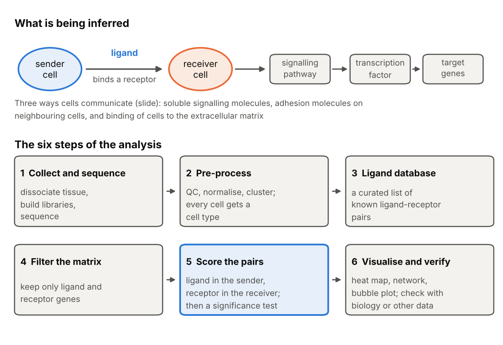
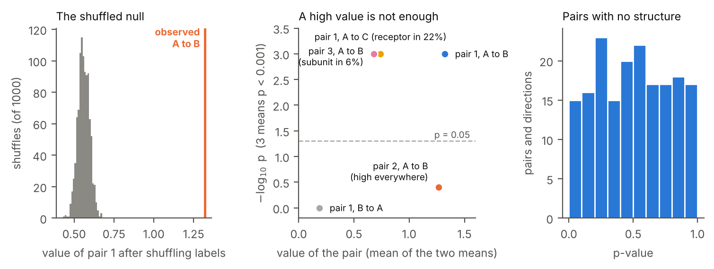
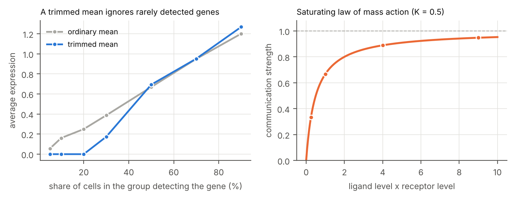
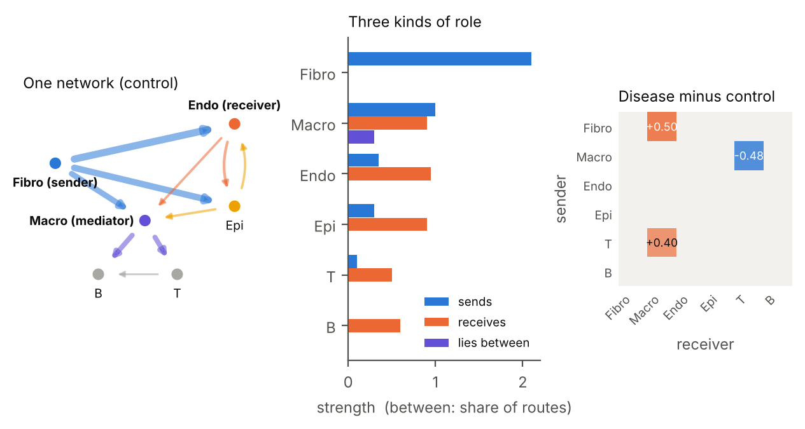
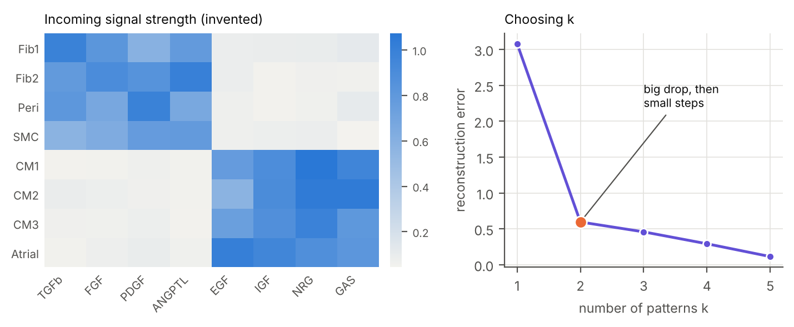

# Cell Communication Analysis and CellChat

> Module 7: how cell types talk to each other, and how to infer it from single cell RNA data. What cell communication is, why the analysis rests on one key assumption, the six-step process, the four tools (CellPhoneDB, NicheNet, CellChat, CellCall), how CellPhoneDB and CellChat score and test an interaction, how to read their plots (networks, roles, patterns, group comparison), and a plan for the after-class tasks.

---

## Table of Contents

1. [What Cell Communication Is, and Why Study It](#1-what-cell-communication-is-and-why-study-it)
2. [What We Actually Measure: Genes Stand in for Proteins](#2-what-we-actually-measure-genes-stand-in-for-proteins)
3. [The Six-Step Analysis Process](#3-the-six-step-analysis-process)
4. [The Four Tools and How to Choose](#4-the-four-tools-and-how-to-choose)
5. [CellPhoneDB: Database and Principle](#5-cellphonedb-database-and-principle)
6. [CellPhoneDB in Practice: the Permutation Test and Its Plots](#6-cellphonedb-in-practice-the-permutation-test-and-its-plots)
7. [CellChat v1: Database and Analysis Principle](#7-cellchat-v1-database-and-analysis-principle)
8. [How CellChat Scores an Interaction](#8-how-cellchat-scores-an-interaction)
9. [CellChat v2](#9-cellchat-v2)
10. [CellChat Visualisation: Pairs, Pathways and Roles](#10-cellchat-visualisation-pairs-pathways-and-roles)
11. [Communication Patterns](#11-communication-patterns)
12. [Comparing Two Groups](#12-comparing-two-groups)
13. [Strengths, Limits and a Checklist for Reading Results](#13-strengths-limits-and-a-checklist-for-reading-results)
14. [Installation and a Plan for the After-Class Tasks](#14-installation-and-a-plan-for-the-after-class-tasks)
15. [Key Takeaways](#15-key-takeaways)
16. [What's Next](#16-whats-next)

---

## How to read this module

Module 5 gave every cluster a cell type name; Module 6 asked what each cell type does. This module asks the next question: **which cell types signal to which, and through what?** The notes follow the lecture's order (what and why, the process, the tools, the two main tools in detail, the CellChat plots, installation) and add the reasoning the slides leave out.

**Sources and honesty about them.** The lecture slides are image captures of a video, so the player controls cut some text and some figures are small; where a number or a label is hard to read, I say "my reading". A text version of the narration is also available. It was produced by speech recognition and writes "ligand" as "liant" or "ligan", "CellChat" as "cell chat" or "Cellhat", "NicheNet" as "Nichet", "multimer" as "multime" and "UniProt" as "Uniprod"; I corrected those silently. Slides 5, 6 and 7 are the same capture three times (a six-step diagram), so they are treated as one. The lecture also refers to an **additional CellChat R notebook** (slide 22) that was not given to me, so the notes cannot describe it.

**R is not installed on the machine used to check this module, so no R code here was run.** The slides contain only the install lines (slide 22), so the CellChat workflow in section 14 is **my own suggestion, written from memory of the package, untested, and not from the slides**; function arguments differ between CellChat v1 and v2. Where I add anything else that is not on a slide, the text says "not on the slides". The Python blocks **were run** and their outputs are real, but they check the *logic* of each idea (a permutation test, a saturating score, sender and receiver roles, a difference between two groups, communication patterns) on small **invented** data. They are **not** CellPhoneDB or CellChat themselves, and none of the numbers in them are results about real biology.

**One disagreement between the narration and the slides, stated early.** The narration says that, unlike CellPhoneDB, CellChat "uses model-based approaches" and not a permutation test. The CellChat slide itself says it infers *statistically* significant communications (slide 14), and as far as I remember, CellChat does also run a permutation test for its p-values. Section 8 explains this.

---

## 1. What Cell Communication Is, and Why Study It

**The definition (slide 3).** Cell communication is the **transmission of information from one cell to another through a medium, to produce a corresponding response**. The slide lists three ways cells communicate:

1. Through **chemical signalling molecules** (secreted ligands, cytokines, hormones).
2. Through **adhesion molecules on the surface of adjacent cells** (cell-cell contact).
3. Through the **adhesion of cells to the extracellular matrix** (ECM).

The three ways are exactly the three classes of interaction in the CellChat database (section 7): *Secreted Signaling*, *Cell-Cell Contact* and *ECM-Receptor*.

**The pathway from signal to response (slide 3).** The slide's last bullet describes the chain: signals pass from a sending cell to a receiving cell through **ligand-receptor (L-R) interactions**, are then **transduced** inside the receiving cell by specific **signalling pathways**, and ultimately **change the activity of downstream transcription factors (TFs) and gene regulatory networks (GRNs)**. The slide's two diagrams show this: a schematic with cell adhesion, ECM, cytokine, receptor, signal transduction pathway, TF and target genes, and a "biological model" in which a ligand binds a receptor and the signal runs to a TF and its target genes (TG1, TG2, TG3).



*Figure. Top: what is being inferred. A ligand from a sender cell binds a receptor on a receiver cell, and the signal runs through a pathway to a transcription factor and its target genes. Bottom: the six steps of the analysis process (section 3).*

**Why study it (slide 4).** Receptor-ligand mediated communication is involved in **embryo development, organogenesis, cancer development, inflammation, drug action and drug resistance**. The slide's circular diagram groups these into physiological processes (embryogenesis, homeostasis, organogenesis), disease pathogenesis and progression (cancers, liver disease, inflammation) and pharmacological research (drug efficacy and resistance), around the heading "current applications of cell-cell communications at single-cell resolution". The slide's message is that **localising and studying L-R interactions is important for understanding cell behaviour and complex biological processes**.

**Why single cell data helps.** The narration gives the practical angle. In downstream single cell analysis we often care about the interaction between particular groups, such as epithelial cells and immune cells, or malignant cells and T cells, or whether cells interact along a developmental path (the narration's example is tumour stem cells and tumour cells). Because the cells are already grouped and named (Modules 4 and 5), the analysis can ask the question **between named cell types** instead of for the tissue as a whole. This is the part that bulk RNA-seq cannot do.

---

## 2. What We Actually Measure: Genes Stand in for Proteins

This is the one idea that everything else in the module depends on, so it comes before any tool.

**The narration's point.** What a single cell experiment detects is **the expression of genes (RNA)**. But what binds is **protein**: a ligand protein binds a receptor protein. The narration's solution is simple: **infer the protein from the expression of its gene**, and use that to build the interaction network.

**What this assumption hides.** The slides do not discuss limits, so the following is general knowledge, not from the slides:

- RNA level is only a rough proxy for protein level; translation, secretion, cleavage and degradation all sit in between.
- A ligand that is secreted can act on a receiver that is not next to the sender, but a membrane-bound ligand needs **contact**. Dissociated single cell data has **lost the position of every cell**, so the analysis cannot tell whether two cell types ever sit near each other. (Slide 15 says CellChat v2 adds spatial information for exactly this reason; section 9.)
- A gene being expressed does not mean the pathway is switched on in the receiver.

So the output of every tool in this module is a **list of predicted, plausible interactions**, not a list of proven ones. This is why the last step of the process is **verification** (section 3), and why the narration says to validate using experimental or spatial data wherever possible.

---

## 3. The Six-Step Analysis Process

**The slide's picture (slides 5 to 7, the same capture three times).** A diagram of six numbered boxes with a bullet list on the right. The source of the diagram is not stated on the slide. The bullets, in the slide's words, in order:

1. **Collect** sample tissues or cells, prepare single-cell suspensions, build libraries and sequence.
2. The **gene expression matrix** is obtained by **pre-processing** the raw data.
3. **Ligand or receptor-related genes are retained** in the matrix by combining it with the **ligand database**.
4. **Score** the interactions between ligands and receptors.
5. **Visualise** the interactions.
6. The predicted L-R interaction is **verified**.

**How the picture's six boxes line up with the bullets.** The diagram's box titles (my reading of small text) are: 1 collection of samples or cells for transcriptomic analysis; 2 data pre-processing and generation of the expression matrix; 3 interacting proteins or ligand-receptor pairs; 4 filtering by interacting proteins or ligand-receptor pairs; 5 cell-cell interactions and communication analysis; 6 interpretation and visualisation of results. So the diagram has *two* boxes (3 and 4) for the database and the filtering, and one box (5) for scoring, which includes an **optional aggregation of scores** into a cell-to-cell communication score. The bullet list merges the database and the filtering into one bullet and splits scoring from visualisation. This is only a difference of grouping.

**The narration, step by step (it adds the detail the slides do not).**

- **Collect and sequence.** Tissue or cells are dissociated into a single cell suspension, libraries are made and sequenced. After quality control, normalisation and clustering, **every cell has an assigned cell type** (Modules 3 to 5). The result is a gene expression matrix.
- **Keep ligand and receptor genes only.** From the full matrix, retain **only genes known to be ligands or receptors**, by looking them up in a **curated ligand-receptor database** such as CellChatDB or CellPhoneDB. The step focuses the analysis on genes involved in communication.
- **Score each pair.** "For each pair of cell types, we evaluate the expression of ligands in the sender cells and receptors in the receiver cells. The average expression levels are combined to quantify the strength of each potential ligand-receptor interaction."
- **Test significance.** "A permutation test is performed. Interactions with low P values are considered significant."
- **Visualise.** Heat maps, network diagrams or bubble plots show **which cell types communicate and through which molecules**.
- **Interpret and validate.** Place the predictions in the context of known biology and pathways, and validate with experimental or spatial data where possible. The aim is to find **key pathways and the critical sender and receiver populations**.

**A point to keep in mind for the next sections.** "Sender" and "receiver" are not properties of a cell type; they are **roles in one interaction**. The same cell type can send one signal and receive another, and the matrix of scores is **directional** (A to B is not B to A). Section 6 shows this with a toy where A to B is significant and B to A is not.

---

## 4. The Four Tools and How to Choose

**The slides' list (slide 8).** Four tools, with the paper each is described in:

| Tool | Paper (as on the slide) | Journal | Year |
|---|---|---|---|
| CellPhoneDB | Inferring cell-cell communication from combined expression of multi-subunit ligand-receptor complexes | Nature Protocols | 2020 |
| NicheNet | Modeling intercellular communication by linking ligands to target genes | Nature Methods | 2019 |
| CellChat | Inference and analysis of cell-cell communication using CellChat | Nature Communications | 2021 |
| CellCall | Integrating paired ligand-receptor and transcription factor activities for cell-cell communication | Nucleic Acids Research | 2021 |

**The comparison table (slide 20, "The comparison of interactive software").** Species, advantages and limitations, as written on the slide:

| Tool | Species in the database | Advantage | Limitation |
|---|---|---|---|
| NicheNet | human, mouse | Combines signalling-pathway and transcriptional-regulation databases, so the **ligand-receptor-target gene** relationship can be extracted directly | The **structural composition** of the ligand is not considered |
| CellPhoneDB | human (other species, such as mouse, rat, monkey and pig, by homologous gene conversion) | Considers the **structural composition** of the ligand (multi-subunit complexes); a high number of references | **Poor visualisation**; an **insignificant p-value does not mean there is no interaction**, only that the specificity between the two cell types is not high |
| CellChat | human, mouse | **Comprehensive data**: 2,021 verified relationships, including multi-subunit receptors and **other signal cofactors**; **rich visualisation** | **Fewer** ligand-receptor pairs are produced |
| CellCall | human, mouse | Intercellular communication networks **and the downstream signalling pathways** can be inferred | The single-cell **dropout** phenomenon limits the enrichment of transcription factors |

**What the narration adds on choosing.** For a beginner it recommends CellChat or CellPhoneDB, because they are "well documented and easy to visualize". If the focus is **downstream gene regulation**, NicheNet is a suitable option, and CellCall is a good choice when you want to connect cell communication to functional gene regulation. One sentence in the narration, "cell phone DB has limited visualization", repeats the table, and the table is the better guide.

**Two readings of the table worth stopping on.**

- **"An insignificant p-value does not mean there is no interaction."** The p-value in CellPhoneDB asks *how specific* an interaction is to a pair of cell types, not *whether it happens*. A ligand and receptor that are both high in every cell type can interact everywhere and still get a large p-value. Section 6 reproduces exactly this in a toy.
- **"Fewer pairs" for CellChat is a trade, not a flaw.** The database is smaller because it was manually curated (section 7). A smaller, better-checked list gives fewer false leads but also misses real interactions that are not in it.

**The two families.** CellPhoneDB and CellChat score **ligand and receptor expression between cell types** (the first part of the chain in section 1). NicheNet and CellCall go further **down the chain** and connect the ligand to **target genes** or **transcription factors** in the receiver (the second part). The rest of the lecture, and this module, concentrates on the first family, with CellPhoneDB as the simpler method and CellChat as the one used in the practice.

---
## 5. CellPhoneDB: Database and Principle

**What it is.** The narration calls CellPhoneDB an **early and widely used** tool that infers cell communication from scRNA-seq data **using a curated database of known ligand-receptor pairs**. Starting from annotated cell types it asks one question: *which cell types are likely to communicate?*

**The database (slide 9).** The slide gives:

- **Species: human.** (Slide 20 adds that other species, such as mouse, rat, monkey and pig, can be used by converting genes to their human homologues.)
- A database of ligands, receptors and their interactions, **978 proteins involved in 1,396 interacting gene pairs**.
- It **considers the structural composition** of ligands and receptors: **heteromeric complexes** (several subunits that assemble into one functional protein) are described accurately. The narration says this "improves accuracy in modeling interactions".
- Protein sources: **UniProt, Ensembl, PDB, the IMEx consortium and IUPHAR**.
- Code: github.com/ventolab/CellphoneDB; paper: Nature Protocols 2020.

The slide's small diagram (my reading of its text) splits the database into secreted and membrane proteins (n = 978), protein complexes, and the protein-protein interactions drawn from curated resources and literature mining (n = 1,396, of which 466 involve protein complexes). I could not read every number reliably, so I quote only the ones in the bullets.

**Why complexes matter.** A receptor is often not one protein. For example, an immune receptor may need two or three subunits together before it can bind. If the database listed only the single subunit that binds, the analysis would call the interaction "present" whenever that one gene is expressed, even when the other subunits are missing. CellPhoneDB's contribution is to treat the **whole complex** as the receptor.

**The five steps (slide 10, "analysis principle").** The slide has five numbered panels:

1. **Input** scRNA-seq data and the cell type annotation.
2. **Calculate the actual mean value of L-R expression.** The panel shows a receptor made of two subunits and the word **Minimum (Sub.1, Sub.2)**: for a complex, the value used is the **smallest** of its subunits' values.
3. **Random arrangement.** All cells are randomly rearranged to form new cell populations (**the default is 1000 random arrangements**), and the mean L-R expression is calculated again each time, producing a **null distribution** (the slide draws a bell curve).
4. **The p-value.** The significance of a receptor-ligand pair in two cell types is estimated from **the proportion of the permuted means that are equal to or higher than the actual mean**.
5. **Rank by specificity.** The slide's text: the smaller the p-value of an L-R pair in the corresponding cells, **the more specific** that pair is to them; use this to screen biologically relevant interactions manually.

**The narration's version.** "It calculates the average expression of each ligand in one cell type and its matching receptor in another, giving an observed interaction signal. To test whether this signal is meaningful, it uses permutation testing. Cell labels are randomly shuffled many times to create a null distribution of expected interactions by chance. The observed signal is then compared to this background to compute a p-value. Finally, significant ligand-receptor interactions are ranked and visualized."

**Two details that are not on the slides** (my knowledge of the method): the score of a pair is the **mean of the ligand's average and the receptor's average** (the narration's "the average expression levels are combined"), and CellPhoneDB also requires that a gene be expressed in a minimum fraction of the cells of a type (10% by default, as far as I remember) before the gene counts at all. The check in section 6 uses the first detail and does *not* implement the second.

---

## 6. CellPhoneDB in Practice: the Permutation Test and Its Plots

**What the test does, in plain words.** Suppose cell type A expresses a ligand and cell type B expresses its receptor, and the score is high. Is that *special*, or would any two cell types look like that? The test shuffles the cell-type labels, so each pseudo cell type is a random mix of cells, recomputes the score many times, and counts how often a random arrangement gives a score at least as large as the real one. If that almost never happens, the pair is **specific** to A and B.

**The toy.** 360 cells in three types (A, B, C, 120 each) and 7 genes plus 60 genes with no structure at all. The pairs are:

- **Pair 1, L1-R1:** the ligand is high in A and the receptor high in B. A specific pair.
- **Pair 2, L2-R2:** both genes are high in **every** cell type.
- **Pair 3, L3 with a two-subunit receptor (R3a + R3b):** the ligand is high in A, subunit R3a high in B, but subunit R3b almost absent everywhere. The complex value uses the **minimum**, as on slide 10.
- **30 "null" pairs** made of the 60 structureless genes, to check how often the test gives a false alarm.

The score is (ligand mean + receptor mean) / 2 on log-normalised counts, and the p-value is the proportion of 1000 label shuffles whose score is at least as large as the real score.

```python
import numpy as np

rng = np.random.default_rng(7)
types = ["A", "B", "C"]
n_per = 120
labels = np.repeat(np.arange(3), n_per)                       # 360 cells, three annotated cell types

def rates(a, b, c):                                           # mean count of a gene in cell type A, B, C
    return np.array([a, b, c])[labels]

genes = {"L1": rates(3, .3, .3), "R1": rates(.3, 3, .3),      # a pair that is specific: ligand in A, receptor in B
         "L2": rates(3, 3, 3), "R2": rates(3, 3, 3),           # a pair that is high everywhere
         "L3": rates(3, .3, .3), "R3a": rates(.3, 3, .3), "R3b": rates(.05, .05, .05)}   # a receptor complex whose 2nd subunit is missing
for i in range(60):                                           # 60 genes with no cell type structure, to make 30 null pairs
    genes[f"N{i}"] = rates(1.5, 1.5, 1.5)
names = list(genes)
X = np.log1p(np.array([rng.poisson(genes[g]) for g in names]))   # "normalised" expression, genes x cells
gi = {g: i for i, g in enumerate(names)}

onehot = np.eye(3)[labels]
def type_means(lab_onehot):
    return X @ lab_onehot / lab_onehot.sum(0)                  # genes x 3 matrix of mean expression per cell type

def score(M, lig, rec, s, r):
    """Interaction value for sender type s, receiver type r: the mean of the ligand mean and the receptor mean.
    For a receptor complex the receptor value is the smallest subunit mean (the slide's figure says 'Minimum')."""
    L = M[gi[lig], s]
    R = min(M[gi[x], r] for x in ([rec] if isinstance(rec, str) else rec))
    return (L + R) / 2

pairs = {"pair 1  L1-R1 (specific)": ("L1", "R1"), "pair 2  L2-R2 (high everywhere)": ("L2", "R2"),
         "pair 3  L3-(R3a+R3b) (complex)": ("L3", ["R3a", "R3b"])}
null_pairs = [(f"N{2 * i}", f"N{2 * i + 1}") for i in range(30)]
ordered = [(s, r) for s in range(3) for r in range(3) if s != r]

M_obs = type_means(onehot)
n_perm = 1000                                                  # the slide's default number of random arrangements
all_pairs = list(pairs.values()) + null_pairs
obs = {(p_i, s, r): score(M_obs, *all_pairs[p_i], s, r) for p_i in range(len(all_pairs)) for s, r in ordered}
count = {k: 0 for k in obs}
perm_demo = []                                                 # the null distribution of pair 1, A -> B, for the figure
for _ in range(n_perm):
    Mp = type_means(np.eye(3)[rng.permutation(labels)])        # shuffle the cell labels
    for (p_i, s, r), o in obs.items():
        v = score(Mp, *all_pairs[p_i], s, r)
        if v >= o: count[(p_i, s, r)] += 1
        if (p_i, s, r) == (0, 0, 1): perm_demo.append(v)
pval = {k: c / n_perm for k, c in count.items()}

def frac(g, t):                                                # share of cells of type t in which the gene is detected
    return float((X[gi[g], labels == t] > 0).mean())
def fmt_p(p): return "< 0.001" if p == 0 else f"{p:.3f}"

print("sender -> receiver, value of the pair, permutation p (1000 shuffles of the cell labels),")
print("and the share of cells expressing the ligand (sender) and the weakest receptor subunit (receiver):")
for p_i, (name, (lig, rec)) in enumerate(pairs.items()):
    for s, r in ([(0, 1), (1, 0), (0, 2)] if p_i == 0 else [(0, 1)]):
        fl = frac(lig, s); fr = min(frac(x, r) for x in ([rec] if isinstance(rec, str) else rec))
        print(f"  {name:32s} {types[s]} -> {types[r]}   value {obs[(p_i, s, r)]:.2f}   p {fmt_p(pval[(p_i, s, r)]):>7s}"
              f"   ligand {100 * fl:3.0f}%   receptor {100 * fr:3.0f}%")
null_p = np.array([pval[(p_i, s, r)] for p_i in range(3, len(all_pairs)) for s, r in ordered])
print(f"\n{len(null_p)} p-values from 30 pairs with no structure (6 directions each): mean {null_p.mean():.2f}, "
      f"share below 0.05 = {100 * (null_p < 0.05).mean():.1f}%")

# Output:
# sender -> receiver, value of the pair, permutation p (1000 shuffles of the cell labels),
# and the share of cells expressing the ligand (sender) and the weakest receptor subunit
#   (receiver):
#   pair 1  L1-R1 (specific)         A -> B   value 1.32   p < 0.001   ligand  94%
#   receptor  98%
#   pair 1  L1-R1 (specific)         B -> A   value 0.19   p   1.000   ligand  25%
#   receptor  23%
#   pair 1  L1-R1 (specific)         A -> C   value 0.74   p < 0.001   ligand  94%
#   receptor  22%
#   pair 2  L2-R2 (high everywhere)  A -> B   value 1.27   p   0.396   ligand  97%
#   receptor  97%
#   pair 3  L3-(R3a+R3b) (complex)   A -> B   value 0.68   p < 0.001   ligand  97%
#   receptor   6%
# 
# 180 p-values from 30 pairs with no structure (6 directions each): mean 0.50, share below
#   0.05 = 3.9%
```



*Figure. Left: the 1000 shuffled scores for pair 1, A to B (grey) and the real score (orange line); the real score is far outside. Middle: value of the pair against its significance; the dashed line is p = 0.05. Right: p-values of the 30 structureless pairs in all six directions.*

**Reading the output.**

- **Direction matters.** Pair 1 is significant from A to B (value 1.32, p < 0.001) but not from B to A (value 0.19, p = 1.000). Only 25% of B cells express the ligand and 23% of A cells the receptor, so the reverse direction has nothing to report. The communication matrix is not symmetric.
- **A high value is not the same as a low p-value.** Pair 2 has a value of 1.27, almost as high as pair 1, but p = 0.396: both genes are high everywhere, so a random arrangement gives nearly the same score. This is the slide 20 caution made concrete: **"an insignificant p-value does not mean there is no interaction"**. The pair may well interact in every cell type; it is just **not specific** to A and B.
- **A lower value can still be significant.** Pair 1 from A to C has a value of 0.74 (the receptor is detected in only 22% of C cells) and still p < 0.001, because the shuffled scores sit around 0.56 and 0.74 is far above them. The p-value ranks *specificity*, not *strength*. This is why the slide says to rank by specificity and then screen manually.
- **The minimum rule helps, but it does not remove pair 3.** Because R3b is almost absent (6% of B cells), the complex value falls to 0.68, about half of pair 1's. Yet its p-value is still below 0.001, because R3b is low in the shuffled data as well, so the shuffled scores are low too, and the ligand and R3a are specific. A permutation p-value alone would let this pair through. In the real tool the **minimum expression fraction** from section 5 (not implemented here) would remove it. The lesson: **look at the value and the fraction of expressing cells as well as the p-value**.
- **The null behaves.** The 180 p-values of pairs with no structure have a mean of 0.50 and 3.9% fall below 0.05, close to the 5% you expect by chance. (The six directions of one pair are not independent, so the exact figure is noisy.)
- **The smallest possible p-value is about 0.001.** With 1000 shuffles you cannot see a smaller one, so "p < 0.001" means "none of the shuffles reached it", not "exactly zero".

**The plots (slides 11 and 12).** The narration describes two settings.

*Single sample.* After running CellPhoneDB on one data set the software summarises the interactions between cell types, usually as **heat maps or dot plots**. In the heat map each row and each column is a cell type, and the colour shows how much communication (my reading of the small caption on slide 11: the logarithm of the number of gene interactions between the interacting cell types). The slides also show a **network** of cell types with edges, a set of fan-shaped networks (one per signalling molecule), a **dot plot** and a **circos plot** (a circular plot with arcs between cell types). In the dot plot (my reading, plus general knowledge of the tool, not on the slides), rows are ligand-receptor pairs, columns are pairs of cell types, the **colour** is the mean expression and the **size** of the dot is the significance (the p-value on a minus-log scale). Stronger colours and larger dots mean more significant interactions.

*Comparing groups.* The narration's example is disease against control, or treated against untreated. CellPhoneDB is run **separately for each group** and the results are compared, so you can see which interactions are **gained, lost or strengthened**, such as immune activation in disease or a drug-induced change. Slide 12's right-hand dot plot is labelled "compare groups against each other" and its legend reads Control and Asthma (my reading).

---

## 7. CellChat v1: Database and Analysis Principle

**What it is.** The narration: CellChat infers and analyses cell communication from scRNA-seq data using a curated database of ligand-receptor pairs **and known signalling pathways**. Starting from annotated cell types it first finds which ligands and receptors are expressed in each cell type, then computes a **communication probability** for each pair between two cell types, "considering both expression levels and the overall network context". It can **aggregate** the pairs into **pathway-level** networks and so identify the main **senders, receivers and mediators** of each pathway. The results are shown as networks, heat maps or hierarchical diagrams.

**The database (slide 13, CellChat v1).** The slide's bullets:

- It considers **not only the structure of ligands and receptors but also cofactors**: soluble agonists, antagonists, co-stimulators and co-inhibitors of membrane-binding receptors.
- It holds **2,021 validated interaction pairs, 48% of which involve heteromeric molecular complexes** (ligand-receptor plus multimer plus cofactor).
- The v1 database includes **229 signalling pathways**, divided into three categories: **Cell-Cell Contact, ECM-Receptor and Secreted Signaling**.

The slide's figure, "manual curation of CellChat database", draws on **KEGG** and the **primary literature**. Its two small pie charts (my reading) show Secreted Signaling about 60%, ECM-Receptor about 21% and Cell-Cell Contact about 19% of the pairs, and heterodimers 48% against others 52%. The second pie matches the bullet; the first is small, so treat the percentages as approximate.

**Why cofactors are in the database.** In real biology a ligand does not always act alone: a soluble agonist can strengthen the signal and an antagonist can block it. A database that records only "ligand binds receptor" would treat both the same. CellChat's curated entries list these helpers, so the score can be raised or lowered by them (section 8). This is also why the pair count is lower than in some other databases (slide 20, "fewer pairs").

**The analysis principle (slide 14).** A flow chart. Reading it in order:

1. **Inputs:** **normalised data** (`@data`) and **cell grouping information**. The right-hand panel says the grouping can be a label per cell (option 1) or a **latent space or trajectory** (option 2), and that the first step is the identification of **over-expressed genes per cell group**.
2. **Create the CellChat object**, together with **CellChatDB** (the ligand-receptor pairs and signalling pathways), giving **the filtered expression matrix**.
3. Two functions, named on the slide: **`identifyOverExpressedGenes(cellchat)`** and **`identifyOverExpressedInteractions(cellchat)`**. They give the **significantly different L-R genes** and the **L-R pairs** whose ligand and receptor are over-expressed.
4. **"PPI network correction expression value."** A correction of the expression values using a protein-protein interaction (PPI) network.
5. **Cellular communication modelling** (right-hand panel): **quantify the communication probability using the law of mass action**, then **infer statistically and biologically significant cellular communications**.
6. **Visualise** (hierarchy plot, circle plot, bubble plot) and **analyse** (bottom panel): identify the **signalling roles** of cells by **network centrality analysis**; discover **dominant communication patterns**; **classify signalling pathways** by topological and functional similarity; find **shared and context-specific signalling across conditions**.

**What the steps do, in plain words (from my memory of the package, not on the slides).**

- Steps 2 and 3 are a **filter**. A gene is considered only if it is *over-expressed* in the cell group, so a ligand expressed weakly everywhere does not generate thousands of candidate interactions.
- Step 4 is, as far as I remember, an **optional smoothing**: each gene's expression is nudged towards that of its neighbours in a PPI network, to reduce the effect of **dropout** (zeros that are technical, not real), which is the problem slide 20 names for CellCall. The slide gives only the name of the step, so I describe it with less certainty than the others.
- Steps 5 and 6 are sections 8 to 12.

---

## 8. How CellChat Scores an Interaction

The slide says the communication probability is quantified "using the law of mass action". This section explains what that means and what two of the choices behind it do.

**The law of mass action (general chemistry).** The rate at which a ligand and a receptor bind is proportional to the **product** of their amounts, so more ligand and more receptor give more binding. But a cell has a limited number of receptors, so as the amounts grow the binding **saturates**: it levels off. A standard way to write this is a **Hill-type** function

> communication probability = (L x R) / (K + L x R)

where L and R are the ligand and receptor levels and K is a constant. In my memory of the CellChat paper K = 0.5 and the ligand and receptor levels are further adjusted by the agonist, antagonist and co-receptor terms, and a multi-subunit receptor is summarised from its subunits; **none of those numbers or the formula is on the slides**, which say only "law of mass action".

**What level of expression goes into L and R.** I remember that the default is a **"trimmed mean" (called "triMean")**, which averages the quartiles and the median, (Q1 + 2 x median + Q3) / 4, so that the lowest and highest cells do not decide the score. The check below compares it with the ordinary mean, and then prints the saturating function. This choice is also not on the slides.

```python
import numpy as np

rng = np.random.default_rng(3)
n = 400                                                         # cells in one cell group

def tri_mean(x):
    q1, q2, q3 = np.quantile(x, [0.25, 0.5, 0.75])
    return (q1 + 2 * q2 + q3) / 4                                # a "trimmed" average that ignores the lowest and highest tails

print("A gene is detected in a share of the 400 cells of a group (log-normalised value of a detected cell about 1.4).")
print("  share of cells detecting the gene | ordinary mean | trimmed mean (Q1 + 2*median + Q3) / 4")
curve = []                                                      # (share, ordinary mean, trimmed mean), for the figure
for f in (0.05, 0.10, 0.20, 0.30, 0.50, 0.70, 0.90):
    x = np.where(rng.random(n) < f, np.log1p(rng.poisson(3, n).clip(1)), 0.0)
    curve.append((f, x.mean(), tri_mean(x)))
    print(f"  {100 * f:6.0f}%                           | {x.mean():13.2f} | {tri_mean(x):13.2f}")

print("\nCommunication strength from ligand level L and receptor level R, Hill-type law of mass action with K = 0.5:")
print("   L     R   product L*R   L*R / (K + L*R)")
K = 0.5
for L, R in ((0.1, 0.1), (0.5, 0.5), (1, 1), (2, 2), (3, 3), (5, 5), (0.1, 5)):
    p = L * R
    print(f"  {L:4.1f}  {R:4.1f}   {p:10.2f}   {p / (K + p):14.2f}")

# Output:
# A gene is detected in a share of the 400 cells of a group (log-normalised value of a
#   detected cell about 1.4).
#   share of cells detecting the gene | ordinary mean | trimmed mean (Q1 + 2*median + Q3) /
#   4
#        5%                           |          0.06 |          0.00
#       10%                           |          0.16 |          0.00
#       20%                           |          0.25 |          0.00
#       30%                           |          0.39 |          0.17
#       50%                           |          0.67 |          0.69
#       70%                           |          0.95 |          0.95
#       90%                           |          1.20 |          1.27
# 
# Communication strength from ligand level L and receptor level R, Hill-type law of mass
#   action with K = 0.5:
#    L     R   product L*R   L*R / (K + L*R)
#    0.1   0.1         0.01             0.02
#    0.5   0.5         0.25             0.33
#    1.0   1.0         1.00             0.67
#    2.0   2.0         4.00             0.89
#    3.0   3.0         9.00             0.95
#    5.0   5.0        25.00             0.98
#    0.1   5.0         0.50             0.50
```



*Figure. Left: average expression of a gene as a function of the share of cells that detect it, by the ordinary mean (grey) and the trimmed mean (blue). Right: a Hill-type communication strength against the product of ligand and receptor levels, with K = 0.5; the dots are the four products 0.25, 1, 4 and 9 of the table.*

**Reading the output.**

- **The trimmed mean is conservative about rare genes.** If fewer than about a quarter of the 400 cells detect the gene, the third quartile and the median are both zero and the trimmed mean is exactly **0.00**, whereas the ordinary mean is 0.06 to 0.25. At 30% it is 0.17 against 0.39. Above 50% the two agree, and at 90% the trimmed mean is slightly higher (1.27 against 1.20) because the zeros no longer drag it down. So a ligand that only a fifth of a cell type expresses is **treated as absent**. That protects against noise and dropout, and it is one reason CellChat reports "fewer pairs" (slide 20), but a real signal from a rare sender can be missed.
- **The score saturates.** Going from a product of 0.25 to 4 (sixteen times more) lifts the strength only from 0.33 to 0.89, and from 4 to 25 only to 0.98. Past a certain level, more expression no longer means more communication, so one extremely high gene cannot dominate the result.
- **A product is symmetric in L and R.** A ligand level of 0.1 with a receptor level of 5 gives the same product (0.5) and the same strength (0.50) as 0.5 with 1.0. Because the score uses the product, a very low ligand can be "compensated" by a very high receptor. That is an arithmetic consequence of the formula, not a biological claim.

**Then the test.** The narration contrasts CellChat with CellPhoneDB: "unlike permutation testing in CellPhoneDB, CellChat uses model-based approaches to quantify interaction strength". That is true of the **score** (a mass-action model rather than a mean). But slide 14 also says CellChat **infers statistically significant communications**, and, as far as I remember (not on the slides), it computes a p-value for each pair **by permuting the cell group labels**, with the number of permutations as a setting. So both tools test against shuffled labels; they differ in the **score** that is tested. If you meet the statement "CellChat does not use a permutation test", treat it as a simplification.

**From pairs to pathways.** The narration says CellChat **aggregates individual L-R interactions into pathway-level signalling networks**. As far as I remember the pathway's strength between two cell types is the **sum** of the probabilities of its pairs (for example the TGF-beta pathway sums the TGFB1, TGFB2 and TGFB3 pairs that use the same receptors). That is why CellChat can show both a pair-level view (bubble plot, section 10) and a pathway-level view (hierarchy, chord and circle plots).

---
## 9. CellChat v2

**The slide (slide 15).** CellChat v2 is an updated version that includes:

- **direct incorporation of the spatial locations of cells** to infer **spatially proximal** cell-cell communication,
- additional **comparison functionality**,
- an **expanded database** of ligand-receptor pairs **with rich annotations**,
- an **Interactive CellChat Explorer**.

The database now has **about 3,300 validated molecular interactions**: about **40%** secreted autocrine or paracrine signalling, about **17%** ECM-receptor, about **13%** cell-cell contact and about **30%** **non-protein signalling**. v2 **adds more than 1,000 protein and non-protein interactions**, such as **metabolic and synaptic signalling**. Code: github.com/jinworks/CellChat. The narration adds that v2 covers autocrine, paracrine, ECM and non-protein signalling, and "supports deeper and more flexible analysis".

**Reading the changes.**

- **Spatial context answers the problem from section 2.** Dissociated cells have lost their positions. If the tissue is also measured spatially, a pair is allowed to interact only when the two cell groups are close enough for the signal to reach. This removes interactions that are chemically possible but physically impossible. The slide does not say how the distance is used; that is general knowledge about why the feature exists.
- **Non-protein signalling is new.** About 30% of v2's interactions are not protein-protein, for example (general knowledge, not on the slide) a **small metabolite** made by an enzyme in the sender that binds a receptor on the receiver. The slide lists "metabolic and synaptic" signalling. In v1 these were absent, because the database was a list of protein ligands and receptors.
- **The narration leaves out cell-cell contact.** The slide lists four classes (secreted about 40%, ECM-receptor about 17%, cell-cell contact about 13%, non-protein about 30%; they add up to 100%), but the narration names only autocrine, paracrine, ECM and non-protein. The slide is the better source.
- **Both versions co-exist.** v1 is described on slides 13 and 14; v2's code and functions differ in some argument names (section 14).

---

## 10. CellChat Visualisation: Pairs, Pathways and Roles

CellChat's strength, in the words of slide 20, is **rich visualisation**. The plots answer three different questions, and it helps to keep them apart.

**1. Which pairs? (slide 16, "inferring cell communication networks at the ligand-receptor level").**

- A **circle plot**: each cell type is a node on a circle (the slide's example has B, CD8 T, CD14+ Mono, FCGR3A+ Mono, NK, DC, Memory CD4 T, Naive CD4 T and Platelet), and each coloured edge is communication between two types, with its width showing the **number or strength** of interactions. The narration: the circle plot shows interaction strength between cell types.
- A **bubble plot** ("identify ligand-receptors that mediate cell communication"): rows are L-R pairs, columns are sender-receiver pairs of cell types; the colour is the **communication probability** and the dot's size or outline the p-value. It is the plot to use when you need to name the molecules. The narration: bubble plots highlight communication probabilities and help identify the key pairs.

**2. Which pathway, and who is in it? (slide 17, "inferring cellular communication at the signalling pathway level", TGF-beta as the example).**

- A **hierarchy plot**: the narration says **solid circles are senders and open circles are receivers**, and the edge colours and sizes show the contribution in cell numbers, which "helps trace pathway flow". The slide's top row draws three views of the same pathway (two hierarchy-style plots and one circle-style network, my reading).
- A **chord diagram**: cell groups around a circle (the slide's example has CM2, CM3, CM5 and fibroblasts) with ribbons between them.
- A **bar plot** of the **relative contribution of each ligand-receptor pair to the pathway** (the slide shows three TGF-beta pairs, my reading).

**3. What role does each cell type play? (slide 17, bottom right, "identification of signalling roles for cells using network centrality analysis").** The slide shows four small networks labelled **Outdegree, Indegree, Betweenness, Information**, above a heat map whose rows are labelled **Sender, Receiver, Mediator, Influencer** and whose columns are the cell types. The two label sets are lined up, and so my reading is that they are paired in that order: the outdegree highlights the **sender**, the indegree the **receiver**, the betweenness the **mediator** and the information centrality the **influencer**. (The slide itself draws the pairing only by position.)

**What the four roles mean.** The network has cell types as nodes and the communication strength as weighted, directed edges.

- **Outdegree** (sender): how much a node **sends**, the total strength of its outgoing edges.
- **Indegree** (receiver): how much a node **receives**.
- **Betweenness** (mediator): how often a node lies **on the shortest routes between other nodes**. A mediator **passes signals on** between others.
- **Information centrality** (influencer): how much of the network's overall **information flow** depends on the node; as far as I remember, it measures how much the network's efficiency falls when the node is removed. This is the least intuitive of the four, and the toy below does not compute it.

**The toy.** Six cell types with invented communication strengths (row = sender, column = receiver). The check computes the outgoing and incoming strength of each, and the **betweenness** of each, with distances equal to 1 / strength (a strong link is a short distance). Note that CellChat's own mediator score is, as far as I remember, a **flow betweenness**, a different calculation; the toy uses the ordinary shortest-path betweenness from `networkx` to show the idea.

```python
import numpy as np
import networkx as nx

types = ["Fibroblast", "Macrophage", "Endothelial", "Epithelial", "T cell", "B cell"]
ix = {t: i for i, t in enumerate(types)}
W = np.zeros((6, 6))                                    # row = sender, column = receiver, value = communication strength
for s, r, w in (("Fibroblast", "Endothelial", .8), ("Fibroblast", "Epithelial", .7), ("Fibroblast", "Macrophage", .6),
                ("Macrophage", "T cell", .5), ("Macrophage", "B cell", .5), ("Endothelial", "Macrophage", .15), ("Epithelial", "Macrophage", .15),
                ("T cell", "B cell", .1), ("Endothelial", "Epithelial", .2), ("Epithelial", "Endothelial", .15)):
    W[ix[s], ix[r]] = w

out_strength = W.sum(axis=1)                            # how much a cell type sends
in_strength = W.sum(axis=0)                             # how much a cell type receives
G = nx.DiGraph()
for s in range(6):
    for r in range(6):
        if W[s, r] > 0: G.add_edge(s, r, weight=W[s, r], dist=1 / W[s, r])      # a strong link is a short distance
bet = nx.betweenness_centrality(G, weight="dist")       # how often a cell type lies on the shortest routes between others
bet = np.array([bet[i] for i in range(6)])

print("cell type     out-strength  in-strength  betweenness")
for t in types:
    i = ix[t]
    print(f"  {t:12s}  {out_strength[i]:10.2f}  {in_strength[i]:11.2f}  {bet[i]:11.2f}")
print("\nhighest out-strength (sender):  ", types[int(out_strength.argmax())])
print("highest in-strength (receiver): ", types[int(in_strength.argmax())])
print("highest betweenness (mediator): ", types[int(bet.argmax())])
print(f"the mediator's own strength: out {out_strength[bet.argmax()]:.2f}, in {in_strength[bet.argmax()]:.2f}"
      f" (largest out {out_strength.max():.2f}, largest in {in_strength.max():.2f})")

# Output:
# cell type     out-strength  in-strength  betweenness
#   Fibroblast          2.10         0.00         0.00
#   Macrophage          1.00         0.90         0.30
#   Endothelial         0.35         0.95         0.00
#   Epithelial          0.30         0.90         0.00
#   T cell              0.10         0.50         0.00
#   B cell              0.00         0.60         0.00
# 
# highest out-strength (sender):   Fibroblast
# highest in-strength (receiver):  Endothelial
# highest betweenness (mediator):  Macrophage
# the mediator's own strength: out 1.00, in 0.90 (largest out 2.10, largest in 0.95)
```



*Figure. Left: one invented network (control); edge width is the strength. Middle: outgoing strength (sends), incoming strength (receives) and betweenness (lies between) of each cell type. Right: the difference of two groups, described in section 12.*

**Reading the output.**

- **Fibroblasts are the sender.** Their outgoing strength is 2.10, by far the highest, and their incoming strength is 0.00: they send to the endothelial, epithelial and macrophage cells and receive nothing.
- **Endothelial cells are the biggest receiver** (incoming 0.95), with epithelial cells close behind (0.90). Both send very little.
- **Macrophages are the mediator**, and it is not because they send or receive the most. Their outgoing strength is 1.00 and incoming 0.90, both moderate, but they are the **only** cell type with a betweenness above zero (0.30): the routes from fibroblasts to T cells and to B cells pass through them. A role is defined by position in the network, not by size.
- **The roles can overlap.** Macrophages also send and receive a lot; one cell type can carry several roles at once. The slide's heat map therefore shows a score for each role in each cell type, not one label per cell type.

---

## 11. Communication Patterns

**The slide (slide 18).** "CellChat uses **pattern recognition** to predict **coordinated responses between cells** and **connects cell type to signalling pathways through communication patterns**." The two figures, captioned "incoming communication patterns of target cells", are a **river (alluvial) plot** that connects **cell groups to patterns to signalling pathways**, and a **dot plot** captioned **"key input signals for each cell type"** whose rows are cell groups (the slide shows CM2, CM3, CM5 and fibroblasts) and whose columns are pathways (TGFb, EGF, NRG, FGF, IGF and others, my reading).

**The narration's example.** "Incoming and outgoing patterns reveal which pathways dominate communication. For example, fibroblasts may receive signals from TGF-beta and FGF, while cardiomyocytes respond to EGF and IGF."

**What the idea is.** The communication matrix has cell types in rows and pathways in columns. Many cell types use **the same set of pathways**, and many pathways **are used together**. Pattern recognition finds a few **shared patterns** (for example, "a stromal pattern" and "a muscle pattern"), then says which cell types belong to which pattern and which pathways make up each. This replaces a long list with two or three groups. As far as I remember CellChat does this with **non-negative matrix factorisation (NMF)** and asks you to choose the **number of patterns k**, with two scores called cophenetic and silhouette to help. None of this is on the slides.

**The toy.** An invented matrix of eight cell types by eight pathways with two hidden programmes: stromal-type cells use TGFb, FGF, PDGF and ANGPTL, and muscle-type cells use EGF, IGF, NRG and GAS (inspired by the narration's example; the data are invented). The check fits NMF with 1 to 5 patterns, then looks at whether k = 2 recovers the planted groups.

```python
import numpy as np
from sklearn.decomposition import NMF

rng = np.random.default_rng(5)
cells = ["Fib1", "Fib2", "Peri", "SMC", "CM1", "CM2", "CM3", "Atrial"]
paths = ["TGFb", "FGF", "PDGF", "ANGPTL", "EGF", "IGF", "NRG", "GAS"]
# two hidden communication programmes: stromal-type receivers use TGFb, FGF, PDGF, ANGPTL; muscle-type receivers use EGF, IGF, NRG, GAS
true_cell = np.array([0, 0, 0, 0, 1, 1, 1, 1]); true_path = np.array([0, 0, 0, 0, 1, 1, 1, 1])
P = np.zeros((8, 8))
for i in range(8):
    for j in range(8):
        P[i, j] = (0.8 if true_cell[i] == true_path[j] else 0.05) * rng.uniform(0.7, 1.3) + abs(rng.normal(0, 0.03))

print("how well k patterns rebuild the matrix (reconstruction error, smaller is better):")
errs = []
for k in range(1, 6):
    m = NMF(n_components=k, init="nndsvda", max_iter=2000, random_state=0)
    m.fit(P); errs.append(m.reconstruction_err_)
    print(f"  k = {k}   error {m.reconstruction_err_:.3f}")

m = NMF(n_components=2, init="nndsvda", max_iter=2000, random_state=0)
Wc = m.fit_transform(P)                      # cell types x patterns
Hp = m.components_                           # patterns x pathways
pc, pp = Wc.argmax(1), Hp.argmax(0)
agree = lambda a, b: max((a == b).mean(), (a != b).mean())        # pattern numbers are arbitrary, so allow a swap
print("\nthe pattern each cell type belongs to:   ", dict(zip(cells, pc.tolist())))
print("the pattern each pathway belongs to:     ", dict(zip(paths, pp.tolist())))
print(f"cell types grouped as planted: {100 * agree(pc, true_cell):.0f}%   pathways grouped as planted: {100 * agree(pp, true_path):.0f}%")

# Output:
# how well k patterns rebuild the matrix (reconstruction error, smaller is better):
#   k = 1   error 3.081
#   k = 2   error 0.596
#   k = 3   error 0.458
#   k = 4   error 0.292
#   k = 5   error 0.114
# 
# the pattern each cell type belongs to:    {'Fib1': 1, 'Fib2': 1, 'Peri': 1, 'SMC': 1,
#   'CM1': 0, 'CM2': 0, 'CM3': 0, 'Atrial': 0}
# the pattern each pathway belongs to:      {'TGFb': 1, 'FGF': 1, 'PDGF': 1, 'ANGPTL': 1,
#   'EGF': 0, 'IGF': 0, 'NRG': 0, 'GAS': 0}
# cell types grouped as planted: 100%   pathways grouped as planted: 100%
```



*Figure. Left: the invented incoming-signal matrix with two blocks. Right: how well k patterns rebuild the matrix (smaller is better); the orange point marks k = 2.*

**Reading the output.**

- **k = 2 gives the big gain.** The error falls from 3.08 with one pattern to 0.60 with two, then only slowly (0.46, 0.29, 0.11). More patterns **always** fit better, so the lowest error is not the goal; you look for the point where the gain stops being large (the "elbow"). CellChat's own criterion, cophenetic and silhouette scores as far as I remember, is different, so this plot shows the idea, not the tool's output.
- **With k = 2 the planted groups come back exactly:** all eight cell types and all eight pathways land in the right group (100% for both). This is the easiest possible case (two clean blocks with a little noise). Real data has overlapping programmes, and the answer depends on k.
- **Outgoing and incoming are separate analyses.** The slide shows the *incoming* patterns (what a cell type receives). A pattern analysis of the *outgoing* signals (what it sends) is run separately and may group the cell types differently.

---

## 12. Comparing Two Groups

**When (slide 19, narration).** When there are **two or more conditions**: healthy against disease, control against treatment, or different time points. "Instead of looking at cell communication in just one data set, CellChat allows us to directly compare communication networks between groups."

**The four views on the slide**, with the narration's reading:

1. **Network diagrams** ("differential number of interactions" and "differential interaction strength"). Each node is a cell type, each edge communication between two types, and the **thickness** is the number or strength. An edge that is thicker in the disease group means that communication between those two types is **increased in disease**.
2. **The difference network.** It shows the **gain or loss** of interactions between groups. The narration: "Positive changes indicate interactions that are enhanced in group one while negative changes represent interactions that are reduced or lost." It is **very useful for finding condition-specific communication patterns** quickly.
3. **Signalling pathway comparison** (bar plots or heat maps; the slide's circle plots are labelled CXCL "NL" and "LS" signalling networks). Instead of single pairs, the pathways are compared: **which pathways are more active in one group, and which cell types contribute most**. This lets you "move from individual genes to biological interpretation at the pathway level".
4. **Sender and receiver roles** (the scatter plots on the slide). A cell type can **change its role**: for example it is a stronger sender in disease than in control.

**Two points to check before you trust a sign.**

- **Which group is "positive"?** The narration says positive means enhanced in **group one**. As far as I remember the CellChat documentation, in the difference network a **positive (red) change means stronger in the second data set compared with the first**. These two readings are opposite, so I cannot tell from the lecture which is meant. **Always check which data set was entered first** and which colour is which in the legend. The toy below defines the difference as *disease minus control* (the second group minus the first), written out in the labels so that nothing depends on a convention.
- **"NL" and "LS" on slide 19** are, in my reading, non-lesional and lesional skin, an example of two groups from one tissue. The narration says "healthy versus disease".

**The toy.** The control network from section 10, and a "disease" copy in which three links are changed: fibroblast to macrophage gets stronger (0.60 to 1.10), macrophage to T cell is almost lost (0.50 to 0.02), and a new link appears from T cell to macrophage (0 to 0.40). A link counts as an interaction when its strength is above 0.05.

```python
import numpy as np

types = ["Fibroblast", "Macrophage", "Endothelial", "Epithelial", "T cell", "B cell"]
ix = {t: i for i, t in enumerate(types)}
def net(edges):
    W = np.zeros((6, 6))
    for s, r, w in edges: W[ix[s], ix[r]] = w
    return W

control = net((("Fibroblast", "Endothelial", .8), ("Fibroblast", "Epithelial", .7), ("Fibroblast", "Macrophage", .6),
               ("Macrophage", "T cell", .5), ("Macrophage", "B cell", .5), ("Endothelial", "Macrophage", .15),
               ("Epithelial", "Macrophage", .15), ("Epithelial", "Endothelial", .15), ("T cell", "B cell", .1),
               ("Endothelial", "Epithelial", .2)))
disease = control.copy()
disease[ix["Fibroblast"], ix["Macrophage"]] = 1.1       # a link that gets stronger
disease[ix["Macrophage"], ix["T cell"]] = 0.02          # a link that is almost lost
disease[ix["T cell"], ix["Macrophage"]] = 0.4           # a link that appears

thr = 0.05                                              # an interaction "counts" if its strength is above this
print(f"number of interactions  control: {(control > thr).sum()}   disease: {(disease > thr).sum()}")
print(f"total strength          control: {control.sum():.2f}   disease: {disease.sum():.2f}")

diff = disease - control                                # positive = stronger in the disease group, negative = weaker
print("\ndifference (disease - control), listed as sender -> receiver:")
for s in range(6):
    for r in range(6):
        if abs(diff[s, r]) > 1e-9:
            print(f"  {types[s]:11s} -> {types[r]:11s} {diff[s, r]:+.2f}   ({control[s, r]:.2f} -> {disease[s, r]:.2f})")

print("\nsending strength (row sums) per cell type:")
for t in types:
    i = ix[t]
    print(f"  {t:12s} control {control[i].sum():.2f}   disease {disease[i].sum():.2f}   change {disease[i].sum() - control[i].sum():+.2f}")

# Output:
# number of interactions  control: 10   disease: 10
# total strength          control: 3.85   disease: 4.27
# 
# difference (disease - control), listed as sender -> receiver:
#   Fibroblast  -> Macrophage  +0.50   (0.60 -> 1.10)
#   Macrophage  -> T cell      -0.48   (0.50 -> 0.02)
#   T cell      -> Macrophage  +0.40   (0.00 -> 0.40)
# 
# sending strength (row sums) per cell type:
#   Fibroblast   control 2.10   disease 2.60   change +0.50
#   Macrophage   control 1.00   disease 0.52   change -0.48
#   Endothelial  control 0.35   disease 0.35   change +0.00
#   Epithelial   control 0.30   disease 0.30   change +0.00
#   T cell       control 0.10   disease 0.50   change +0.40
#   B cell       control 0.00   disease 0.00   change +0.00
```

**Reading the output.**

- **The count does not change; the wiring does.** Both groups have **10** interactions. One link was lost (macrophage to T cell, which fell below the threshold) and one was gained (T cell to macrophage), so the *number of interactions* sees nothing. The total strength rose from 3.85 to 4.27.
- **The difference matrix shows exactly where.** It has three non-zero cells: +0.50 (fibroblast to macrophage), -0.48 (macrophage to T cell) and +0.40 (T cell to macrophage), the right-hand panel of the figure in section 10.
- **Roles change.** Fibroblasts send more (2.10 to 2.60), macrophages send less (1.00 to 0.52) and T cells send more (0.10 to 0.50). That is slide 19's fourth view: the same cell type can be a different sender in the two groups.
- **What the toy cannot tell you.** A real comparison needs an estimate of **how much of a difference is noise**, and the two groups need comparable numbers of cells and the same cell-type labels. The toy has no noise; the slides do not describe how CellChat judges whether a difference is real.

---

## 13. Strengths, Limits and a Checklist for Reading Results

**Putting the two main tools side by side** (from slides 9 to 20, the table on slide 20, and the narration).

| | CellPhoneDB | CellChat |
|---|---|---|
| Database | 978 proteins, 1,396 gene pairs; human | v1: 2,021 pairs, 229 pathways, with cofactors; v2: about 3,300 interactions with spatial context |
| Complexes | yes; the value is the minimum subunit | yes (48% of v1 pairs are heteromeric) |
| Score | mean of ligand and receptor expression (the "average expression levels are combined") | communication probability from the law of mass action |
| Significance | permutation test, 1000 shuffles by default | statistically significant communication (permutation of labels, as far as I remember) |
| Strong point | considers complexes; many references | rich visualisation; pathways, roles, patterns, group comparison |
| Limit named on the slide | poor visualisation; insignificant p does not mean no interaction | fewer L-R pairs |

**A checklist for reading a result** (my own, built from the sections above).

1. **Is it predicted or proven?** Every row of an output table is an *inference from RNA* (section 2). Treat it as a hypothesis.
2. **Is the pair specific or just strong?** Look at the p-value *and* the value *and* the fraction of cells expressing both genes (section 6).
3. **Do you trust the cell type labels?** The whole analysis is a function of Module 5's names. A wrong label creates a wrong sender or receiver.
4. **Is the direction right?** A to B is not B to A.
5. **Is a rare cell type missing?** A conservative score (section 8) drops signals from small populations.
6. **For two groups, do the numbers of cells and the labels match,** and which data set was entered first (section 12)?
7. **Can you verify it?** Expression of the downstream target genes in the receiver, or a spatial measurement, is much stronger evidence than the pair itself (this is the sixth step of the process).

---

## 14. Installation and a Plan for the After-Class Tasks

**The slide (slide 22, "CellChat Analysis - Install packages").** The slide says: see the additional R html notebook; install the required packages, and if you get error messages restart the R session and try again.

```r
devtools::install_github("jinworks/CellChat")
```

If there are error messages about dependent packages, install them and restart the R session. The slide shows these three lines **commented out** (with a leading `#`):

```r
#devtools::install_github("jokergoo/ComplexHeatmap")
#devtools::install_github("jokergoo/circlize")
#install.packages("knitr")
```

and points to the Installation section of the GitHub page for more. (The narration says "knitter" for knitr, "complex heat map" for ComplexHeatmap; speech recognition.) Remove the `#` if you need the line.

**The after-class tasks (slide 23).** (1) **Understand the methods of cell communication analysis.** (2) **Learn the CellChat process, understand the analysis code and the visual results** (in the additional notebook, which I do not have).

**A suggested workflow for task 2: my own suggestion, written from memory, untested, and not from the slides.** It follows the steps on slide 14. CellChat v1 and v2 differ in some argument names, so check the package's help pages before you run it.

```r
library(CellChat)
library(Seurat)

# 1. Normalised data and cell group labels (Module 5's cell types)
data.input <- GetAssayData(obj, assay = "RNA", slot = "data")     # Seurat v5: layer = "data"
meta <- data.frame(labels = Idents(obj), row.names = colnames(obj))
cellchat <- createCellChat(object = data.input, meta = meta, group.by = "labels")
# v2 can also take the Seurat object directly: createCellChat(object = obj, group.by = "ident", assay = "RNA")

# 2. The database (human); optionally keep one class of signalling
cellchat@DB <- CellChatDB.human          # or subsetDB(CellChatDB.human, search = "Secreted Signaling")

# 3. Over-expressed genes and interactions (slide 14)
cellchat <- subsetData(cellchat)
cellchat <- identifyOverExpressedGenes(cellchat)
cellchat <- identifyOverExpressedInteractions(cellchat)

# 4. Communication probability, then the pathway level
cellchat <- computeCommunProb(cellchat, type = "triMean")
cellchat <- filterCommunication(cellchat, min.cells = 10)
cellchat <- computeCommunProbPathway(cellchat)
cellchat <- aggregateNet(cellchat)

# 5. Plots (sections 10 and 11)
netVisual_circle(cellchat@net$weight, vertex.weight = as.numeric(table(cellchat@idents)), weight.scale = TRUE)
netVisual_bubble(cellchat, sources.use = 1, targets.use = 2:4, remove.isolate = FALSE)
netVisual_aggregate(cellchat, signaling = "TGFb", layout = "hierarchy")
cellchat <- netAnalysis_computeCentrality(cellchat)
netAnalysis_signalingRole_network(cellchat, signaling = "TGFb")
selectK(cellchat, pattern = "outgoing")
cellchat <- identifyCommunicationPatterns(cellchat, pattern = "outgoing", k = 3)
netAnalysis_river(cellchat, pattern = "outgoing")

# 6. Two groups (section 12): run the steps above on each group, then merge
object.list <- list(control = cellchat_control, disease = cellchat_disease)
cellchat_both <- mergeCellChat(object.list, add.names = names(object.list))
compareInteractions(cellchat_both, show.legend = FALSE, group = c(1, 2))
netVisual_diffInteraction(cellchat_both, weight.scale = TRUE)
rankNet(cellchat_both, mode = "comparison", stacked = TRUE)
netAnalysis_signalingRole_scatter(object.list[[2]])
```

**A short plan.**

1. Install the package, confirm it loads (`library(CellChat)`), and restart R if a dependency complains.
2. Run one data set from the labels of Module 5 to the circle plot, and read it with section 10 in hand.
3. Name one sender, one receiver and one mediator for one pathway, and check them against the centrality heat map.
4. Choose k for the patterns on purpose (section 11), and write down why.
5. If you have two groups, **say aloud which is first** before you read any sign (section 12).

---

## 15. Key Takeaways

1. **Cell communication** is signalling through secreted ligands, cell-cell contact and the ECM, passing through receptors, pathways and transcription factors to change gene regulation. It matters in development, cancer, inflammation and drug response.
2. Single cell data gives **RNA, not protein**. Every tool **infers** the interaction from the expression of the ligand and receptor genes, so the result is a **hypothesis to verify**.
3. The process has six steps: collect and sequence, pre-process and annotate, look up a **ligand-receptor database**, filter the matrix to those genes, **score** each pair between cell types, and **visualise and verify**.
4. Four tools: **CellPhoneDB** and **CellChat** (ligand and receptor expression between cell types), **NicheNet** (ligand to target genes) and **CellCall** (adds transcription factors). Beginners start with CellChat or CellPhoneDB.
5. **CellPhoneDB** scores a pair from the average ligand and receptor expression (the **minimum subunit** for complexes), and tests it by shuffling cell labels (1000 times by default). **An insignificant p-value does not mean no interaction**; it means the pair is not specific. In the toy, a pair high everywhere got p = 0.396, a lower pair got p < 0.001, and direction mattered.
6. **CellChat** has a manually curated database (v1: 2,021 pairs, 229 pathways, cofactors; v2: about 3,300 interactions, spatial, non-protein), scores a **communication probability** from the **law of mass action**, and aggregates pairs into **pathways**.
7. A **trimmed mean** treats a gene detected in under a quarter of a group's cells as absent, and the **saturating score** stops one very high gene from dominating. Both are from my memory, not the slides.
8. CellChat's plots answer three questions: **which pairs** (circle, bubble), **which pathway and who is in it** (hierarchy, chord), and **what role each cell type plays** (outdegree = sender, indegree = receiver, betweenness = mediator, information = influencer).
9. **Pattern recognition** groups cell types and pathways into a few shared patterns (as far as I remember, with NMF); choose the number of patterns on purpose.
10. **Group comparison** needs care: a count of interactions can stay the same while the wiring changes, and **the sign of a difference depends on which data set is first**.
11. The CellChat R workflow in section 14 is **mine and untested**; the slides give only the installation.

**Commands at a glance** (only the first two rows are from the slides; the rest is my suggestion from memory, untested)

| I want to ... | Command |
|---|---|
| Install CellChat | `devtools::install_github("jinworks/CellChat")` |
| Find over-expressed genes and pairs | `identifyOverExpressedGenes(cellchat)`, `identifyOverExpressedInteractions(cellchat)` |
| Make a CellChat object | `createCellChat(object = data.input, meta = meta, group.by = "labels")` |
| Choose the database | `cellchat@DB <- CellChatDB.human` |
| Compute the communication probability | `computeCommunProb(cellchat, type = "triMean")` |
| Roll pairs up to pathways | `computeCommunProbPathway(cellchat)`, then `aggregateNet(cellchat)` |
| Circle, bubble and hierarchy plots | `netVisual_circle()`, `netVisual_bubble()`, `netVisual_aggregate(layout = "hierarchy")` |
| Sender, receiver, mediator, influencer | `netAnalysis_computeCentrality()`, `netAnalysis_signalingRole_network()` |
| Choose k and find patterns | `selectK()`, `identifyCommunicationPatterns()` |
| Compare two groups | `mergeCellChat()`, `compareInteractions()`, `netVisual_diffInteraction()`, `rankNet()` |

---

## 16. What's Next

The slides end with the next session's thumbnail: **Session 8, Trajectory Inference and Monocle Practice**, and the narration calls it "the eighth and last session". Communication analysis treated each cell type as a fixed group. Trajectory inference asks the question that Module 4's clusters do not: **in what order do the cells change, along a developmental or disease path?** (that is general knowledge about the topic; the slide shows only the title). Monocle is the tool the title names. It builds on the clusters and cell types of Modules 4 and 5, and CellChat's slide 14 already allows a **latent space or trajectory** as the cell grouping, so the two analyses can be combined later.
