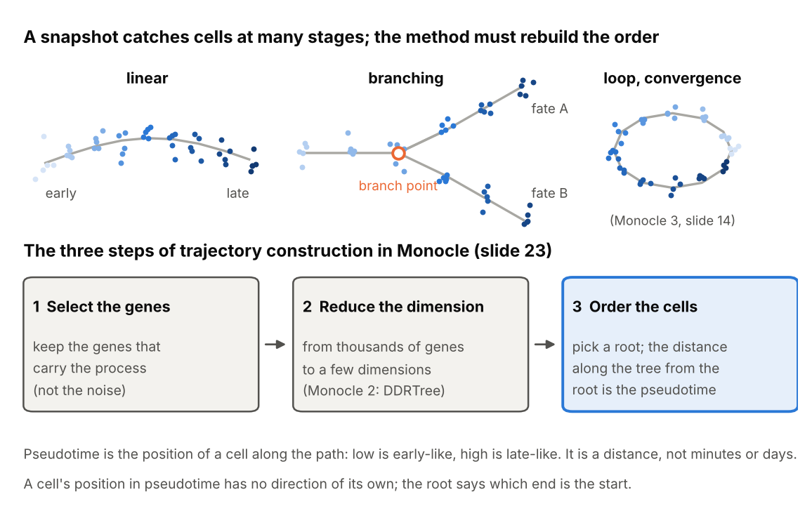
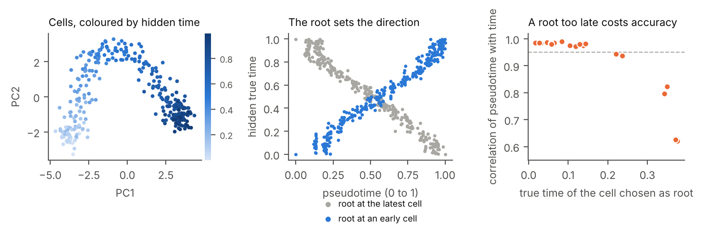
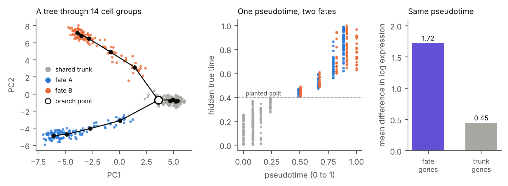
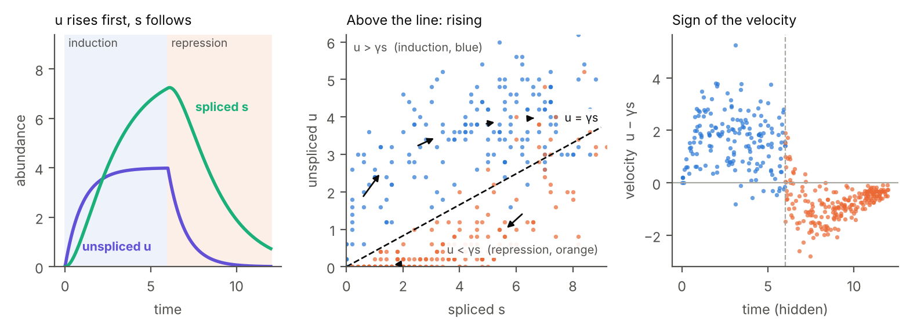
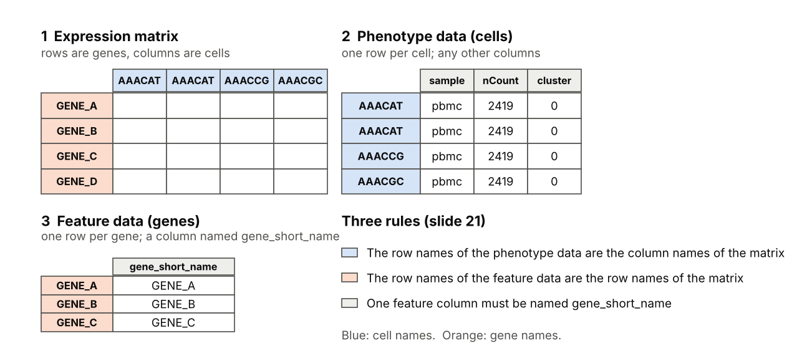

# Trajectory Inference and Monocle Practice

> Module 8, the last session of the course: how to put cells in order along a developmental or disease path from a single snapshot. What trajectory inference is and why it is hard, how a trajectory is built (reduce the dimension, then track the path), pseudotime, branching and lineages, two published use cases (neuroblastoma, neutrophils), the Monocle family (1, 2 and 3), RNA velocity, newer deep-learning methods, how to choose software, the Monocle input format, and a plan for the after-class task on mouse fibroblasts.

---

## Table of Contents

1. [What Trajectory Inference Is](#1-what-trajectory-inference-is)
2. [How a Trajectory Is Built: Reduce the Dimension, Then Track the Path](#2-how-a-trajectory-is-built-reduce-the-dimension-then-track-the-path)
3. [The Trajectory as a Directed Graph: Branches and Lineages](#3-the-trajectory-as-a-directed-graph-branches-and-lineages)
4. [Use Case 1: Neuroblastoma](#4-use-case-1-neuroblastoma)
5. [Use Case 2: Neutrophils](#5-use-case-2-neutrophils)
6. [Monocle: Ordering Cells by Gene Expression](#6-monocle-ordering-cells-by-gene-expression)
7. [Monocle 2: Branches with DDRTree](#7-monocle-2-branches-with-ddrtree)
8. [Monocle 3: Trajectory and Atlas Together](#8-monocle-3-trajectory-and-atlas-together)
9. [RNA Velocity: Giving the Path a Direction](#9-rna-velocity-giving-the-path-a-direction)
10. [Newer Trends: Generative Models](#10-newer-trends-generative-models)
11. [Choosing the Software](#11-choosing-the-software)
12. [What Monocle Does and the Input Format](#12-what-monocle-does-and-the-input-format)
13. [The Monocle Construction Process and the After-Class Task](#13-the-monocle-construction-process-and-the-after-class-task)
14. [Reading a Trajectory: a Checklist and the Limits](#14-reading-a-trajectory-a-checklist-and-the-limits)
15. [Key Takeaways](#15-key-takeaways)
16. [The End of the Course: How the Eight Modules Fit Together](#16-the-end-of-the-course-how-the-eight-modules-fit-together)

---

## How to read this module

Module 7 treated every cell type as a fixed group and asked who signals to whom. This module treats the cells as **moving**: a cell type is a stage on a path, and the question is **in what order the cells change**. The notes follow the lecture's order (the concept, two use cases, the software, the Monocle practice) and add the reasoning the slides leave out.

**Sources and honesty about them.** The lecture slides are image captures of a video, so the player controls cut some text and some figures are small; where a number or a label is hard to read, I say "my reading". Slide 11's title is partly hidden by a player message. A text version of the narration is also available. It was produced by speech recognition and writes scTour as "SC tool" or "SC2", CytoTRACE as "CytoTrace", and "pseudotime" as "pseudo time"; I corrected those silently. The lecture refers to an **additional R notebook** with the Monocle 2 practice (slides 23 and 24) that was not given to me, so the notes cannot describe it.

**R is not installed on the machine used to check this module, so no R code here was run.** The slides contain only the Monocle installation lines and the three lines that build the input files (slides 21 and 22). The Monocle workflow in section 13 is **my own suggestion, written from memory of the package, untested, and not from the slides**. Where I add anything else that is not on a slide, the text says "not on the slides". The Python blocks **were run** and their outputs are real, but they test the *logic* of each idea (pseudotime, a branching tree, RNA velocity, the three-file input rule) on small **invented** data. They are **not** Monocle, scTour or any real tool, and none of the numbers in them are results about real biology.

**Places where the narration and the slides do not agree, stated early.**

- The narration says that Monocle 2 differs from Monocle because Monocle "required a strong prior assumption about the starting and ending cell states". A few sentences earlier it says that the key idea of Monocle is to build trajectories "even if the exact differentiation relationships between cells aren't known", without prior assumptions. Both cannot be true. Section 6 explains what I think is the real difference.
- The narration describes the Monocle process as **four** stages (gene filtering, dimension reduction, graph learning, pseudotime ordering); slide 23 shows **three** steps. Section 13 puts the two together.
- The website shown on slide 20 carries a banner that, in my reading, says Monocle 2 is **deprecated** and tells readers to use Monocle 3, while the practice in this lecture uses Monocle 2. Section 12 returns to this.

---

## 1. What Trajectory Inference Is

**The slide (slide 4).** The slide shows a diagram of early human embryo development, from fertilisation (day 1) through cleavage, compaction, implantation and gastrulation to day 23, and next to it the label **"scRNA-seq: at a certain time"** and the words **"Continuous change!"**. Below, the definition: trajectory inference (TI) is the **process of reconstructing developmental or differentiation trajectories of individual cells based on their gene expression profiles**.

**The problem the slide is pointing at.** Development is a **continuous** process: the cells change a little at a time. But a single cell experiment is **one snapshot at one moment**. In one tissue sample, cells at many different stages are mixed together, and each cell is measured once (the measurement destroys it, which is general knowledge and not on the slide). You cannot film one cell and follow it. Trajectory inference solves this by a clever swap: if the sample contains cells from every stage of the process, then **ordering the cells by how similar their gene expression is** gives the order of the stages, in the same way that a photograph of a forest with trees of all ages shows how a tree grows.

**What it is used for (narration).** The narration says the technique is especially useful for understanding **how stem cells become specialised cell types** and **how disease states emerge**. It models continuous changes in cell state, so it helps with **development, the immune response and disease progression**. The next two sections are two examples (cancer and immune cells).



*Figure. Top: the same idea in three shapes (a line, a line that splits, and a loop); the colour is the stage. Bottom: the three steps of trajectory construction in Monocle (slide 23), explained in sections 2 and 13.*

**What the narration lists as the usual workflow.** (1) **Dimensionality reduction**, which simplifies the data while keeping the important features; (2) **track construction**, which builds paths that represent cellular transitions; (3) optionally **RNA velocity**, which adds a time layer by comparing spliced and unspliced mRNA to predict future cell states (section 9).

---

## 2. How a Trajectory Is Built: Reduce the Dimension, Then Track the Path

**The slide (slide 5).** A large diagram, taken from a published review (the citation on the slide: Cannoodt, Saelens and Saeys, *European Journal of Immunology*, 2016, "Computational methods for trajectory inference from single-cell transcriptomics"). Below it, a box: **"The main steps of the TI method: Step 1: Reduce the dimension. Step 2: Track construction."**

**How to read the diagram (my reading of the small labels).** It is a map of choices. The input, **single cell expression**, is on the left. Each coloured line is one published method (named on the right: SCUBA, pseudotime, Wanderlust, Wishbone, SLICER, SCOUP, Waterfall, Mpath, TSCAN, **Monocle**, and RNA velocity at the bottom), and the line passes through the choices that method makes.

- **Dimensionality reduction (left grey block).** First a **similarity** measure (for example Euclidean distance, cosine, Pearson or Spearman correlation); then a way of reducing the dimension: **manifold learning** (t-SNE, diffusion maps, locally linear embedding, **PCA**, **ICA**), **clustering** (Mclust, k-means, hierarchical), or a **graph** (k-nearest neighbours, minimum spanning tree).
- **Trajectory modelling (right grey block).** **Pathfinding** (a principal curve, the shortest path from an origin, the longest path, a binary tree) and **cell ordering** (average orderings, detecting branches, projecting cells onto a path, optimising a tree).

The point of the figure is that **different methods are different combinations of the same few parts**. Monocle's line, for example, uses ICA to reduce the dimension, a minimum spanning tree as the graph, and then orders the cells along it (my reading; section 6 explains why this matters).

**The two steps in plain words.**

1. **Reduce the dimension.** A cell has thousands of numbers (one per gene). Most of the variation is noise. Reduce each cell to a few coordinates in which similar cells lie close together (the same idea as PCA and UMAP in Module 4).
2. **Track construction.** In that low-dimensional space, draw a path or a tree through the cloud of cells, choose where it **starts** (the **root**), and give each cell its **pseudotime**: its distance along the path from the root.

**Pseudotime (narration, slide 11).** Cells with an early-like gene expression pattern get **low** pseudotime values and cells with a late-like, more differentiated pattern get **high** values. Pseudotime is **not time**: it has no unit of minutes or days. It measures **how much the cell's expression has changed along the path**. Two cells can be one hour apart in real time and far apart in pseudotime if the cell changes quickly, or the other way round.

**The toy, step by step.** The check below makes 300 cells at hidden times between 0 and 1 and 200 genes: **40 genes that change with time** (they switch on, switch off, or have a short burst) and **160 genes that do nothing** (a constant level, only counting noise). The method never sees the hidden time. Then:

1. Take the log-normalised counts and keep the **40 most variable genes** (this is the *"select the genes used in the analysis"* step of slide 23). In the toy, 38 of the 40 are real time genes.
2. Reduce to 10 principal components.
3. Join each cell to its 15 nearest neighbours.
4. Choose the **root**: the cell with the highest value of a known **early marker** (a gene that switches off with time). This is how you would choose a root from biology.
5. Pseudotime is the shortest path length along the neighbour graph from the root to each cell.
6. Compare with the hidden time by Spearman correlation.

```python
import numpy as np
from sklearn.decomposition import PCA
from sklearn.neighbors import kneighbors_graph
from scipy.sparse.csgraph import shortest_path
from scipy.stats import spearmanr

def simulate(seed, n_cells=300, n_time=40, n_noise=160):
    """A snapshot of cells that sit at different, unknown positions of one process (true time t in 0..1)."""
    rng = np.random.default_rng(seed)
    t = rng.uniform(0, 1, n_cells)                                    # the hidden true time of each cell (never given to the method)
    means = []
    for g in range(n_time):                                           # genes that change with time: rising, falling and transient
        kind = g % 4
        c, w = rng.uniform(0.25, 0.75), rng.uniform(0.08, 0.2)
        sig = 1 / (1 + np.exp(-(t - c) / w))
        if kind in (0, 1):  m = 0.5 + 6 * sig                         # switches on
        elif kind == 2:     m = 0.5 + 6 * (1 - sig)                   # switches off
        else:               m = 0.5 + 6 * np.exp(-((t - c) / 0.15) ** 2)   # a transient burst
        means.append(m)
    for g in range(n_noise):                                          # genes with no relation to time (a similar level of expression)
        means.append(np.full(n_cells, rng.uniform(0.5, 4)))
    X = np.log1p(rng.poisson(np.array(means)))                        # genes x cells, log-normalised counts
    return X, t

def pseudotime(X_cells_by_genes, root):
    """Reduce to 10 PCs, join each cell to its 15 nearest neighbours, and take the shortest path length from the root cell."""
    Z = PCA(n_components=10, random_state=0).fit_transform(X_cells_by_genes)
    G = kneighbors_graph(Z, 15, mode="distance")
    D = shortest_path(G, directed=False, indices=root)
    return Z, D

X, t = simulate(0)
Xc = X.T                                                              # cells x genes for scikit-learn
early_gene = 2                                                        # gene 2 switches OFF with time: a known "early" marker
root = int(np.argmax(X[early_gene]))                                  # root = the cell with the highest early marker (chosen from biology)
latest = int(np.argmax(t))

var = X.var(axis=1)                                                   # step 1 of Monocle: choose the genes that will order the cells
chosen = np.argsort(var)[::-1][:40]
print(f"top-40 genes by variance: {int((chosen < 40).sum())} of 40 are genes that really change with time (the other 160 genes are noise)")

Z_all, pt_all = pseudotime(Xc, root)
Z_sel, pt_sel = pseudotime(Xc[:, chosen], root)
_, pt_wrong = pseudotime(Xc[:, chosen], latest)
rho = lambda a: spearmanr(a, t)[0]
print(f"\nSpearman correlation between pseudotime and the hidden true time (one data set of 300 cells):")
print(f"  all 200 genes, root = early marker cell     : {rho(pt_all):+.3f}")
print(f"  40 chosen genes, root = early marker cell   : {rho(pt_sel):+.3f}")
print(f"  40 chosen genes, root = the latest cell     : {rho(pt_wrong):+.3f}   (same graph, root at the wrong end)")

all_r, sel_r, root_t = [], [], []                                      # repeat on 20 new simulated data sets
for s_ in range(1, 21):
    Xs, ts = simulate(s_)
    r = int(np.argmax(Xs[early_gene])); ch = np.argsort(Xs.var(axis=1))[::-1][:40]
    all_r.append(spearmanr(pseudotime(Xs.T, r)[1], ts)[0]); sel_r.append(spearmanr(pseudotime(Xs.T[:, ch], r)[1], ts)[0]); root_t.append(ts[r])
all_r, sel_r, root_t = map(np.array, (all_r, sel_r, root_t))
print(f"\n20 further data sets:  all genes {all_r.mean():+.3f} +/- {all_r.std():.3f}   chosen genes {sel_r.mean():+.3f} +/- {sel_r.std():.3f}")
good = root_t < 0.2
print(f"the root cell sat at true time < 0.2 in {int(good.sum())} of 20 sets: mean correlation {sel_r[good].mean():+.3f}; "
      f"in the other {int((~good).sum())} sets (root at true time {root_t[~good].min():.2f} to {root_t[~good].max():.2f}): {sel_r[~good].mean():+.3f}, worst {sel_r.min():+.3f}")

# Output:
# top-40 genes by variance: 38 of 40 are genes that really change with time (the other 160
#   genes are noise)
# 
# Spearman correlation between pseudotime and the hidden true time (one data set of 300
#   cells):
#   all 200 genes, root = early marker cell     : +0.979
#   40 chosen genes, root = early marker cell   : +0.984
#   40 chosen genes, root = the latest cell     : -0.978   (same graph, root at the wrong
#   end)
# 
# 20 further data sets:  all genes +0.921 +/- 0.103   chosen genes +0.925 +/- 0.113
# the root cell sat at true time < 0.2 in 14 of 20 sets: mean correlation +0.982; in the
#   other 6 sets (root at true time 0.22 to 0.38): +0.791, worst +0.621
```



*Figure. Left: the 300 cells in the first two principal components, coloured by hidden time; the cloud is an arch. Middle: pseudotime against hidden time for a root at an early cell (blue) and at the latest cell (grey). Right: in 20 further data sets, the correlation against the true time of the cell chosen as root.*

**Reading the output.**

- **The method recovers the order.** With the early marker as the root the correlation with the hidden time is **+0.984** (and +0.979 with all 200 genes). The cells lie along an arch in the figure, and the neighbour graph follows it.
- **The root decides the direction.** The same graph rooted at the **latest** cell gives **-0.978**: the same ordering, back to front. Pseudotime has no direction of its own. **You** tell it where the start is, with biology (a known early marker, a stem-cell marker).
- **A root too far from the start costs accuracy.** In 20 more data sets the correlation was +0.982 on average when the chosen root was at true time below 0.2 (14 sets), but only **+0.791** on average, and **+0.621** at worst, when the "early marker" cell sat at true time 0.22 to 0.38 (6 sets). The marker gene was high in many cells, and the single highest cell was a poor choice. A good root takes care.
- **Gene selection made almost no difference here**: +0.925 for the 40 chosen genes against +0.921 for all genes. In this toy the 160 noise genes are flat, so they add little. Real data have many more genes and much messier noise, which is why Monocle has the step, but this check does not show it, so I do not claim it.

---

## 3. The Trajectory as a Directed Graph: Branches and Lineages

**The slide (slide 6).** A figure with the heading structure: (A) a **snapshot of a cell population** (or **synchronised cell populations** taken at times t0, t1, t2), measured by **scRNA-seq, sc-qPCR or flow or mass cytometry**, giving a **single cell expression matrix**; then **trajectory inference**, whose result can be (B) **linear trajectories** or (C) **branched trajectories**, each with its downstream analyses (finding new transition states, **state-specific surface markers**, **modules of pseudotemporal co-expression**, **temporal dynamics of gene regulation**; for branches: the **bifurcation state**, **branch-specific markers**, the **wiring of the differentiation tree**, **transcriptional regulation of branching**). Two text blocks:

- "**TI is a dynamic process as a directed graph and each distinct path along the graph is a lineage.**"
- "TI aims to sequence cells according to their underlying dynamic processes; the structure of the dynamic process can be **linear, nonlinear or branching**."

**What this means, piece by piece (narration).** "Trajectory inference is best understood as a dynamic directed graph."

- A **node** is a cell or a group of similar cells.
- An **edge** is a transition between transcriptional states.
- **Directed** means the edge has an arrow: from earlier to later.
- A **lineage** is **one distinct path through the graph**, from the start to one end.
- A **branch point** is where a progenitor cell can become one of two or more mature cell types. "This branching structure is a hallmark of many developmental and disease-related processes."

**The big challenge (narration).** "Knowing not just how cells are related, but **which states come earlier or later**." Section 2 showed it: the ordering is the same read forwards or backwards. The tool that answers it is **RNA velocity** (section 9).

**What happens to pseudotime at a branch (narration, slide 11).** "When the graph branches, pseudotime continues to increase along each branch, but the **biological meaning diverges**. Two cells can have similar pseudotime values but belong to different lineages, reflecting alternative fate decisions." So a pseudotime value alone is not enough: you also need to know **which branch** a cell is on.

**The toy.** 400 cells with a hidden time. Until time 0.4 they are one **shared trunk**; after that, each cell takes **fate A** or **fate B**. There are 30 trunk genes (on early, off after the split, in both fates), 25 genes that turn on only in fate A, 25 only in fate B, and 60 noise genes. The check then does a simplified cousin of what slide 12 shows for Monocle 2 (the real algorithm, DDRTree, reduces the dimension and fits the tree together, section 7; this toy does them one after the other):

1. PCA to 5 components.
2. Divide the cells into **14 groups** (k-means, a choice of mine) and take the group centres.
3. Join the centres with a **minimum spanning tree** (the shortest set of links that connects them all).
4. Root at the group containing the earliest-looking cell; pseudotime = distance along the tree from the root.
5. A group with **three or more links** is a **branch point**. Cut the tree there; the two pieces that do not contain the root are the **two fates**.

```python
import numpy as np
import networkx as nx
from sklearn.decomposition import PCA
from sklearn.cluster import KMeans
from scipy.stats import spearmanr

rng = np.random.default_rng(2)
n = 400
t = rng.uniform(0, 1, n)                                          # hidden true time
branch = np.where(t < 0.4, 0, rng.integers(1, 3, n))              # 0 = shared trunk (t < 0.4); then 1 = fate A or 2 = fate B
sig = lambda x: 1 / (1 + np.exp(-x))
late = sig((t - 0.5) / 0.08)                                      # 0 before the split, 1 well after it
means = []
for g in range(30):  means.append(0.5 + 6 * (1 - sig((t - 0.4) / 0.1)))          # trunk genes: on early, off after the split, in BOTH fates
for g in range(25):  means.append(0.3 + 6 * late * (branch == 1))                  # fate A genes
for g in range(25):  means.append(0.3 + 6 * late * (branch == 2))                  # fate B genes
for g in range(60):  means.append(np.full(n, rng.uniform(0.5, 3)))                 # noise genes
X = np.log1p(rng.poisson(np.array(means)))                                         # genes x cells
trunk_g, a_g, b_g = np.arange(0, 30), np.arange(30, 55), np.arange(55, 80)

Z = PCA(n_components=5, random_state=0).fit_transform(X.T)

# a single straight ordering (first principal component) against the hidden time
print(f"PC1 as a straight ordering:  Spearman with true time = {abs(spearmanr(Z[:, 0], t)[0]):.3f}"
      f"   (cells of fate A only: {abs(spearmanr(Z[branch != 2, 0], t[branch != 2])[0]):.3f}, fate B only: {abs(spearmanr(Z[branch != 1, 0], t[branch != 1])[0]):.3f})")

# a tree: 14 cell groups (k-means), join their centres by a minimum spanning tree, measure distance from the root group
km = KMeans(n_clusters=14, n_init=10, random_state=0).fit(Z)
C, lab = km.cluster_centers_, km.labels_
K = nx.Graph()
for i in range(14):
    for j in range(i + 1, 14): K.add_edge(i, j, weight=float(np.linalg.norm(C[i] - C[j])))
T = nx.minimum_spanning_tree(K)
root_cell = int(np.argmax(X[0]))                                  # the cell with the highest trunk gene = the earliest-looking cell
root = lab[root_cell]
dist = nx.single_source_dijkstra_path_length(T, root, weight="weight")
pt = np.array([dist[l] for l in lab]); pt = pt / pt.max()         # pseudotime of a cell = distance of its group from the root, scaled 0..1
print(f"tree pseudotime:             Spearman with true time = {abs(spearmanr(pt, t)[0]):.3f}")

hubs = [v for v, d in T.degree() if d >= 3]
print(f"\nnodes with 3 or more links (branch points): {hubs}")
hub = hubs[0]
print(f"the branch point group holds cells with mean true time {t[lab == hub].mean():.2f}  (the planted split is at 0.40)")

T2 = T.copy(); T2.remove_node(hub)                                # cut the tree at the branch point: trunk side and the two fates fall apart
parts = [p for p in nx.connected_components(T2) if root not in p]
which = np.full(n, -1)
for k, p in enumerate(parts): which[np.isin(lab, list(p))] = k
sel = (t > 0.6)                                                   # cells that are clearly past the split
if len(parts) == 2:
    m = (which[sel] == 0) == (branch[sel] == 1)
    print(f"{len(parts)} branches found; of {int(sel.sum())} cells with true time > 0.6, {100 * max(m.mean(), 1 - m.mean()):.1f}% are placed in the right fate")
    A, B = np.where((which == 0) & sel)[0], np.where((which == 1) & sel)[0]
    near = np.array([B[np.argmin(np.abs(pt[B] - pt[a]))] for a in A])
    dpt = np.abs(pt[A] - pt[near])
    d_branch = np.abs(X[np.ix_(np.r_[a_g, b_g], A)] - X[np.ix_(np.r_[a_g, b_g], near)]).mean()
    d_trunk = np.abs(X[np.ix_(trunk_g, A)] - X[np.ix_(trunk_g, near)]).mean()
    print(f"\npairs of cells on the two branches with almost the same pseudotime (median difference {np.median(dpt):.3f}):")
    print(f"  mean difference in the fate genes {d_branch:.2f}   mean difference in the trunk genes {d_trunk:.2f}")

# Output:
# PC1 as a straight ordering:  Spearman with true time = 0.936   (cells of fate A only:
#   0.961, fate B only: 0.951)
# tree pseudotime:             Spearman with true time = 0.921
# 
# nodes with 3 or more links (branch points): [5]
# the branch point group holds cells with mean true time 0.35  (the planted split is at
#   0.40)
# 2 branches found; of 164 cells with true time > 0.6, 100.0% are placed in the right fate
# 
# pairs of cells on the two branches with almost the same pseudotime (median difference
#   0.028):
#   mean difference in the fate genes 1.72   mean difference in the trunk genes 0.45
```



*Figure. Left: the first two principal components with the tree drawn through the cell groups; the white circle is the branch point. Middle: pseudotime against hidden time; the two fates sit at the same pseudotime. Right: for pairs of cells on different fates with almost the same pseudotime, the mean difference in the fate genes and in the trunk genes.*

**Reading the output.**

- **The tree finds the structure.** It has exactly one branch point, in a group whose cells have a mean hidden time of **0.35**, near the planted split at 0.40. Of the 164 cells that are clearly past the split (hidden time above 0.6), **100%** are placed in the right fate.
- **Overall correlation does not show the benefit.** A single straight ordering (the first principal component) also correlates well with the hidden time (0.936), more than the tree's coarser pseudotime (0.921). The tree's value is not a better single number; it is the **branch point and the fate of each cell**, which a single ordering cannot hold.
- **The same pseudotime is not the same cell state.** For pairs of cells on the two fates with almost the same pseudotime (median difference 0.028), the mean difference in the **fate genes** is **1.72** but in the **trunk genes** only **0.45** (the level of the counting noise). That is the narration's point: two cells at the same pseudotime on different branches have chosen different fates.
- **What the toy does not show.** It is one simulated data set with one random seed and a group count I chose, and the two fates are very different from each other. Real branches are often closer and the answer depends on the choices.

---

## 4. Use Case 1: Neuroblastoma

**The slide (slide 8).** Title: "Application of trajectory analysis in neuroblastoma cells". The text on the slide:

- Tumour-to-normal single-cell mRNA comparisons reveal a **pan-neuroblastoma cancer cell**.
- The authors wanted to study the developmental processes of neuroblastoma cells **by comparing cancer with normal fetal adrenal scRNA-seq data**.
- They found the **sympathoblastic state** to be a **universal feature of neuroblastoma cells**, which could be used as a target.
- For the trajectory analysis, **Monocle 3 and RNA velocity** were used.

The citation under the slide is Kildisiute et al., *Science Advances*, 2021 (my reading of the small print). The figure has panels showing a UMAP of the normal adrenal medulla cell types (labels in my reading: sympathoblast, chromaffin, bridge, SCP), a UMAP coloured by pseudotime with velocity arrows, and a heat map of genes along the pseudotime trajectory. The slide does not define "SCP"; in this field it usually means Schwann cell precursor (general knowledge, not on the slide).

**What the narration adds.** Neuroblastoma is "a pediatric cancer originating from neural crest cells". On the trajectory plots "tumor cells align along a developmental path rather than forming entirely novel states", and the narrator concludes that this "suggests that neuroblastoma represents a locked or deregulated developmental program, providing potential therapeutic targets". The last sentence is the narrator's interpretation; the slide says only that the sympathoblastic state is a possible target.

**Why this is a trajectory question.** A normal tissue passes through stages (precursor, bridge, sympathoblast). If a tumour's cells fall on the **same** path as the normal cells, and mostly at one stage, then the tumour has not invented a new cell type: it is **stuck at, or has re-entered, a normal stage**. A clustering alone (Module 4) says "these cells are similar to sympathoblasts". The trajectory says **where on the normal path they sit**, and so which genes are changing as they get there.

**Why the two tools together.** Monocle 3 builds the graph and the pseudotime. RNA velocity (section 9) adds the **arrows**, which tell you the direction. The slide's panel B is exactly this combination: pseudotime as colour, velocity as arrows.

**The root was a biological choice (my reading of the small print under the figure).** The methods text on the slide describes building a Monocle 3 object from a Seurat object, using the `learn_graph` function to build a principal graph, then `order_cells` to place cells on a pseudotime trajectory from a **starting node chosen from earlier knowledge of mouse development**. This is the point of section 2: the algorithm cannot choose the root, the biologist does.

---

## 5. Use Case 2: Neutrophils

**The slide (slide 9).** Title: "Application of trajectory analysis in neutrophils". The paper (citation on the slide, my reading: Wu et al., *Cell*, 2024) is "Neutrophil profiling illuminates anti-tumor antigen-presenting potency". The text on the slide, in short:

- The authors built a **neutrophil atlas** ("first immune responders") to find distinct, clinically relevant transcriptional states.
- **Trajectory analysis was one of the key steps** to identify the stages of neutrophil subsets, the cancer type specificity and the differentiation state.
- They concluded that a subset matters, one that is **terminally differentiated and metabolically reprogrammed at the end of maturation**; **CD11b, MPO and RFX5** were enriched in this subset.
- **scTour was the main software** for the trajectory, and the trajectory was **confirmed with CytoTRACE, Monocle 3 and Slingshot**.
- The rest of the slide (leucine-triggered antigen presentation, higher survival in most cancers, ligand-receptor interactions with anti-tumour T cells, possible immunotherapies) is downstream of the trajectory and is not the topic of this module.

**What the narration adds.** Neutrophils are "traditionally considered terminally differentiated", but trajectory analysis "revealed a much more complex picture": distinct maturation stages, metabolically active subsets and antigen-presenting states. On the graphs "cells progress from early differentiation states toward terminal, functionally specialized states", and the three markers were enriched "at specific end points of the trajectory". The narration says that several tools "validate" the trajectory but does not say which was the main one; the slide does (scTour).

**Three things to take from this case.**

1. **A "terminal" cell type is not a single state.** A trajectory can split a cell type that clustering treats as one block into stages.
2. **Confirm with more than one method.** The slide's authors used four tools. Slide 17 gives the same advice: "confirm results using at least two methods" (my reading of the small text; section 11).
3. **Markers along the path are how you describe the end state.** A trajectory is a graph; what makes it biology is the genes that change along it. CD11b and MPO are classic neutrophil maturation genes and RFX5 is a transcription factor linked to antigen presentation (general knowledge, not on the slides).

---

## 6. Monocle: Ordering Cells by Gene Expression

**The slide (slide 11).** Title partly hidden by the video player ("Monocle - Based on g...els"; from the narration I would guess "based on gene expression levels", but that is my guess). Three kinds of panel:

- Left: a scatter of 16,786 T cells (my reading of "n = 16,786") laid out on two axes, with the labels **Naive, Memory, Activated, Activated/exhausted, Exhausted**. Caption as written: "**Functional differentiation between T cell subtypes**". Next to it, small plots of gene expression along the cell order (my reading: PDCD1 and HAVCR2; IFNG and TNF).
- Right: a pseudotime plot on two components, coloured by cluster and by expression of one gene (my reading: Zscan4d). Caption as written: "**The transformation of omnipotent stem cells into pluripotent stem cells**". I quote the caption as the slide has it. In standard usage a totipotent cell is the more potent one, and I did not check which direction the source figure shows.

The slide does not say which tool made each panel. They show what a pseudotime output looks like: a coloured path, and genes that rise or fall along it.

**What Monocle does (narration).** "Monocle is one of the earliest and most widely used tools for trajectory inference". It "works primarily by looking at gene expression levels" and orders the cells along a continuous trajectory, the pseudotime. Cells with early-like patterns get low values and late-like cells high values. When pseudotime is drawn on a trajectory plot the cells are coloured on a gradient from early to late, and this gradient "helps us interpret the direction of biological progression along each lineage and identify key transition points, such as commitment or terminal differentiation".

**Its key idea and its limit (narration).**

- The idea: you can build a continuous trajectory "even if the exact differentiation relationships between cells aren't known", which "was a major innovation at the time".
- The limit: the dimension reduction, "typically independent component analysis" (**ICA**), "is different from what is used in modern cell atlas tools, and it can struggle to capture branching structures or more complex transitions".

**What ICA changes (my explanation).** PCA finds directions along which the cells vary most; ICA finds directions that are as statistically independent from each other as possible. Either way, the cells end up in a low-dimensional space, and the ordering is then drawn there (slide 5 shows Monocle's line passing through ICA; my reading). As far as I know from the Monocle papers (not on the slides), the first version of Monocle drew a tree through the cells and took the longest path in it as the main trajectory, so a process with several branches was hard to represent. The toy in section 3 shows why one ordering is not enough once there is a branch.

---

## 7. Monocle 2: Branches with DDRTree

**The slide (slide 12).** Title: "Monocle2- Principles of analysis", with the address of the Monocle 2 website (cole-trapnell-lab.github.io/monocle-release, my reading). The right side repeats the method map of slide 5. The left side is a picture of the algorithm. Its small labels, in my reading, run:

1. **Initial dimension reduction** (PCA, LLE or diffusion maps).
2. **Guess an initial cell trajectory** on the centroids (group centres) of the cells.
3. **Update the cell positions** based on the current trajectory, and **update the centroids**.
4. **Repeat until the trajectory and the cell positions are stable** under the optimisation function.
5. **Map back to the high-dimensional space.**
6. **Select the root.** The **distance from the root defines pseudotime**, and the **branches define fate decisions**.

The orange box on the slide has two bullets: "Continuous trajectories can be constructed even if there is no differentiation relation" and "The dimension reduction of the trajectory construction is not consistent with which used for the cell atlas". The second is the problem Monocle 3 sets out to fix (section 8).

**What DDRTree is, in plain words.** The narration spells it out as "discriminative dimensionality reduction tree", and says it "compresses the high-dimensional gene expression data into a low-dimensional space while preserving branching structure". The picture of steps 2 to 4 is the key. Instead of reducing the dimension **first** and drawing the tree **second** (the order of Monocle 1 and of my toy in section 3), Monocle 2 does the two **together** and goes back and forth: the tree pulls the cells towards itself, and the cells reshape the tree, until neither moves. That is why it can follow branches that a one-shot reduction flattens.

**What the narration says about the benefit.** Monocle 2 "can construct continuous trajectories even when differentiation paths are unclear or complex", "model multiple fate decisions and branching trajectories more flexibly than Monocle", and "reveal subtle cellular transitions and rare subpopulations that Monocle might miss".

**An inconsistency in the narration, and my reading.** The narration says that, "unlike Monocle, which required a strong prior assumption about the starting and ending cell states", Monocle 2 does not. But a few sentences before, it says the key idea of Monocle was to build trajectories without knowing the relationships between cells. Both cannot be the difference. My reading: what DDRTree adds is the ability to find **branches** by itself, and the narrator's "prior assumption" probably means that a single ordering works best when you already know that the process is one path. I cannot confirm that from the slides. In every version, you still choose the **root** yourself after the trajectory exists.

**Practice in this lecture.** The Monocle 2 pipeline is the one practised (slide 21 onwards). Slide 20 shows the Monocle website with a banner that, in my reading, says that Monocle 2 and Monocle 3 alpha are deprecated and asks readers to use Monocle 3. So the lecture's practice package is the older one, which is still widely used in published work; for a new project, check the current Monocle site first.

---

## 8. Monocle 3: Trajectory and Atlas Together

**The slide (slide 14).** Title "Monocle3", with a flow chart and a list titled "What's new in Monocle 3" (from the Monocle 3 website, address cole-trapnell-lab.github.io/monocle3 on the slide).

**The flow chart, in order (my reading).**

1. A high-dimensional, noisy RNA-seq data set.
2. **Preprocess**: normalisation and PCA.
3. **Non-linear dimension reduction**: **tSNE** or **UMAP**.
4. **Cluster** the cells (Louvain clustering).
5. **Partition**: group clusters that are strongly connected into **components**.
6. **Learn graph**: fit a principal graph; the three algorithms named on the slide are **DDRTree, SimplePPT and L1-graph**.
7. **Pseudotime assignment.**
8. **Graph-based differential analysis** (find genes that change along the graph).

**What is new (the slide's list).** A better structured workflow for developmental trajectories; use of **UMAP** to initialise the trajectory; support for trajectories with **multiple roots**; ways to learn trajectories with **loops or points of convergence**; algorithms that automatically **partition cells** to learn **disjoint or parallel trajectories** (using ideas from "approximate graph abstraction", the slide says); **a new statistical test** for genes with trajectory-dependent expression; and a **3D interface**.

**The orange box.**

- "The trajectory and atlas are unified, and the direction of differentiation can be inferred."
- "Cells that are not related to differentiation are not forced onto a trajectory."
- "Non-mainstream software that is still being tested and improved."

**Why each point matters.**

- **Unified with the atlas.** In Monocle 1 and 2 the space used to draw the trajectory (ICA, DDRTree) was not the space used for the atlas (the UMAP or t-SNE of Module 4). A cell could sit in one cluster in the atlas and somewhere unrelated on the trajectory. In Monocle 3 the same UMAP is used for both, so the trajectory is drawn **on the atlas you already trust**.
- **Partition.** A real sample can have a T cell population that has no developmental relation to the myeloid cells. Forcing one tree through all of them invents relationships. Partition first **splits the data into groups that are not connected**, then learns a graph in each (the second bullet).
- **Loops and several roots.** Real processes do not always branch outwards from one start (cells can converge, or the same type can arise from more than one source).
- **"Direction can be inferred"** is on the slide without explanation. I read it as "once you choose the root, pseudotime has a direction", not as "the tool finds the direction alone"; for that, RNA velocity is the tool (section 9).

**The narration** adds that Monocle 3 "doesn't force unrelated cells into the same trajectory, which was a limitation in earlier versions", and can "model complex branching differentiation paths and even multiple simultaneous processes within the same data set".

**A caution.** The slide's own last bullet calls it "non-mainstream software that is still being tested and improved". Check the Monocle 3 documentation for the current commands before you rely on any function name.

---

## 9. RNA Velocity: Giving the Path a Direction

**The slide (slide 15).** Title "RNA Velocity", from La Manno et al., *Nature*, 2018 (citation on the slide). It has four parts.

1. **Gene structure and read types (left).** For a gene with exons and introns, reads fall into **spliced reads** (exon-exon) and **unspliced reads** (including intron). Read-based protocols (SMART-seq2) and UMI-based protocols (inDrop, Chromium) both contain unspliced molecules. The three pie charts show 22%, 17% and 23% in red; my reading is that these are the share of unspliced reads or molecules in each protocol. The slide does not say what the pie charts measure.
2. **The process (middle).** **Transcription** (rate α) makes **unspliced mRNA u**; **splicing** (β, and the slide sets **β = 1**) turns it into **spliced mRNA s**; **degradation** (γ) removes it. The equation on the slide: **ds/dt = u − γs**.
3. **The phase plane (right).** Axes: unspliced (u) against spliced (s). A dashed diagonal is the **steady state, u = γs**. Above it, in red: **induction, u > γs**. Below it, in blue: **repression, u < γs**. The curves show a cell moving up and to the right in induction, then returning below the line.
4. **Orange box.** (a) On the time axis, **unspliced mRNA always appears earlier than spliced**. (b) Increasing the transcription rate (induction) first raises unspliced mRNA, then spliced. (c) Comparing unspliced and spliced abundance reveals the **dynamic change** of the transcript. (d) The **start and end points** of differentiation can be predicted.

**The idea, step by step.**

1. Newly made RNA is unspliced; later it is spliced.
2. **If a gene has just been switched on**, there is a lot of unspliced RNA compared with what the spliced level would predict for a steady state. The cell is **above the line** (u > γs), and the spliced amount is about to **rise**.
3. **If a gene has just been switched off**, the unspliced RNA disappears first, and the cell is **below the line** (u < γs); the spliced amount is about to **fall**.
4. So **u − γs** is a prediction of **ds/dt**, the rate of change of the spliced RNA: the **velocity**. It is positive in induction and negative in repression.
5. Combine the velocities of many genes into one **arrow** per cell on the UMAP. The arrow points from the cell's current state to its predicted state a short time later.

**Pseudotime and velocity are complementary (narration).** Pseudotime "provides a global, smooth ordering of cells along lineages"; RNA velocity "provides local, short-term directional information". The narrator stresses that this matters at **branch points**, "where pseudotime alone cannot determine which branch represents the forward direction", and for finding **start and end states**.

**The toy.** One gene, one process. The gene is switched on (transcription α = 4) until time 6, then off. With β = 1 and γ = 0.5 the equations are integrated numerically (du/dt = α − βu is **my addition**, not on the slide; the slide gives only ds/dt = u − γs). 400 cells are caught at random times, and each is measured by **counting**: a Poisson draw, so the numbers are noisy. Then:

1. Estimate γ from the cells with the highest spliced level, assuming they sit near the steady state where u = γs. The ratio of mean u to mean s over the top 5% of cells is γ-hat.
2. The velocity of each cell is u − γ-hats.
3. Compare with the real ds/dt, which in a toy we know.
4. Ask whether the velocity can **orient an ordering**: take the cells in the right time order and in the reversed order, and check how well the velocity agrees with the slope of the spliced signal along the ordering.

```python
import numpy as np
from scipy.stats import spearmanr

rng = np.random.default_rng(4)
beta, gamma = 1.0, 0.5                      # splicing rate (the slide sets beta = 1) and degradation rate of spliced mRNA
T_on, T_end, dt = 6.0, 12.0, 0.01           # the gene is switched on for t < 6 (induction) and off afterwards (repression)

def alpha(t): return 4.0 if t < T_on else 0.0          # transcription rate
steps = int(T_end / dt)
u = np.zeros(steps + 1); s = np.zeros(steps + 1)
for i in range(steps):                                  # du/dt = alpha - beta*u ;  ds/dt = beta*u - gamma*s  (Euler steps)
    a = alpha(i * dt)
    u[i + 1] = u[i] + dt * (a - beta * u[i])
    s[i + 1] = s[i] + dt * (beta * u[i] - gamma * s[i])
time = np.arange(steps + 1) * dt
print(f"steady state while on: u = alpha/beta = {4 / beta:.1f}, s = alpha/gamma = {4 / gamma:.1f};  at t = {T_on:.0f}: u = {u[int(T_on / dt)]:.2f}, s = {s[int(T_on / dt)]:.2f}")

n = 400                                                 # 400 cells caught at random moments of the process (a snapshot)
tc = rng.uniform(0, T_end, n)
idx = (tc / dt).astype(int)
u_true, s_true = u[idx], s[idx]
true_vel = beta * u_true - gamma * s_true               # the real ds/dt of each cell
depth = 5                                               # counts per unit of expression: smaller = noisier
u_obs = rng.poisson(depth * u_true) / depth
s_obs = rng.poisson(depth * s_true) / depth

# estimate gamma from the cells nearest the steady state (the top 5% of spliced abundance), assuming u = gamma * s there
top = np.argsort(s_obs)[::-1][:int(0.05 * n)]
gamma_hat = u_obs[top].mean() / s_obs[top].mean()
vel = u_obs - gamma_hat * s_obs                         # estimated RNA velocity of each cell (beta = 1)
top_true = np.argsort(s_true)[::-1][:int(0.05 * n)]       # for comparison only: the same choice made with the noise-free values
gamma_clean = u_obs[top_true].mean() / s_obs[top_true].mean()
print(f"gamma: true {gamma:.2f}, estimated from the top 5% of cells {gamma_hat:.2f} (if the top cells are picked by the noise-free value: {gamma_clean:.2f})")

ind, rep = tc < T_on, tc >= T_on
print(f"\nvelocity > 0 in {100 * (vel[ind] > 0).mean():.0f}% of induction cells and < 0 in {100 * (vel[rep] < 0).mean():.0f}% of repression cells")
print(f"correlation between estimated velocity and the real ds/dt: Pearson {np.corrcoef(vel, true_vel)[0, 1]:.3f}")
above = u_obs > gamma_hat * s_obs
print(f"cells above the steady-state line (u > gamma*s): {100 * above[ind].mean():.0f}% of induction cells, {100 * above[rep].mean():.0f}% of repression cells")

def orientation_score(order, v, w=25):
    """Agreement between velocity and the slope of the spliced signal along a given ordering (any orientation)."""
    ss = s_obs[order]; vv = v[order]
    sm = np.convolve(ss, np.ones(w) / w, mode="same")
    slope = np.gradient(sm)
    keep = slice(w, -w)
    return spearmanr(vv[keep], slope[keep])[0]
fwd = np.argsort(tc)                                    # a pseudotime that points the right way
print(f"\nvelocity against the slope along an ordering:  correct direction {orientation_score(fwd, vel):+.2f},  reversed {orientation_score(fwd[::-1], vel):+.2f}")

# Output:
# steady state while on: u = alpha/beta = 4.0, s = alpha/gamma = 8.0;  at t = 6: u = 3.99, s
#   = 7.23
# gamma: true 0.50, estimated from the top 5% of cells 0.41 (if the top cells are picked by
#   the noise-free value: 0.48)
# 
# velocity > 0 in 93% of induction cells and < 0 in 92% of repression cells
# correlation between estimated velocity and the real ds/dt: Pearson 0.841
# cells above the steady-state line (u > gamma*s): 93% of induction cells, 8% of repression
#   cells
# 
# velocity against the slope along an ordering:  correct direction +0.58,  reversed -0.58
```



*Figure. One gene switched on, then off. Left: unspliced u rises first and spliced s follows. Middle: each cell is a point in the (s, u) plane; the dashed line is u = γs and the arrows show the direction a cell is moving. Right: the velocity u − γs of each cell against its hidden time.*

**Reading the output.**

- **The curves behave as the equations say.** While the gene is on, u settles at α/β = 4.0 and s heads towards α/γ = 8.0; at the switch-off (t = 6) s has reached only 7.23. The process had **not** quite reached the steady state when it was switched off.
- **The sign of the velocity is right for most cells.** It is positive in **93%** of induction cells and negative in **92%** of repression cells, and it correlates with the true ds/dt (Pearson **0.841**). In the phase plane, 93% of induction cells are above the line and only 8% of repression cells.
- **The estimate of γ is too low: 0.41 against the true 0.50.** The reason is that the top-spliced cells are chosen using the noisy counts, which picks cells whose s was counted high by chance. Choosing them by the noise-free value gives 0.48. A wrong γ shifts the line and so the velocity of cells near it. Real tools handle this in other ways, so this toy shows the problem and not what a real tool does.
- **Velocity can orient a path.** Along the correct ordering the agreement is **+0.58**, along the reversed ordering **-0.58**. This is the idea behind "RNA velocity gives the direction": a path read forwards agrees with the velocity; read backwards it disagrees.
- **What it does not show.** It is one gene with a clean on and off switch. Real data have thousands of genes, many with no useful signal, only a minority of reads are unspliced (the pie charts), and the steady-state assumption can fail. Treat arrows as **evidence to check against known biology**, not as proof.

---

## 10. Newer Trends: Generative Models

**The slide (slide 16).** Title: "Newer trends of trajectory analysis (Generative)". Two boxes:

- "**scTour**: deep learning architecture of cellular dynamics via variational autoencoder and neural ordinary differential equations" (Li, *Genome Biology*, 2023, citation on the slide).
- "**Decipher**: variational autoencoders with deep exponential families for shared and disrupted dynamics" (Nazaret et al., a 2023 preprint about acute myeloid leukaemia, citation on the slide).

**What the words mean (my explanation, not on the slides).**

- A **variational autoencoder (VAE)** compresses each cell's expression into a few hidden numbers (the **latent space**) and learns to rebuild the expression from them. It is a learned dimension reduction (step 1 of section 2).
- A **neural ODE** learns a rule for how those hidden numbers **change with time**: a vector field. Following the rule from a cell gives a path (step 2 of section 2), and the rule has a direction built in.
- So scTour is a trajectory method **with a model of the dynamics**: it can give pseudotime, a vector field and a latent space, and **predict** the state of a cell later (the small panel labels on the slide, my reading: inference, and prediction).
- **Decipher** uses a VAE for **shared and disrupted** dynamics: the normal path and the changed path in a disease (the narration: it "can handle disrupted trajectories in diseases like leukemia").

**The narration's summary.** "These generative models offer robust predictions". The narrator calls them "the frontier of trajectory analysis research". The speech-recognition text writes scTour as "SC tool" and "SC2" and Decipher in lower case; I have corrected them.

**What this means for you.** In the neutrophil case (section 5), scTour was the main tool. These methods need more software and more care (they are neural networks trained on your data), and the lecture does not practise them. For this course the practised tool is Monocle 2.

---

## 11. Choosing the Software

**The slide (slide 17).** Title: "How to choose the software?". It shows a large flow chart (in my reading, the interactive guideline of a published comparison of trajectory methods; the slide's own text names only the address guidelines.dynverse.org at the bottom of the chart). An orange box says:

- "**There is no one software for all data.**"
- "Check out the TI tool selection server: https://zouter.shinyapps.io/server/".

**How the chart works (my reading of the small labels).** You answer questions about what you **expect** the trajectory to look like:

- Do you expect **multiple disconnected trajectories**?
- Do you expect **cycles**?
- Do you expect a **tree with two or more bifurcations**?
- Do you expect **a particular topology** (a fixed shape), or do you want the method to find it (a **free topology**)?

The answers lead to one of seven **topologies**: **disconnected, graph, tree, multifurcation, bifurcation, linear, cycle**. Beside each topology is a table of methods, with columns (in my reading) for **accuracy**, **usability**, **running time** for several data sizes, and the **prior information** the method needs (for example, the starting cell). The three boxes at the bottom say: "**Confirm expectations** using a method with free topology", "**Confirm results** using at least two methods", and "Check out the interactive guidelines".

**The advice in one sentence.** Decide what shape you expect and why, let a free-topology method **test** that expectation, and do not trust one method alone. That is the same reason the neutrophil authors used four tools (section 5).

**The narration's factors.** "Data size, lineage complexity, availability of spliced and unspliced reads, and biological context all influence tool selection."

**The slide (slide 18).** "Single cell trajectory analysis software: **Monocle, RNA velocity, Palantir, slice, cytotrace, Slingshot** ...". Then "Why use Monocle?":

1. "Commonly used software of mainstream CNS journals, with high acceptance and penetration rate" (CNS, in my reading: Cell, Nature, Science).
2. **Powerful function.**
3. **Low learning cost (R based).** If you already use Seurat (Module 4), you are already in R.

**A comment.** The reasons for Monocle are practical and about **reviewers and learning time**. They are good reasons for a course and for a first analysis; they do not say that Monocle is the most accurate for your data. For that, use the flow chart and a second method.

---

## 12. What Monocle Does and the Input Format

**The slide (slide 20).** The Monocle website. In my reading, a banner at the top says Monocle 2 and Monocle 3 alpha are deprecated and points to Monocle 3 (section 7). Three boxes: **Pseudotime**, **Clustering**, **Differential expression**. The text beside them says what Monocle does:

- **Clustering, classifying and counting cells**: find new, possibly rare, cell subtypes.
- **Constructing single-cell trajectories**: "In development, disease, and throughout life, cells transition from one state to another. Monocle helps you discover these transitions."
- **Differential expression analysis**: compare cell types and states to characterise them, and find genes that change along a trajectory.

**The narration** calls these "a few key questions" and adds that differential expression "helps connect changes in gene expression to underlying biological decisions".

**The slide (slide 21): installation and the three inputs.** The installation (copied from the slide):

```r
if (!requireNamespace("BiocManager", quietly = TRUE))
  install.packages("BiocManager")
BiocManager::install("monocle")
```

The input is three parts, which are combined to make the Monocle object:

| Part | What it holds | The rule on the slide |
|---|---|---|
| **Expression matrix** | One number per gene and cell | **Rows are genes, columns are cells.** The slide recommends the **count** matrix |
| **phenoData (pd)** | Cell information: barcode, sample, cluster, counts | The **row names** of the phenoData must **match the column names** of the matrix |
| **featureData (fd)** | Gene information | The **row names** must **match the row names** of the matrix, and **one column must be named `gene_short_name`** |

**The slide (slide 22): "Three files for the Monocle object".** The slide shows how to make each from a Seurat object named `pro` (the PBMC 3k data of earlier modules; my reading, because the phenotype table has `pbmc3k` in its sample column, 2,700 cells and 13,714 genes):

```r
count <- GetAssayData(object = pro[["RNA"]], slot = "counts")   # expression matrix, genes x cells
dim(count)                                                      # [1] 13714  2700 (as on the slide)
pdata <- pro@meta.data                                          # phenotype data: one row per cell
dim(pdata)                                                      # 2700 rows, 7 columns (my reading)
fdata <- data.frame(gene_short_name = row.names(count), row.names = row.names(count))   # feature data
head(fdata)
```

- **Expression matrix:** rows are genes and columns are cell barcodes. It is the **count** matrix (`slot = "counts"` is Seurat v4; in Seurat v5 the argument is `layer = "counts"`).
- **Phenotype data:** the **first column** is the cell barcode (a row name), and the other columns are cell information (the example shows sample name, `nCount_RNA`, `nFeature_RNA`, `percent.mt`, the cluster columns).
- **Feature data:** one column, `gene_short_name`, filled with the gene names; the row names are the gene names. The slide's text writes the column name as "geneshortname", which is a typo; the code on the slide uses `gene_short_name`. In my reading, Monocle adds more columns to this table as it runs.

**The narration's version.** The expression matrix has "row names as gene names and column names as cell barcodes"; the phenotype data has "cell barcodes as row indexes and other metadata variables in columns".

**Why the rules matter.** The three parts are linked **only by names**. If the cell names in the phenotype table do not match the columns of the matrix, Monocle cannot tell which row of information belongs to which cell, and the object cannot be built (or, worse, is built with cells mixed up). A common slip is a matrix with **cells as rows**, the layout of some other tools.

**The toy.** The check below does not use Monocle. It writes the slide's three rules as a function and tries them on a small made-up example (6 genes, 5 cells) in six cases: one correct and five broken in the ways a student is likely to break them.

```python
import numpy as np
import pandas as pd

def check_monocle_inputs(expr, pdata, fdata):
    """The three rules of the lecture: genes are rows and cells are columns; the row names of the phenotype data are the
    column names of the matrix; the row names of the feature data are the row names of the matrix, with a column gene_short_name."""
    problems = []
    if set(pdata.index) == set(expr.index) and len(expr.index) > 0 and set(pdata.index) != set(expr.columns):
        problems.append("the matrix looks transposed: cells are rows, genes are columns")
    miss = set(expr.columns) - set(pdata.index); extra = set(pdata.index) - set(expr.columns)
    if miss or extra:
        problems.append(f"phenotype rows and matrix columns differ ({len(miss)} cells without phenotype, {len(extra)} phenotype rows without a cell)")
    elif list(pdata.index) != list(expr.columns):
        problems.append("same cells, different order (reorder the phenotype rows to the matrix columns)")
    missg = set(expr.index) - set(fdata.index); extrag = set(fdata.index) - set(expr.index)
    if missg or extrag:
        problems.append(f"feature rows and matrix rows differ ({len(missg)} genes without annotation, {len(extrag)} annotation rows without a gene)")
    elif list(fdata.index) != list(expr.index):
        problems.append("same genes, different order (reorder the feature rows to the matrix rows)")
    if "gene_short_name" not in fdata.columns:
        problems.append("the feature data has no column named gene_short_name")
    return problems

rng = np.random.default_rng(1)
genes = ["GENE_A", "GENE_B", "GENE_C", "GENE_D", "GENE_E", "GENE_F"]
cells = ["AAACATAC", "AAACATTG", "AAACCGTG", "AAACGCAC", "AAACGGCT"]
expr = pd.DataFrame(rng.poisson(2, (6, 5)), index=genes, columns=cells)                          # genes x cells
pdata = pd.DataFrame({"sample": "pbmc", "nCount_RNA": expr.sum(axis=0).values, "cluster": [0, 1, 0, 2, 1]}, index=cells)
fdata = pd.DataFrame({"gene_short_name": genes}, index=genes)                                    # as on the slide: gene_short_name = row names
print(f"matrix {expr.shape[0]} genes x {expr.shape[1]} cells | phenotype {pdata.shape[0]} x {pdata.shape[1]} | feature {fdata.shape[0]} x {fdata.shape[1]}")

cases = {
    "correct":                          (expr, pdata, fdata),
    "matrix transposed":                (expr.T, pdata, fdata),
    "one cell missing from phenotype":  (expr, pdata.drop(cells[0]), fdata),
    "phenotype rows in another order":  (expr, pdata.iloc[::-1], fdata),
    "no gene_short_name column":        (expr, pdata, fdata.rename(columns={"gene_short_name": "symbol"})),
    "one gene missing from feature":    (expr, pdata, fdata.drop(genes[-1])),
}
for name, (e, p, f) in cases.items():
    pr = check_monocle_inputs(e, p, f)
    print(f"\n{name}:  {'OK' if not pr else 'PROBLEM'}")
    for x in pr: print("   -", x)

# Output:
# matrix 6 genes x 5 cells | phenotype 5 x 3 | feature 6 x 1
# 
# correct:  OK
# 
# matrix transposed:  PROBLEM
#    - the matrix looks transposed: cells are rows, genes are columns
#    - phenotype rows and matrix columns differ (6 cells without phenotype, 5 phenotype rows
#   without a cell)
#    - feature rows and matrix rows differ (5 genes without annotation, 6 annotation rows
#   without a gene)
# 
# one cell missing from phenotype:  PROBLEM
#    - phenotype rows and matrix columns differ (1 cells without phenotype, 0 phenotype rows
#   without a cell)
# 
# phenotype rows in another order:  PROBLEM
#    - same cells, different order (reorder the phenotype rows to the matrix columns)
# 
# no gene_short_name column:  PROBLEM
#    - the feature data has no column named gene_short_name
# 
# one gene missing from feature:  PROBLEM
#    - feature rows and matrix rows differ (1 genes without annotation, 0 annotation rows
#   without a gene)
```



*Figure. Left: the expression matrix (genes in rows, cells in columns), the phenotype data (one row per cell) and the feature data (one row per gene, with the column gene_short_name). Right: the three rules. Blue marks cell names, orange marks gene names; the same colours must match across the tables.*

**Reading the output.**

- **The correct case passes**; **each broken case is caught** and named: the transposed matrix, a cell missing from the phenotype data, phenotype rows in a different order, no `gene_short_name` column, a gene missing from the feature data.
- **One mistake can raise several messages.** The transposed matrix breaks all three rules at once (cells as rows, so the phenotype rows and the feature rows no longer match the matrix). Fix the first message and re-run.
- **The order matters in my check, and I believe in R too.** The slide says the names "should match". As far as I know, the R objects Monocle builds on compare the names in order, so the safe rule is the same names in the same order. I did not test this in R.
- **What the check cannot do.** It tests names, not values. A matrix of the wrong values with the right names passes.

---

## 13. The Monocle Construction Process and the After-Class Task

**The slide (slide 23).** "Monocle-Trajectory construction process": three boxes along an arrow, with the line "More details in the R analysis notebook".

1. **Step 1: Select the genes used in the analysis.**
2. **Step 2: Data dimension reduction.**
3. **Step 3: The cells are arranged according to pseudotime.**

**The narration lists four stages**: "gene filtering, dimensionality reduction, graph learning, and pseudo time ordering", and says the result is "visualized as a branch structure with cells colored by pseudo time, cluster, or gene expression". My reading of the difference: in Monocle 2 the tree is learned **inside** the DDRTree reduction (section 7), so the slide folds "graph learning" into step 2. The narration separates it to explain it.

**Why each step is there.**

1. **Select genes.** Use genes that carry the process: those that change from cell to cell for a reason (variable genes, genes that differ between your clusters), not every gene. In the toy of section 2 the choice made little difference, because the noise genes were simple. In real data the choice can change the shape of the tree, so keep a record of what you chose.
2. **Reduce the dimension** with DDRTree (section 7). The result is a tree with the cells placed on it.
3. **Order the cells.** **Choose the root**, then each cell's pseudotime is its distance from the root along the tree. This is where the biology enters (section 2: the root decided the direction, and a root too late cost accuracy).

**The slide (slide 24): After-class assignment.**

1. Know the software of the pseudotime analysis.
2. Learn and get familiar with the analysis process and code of Monocle 2 for pseudotime analysis.
3. Perform Monocle analysis on the **fibroblasts annotated in mouse samples**, and present the relevant visualisation results.

The lecture refers to an **additional R notebook** for the practice. I do not have it, so what follows is **my own suggestion, written from memory of the Monocle 2 package. It is untested: R is not installed where I prepared this module. Function names and arguments can differ between versions, so compare it with the notebook and the package documentation.** The first lines are from the slides (slides 21 and 22); the rest is mine.

```r
# --- From the slides (slides 21 and 22) -------------------------------------
if (!requireNamespace("BiocManager", quietly = TRUE))
  install.packages("BiocManager")
BiocManager::install("monocle")

count <- GetAssayData(object = pro[["RNA"]], slot = "counts")      # Seurat v4; v5: layer = "counts"
pdata <- pro@meta.data
fdata <- data.frame(gene_short_name = row.names(count), row.names = row.names(count))

# --- My suggestion, from memory, untested -----------------------------------
library(monocle)
pd  <- new("AnnotatedDataFrame", data = pdata)
fd  <- new("AnnotatedDataFrame", data = fdata)
cds <- newCellDataSet(count, phenoData = pd, featureData = fd,
                      lowerDetectionLimit = 0.5, expressionFamily = negbinomial.size())
cds <- estimateSizeFactors(cds)
cds <- estimateDispersions(cds)

# Step 1: select the genes used for ordering
disp_table     <- dispersionTable(cds)
ordering_genes <- subset(disp_table, mean_expression >= 0.1 &
                           dispersion_empirical >= 1 * dispersion_fit)$gene_id
cds <- setOrderingFilter(cds, ordering_genes)

# Step 2: reduce the dimension
cds <- reduceDimension(cds, max_components = 2, method = "DDRTree")

# Step 3: order the cells (choose the root yourself afterwards)
cds <- orderCells(cds)
# cds <- orderCells(cds, root_state = 2)       # 2 is a placeholder: pick the state that is the biological start

plot_cell_trajectory(cds, color_by = "Pseudotime")
plot_cell_trajectory(cds, color_by = "State")
plot_cell_trajectory(cds, color_by = "cluster")           # a column of the phenotype data
plot_genes_in_pseudotime(cds["GENE_A", ])                 # GENE_A is a placeholder gene name
```

**A short plan for the three tasks.**

1. **Task 1.** Write one line for each tool on slide 18 (Monocle, RNA velocity, Palantir, slice, cytotrace, Slingshot) saying what it gives (a trajectory, a direction, a differentiation potential ...). Slide 17's chart tells you which to try next.
2. **Task 2.** Run the three steps on the PBMC example of the slide first, then reread sections 7 and 13 and say aloud what each line did.
3. **Task 3.** Take the mouse object you annotated in Module 5, **subset the fibroblasts** (by your own label, which I have not seen), and build the three tables. **Run the name check of section 12 before building the object.** Select genes and reduce the dimension. Then:

   (a) **Choose the root from biology**, not by looking for a pretty plot, and write down why.

   (b) Make at least four plots: the trajectory coloured by **pseudotime**, **state**, **cluster** and a **marker gene**.

   (c) For each branch, name two or three genes that change along it, and state in one sentence what you think the branch is. Say that this is a **hypothesis**.

   (d) If you can, run a second method (slide 17: confirm with at least two) and say whether it agrees.

---

## 14. Reading a Trajectory: a Checklist and the Limits

1. **Is the question a trajectory question?** The method will draw a path through **any** cloud of cells. The first bullet of slide 12 ("continuous trajectories can be constructed even if there is no differentiation relation") is a strength (no prior knowledge needed) and also a warning. Monocle 3's **partition** (section 8) exists to stop unrelated cells being forced onto one path.
2. **Does the sample contain all the stages?** A snapshot works only if cells from the whole process are present. If a stage is missing, the path has a gap, and the method will close it.
3. **Pseudotime is not time.** It has no unit; a stretch of pseudotime can be a quick change or a slow one (section 2).
4. **Who chose the root, and why?** The toy gave -0.978 with the root at the wrong end and a clear loss with a root that was only a bit too late. Write the root and the reason in your methods.
5. **Is the direction supported?** An ordering is the same read backwards. Use known markers, and if you have spliced and unspliced counts, RNA velocity (section 9).
6. **Same pseudotime, different branch, different cell.** Always report the **branch** together with the pseudotime (section 3).
7. **Are the genes along the path the ones you expect?** Plot a few known markers against pseudotime. If they do not move as biology says, doubt the trajectory, not the biology.
8. **Do two methods agree?** (Slide 17.) If they disagree, find out why before you draw a conclusion.
9. **Batch and sample effects can look like a trajectory.** Check that cells from different samples are mixed along the path (general advice, not on the slides).
10. **A trajectory is a model, not a film.** It is built from different cells at one moment. Calling a path "differentiation" is an interpretation, and the neuroblastoma and neutrophil papers support theirs with more than the trajectory.

---

## 15. Key Takeaways

1. **Trajectory inference** orders cells by the similarity of their gene expression to rebuild a developmental or disease path from **one snapshot**, because a single cell cannot be followed in time.
2. The two steps (slide 5): **reduce the dimension**, then **construct the track**. Methods are different combinations of the same parts.
3. **Pseudotime** is the position of a cell along the path from the **root**: a distance, not a time. The **root** decides the direction, and a poor root costs accuracy (toy: -0.978 with the root at the wrong end; +0.79 on average when the root was a bit too late).
4. The trajectory is a **directed graph**; each distinct path is a **lineage**; a **branch point** is where a progenitor chooses a fate. Cells with the same pseudotime on different branches are different cells (toy: fate genes differ by 1.72, trunk genes by 0.45).
5. **Neuroblastoma** (Monocle 3 and RNA velocity): tumour cells lie on a normal developmental path, at a **sympathoblastic** state. **Neutrophils** (scTour, confirmed with CytoTRACE, Monocle 3 and Slingshot): a "terminal" cell type has stages.
6. **Monocle 1** orders cells with ICA and struggles with branches. **Monocle 2** uses **DDRTree** to reduce the dimension and fit the tree together, so it handles branches. **Monocle 3** uses **UMAP**, **partitions** the cells, supports loops and several roots, and unites the **trajectory with the atlas**.
7. **RNA velocity** uses **unspliced (u)** and **spliced (s)** mRNA: **ds/dt = u − γs**; above the line u = γs is **induction**, below is **repression**. It gives local **arrows**, which orient the global pseudotime. In the toy the sign was right in about 93% of cells, and the correct ordering scored +0.58 against -0.58 reversed.
8. **Generative methods** (scTour: VAE with a neural ODE; Decipher: VAE with deep exponential families) model the dynamics and the disrupted dynamics of a disease.
9. **There is no one tool for all data.** Decide the expected topology, use the TI tool selection server or the flow chart, and confirm with at least two methods. Monocle is chosen for acceptance, power and a low learning cost.
10. **Monocle 2 needs three tables** linked only by names: the expression matrix (**genes in rows, cells in columns**), phenoData (rows are the cells) and featureData (rows are the genes, with a column **`gene_short_name`**). Check the names before building.
11. **The Monocle 2 process:** select genes, reduce the dimension, order the cells (choose the root). The R workflow in section 13 is **mine and untested**; the slides give the installation and the three table-building lines.
12. A trajectory is a **hypothesis** built from a snapshot. Check the root, the direction, the genes along the path, and a second method.

**Commands at a glance** (rows 1 to 4 are from the slides; the rest is my suggestion from memory, untested)

| I want to ... | Command |
|---|---|
| Install Monocle 2 | `BiocManager::install("monocle")` |
| Get the count matrix from Seurat | `GetAssayData(object = pro[["RNA"]], slot = "counts")` |
| Get the cell information | `pro@meta.data` |
| Build the gene information | `data.frame(gene_short_name = row.names(count), row.names = row.names(count))` |
| Make the Monocle object | `newCellDataSet(count, phenoData = pd, featureData = fd, ...)` |
| Prepare the model | `estimateSizeFactors(cds)`, `estimateDispersions(cds)` |
| Choose the genes | `dispersionTable(cds)`, `setOrderingFilter(cds, ordering_genes)` |
| Reduce the dimension | `reduceDimension(cds, max_components = 2, method = "DDRTree")` |
| Order the cells and set the root | `orderCells(cds)`, `orderCells(cds, root_state = k)` |
| Plot the trajectory | `plot_cell_trajectory(cds, color_by = "Pseudotime")` |
| Plot a gene along pseudotime | `plot_genes_in_pseudotime(cds["GENE", ])` |
| Monocle 3 (named in the small print of slide 8) | `learn_graph()`, `order_cells()` |

---

## 16. The End of the Course: How the Eight Modules Fit Together

The narration closes the course: "We have arrived at the end of our bioinformatics course", and thanks the learners for joining "these eight sessions". Module 8 is the last of the course. The eight modules are the steps of one single-cell project, from a computer to a biological claim:

| Module | The question it answers | What you hold afterwards |
|---|---|---|
| 1. Linux and environments | Where do I run the work? | A working command line, files, permissions, Conda environments |
| 2. CeleScope | How do raw reads become a count matrix? | A cells-by-genes matrix and a QC report |
| 3. R | How do I handle the data and draw it? | R skills: data frames, functions, ggplot2 |
| 4. Seurat | What is in the data? | QC, normalisation, clusters, UMAP, marker genes |
| 5. Cell type annotation | What are these clusters? | Named cell types and subtypes |
| 6. Gene enrichment | What do the genes of each group do? | Pathways and functions per group |
| 7. Cell communication | Who signals to whom? | Ligand-receptor networks between cell types |
| 8. Trajectory inference | In what order do the cells change? | Pseudotime, branches and a direction (with RNA velocity) |

In the lectures, Modules 4 to 8 all work from a **Seurat object**: the clusters of Module 4, named in Module 5, are the groups that Modules 6 and 7 compare, and the cells that Module 8 puts in order. Each later step depends on the earlier ones being right: a wrong cell label (Module 5) becomes a wrong sender in Module 7 and a wrong root in Module 8.

The question that carries across all of them is the one from the first slides: **a figure is a hypothesis until it is checked**. The enrichment list, the communication network and the trajectory each give you a story; your job is to decide how much of the story the data support, and what experiment or second method would test it.
