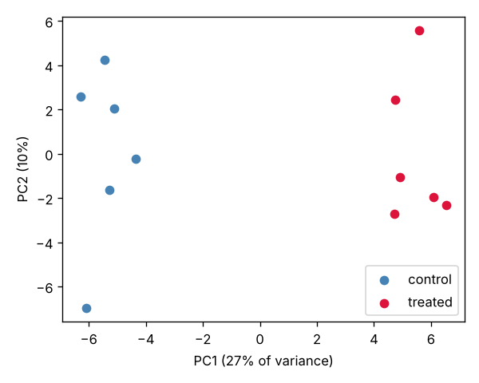
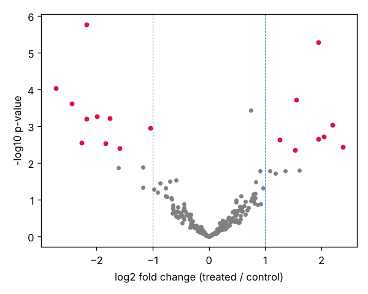
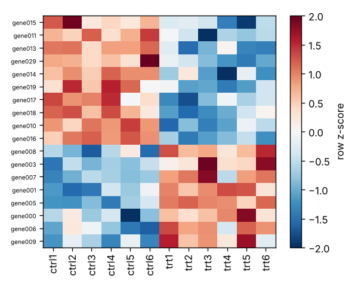

# Analyzing Genomics, Transcriptomics, and Multi-Omics Data

> Module 16: How raw sequencing data becomes biological answers — omics layers, the NGS workflow, read quality control, read mapping, variant calling and annotation, RNA-seq and differential expression, functional enrichment, single-cell sequencing, multi-omics integration, and visualization of results.

---

## Table of Contents

1. [Overview of Omics](#1-overview-of-omics)
2. [NGS Workflow — From Sample to Sequence](#2-ngs-workflow--from-sample-to-sequence)
3. [Read Quality Control and Trimming](#3-read-quality-control-and-trimming)
4. [Read Mapping and Alignment to Reference Genomes](#4-read-mapping-and-alignment-to-reference-genomes)
5. [Variant Calling — SNPs and Indels](#5-variant-calling--snps-and-indels)
6. [Variant Annotation and Interpretation](#6-variant-annotation-and-interpretation)
7. [RNA-Seq Workflow — Quantifying Gene Expression](#7-rna-seq-workflow--quantifying-gene-expression)
8. [Differential Expression Analysis Concepts](#8-differential-expression-analysis-concepts)
9. [Functional Enrichment and Pathway Analysis](#9-functional-enrichment-and-pathway-analysis)
10. [Single-Cell Sequencing Fundamentals](#10-single-cell-sequencing-fundamentals)
11. [Integrating Multi-Omics Data](#11-integrating-multi-omics-data)
12. [Data Visualization for Omics Results](#12-data-visualization-for-omics-results)
13. [Key Takeaways](#13-key-takeaways)
14. [What's Next](#14-whats-next)

---

## How to read this module

Earlier modules explained what sequences, genomes, alignments, and structures are. This module follows the data downstream: a tube of biological sample goes in at one end, and a short list of biological conclusions comes out at the other. Everything in between is a chain of steps, and **each step can only be as good as the step before it.**

```
sample (DNA or RNA)
   -> library preparation and sequencing        -> reads (FASTQ)
   -> quality control and trimming              -> clean reads
   -> mapping to a reference genome             -> alignments (SAM/BAM)
          |                                           |
   DNA branch                                   RNA branch
   variant calling  -> VCF                      counting -> gene count table
   annotation       -> candidate variants       differential expression -> gene list
                                                enrichment -> pathways
   single-cell and multi-omics integration, and visualization, sit on top of both
```

All the Python in this module is plain Python, with `numpy`, `pandas`, `scipy`, and `matplotlib` used only where they are natural (statistics, tables, and figures). The datasets in the code are small, invented, and generated on purpose, so every printed output can be checked by hand.

---

## 1. Overview of Omics

**Omics studies biology through connected layers of the same system.** The suffix "-ome" names the complete set of something (genome = all the DNA, transcriptome = all the RNA, proteome = all the proteins), and "-omics" is the study of that complete set rather than of one member at a time.

| Layer | What it measures | The question it answers |
|---|---|---|
| **Genomics** | The full DNA sequence | The **blueprint**: what *could* happen biologically |
| **Transcriptomics** | The RNA molecules present | Which genes are **active** in specific cells or conditions |
| **Proteomics** | The proteins present | Which molecules are **doing most of the cell's work** |
| **Metabolomics** | Small molecules (metabolites) | The cell's **current chemical state** |

The layers follow the flow of information in the cell:

```
DNA  ->  RNA  ->  protein  ->  metabolites
blueprint  message  worker     chemical outcome
(what could happen)  ...............  (what is happening now)
```

Two ideas explain why you need more than one layer:

- **The blueprint is not the behaviour.** Almost every cell in your body carries the same genome, but a neuron and a liver cell behave very differently because they use different parts of it. Genomics alone cannot show this; transcriptomics can.
- **Each layer sits closer to the outcome than the one before.** DNA is mostly fixed, while the layers downstream of it change with the cell's condition and over time, so each layer records something the others cannot.

The lecture's summary line is the reason the whole subject exists: **combining omics improves insight into disease, drugs, and biological change.** Its narration puts it lightly: biology rarely explains itself in one language, so you read several.

> **Key idea:** each omics layer is a different view of the same living system. The genome says what is possible, the transcriptome what is switched on, the proteome what is working, and the metabolome what is happening now.

---

## 2. NGS Workflow — From Sample to Sequence

**Next-generation sequencing (NGS) converts a biological sample into digital sequence data.** The lecture's analogy is a shredded book: the sequencer does not read the book from cover to cover, it reads the shredded pieces, and you reconstruct the meaning afterwards.

### The steps

1. **Sample**: collect the tissue, blood, cells, or culture.
2. **Extract** DNA or RNA.
3. **Library preparation**: the nucleic acid is fragmented, short known sequences called **adapters** are attached to the ends, and the library is usually amplified by PCR. Adapters let the fragments attach to the sequencer and be read.
4. **Sequencing**: the machine reads each fragment and produces millions of short **reads**.
5. **Output**: reads stored in a **FASTQ** file (sequence plus a quality score per base).

The key message of the slide: **sequencing produces millions of short reads, not an instant final answer.** And the warning that follows from it: **sample quality and library preparation strongly shape read quality and bias.** Degraded RNA, too little starting material, or heavy PCR duplication all leave marks in the data that no software can fully remove. The closing line of the slide: **raw data must be checked and processed before interpretation.**

### How much sequencing is enough? Coverage

**Coverage (depth)** is the average number of reads that cover each base of the genome:

**c = (N × L) / G**, where N = number of reads, L = read length, G = genome size.

Reads land at random places, so some bases are covered many times and some not at all. The fraction of the genome with no coverage at all is approximately **e^(−c)**. The code below shreds a toy 2,000-base circular genome (circular, like a bacterial chromosome, so there are no ends to distort the result) and compares the simulation against that formula. Each row averages 20 random runs.

```python
import random, math

rng = random.Random(7)
genome = "".join(rng.choice("ACGT") for _ in range(2000))

def shred(genome, n_reads, read_len, rng):
    """Cut random fragments from a circular genome (so there are no ends)."""
    circular = genome + genome[:read_len - 1]
    reads = []
    for _ in range(n_reads):
        start = rng.randrange(len(genome))
        reads.append((start, circular[start:start + read_len]))
    return reads

def depth_per_base(reads, genome_len):
    depth = [0] * genome_len
    for start, seq in reads:
        for i in range(start, start + len(seq)):
            depth[i % genome_len] += 1
    return depth

G, L = len(genome), 50
print("n_reads  expected_depth  mean_depth  uncovered(obs, mean of 20 runs)  uncovered(exp e^-c)")
for n in (20, 40, 100, 200, 400):
    unc_runs, mean_depths = [], []
    for rep in range(20):
        reads = shred(genome, n, L, random.Random(1000 * n + rep))
        depth = depth_per_base(reads, G)
        unc_runs.append(sum(1 for d in depth if d == 0) / G)
        mean_depths.append(sum(depth) / G)
    c = n * L / G
    obs_unc = sum(unc_runs) / 20
    mean_depth = sum(mean_depths) / 20
    print(f"{n:7d}  {c:14.2f}  {mean_depth:10.2f}  {obs_unc:31.3f}  {math.exp(-c):19.3f}")

# Output:
# n_reads  expected_depth  mean_depth  uncovered(obs, mean of 20 runs)  uncovered(exp e^-c)
#      20            0.50        0.50                            0.603                0.607
#      40            1.00        1.00                            0.368                0.368
#     100            2.50        2.50                            0.069                0.082
#     200            5.00        5.00                            0.007                0.007
#     400           10.00       10.00                            0.000                0.000
```

Reading the table: at 1x average coverage, about 37% of the genome has no read at all, and at 5x it is still 0.7%. This is why real projects aim for much higher depth. The formula and simulation agree closely, with the small differences at 2.5x being random noise from only 20 runs. Higher depth also helps for a second reason you will meet in §5: it lets you tell real differences from sequencing errors.

> **Key idea:** NGS cuts a sample into fragments, reads millions of them, and leaves reconstruction to software. Depth decides how much of the genome is seen, and the quality of the sample and library decides how reliable the reads are.

---

## 3. Read Quality Control and Trimming

**Raw reads may contain low-quality bases, adapters, and technical noise.** The slide's central warning is that ignoring noisy reads distorts every later analysis, and that quality control (QC) exists to **separate real biology from technical artifacts**.

### Anatomy of a FASTQ record

Each read takes exactly four lines:

```
@read1                                   <- line 1: read name
GATTACAGATTACAGGCTAGCTAGGATCCGA          <- line 2: the sequence
+                                        <- line 3: separator
IIIIIIIIIIIIIIIIIIIIIIIIIII####          <- line 4: one quality character per base
```

### Phred quality scores

Each quality character encodes a **Phred score Q = −10 × log10(P)**, where P is the probability that the base call is wrong. The character is stored as its ASCII code plus 33 (the "Phred+33" encoding used by current Illumina data), so `I` means 73 − 33 = 40, and `#` means 35 − 33 = 2.

| Phred score | Chance the base is wrong | Base accuracy |
|---|---|---|
| Q10 | 1 in 10 | 90% |
| Q20 | 1 in 100 | 99% |
| Q30 | 1 in 1,000 | 99.9% |
| Q40 | 1 in 10,000 | 99.99% |

### What QC looks at

- **Base quality along the read** (quality usually falls towards the 3' end).
- **Sequence patterns**: unusual base composition, over-represented sequences, high duplication.
- **Adapter content**: adapter sequence read through when a fragment is shorter than the read.
- **Contamination**: reads from another organism, or from the lab.

### What trimming does

Trimming removes **unreliable bases and leftover adapter fragments**. The code below parses three FASTQ reads, computes their quality, removes the adapter (the start of a common Illumina adapter, `AGATCGGAAGAGC`) and low-quality tails, and discards reads that end up too short.

```python
FASTQ = """@read1
GATTACAGATTACAGGCTAGCTAGGATCCGA
+
IIIIIIIIIIIIIIIIIIIIIIIIIII####
@read2
TTGACCGGTAAGCTTGACAGATCGGAAGAGCACA
+
IIIIIIIIIIIIIIIIIIIIIIIIIIIIIIIIII
@read3
ACGTACGTACGTACGTACGTACGT
+
5555555555((((((((((!!!!
"""

def parse_fastq(text):
    lines = text.strip().split("\n")
    for i in range(0, len(lines), 4):
        yield lines[i][1:], lines[i + 1], lines[i + 3]

def phred(qual):                        # Phred+33 encoding
    return [ord(ch) - 33 for ch in qual]

def error_prob(q):                      # Q = -10 log10(P)
    return 10 ** (-q / 10)

def trim_adapter(seq, qual, adapter, min_overlap=5):
    """Cut the adapter, including a partial adapter at the 3' end."""
    i = seq.find(adapter)
    if i != -1:
        return seq[:i], qual[:i]
    for k in range(len(adapter) - 1, min_overlap - 1, -1):
        if seq.endswith(adapter[:k]):
            return seq[:-k], qual[:-k]
    return seq, qual

def trim_low_quality_tail(seq, qual, min_q=20):
    scores = phred(qual)
    end = len(seq)
    while end > 0 and scores[end - 1] < min_q:
        end -= 1
    return seq[:end], qual[:end]

ADAPTER = "AGATCGGAAGAGC"
for name, seq, qual in parse_fastq(FASTQ):
    q = phred(qual)
    print(f"{name}: length {len(seq)}, mean Q {sum(q)/len(q):.1f}, "
          f"expected errors {sum(error_prob(x) for x in q):.2f}")
    s, ql = trim_adapter(seq, qual, ADAPTER)
    s, ql = trim_low_quality_tail(s, ql)
    verdict = "kept" if len(s) >= 15 else "discarded (too short)"
    mean_q = sum(phred(ql)) / max(len(ql), 1)
    print(f"    after trimming: length {len(s)}, mean Q {mean_q:.1f} -> {verdict}")

print([ (q, error_prob(q)) for q in (10, 20, 30, 40)])

# Output:
# read1: length 31, mean Q 35.1, expected errors 2.53
#     after trimming: length 27, mean Q 40.0 -> kept
# read2: length 34, mean Q 40.0, expected errors 0.00
#     after trimming: length 18, mean Q 40.0 -> kept
# read3: length 24, mean Q 11.2, expected errors 6.10
#     after trimming: length 10, mean Q 20.0 -> discarded (too short)
# [(10, 0.1), (20, 0.01), (30, 0.001), (40, 0.0001)]
```

Read 1 has a poor-quality tail (`####`, Q2), which accounts for nearly all of its 2.53 expected errors; trimming 4 bases leaves a clean 27-base read. Read 2 is fine in quality but has read into an adapter, so 16 bases are removed. Read 3 is poor throughout (mean Q 11.2) and only 10 good bases survive, so a minimum-length filter discards it.

In practice, quality is inspected with tools such as **FastQC** (one sample) and **MultiQC** (many samples in one report), and trimming is done with tools such as **Trimmomatic, Cutadapt, or fastp**. Run QC again after trimming to confirm the problems are gone, and do not over-trim: throwing away good bases also loses information.

The slide's closing line: **cleaner reads improve alignment, variant calling, and result reliability.**

> **Key idea:** inspect first, then trim. QC separates genuine biology from technical artifacts, and everything downstream inherits the quality of the reads.

---

## 4. Read Mapping and Alignment to Reference Genomes

**The reference genome acts as a map: reads must be placed in their correct genomic locations.** Mapping (alignment) finds where each read most likely originated in the genome. It is the same alignment idea as Module 12, but applied to millions of short reads against one very long sequence, so it has to be fast.

### How a mapper finds a location

Real mappers (BWA-MEM and Bowtie2 for DNA; STAR and HISAT2 for RNA, which must also handle spliced reads) use compressed indexes of the genome. The principle can be shown with a toy **seed-and-extend** mapper:

1. **Index**: record the positions of every k-mer (short word) of the reference.
2. **Seed**: look up the read's k-mers in the index to find candidate locations.
3. **Extend and score**: compare the whole read to the reference at each candidate position, counting mismatches.
4. **Decide**: report the best-scoring location. If several locations tie, the read is **multi-mapped**.

The toy reference below contains a 13-base segment that appears twice (a **repeat**), at positions 43 and 94. The slide's warning is exactly this: **repetitive regions can cause reads to map to multiple sites.**

```python
from collections import defaultdict

reference = ("ATGCCGTAAGCTTAGGCATCGGATTCCGAGCTAGGCTAACGTT"      # unique block
             "GGATCCATGCAGT"                                      # repeat copy 1
             "TTAGCGATCGATCAGCTTACGGCATCAGTTCGAAGCTT"             # unique block
             "GGATCCATGCAGT"                                      # repeat copy 2
             "CCGATTAGCCTAGGATCAGCTTACCGGATA")                    # unique block
K = 8

def build_index(ref, k):
    index = defaultdict(list)
    for i in range(len(ref) - k + 1):
        index[ref[i:i + k]].append(i)
    return index

def mismatches(a, b):
    return sum(x != y for x, y in zip(a, b))

def map_read(read, ref, index, k=K, max_mm=2):
    """Seed with the first k-mer, then check the whole read at each seed position."""
    hits = {}
    for offset in range(0, len(read) - k + 1, k):        # seed at several offsets
        for pos in index.get(read[offset:offset + k], []):
            start = pos - offset
            if 0 <= start <= len(ref) - len(read):
                mm = mismatches(read, ref[start:start + len(read)])
                if mm <= max_mm:
                    hits[start] = mm
    if not hits:
        return "unmapped", []
    best = min(hits.values())
    best_positions = sorted(p for p, m in hits.items() if m == best)
    status = "unique" if len(best_positions) == 1 else "multi-mapped"
    return status, [(p, hits[p]) for p in best_positions]

index = build_index(reference, K)
def mutate(seq, i):
    """Change the base at position i to a different base."""
    return seq[:i] + ("A" if seq[i] != "A" else "C") + seq[i + 1:]

reads = {
    "r1 (unique, exact)": reference[10:30],
    "r2 (unique, 1 mismatch)": mutate(reference[56:76], 9),
    "r3 (inside the repeat)": "GGATCCATGCAGT",
    "r4 (random junk)": "TTTTTTTTTTTTTTTTTTTT",
}
for name, r in reads.items():
    print(name, "->", map_read(r, reference, index))

# a read that spans the repeat and its unique neighbour can be placed uniquely
r5 = reference[34:34 + 22]
print("r5 (repeat + 9 unique bases) ->", map_read(r5, reference, index))
repeat = "GGATCCATGCAGT"
copies = [i for i in range(len(reference)) if reference.startswith(repeat, i)]
print("repeat copy positions:", copies)

# Output:
# r1 (unique, exact) -> ('unique', [(10, 0)])
# r2 (unique, 1 mismatch) -> ('unique', [(56, 1)])
# r3 (inside the repeat) -> ('multi-mapped', [(43, 0), (94, 0)])
# r4 (random junk) -> ('unmapped', [])
# r5 (repeat + 9 unique bases) -> ('unique', [(34, 0)])
# repeat copy positions: [43, 94]
```

- `r1`, `r2`: reads from unique places map uniquely, even with one mismatch (`r2` has mismatches = 1 at position 56).
- `r3` lies entirely inside the repeat, so it fits equally well at 43 and 94. It is **multi-mapped**, and the mapper cannot know which copy it came from.
- `r4` matches nowhere and is **unmapped**.
- `r5` includes 9 unique bases next to the repeat, which breaks the tie, and it maps uniquely at 34. This is also why longer reads and **paired-end reads** (two reads from the two ends of one fragment) resolve repeats better.

### Mapping quality and the SAM/BAM format

Alignments are stored in **SAM** (text) or **BAM** (compressed binary) files. Each alignment has these standard fields:

| Field | Meaning |
|---|---|
| QNAME | Read name |
| FLAG | Number encoding properties (paired, reverse strand, unmapped, ...) |
| RNAME, POS | Chromosome and start position |
| MAPQ | **Mapping quality**: confidence that the position is right, as −10 × log10 P(position is wrong) |
| CIGAR | How the read aligns, for example `20M` (20 matches) or `10M2D8M` (a 2-base deletion) |
| RNEXT, PNEXT, TLEN | Mate-pair information |
| SEQ, QUAL | The read sequence and its base qualities |

Multi-mapped reads typically get a MAPQ of 0 or very low, which tells later steps not to trust them. This reflects the slide's last bullets: **alignment considers sequence match, confidence, ambiguity, and biological context**, and **incorrect alignment can distort variant calls, expression results, and conclusions.** A read placed in the wrong repeat copy can create a false variant or give a gene the wrong count.

The slide closes with the link to the next step: **consistent base changes across reads may indicate real biology, not sequencing noise.**

> **Key idea:** mapping gives each read an address, and a confidence in that address. Repeats make some addresses ambiguous, and the errors made here travel into every later result.

---

## 5. Variant Calling — SNPs and Indels

**Variant calling finds positions where the sample's DNA differs from the reference genome.** The slide states the core question precisely: **is the difference true biology or just sequencing noise?**

- **SNP (single-nucleotide polymorphism)**: a single-base change, such as A changing to G.
- **Indel**: a small insertion or deletion. Indels **can disrupt alignment** (the read no longer fits the reference without a gap) and so are harder to call than SNPs.

### The pileup

Variant callers stack all the reads over each position (a **pileup**) and look at the column of bases. **Repeated high-quality support increases confidence.** For a diploid organism, the pattern in the column suggests the **genotype**:

| Pattern at a position | Genotype | Meaning |
|---|---|---|
| Almost all reads show the reference base | 0/0 | Same as reference |
| About half the reads show a different base | 0/1 | **Heterozygous**: one copy differs |
| Almost all reads show a different base | 1/1 | **Homozygous alternative**: both copies differ |
| A very few reads differ, with low base quality | none | Probably **sequencing error** |

### A toy variant caller

The code builds reads over a 30-base reference with three planted situations (1-based positions): a heterozygous SNP at 13, a homozygous SNP at 20, and two low-quality errors at 23. The caller applies three rules: a minimum depth, a minimum base quality, and a minimum fraction of reads supporting the alternative base.

```python
import math
from collections import Counter, defaultdict

reference = "ACGTTAGCCATGGCATTCGAATCCGGTAAC"          # 30 bases, positions 0-29

def make_reads(ref):
    """Aligned reads (start, sequence, quality string). Reads are 10 bases long."""
    reads = []
    # position 12 (ref 'G'): a true heterozygous SNP, about half of the reads carry A
    # position 19 (ref 'A'): every read carries G (homozygous alternative)
    # position 22 (ref 'C'): two reads carry a low-quality error (T)
    for start in range(4, 21):
        seq = list(ref[start:start + 10])
        qual = list("I" * 10)
        for pos, alt, rule in ((12, "A", start % 2 == 0), (19, "G", True)):
            if start <= pos < start + 10 and rule:
                seq[pos - start] = alt
        if start in (15, 16):                             # sequencing errors at position 22
            seq[22 - start] = "T"; qual[22 - start] = "+"  # '+' is Phred 10
        reads.append((start, "".join(seq), "".join(qual)))
    return reads

def pileup(reads):
    column = defaultdict(list)
    for start, seq, qual in reads:
        for i, (base, qch) in enumerate(zip(seq, qual)):
            column[start + i].append((base, ord(qch) - 33))
    return column

def call_variants(ref, reads, min_depth=6, min_base_q=20, min_alt_frac=0.2):
    calls = []
    for pos, bases in sorted(pileup(reads).items()):
        good = [b for b, q in bases if q >= min_base_q]          # ignore low-quality bases
        if len(good) < min_depth:
            continue
        counts = Counter(good)
        for alt, n in counts.items():
            if alt != ref[pos] and n / len(good) >= min_alt_frac:
                frac = n / len(good)
                genotype = "1/1" if frac > 0.8 else "0/1"
                calls.append((pos + 1, ref[pos], alt, len(good), n, round(frac, 2), genotype))
    return calls

reads = make_reads(reference)
print("pos(1-based) ref alt depth alt_reads alt_frac genotype")
for call in call_variants(reference, reads):
    print(*call)

# with no quality filter, the two errors at 1-based position 23 look like a variant
print(call_variants(reference, reads, min_base_q=0))

def p_at_least(k, depth, err):
    """Chance that k or more of `depth` reads show an error (true base = reference)."""
    return sum(math.comb(depth, j) * err**j * (1 - err)**(depth - j) for j in range(k, depth + 1))

for k in (1, 2, 3, 5):
    print(k, f"{p_at_least(k, 20, 0.01):.6f}")

# Output:
# pos(1-based) ref alt depth alt_reads alt_frac genotype
# 13 G A 9 5 0.56 0/1
# 20 A G 10 10 1.0 1/1
# [(13, 'G', 'A', 9, 5, 0.56, '0/1'), (20, 'A', 'G', 10, 10, 1.0, '1/1'), (23, 'C', 'T', 8,
#   2, 0.25, '0/1')]
# 1 0.182093
# 2 0.016859
# 3 0.001004
# 5 0.000001
```

The caller reports the two real variants: `13 G>A` with 5 of 9 reads (0/1, heterozygous) and `20 A>G` with 10 of 10 reads (1/1, homozygous). The errors at position 23 are ignored because their base quality is only Q10. With the quality filter switched off (the last printed line), they would pass the 20% threshold and appear as a false heterozygous variant, `23 C>T`.

### Why errors cannot simply be ignored

The last four numbers show the chance that **at least k of 20 reads** show an error by pure chance, using an error rate of 1% per base (a deliberately high, illustrative figure). One error is common (18%), three errors are rare (0.1%), but a genome has about 3 billion positions: 3 × 10⁹ × 0.001 is **about 3 million false positives**, which is far too many. This is why real callers (such as **GATK HaplotypeCaller, bcftools, or FreeBayes**) combine base quality, mapping quality, strand balance, and prior probabilities in a statistical model, instead of using a single cut-off.

Variants are stored in a **VCF** file, one line per variant, with columns for chromosome, position, reference allele, alternative allele, quality, filters, and genotype. Indels are written in a left-anchored form: a deletion of `CG` after an `A` is REF `ACG`, ALT `A`, and an insertion of `CC` is REF `A`, ALT `ACC`.

The slide's conclusion: **trusted variants help explain traits, disease risk, and treatment response.**

> **Key idea:** a variant is a difference that survives scepticism. Depth, base quality, and the fraction of supporting reads separate real SNPs and indels from noise.

---

## 6. Variant Annotation and Interpretation

**Annotation adds biological meaning to raw SNP and indel calls.** A VCF line only says that chromosome X, position Y has a different base. Annotation links that genomic position to an **interpretable biological context** by asking the slide's key questions: **which gene is affected, and where does the variant lie?**

### The effect on the protein

For a variant inside a coding region, the codon is re-read:

- **Synonymous** (silent): a different codon for the **same** amino acid. The protein is unchanged.
- **Missense**: a different amino acid. This **may change the protein's function**.
- **Nonsense (stop gained)**: the codon becomes a stop codon, so the protein is cut short.
- **Start lost**: the start codon ATG is destroyed, so translation cannot begin normally.
- **Frameshift**: an indel whose length is not a multiple of 3 shifts the reading frame of every codon after it. An indel whose length is a multiple of 3 is *in-frame* and removes or adds whole amino acids.
- Variants in **introns, UTRs, splice sites, or intergenic regions** need different reasoning, and can still matter (for example by disrupting splicing or regulation).

The slide puts it as: **coding variants may change an amino acid or remain silent.** The code below classifies four variants in a 30-base coding sequence (MAEFRKWGH-stop), using the standard genetic code (the codon idea from Module 10), and writes them in the standard **HGVS** notation (`c.` for position in the coding DNA, `p.` for the protein change).

```python
BASES = "TCAG"
AMINO = "FFLLSSSSYY**CC*WLLLLPPPPHHQQRRRRIIIMTTTTNNKKSSRRVVVVAAAADDEEGGGG"
CODON = {a + b + c: AMINO[16 * i + 4 * j + k]
         for i, a in enumerate(BASES) for j, b in enumerate(BASES) for k, c in enumerate(BASES)}
THREE = {"A": "Ala", "R": "Arg", "N": "Asn", "D": "Asp", "C": "Cys", "Q": "Gln", "E": "Glu",
         "G": "Gly", "H": "His", "I": "Ile", "L": "Leu", "K": "Lys", "M": "Met", "F": "Phe",
         "P": "Pro", "S": "Ser", "T": "Thr", "W": "Trp", "Y": "Tyr", "V": "Val", "*": "Ter"}

assert CODON["ATG"] == "M" and CODON["TGG"] == "W" and CODON["TAA"] == "*" and CODON["GAA"] == "E"

cds = "ATGGCTGAATTTCGAAAATGGGGTCATTAA"             # 30 bases = 10 codons
protein = "".join(CODON[cds[i:i + 3]] for i in range(0, len(cds), 3))
print(protein)                                      # MAEFRKWGH*

def annotate(cds, pos, alt):
    """pos is 1-based within the coding sequence."""
    i = pos - 1
    codon_no = i // 3
    start = codon_no * 3
    ref_codon = cds[start:start + 3]
    new_codon = ref_codon[:i - start] + alt + ref_codon[i - start + 1:]
    ref_aa, new_aa = CODON[ref_codon], CODON[new_codon]
    if codon_no == 0 and new_aa != "M":
        effect = "start lost"
    elif ref_aa == new_aa:
        effect = "synonymous"
    elif new_aa == "*":
        effect = "stop gained (nonsense)"
    else:
        effect = "missense"
    label = f"p.{THREE[ref_aa]}{codon_no + 1}{THREE[new_aa]}"
    return f"c.{pos}{cds[i]}>{alt}", f"{ref_codon}>{new_codon}", label, effect

for pos, alt in [(6, "C"), (8, "G"), (21, "A"), (2, "C")]:
    print(*annotate(cds, pos, alt), sep="   ")

# --- filtering thousands of variants down to the few that matter (invented numbers) ---
import random
rng = random.Random(3)
effects = ["synonymous", "intronic", "missense", "stop gained (nonsense)", "intergenic"]
weights = [0.20, 0.45, 0.10, 0.01, 0.24]
variants = []
for i in range(5000):
    effect = rng.choices(effects, weights)[0]
    freq = rng.choice([0.2, 0.05, 0.01, 0.001, 0.0001, 0.0])      # frequency in the population
    gene = f"G{rng.randrange(1000)}"
    variants.append({"id": f"v{i}", "gene": gene, "effect": effect, "pop_freq": freq})

step1 = [v for v in variants if v["effect"] in ("missense", "stop gained (nonsense)")]
step2 = [v for v in step1 if v["pop_freq"] < 0.01]             # rare in the population
panel = {f"G{i}" for i in range(20)}                           # 20 genes linked to the disease
step3 = [v for v in step2 if v["gene"] in panel]
print(len(variants), len(step1), len(step2), len(step3))
print(sorted({v["gene"] for v in step3}))
```

Run on the four variants, the first part prints:

```
MAEFRKWGH*
c.6T>C   GCT>GCC   p.Ala2Ala   synonymous
c.8A>G   GAA>GGA   p.Glu3Gly   missense
c.21G>A   TGG>TGA   p.Trp7Ter   stop gained (nonsense)
c.2T>C   ATG>ACG   p.Met1Thr   start lost
```

All four are single-base changes, but their consequences are completely different: nothing, one amino acid swapped, a truncated protein, and a protein that probably cannot start. The base change itself never tells you the importance of the variant.

### Interpretation: from thousands of variants to a few

The second part of the code mimics the slide's final line, **annotation filters thousands of variants to the few that matter**, by applying filters one after another to 5,000 invented variants:

```
5000 variants -> 515 -> 267 -> 5
```

1. Keep only variants with a protein-damaging effect (missense or stop gained): 515 remain.
2. Keep only those that are **rare in the population** (below 1% frequency): 267 remain. Common variants are rarely the cause of a rare disease.
3. Keep only those in genes already linked to the disease (a 20-gene panel): 5 remain, in genes G10, G2, and G6.

The numbers are invented, but the shape of the funnel is real. Real **interpretation** checks several kinds of evidence, as the slide says: **known evidence, disease links, and impact.**

| Evidence | Typical source |
|---|---|
| Population frequency | Databases such as gnomAD |
| Previous clinical reports | ClinVar |
| Predicted damage to the protein | Prediction scores such as SIFT, PolyPhen, or CADD |
| Published studies | Literature |

Clinical labs summarise this evidence into five classes (ACMG guidelines): **pathogenic, likely pathogenic, variant of uncertain significance (VUS), likely benign, and benign.** A large share of variants end up as VUS, which is an honest statement that the evidence is not yet enough. Annotation tools include **VEP, SnpEff, and ANNOVAR**. The lecture's analogy: a book has a title, a footnote, and a plot twist, and annotation is the act of working out which line is the plot twist.

> **Key idea:** a raw variant is a coordinate. Annotation turns it into a statement about a gene and a protein, and filtering plus evidence turns thousands of such statements into a few worth following up.

---

## 7. RNA-Seq Workflow — Quantifying Gene Expression

**RNA-Seq shifts the focus from DNA changes to which genes are used, and how strongly.** The slide's key point: **same genome, different cells: expression differences drive distinct cell behaviour.** RNA-Seq measures the RNA molecules present and so captures **a snapshot of cellular activity**. The lecture's narration: it is listening to what the cell is choosing to say.

### The workflow

1. **Extract RNA** from the cells or tissue.
2. **Make cDNA**: RNA is copied into DNA (by reverse transcription), because sequencers read DNA.
3. **Sequence** the cDNA to obtain reads.
4. **Align** the reads to the genome or transcriptome. For eukaryotes this needs a **splice-aware** aligner (such as STAR or HISAT2), because a read can span the junction between two exons.
5. **Count** the reads that fall on each gene, giving a **gene-by-sample count table**. (Tools such as featureCounts or HTSeq count reads; Salmon and kallisto estimate counts without a full alignment.)

The slide says **higher read counts usually indicate higher expression, but careful processing is essential.** The next two subsections show why the caution is needed.

### Step 5 in miniature: counting reads per gene

A read counts for a gene if it overlaps that gene. A read that overlaps two genes is **ambiguous**, and the simplest rule is to discard it rather than guess.

### Raw counts are not directly comparable

Two things distort raw counts:

- **Sequencing depth (library size).** A sample sequenced twice as deeply gives about twice the counts for every gene, though nothing changed biologically.
- **Gene length.** A longer gene produces more fragments, so it collects more reads even when the same number of RNA molecules is present.

Two common corrections are **CPM** (counts per million: divide by the total counts and multiply by 10⁶) and **TPM** (transcripts per million: divide each count by gene length in kilobases first, then rescale so the values sum to 10⁶).

```python
# ---- counting reads per gene (a very small featureCounts-like step) ----
# (start, end) of each gene, end exclusive
genes = {"geneA": (100, 600), "geneB": (580, 1000), "geneC": (1500, 2400)}

def count_reads(reads, genes, read_len=50):
    counts = {g: 0 for g in genes}
    ambiguous = 0
    for start in reads:
        end = start + read_len
        hit = [g for g, (gs, ge) in genes.items() if start < ge and end > gs]
        if len(hit) == 1:
            counts[hit[0]] += 1
        elif len(hit) > 1:
            ambiguous += 1                        # overlaps two genes: not counted
    return counts, ambiguous

reads = [120, 130, 300, 455, 560, 575, 700, 900,           # start positions of 17 reads
         1500, 1600, 1700, 1800, 2000, 2100, 2200, 2300, 2350]
counts, amb = count_reads(reads, genes)
print(counts, "ambiguous:", amb)

# ---- why raw counts are not comparable ----
def cpm(counts):
    total = sum(counts.values())
    return {g: round(c / total * 1e6, 1) for g, c in counts.items()}

def tpm(counts, lengths_bp):
    rate = {g: counts[g] / (lengths_bp[g] / 1000) for g in counts}          # reads per kb
    scale = sum(rate.values())
    return {g: round(r / scale * 1e6, 1) for g, r in rate.items()}

lengths = {"g1": 1000, "g2": 2000, "g3": 4000, "g4": 500}
sample1 = {"g1": 100, "g2": 400, "g3": 800, "g4": 50}
print("CPM:", cpm(sample1))
print("TPM:", tpm(sample1, lengths))

# the same sample sequenced twice as deeply: counts double, but CPM and TPM stay the same
deep = {g: 2 * c for g, c in sample1.items()}
print("deeper counts:", deep)
print("CPM equal:", cpm(deep) == cpm(sample1))
print("TPM equal:", tpm(deep, lengths) == tpm(sample1, lengths))

# ---- same number of transcripts, different gene lengths ----
transcripts = {"short": 100, "long": 100}
length_bp = {"short": 500, "long": 5000}
reads_expected = {g: transcripts[g] * length_bp[g] / 1000 for g in transcripts}
print("reads expected (1 read per kb per transcript):", reads_expected)
print("TPM:", tpm(reads_expected, length_bp))

# Output:
# {'geneA': 4, 'geneB': 2, 'geneC': 9} ambiguous: 2
# CPM: {'g1': 74074.1, 'g2': 296296.3, 'g3': 592592.6, 'g4': 37037.0}
# TPM: {'g1': 166666.7, 'g2': 333333.3, 'g3': 333333.3, 'g4': 166666.7}
# deeper counts: {'g1': 200, 'g2': 800, 'g3': 1600, 'g4': 100}
# CPM equal: True
# TPM equal: True
# reads expected (1 read per kb per transcript): {'short': 50.0, 'long': 500.0}
# TPM: {'short': 500000.0, 'long': 500000.0}
```

Reading the output:

- Of 17 reads, geneA receives 4, geneB receives 2, and geneC receives 9; the reads starting at 560 and 575 overlap both geneA and geneB, so they are ambiguous and are not counted.
- Doubling the depth doubles every count, but **CPM and TPM are unchanged**: they are comparable between samples of different depth.
- In the last example, a short and a long gene have the same 100 transcripts, yet the long gene gets 10 times as many reads (500 against 50). After length correction, TPM is 500,000 for both, which is the correct answer.

Two further points. First, TPM is good for comparing genes *within* a sample. Second, the statistical tools of §8 (DESeq2, edgeR) normally work from the **raw counts** and apply their own between-sample normalisation, so you give them the count table, not TPM. And always have **biological replicates** (several independent samples per condition; at least three is the usual minimum): without them the natural variation between individuals cannot be measured.

The slide's closing line: **expression patterns reveal pathways, disease states, and treatment responses.**

> **Key idea:** RNA-Seq counts reads per gene as a proxy for expression, but raw counts reflect depth and gene length as well as biology, so normalise before comparing.

---

## 8. Differential Expression Analysis Concepts

**Differential expression (DE) analysis asks which genes truly change between conditions.** It compares groups, such as **treated against untreated**, to find **up- or downregulated genes**. The slide's central question: **is a change real signal or just random biological noise?** and its justification: **statistical testing is used because raw differences alone are not reliable.**

### Why a raw difference is not enough

Replicates of the same condition are never identical: living systems vary. So two groups will almost always differ a little in the average even when the treatment did nothing. A gene is only convincing when the difference between groups is large **relative to** the variation within groups. That is what a statistical test measures.

### The ingredients

- **Fold change** shows the size of the change. On the log₂ scale, log₂FC = +1 means 2 times higher, +2 means 4 times higher, and −1 means half. It does not by itself show reliability.
- **p-value**: how surprising the observed difference would be if the gene did *not* change. A small p-value argues against "no change".
- **Multiple testing.** An RNA-Seq experiment tests about 20,000 genes at once. At the usual cut-off of p < 0.05, about 5% of genes with no real change would still pass: that is about 1,000 false hits. The remedy is to correct the p-values. The **Benjamini–Hochberg (BH)** method controls the **false discovery rate (FDR)**: among the genes called significant, the expected fraction of false ones is kept below a chosen level (such as 5%). The corrected values are called **q-values** or adjusted p-values.

### A simulated experiment

The code builds a simulated experiment: 200 genes, 6 control and 6 treated samples, in which 20 genes (10 up, 10 down, a 4-fold change) are truly different and 180 are not. Because we planted the truth, we can count mistakes exactly. A Welch t-test is applied to each gene, then BH correction. The helper function that builds the data (`make_expression`) and implements BH is shown first.

```python
import numpy as np

def make_expression(seed=42, n_genes=200, n_per_group=6, n_up=10, n_down=10,
                    shift=2.0, noise_sd=0.7):
    """Log2 expression for n_genes x (2 * n_per_group) samples.
    The first n_up genes are up in 'treated', the next n_down are down, the rest do not change."""
    rng = np.random.default_rng(seed)
    base = rng.normal(8, 1.5, size=(n_genes, 1))          # each gene has its own typical level
    noise = rng.normal(0, noise_sd, size=(n_genes, 2 * n_per_group))   # replicate noise
    expr = base + noise
    expr[:n_up, n_per_group:] += shift
    expr[n_up:n_up + n_down, n_per_group:] -= shift
    genes = [f"gene{i:03d}" for i in range(n_genes)]
    samples = ([f"ctrl{i+1}" for i in range(n_per_group)]
               + [f"trt{i+1}" for i in range(n_per_group)])
    return genes, samples, expr

def benjamini_hochberg(pvals):
    """Return BH-adjusted p-values (q-values)."""
    p = np.asarray(pvals)
    n = len(p)
    order = np.argsort(p)
    ranked = p[order] * n / np.arange(1, n + 1)
    q_sorted = np.minimum.accumulate(ranked[::-1])[::-1]            # make them monotone
    q = np.empty(n)
    q[order] = np.minimum(q_sorted, 1.0)
    return q
```

```python
import numpy as np
from scipy import stats
from de16 import make_expression, benjamini_hochberg

genes, samples, expr = make_expression()
ctrl, trt = expr[:, :6], expr[:, 6:]
log2fc = trt.mean(axis=1) - ctrl.mean(axis=1)           # data are already on a log2 scale
t, p = stats.ttest_ind(trt, ctrl, axis=1, equal_var=False)   # Welch's t-test, one per gene
q = benjamini_hochberg(p)

true_de = np.arange(len(genes)) < 20
print("raw p < 0.05:", int((p < 0.05).sum()),
      "| true DE found:", int(((p < 0.05) & true_de).sum()),
      "| false positives:", int(((p < 0.05) & ~true_de).sum()))
print("BH q < 0.05 :", int((q < 0.05).sum()),
      "| true DE found:", int(((q < 0.05) & true_de).sum()),
      "| false positives:", int(((q < 0.05) & ~true_de).sum()))
print("my BH matches scipy:", np.allclose(q, stats.false_discovery_control(p)))

sig = (q < 0.05) & (np.abs(log2fc) >= 1)
print("significant and |log2FC| >= 1:", int(sig.sum()),
      "up:", int((sig & (log2fc > 0)).sum()), "down:", int((sig & (log2fc < 0)).sum()))

# the five most significant genes
for i in np.argsort(p)[:5]:
    print(genes[i], f"log2FC={log2fc[i]:+.2f}", f"p={p[i]:.2e}", f"q={q[i]:.2e}")

# an apparent change that is only noise: genes with NO true change, sorted by |log2FC|
null_idx = np.where(~true_de)[0]
worst = null_idx[np.argsort(-np.abs(log2fc[null_idx]))[:3]]
for i in worst:
    print("null gene", genes[i], f"log2FC={log2fc[i]:+.2f}", f"p={p[i]:.3f}", f"q={q[i]:.2f}")

# repeat the whole experiment with 100 different random datasets
raw_fp, bh_fp, bh_found, bh_calls = [], [], [], []
for seed in range(100):
    g_, s_, e_ = make_expression(seed=seed)
    p_ = stats.ttest_ind(e_[:, 6:], e_[:, :6], axis=1, equal_var=False)[1]
    q_ = benjamini_hochberg(p_)
    td = np.arange(len(g_)) < 20
    raw_fp.append(int(((p_ < 0.05) & ~td).sum()))
    bh_fp.append(int(((q_ < 0.05) & ~td).sum()))
    bh_found.append(int(((q_ < 0.05) & td).sum()))
    bh_calls.append(int((q_ < 0.05).sum()))
print("average false positives per run: raw p<0.05 =", np.mean(raw_fp),
      "| BH q<0.05 =", np.mean(bh_fp))
print("average true DE genes found by BH:", np.mean(bh_found), "of 20")
print("average false discovery proportion with BH:", round(sum(bh_fp) / sum(bh_calls), 3))

# Output:
# raw p < 0.05: 33 | true DE found: 20 | false positives: 13
# BH q < 0.05 : 19 | true DE found: 17 | false positives: 2
# my BH matches scipy: True
# significant and |log2FC| >= 1: 18 up: 8 down: 10
# gene016 log2FC=-2.18 p=1.73e-06 q=3.45e-04
# gene005 log2FC=+1.94 p=5.25e-06 q=5.25e-04
# gene010 log2FC=-2.73 p=9.24e-05 q=6.16e-03
# gene001 log2FC=+1.55 p=1.92e-04 q=9.58e-03
# gene018 log2FC=-2.44 p=2.40e-04 q=9.60e-03
# null gene gene196 log2FC=+1.18 p=0.019 q=0.15
# null gene gene178 log2FC=-1.17 p=0.013 q=0.13
# null gene gene084 log2FC=-1.17 p=0.047 q=0.29
# average false positives per run: raw p<0.05 = 8.3 | BH q<0.05 = 0.73
# average true DE genes found by BH: 16.47 of 20
# average false discovery proportion with BH: 0.042
```

What it shows:

- **Without correction**, p < 0.05 calls 33 genes. All 20 real genes are found, but **13 of the 33 are false positives**. About 9 are expected by chance (5% of 180).
- **With BH correction**, 19 genes are called: 17 real and 2 false. The correction costs three real genes (lower sensitivity) but removes 11 false positives. BH controls the *average* false discovery proportion, so a single run can land slightly above 5% (2 of 19 here is 10.5%).
- Over **100 repeated experiments**, uncorrected testing gives 8.3 false positives per run, and BH gives 0.73, with an average false discovery proportion of 4.2%, which is under the 5% target. BH still finds 16.5 of the 20 real genes on average.
- The strongest null genes show how noise can mimic biology: `gene196`, which has no true change, shows a log₂FC of +1.18 (more than 2-fold) and an uncorrected p of 0.019. After correction its q-value is 0.15, so it is correctly not trusted.
- A common final filter is **q < 0.05 and |log₂FC| ≥ 1**. That keeps 18 genes (8 up, 10 down), requiring a gene to be both statistically reliable and large enough to matter.

### How real tools differ from this toy

Real RNA-Seq data are **counts**, not log-scale measurements, and counts have more variation than a normal distribution allows. Tools such as **DESeq2, edgeR, and limma-voom** therefore model counts directly (typically with a negative binomial distribution) and **share information across genes** to estimate variation reliably from few replicates. The logic is the same as the toy: size of change, reliability of change, and correction for the number of genes tested. The lecture's final statement: **sample variation is accounted for to produce a trustworthy gene list.**

> **Key idea:** differential expression separates real changes from random variation. Report the size of the change and its adjusted significance together, and always correct for testing thousands of genes at once.

---

## 9. Functional Enrichment and Pathway Analysis

A list of 300 significant genes is still hard to interpret. **Functional enrichment and pathway analysis reveal biological meaning in gene lists** by **grouping many significant genes into shared functions, processes, or pathways.** The lecture's picture is an orchestra: each gene is a player, and the pathway is the piece they are playing together. **Pathway analysis shows coordinated roles in signalling, metabolism, or immunity.**

### The question being asked

**Functional enrichment tests if categories appear more often than expected by chance.** Suppose your DE list has 100 genes and 8 of them belong to a particular pathway. Is 8 impressive? It depends on how many genes the pathway has and how many genes were tested. The answer is a **hypergeometric test** (the same as Fisher's exact test for this table), which asks: if I drew 100 genes at random from all N genes, what is the chance of getting at least k from the pathway?

- N = genes in the background (here 20,000)
- K = genes in the pathway (here 200)
- n = genes in the DE list (here 100)
- k = genes in the overlap

**Expected overlap by chance = n × K / N = 100 × 200 / 20,000 = 1.0.**

```python
import math
from scipy import stats

def enrichment_p(N, K, n, k):
    """P(overlap >= k) when n genes are drawn at random from N, K of which are in the pathway."""
    ways = sum(math.comb(K, j) * math.comb(N - K, n - j) for j in range(k, min(K, n) + 1))
    return ways / math.comb(N, n)

N, K, n = 20000, 200, 100            # background genes, pathway size, size of the DE gene list
expected = n * K / N
print("expected overlap by chance:", expected)
for k in (2, 4, 8):
    p_mine = enrichment_p(N, K, n, k)
    p_scipy = stats.hypergeom.sf(k - 1, N, K, n)
    print(f"overlap {k}: {k / expected:.0f}x enrichment, p = {p_mine:.3g} (scipy {p_scipy:.3g})")

# many pathways are tested, so the same multiple-testing problem returns
n_pathways, alpha = 500, 0.05
print("Bonferroni cut-off:", alpha / n_pathways)
print("overlap 8 passes:", enrichment_p(N, K, n, 8) < alpha / n_pathways)
print("overlap 4 passes:", enrichment_p(N, K, n, 4) < alpha / n_pathways)
print("false hits expected at p < 0.05 if no pathway is truly enriched:", 500 * 0.05)

# Output:
# expected overlap by chance: 1.0
# overlap 2: 2x enrichment, p = 0.264 (scipy 0.264)
# overlap 4: 4x enrichment, p = 0.0181 (scipy 0.0181)
# overlap 8: 8x enrichment, p = 7.37e-06 (scipy 7.37e-06)
# Bonferroni cut-off: 0.0001
# overlap 8 passes: True
# overlap 4 passes: False
# false hits expected at p < 0.05 if no pathway is truly enriched: 25.0
```

Reading the output:

| Overlap in the DE list | Enrichment over chance | p-value | Verdict |
|---|---|---|---|
| 2 genes | 2x | 0.264 | Compatible with chance |
| 4 genes | 4x | 0.018 | Nominally significant, but see below |
| 8 genes | 8x | 7.4 × 10⁻⁶ | Strong evidence |

The function written from scratch from binomial coefficients matches the library function exactly, which confirms the formula.

### The same multiple-testing trap returns

If you test 500 pathways, you expect about 25 to pass p < 0.05 even if no pathway were truly involved. With a strict Bonferroni cut-off (0.05 / 500 = 0.0001), the 8-gene overlap passes and the 4-gene overlap does not. In practice, enrichment p-values are adjusted just like those in §8.

### Practical points

- **Gene sets** come from databases: **Gene Ontology (GO)**, which has biological process, molecular function, and cellular component terms; and pathway databases such as **KEGG** and **Reactome**.
- Choose the **background** with care: it should be the genes that were actually measured, not the whole genome, otherwise results are biased.
- **Over-representation analysis** (this section) needs a cut-off to define the gene list. **Gene set enrichment analysis (GSEA)** instead uses all genes ranked by their change, so no cut-off is needed and subtle but coordinated shifts can be found.
- GO terms overlap heavily, so many "significant" terms can describe the same underlying finding.

The slide's conclusion: **they convert gene-level results into system-level biological insight.**

> **Key idea:** enrichment asks whether a function shows up in your gene list more than luck would explain. It turns a list of genes into a statement about biological processes, once multiple testing is controlled.

---

## 10. Single-Cell Sequencing Fundamentals

**Single-cell sequencing measures molecular signals in individual cells, not pooled averages.** The lecture's image is a smoothie against a fruit tray: **bulk** sequencing blends all the cells and gives one average, while **single-cell** sequencing lets you see each fruit separately.

### Why averages can mislead

**Tissues are heterogeneous: similar-looking cells can behave very differently.** **Averages can hide the most important biology across cells.** The simulation below makes this concrete. Sample 1 consists of 1,000 identical cells that each express a gene at a moderate level. Sample 2 consists of 900 cells that barely express it and 100 rare cells that express it strongly. The two samples have the same bulk average.

```python
import numpy as np

rng = np.random.default_rng(11)
n_cells = 1000

# Sample 1: every cell is the same type and expresses the gene at a moderate level.
sample1 = rng.poisson(2.0, size=n_cells)

# Sample 2: 90% of cells barely express the gene, 10% (a rare cell type) express it strongly.
rare = np.arange(n_cells) < 100                  # exactly 100 rare cells
sample2 = np.where(rare, rng.poisson(18.0, size=n_cells), rng.poisson(0.2, size=n_cells))

for name, x in (("sample 1", sample1), ("sample 2", sample2)):
    print(f"{name}: bulk average = {x.mean():.2f}"
          f" | cells with zero counts = {np.mean(x == 0):.0%}"
          f" | cells with count >= 10 = {np.mean(x >= 10):.0%} | maximum = {x.max()}")

# --- the sparsity of single-cell data ---
genes, cells = 2000, 500
matrix = rng.poisson(0.1, size=(genes, cells))     # most genes are seen rarely in one cell
print("zeros in a 2000 x 500 toy matrix:", f"{np.mean(matrix == 0):.1%}")
print("average UMI-like counts per cell:", int(matrix.sum(axis=0).mean()))

# Output:
# sample 1: bulk average = 1.96 | cells with zero counts = 14% | cells with count >= 10 = 0%
#   | maximum = 9
# sample 2: bulk average = 2.01 | cells with zero counts = 74% | cells with count >= 10 =
#   10% | maximum = 31
# zeros in a 2000 x 500 toy matrix: 90.4%
# average UMI-like counts per cell: 201
```

A bulk experiment would report **1.96 against 2.01**, essentially the same, and conclude that nothing differs. The single-cell view shows two very different tissues:

| | Sample 1 | Sample 2 |
|---|---|---|
| Bulk average | 1.96 | 2.01 |
| Cells with zero counts | 14% | 74% |
| Cells with count of 10 or more | 0% | 10% |
| Highest count in any cell | 9 | 31 |

Sample 2 contains a small population with strongly different behaviour, which is exactly the kind of **rare population** the slide says single-cell data can reveal, along with **cell types and cell states**. This is **crucial in cancer** (tumours contain many cell types), **development** (cells change identity over time), and **immunology** (many immune cell types with different roles).

### A typical single-cell workflow

1. Isolate single cells (for example, in tiny droplets, each with a barcode that marks its cell) and sequence them.
2. Count molecules per gene per cell (often using **UMIs**, unique tags that let duplicated copies be recognised), producing a **cell-by-gene matrix**.
3. **Quality control**: remove empty droplets, damaged cells (often those with a high share of mitochondrial reads), and doublets (two cells captured as one).
4. **Normalise**, select the most variable genes, reduce dimensions (PCA), and **cluster** cells.
5. **Visualise** (UMAP or t-SNE) and **annotate** the clusters using known marker genes.

Tools commonly used for this: **Seurat** (R) and **Scanpy** (Python).

### The price: noise and sparsity

The last two lines of the code show a defining property of the data. In a toy 2,000-gene by 500-cell matrix with low expression, **90.4% of the entries are zero**, and each cell has only about 200 counts in total. A single cell contains very little RNA, and only a fraction of it is captured, so many genes are "missed" in any one cell (often called **dropout**). The lecture's summary: **one-cell-at-a-time data is noisier, but often far more informative.** The analysis methods are designed around exactly this sparsity.

> **Key idea:** bulk sequencing gives the average of a crowd, and single-cell sequencing lets you hear each individual. It is noisier and sparser, but it reveals cell types, states, and rare populations that averages hide.

---

## 11. Integrating Multi-Omics Data

**One omics layer alone rarely explains the full biology.** The slide gives three reasons: **genes may exist without expression, protein production, or metabolic impact.** A gene variant can be present in the genome but never transcribed; an RNA can be made but not translated efficiently; a protein can be made but be inactive or quickly degraded. **Multi-omics combines genomics, transcriptomics, proteomics, and metabolomics** to follow the whole chain.

The lecture's **company analogy** maps each layer to a role:

| Layer | Role in the company |
|---|---|
| Genome | The **blueprint** |
| Transcripts | The **memos** that carry the instructions |
| Proteins | The **workers** who do the job |
| Metabolites | The **outcomes** (what the company actually produces) |

**Integration reveals regulation, disease mechanisms, and missed biomarkers**, and its **value lies in a connected view for cancer, precision medicine, and drugs.** The narration notes that the advantage is not simply more data for the "spreadsheet Olympics": it is the connections between the layers.

### Step 1 of integration is matching samples

Each omics layer arrives as its own table, and the layers are joined using the **sample ID**. If a sample was not measured in one layer, it is lost from the combined analysis (unless you use methods that handle missing layers). The toy data below are invented, with a proteomics measurement missing for sample S5.

```python
import pandas as pd

# one table per omics layer, each keyed by sample ID (all values invented)
genomics = pd.DataFrame({"sample": ["S1", "S2", "S3", "S4", "S5", "S6"],
                         "variant_dosage": [0, 1, 2, 0, 1, 2]})   # copies of the alt allele
transcriptomics = pd.DataFrame({"sample": ["S1", "S2", "S3", "S4", "S5", "S6"],
                                "mRNA_TPM": [12, 25, 41, 10, 28, 45]})
proteomics = pd.DataFrame({"sample": ["S1", "S2", "S3", "S4", "S6"],     # S5 was not measured
                           "protein_abundance": [1.1, 2.0, 3.9, 0.9, 4.1]})
metabolomics = pd.DataFrame({"sample": ["S1", "S2", "S3", "S4", "S5", "S6"],
                             "metabolite_uM": [5.0, 4.1, 2.2, 5.3, 3.8, 1.9]})

merged = genomics
for layer in (transcriptomics, proteomics, metabolomics):
    merged = merged.merge(layer, on="sample", how="inner")    # keep samples in every layer
print(merged)
print("samples kept:", len(merged), "of 6")

# Output:
#   sample  variant_dosage  mRNA_TPM  protein_abundance  metabolite_uM
# 0     S1               0        12                1.1            5.0
# 1     S2               1        25                2.0            4.1
# 2     S3               2        41                3.9            2.2
# 3     S4               0        10                0.9            5.3
# 4     S6               2        45                4.1            1.9
# samples kept: 5 of 6
```

Five of the six samples survive the inner join. In real studies this loss, along with batch effects between measurement runs and different scales between layers, is a large practical part of the work.

### Layers do not always agree

The second toy example compares mRNA and protein levels for eight genes (invented numbers) by rank:

```python
# a gene-level view: mRNA and protein do not always agree (invented numbers)
mrna    = {"G1": 10, "G2": 55, "G3": 120, "G4": 30, "G5": 300, "G6": 8, "G7": 75, "G8": 200}
protein = {"G1": 12, "G2": 40, "G3": 15,  "G4": 150, "G5": 250, "G6": 9, "G7": 80, "G8": 16}

def ranks(values):
    order = sorted(values, key=values.get)
    return {g: i + 1 for i, g in enumerate(order)}

r_m, r_p = ranks(mrna), ranks(protein)
n = len(mrna)
d2 = sum((r_m[g] - r_p[g]) ** 2 for g in mrna)
rho = 1 - 6 * d2 / (n * (n ** 2 - 1))                              # Spearman, no ties
print("Spearman correlation mRNA vs protein:", round(rho, 2))
for g in mrna:
    gap = r_m[g] - r_p[g]
    if abs(gap) >= 3:
        print(g, "mRNA rank", r_m[g], "protein rank", r_p[g],
              "-> mRNA high but protein low" if gap > 0 else "-> protein high but mRNA low")

# Output:
# Spearman correlation mRNA vs protein: 0.57
# G3 mRNA rank 6 protein rank 3 -> mRNA high but protein low
# G4 mRNA rank 3 protein rank 7 -> protein high but mRNA low
# G8 mRNA rank 7 protein rank 4 -> mRNA high but protein low
```

The overall rank correlation between mRNA and protein is only 0.57, and three genes stand out: G3 and G8 have high mRNA but low protein (perhaps poorly translated or quickly degraded), and G4 has high protein but low mRNA (perhaps a very stable protein). These discordant genes are precisely what a single layer would miss, and they are the starting points for hypotheses about regulation.

### Ways to integrate

- **Early**: join all layers into one large table and analyse it together.
- **Intermediate**: use joint models that find patterns shared across layers (for example, factor-analysis methods such as MOFA).
- **Late**: analyse each layer separately and then combine the conclusions (such as overlapping pathways).

> **Key idea:** each layer sees a different part of the chain from blueprint to outcome. Integration works only when samples are matched across layers, and its value comes from the places where the layers disagree.

---

## 12. Data Visualization for Omics Results

**Visualization makes integrated omics results easier to interpret than raw tables alone.** The slide poses a pointed question: can a huge spreadsheet reveal biology instantly without visual support? The lecture's answer is the sign-post: start from the **biological question**, and let it choose the plot. Its closing instruction: **use visuals to answer the right question.**

| Plot | What it shows | Use it to |
|---|---|---|
| **Heatmap** | **Genes with similar expression patterns across samples**, as colours | See groups of co-regulated genes and of similar samples |
| **Volcano plot** | Each gene by size of change (x) against statistical significance (y) | Spot **features with large and statistically significant changes** |
| **Network diagram** | Nodes (genes, proteins, metabolites) joined by interaction edges | See **interactions** and hubs |
| **PCA / UMAP** (dimensionality reduction) | Samples or cells placed on 2 axes | See **sample clustering**, batch effects, and outliers |

### Making them

The code below uses the simulated experiment of §8. It runs a PCA of the samples, draws a volcano plot, and draws a heatmap of the significant genes with the rows clustered. (Figures are saved to files; the three produced are shown after the code.)

```python
import numpy as np
import matplotlib
matplotlib.use("Agg")                                  # draw to a file, no screen needed
import matplotlib.pyplot as plt
from scipy import stats
from scipy.cluster.hierarchy import linkage, leaves_list
from de16 import make_expression, benjamini_hochberg

genes, samples, expr = make_expression()
ctrl, trt = expr[:, :6], expr[:, 6:]
log2fc = trt.mean(axis=1) - ctrl.mean(axis=1)
p = stats.ttest_ind(trt, ctrl, axis=1, equal_var=False)[1]
q = benjamini_hochberg(p)

# ---- PCA: do the samples cluster by condition? ----
centered = expr - expr.mean(axis=1, keepdims=True)        # centre each gene across samples
U, S, Vt = np.linalg.svd(centered.T, full_matrices=False)  # samples x genes
explained = S ** 2 / np.sum(S ** 2)
scores = U * S                                             # sample coordinates on PC1, PC2, ...
print("variance explained by PC1, PC2:", np.round(explained[:2] * 100, 1))
for name, pc1, pc2 in zip(samples, scores[:, 0], scores[:, 1]):
    print(f"{name:6s} PC1 = {pc1:+6.2f}  PC2 = {pc2:+6.2f}")

# ---- PCA plot ----
fig, ax = plt.subplots(figsize=(5, 4))
is_trt = np.array([s.startswith("trt") for s in samples])
ax.scatter(scores[~is_trt, 0], scores[~is_trt, 1], color="steelblue", label="control")
ax.scatter(scores[is_trt, 0], scores[is_trt, 1], color="crimson", label="treated")
ax.set_xlabel(f"PC1 ({explained[0]:.0%} of variance)"); ax.set_ylabel(f"PC2 ({explained[1]:.0%})")
ax.legend(); fig.tight_layout(); fig.savefig("pca.png", dpi=120); plt.close(fig)

# ---- volcano plot ----
sig = (q < 0.05) & (np.abs(log2fc) >= 1)
fig, ax = plt.subplots(figsize=(5, 4))
ax.scatter(log2fc[~sig], -np.log10(p[~sig]), s=10, color="grey")
ax.scatter(log2fc[sig], -np.log10(p[sig]), s=14, color="crimson")
ax.axvline(-1, ls="--", lw=0.6); ax.axvline(1, ls="--", lw=0.6)
ax.set_xlabel("log2 fold change (treated / control)"); ax.set_ylabel("-log10 p-value")
fig.tight_layout(); fig.savefig("volcano.png", dpi=120); plt.close(fig)

# ---- heatmap of the significant genes, rows clustered ----
idx = np.where(sig)[0]
z = (expr[idx] - expr[idx].mean(axis=1, keepdims=True)) / expr[idx].std(axis=1, keepdims=True)
order = leaves_list(linkage(z, method="average"))
fig, ax = plt.subplots(figsize=(5, 4))
im = ax.imshow(z[order], aspect="auto", cmap="RdBu_r", vmin=-2, vmax=2)
ax.set_xticks(range(len(samples))); ax.set_xticklabels(samples, rotation=90)
ax.set_yticks(range(len(idx))); ax.set_yticklabels([genes[i] for i in idx[order]], fontsize=6)
fig.colorbar(im, label="row z-score"); fig.tight_layout()
fig.savefig("heatmap.png", dpi=120); plt.close(fig)
print("significant genes drawn:", len(idx))

# Output:
# variance explained by PC1, PC2: [27.  10.1]
# ctrl1  PC1 =  -6.28  PC2 =  +2.59
# ctrl2  PC1 =  -6.09  PC2 =  -6.97
# ctrl3  PC1 =  -4.36  PC2 =  -0.22
# ctrl4  PC1 =  -5.45  PC2 =  +4.23
# ctrl5  PC1 =  -5.12  PC2 =  +2.03
# ctrl6  PC1 =  -5.28  PC2 =  -1.63
# trt1   PC1 =  +6.09  PC2 =  -1.97
# trt2   PC1 =  +4.74  PC2 =  +2.45
# trt3   PC1 =  +6.54  PC2 =  -2.30
# trt4   PC1 =  +4.72  PC2 =  -2.73
# trt5   PC1 =  +5.59  PC2 =  +5.58
# trt6   PC1 =  +4.90  PC2 =  -1.05
# significant genes drawn: 18
```







How to read them:

- **PCA.** PC1 captures 27.0% of the variation and cleanly splits the six control samples (negative PC1) from the six treated samples (positive PC1), which tells you the treatment, not random noise, is the largest signal in the data. The sign of a principal component is arbitrary, so only the separation matters, not which side is positive. A PCA in which samples separate by *batch* instead of condition is a warning sign.
- **Volcano.** The two dashed lines mark |log₂FC| = 1. Red points are both large and significant (18 genes). Grey points near the middle are either too small or too uncertain.
- **Heatmap.** Each row is one gene, scaled across samples (a z-score) so that the pattern, not the absolute level, is visible. Rows cluster into two blocks: genes high in control and low in treated, and the reverse.

### Good practice

- Label axes, show the thresholds used, and state what the colours mean.
- Scale heatmap rows so that highly expressed genes do not dominate.
- Choose the plot for the question, not for decoration. For a network, tools such as **Cytoscape** (and databases such as **STRING**) are widely used.
- A figure is evidence, not proof: check that a striking pattern is not a batch effect or an artefact of how the data were filtered.

> **Key idea:** a result you cannot see is a result you cannot check. Pick the plot that answers the biological question, and use it to catch problems as well as to show findings.

---

## 13. Key Takeaways

- Omics studies the same biological system through connected layers: genome (what could happen), transcriptome (what is switched on), proteome (what works), and metabolome (the current chemical state).
- NGS shreds a sample into millions of short reads. Coverage is c = N × L / G, and the sample and library preparation limit read quality.
- Always check and trim reads first. Phred scores encode the chance of error (Q30 means 1 in 1,000), and cleaner reads give more reliable alignment and variant calls.
- Mapping places each read on the reference with a confidence (MAPQ). Repeats cause multi-mapping, and mapping errors flow into variant and expression results.
- Variant calling separates true SNPs and indels from noise using depth, base quality, and the fraction of supporting reads. Heterozygous variants show about half the reads, and homozygous ones nearly all.
- Annotation puts variants in context: which gene, which protein change (synonymous, missense, nonsense, start lost, frameshift), and what the evidence says. Filtering narrows thousands of variants to a few.
- RNA-Seq counts reads per gene. Raw counts depend on sequencing depth and gene length, so normalise (CPM, TPM) and keep biological replicates.
- Differential expression compares groups, accounts for variation, and corrects for testing thousands of genes (Benjamini-Hochberg FDR). Report fold change together with adjusted significance.
- Enrichment tests whether a function or pathway appears in a gene list more often than chance (hypergeometric test), again with multiple-testing control.
- Single-cell sequencing reveals cell types, states, and rare populations that bulk averages hide, at the cost of noisier and sparser data.
- Multi-omics integration joins the layers by sample and finds regulation and mechanisms that a single layer misses, especially where the layers disagree.
- Choose visualizations (heatmap, volcano, network, PCA/UMAP) to answer the biological question, and use them to catch artefacts.

---

## 14. What's Next

With reads cleaned, mapped, interpreted, and visualised, the remaining challenge is to make the whole chain repeatable, scalable, and usable: to wrap these steps into pipelines, run them on bigger infrastructure, and apply them in real settings. The next module on building end-to-end bioinformatics solutions picks up exactly there.
